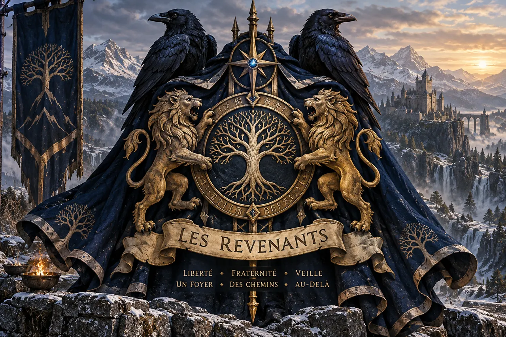
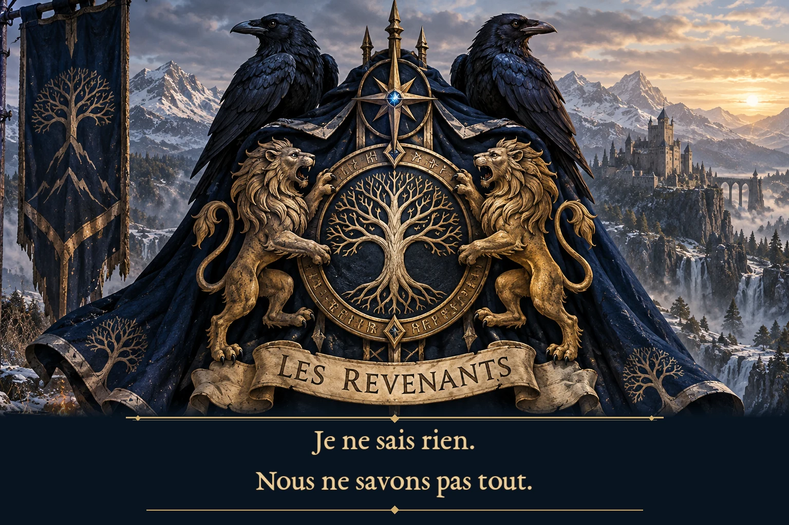

*Proposition d’iconographie des Revenants — cape sombre, corbeaux et lions. Illustration à valider comme emblème officiel ; les ornements, l’arbre central et les devises inscrites sur l’image sont des choix artistiques, **pas des symboles ou devises officiellement adoptés en jeu**.*

*Ils ne portent pas ce nom parce qu'ils sont revenus d'entre les morts. Ils le portent parce qu'ils savent partir, et qu'ils veulent que chacun puisse revenir.*

> [!abstract] La compagnie, en quelques mots
> Les **Revenants** sont la compagnie de route et d'action d'**Orin**, née des liens forgés autour de la **Compagnie du Mérien**. Le groupe n'est ni une armée de morts ressuscités, ni une garde personnelle réduite à exécuter les volontés d'un prince. Ses membres apprennent à se protéger, à décider ensemble, à se séparer pour mieux agir, et à poursuivre une mission lorsque Orin n'est pas là. Leur fidélité est une **relation librement choisie**.

> [!info] État documentaire
> **Code : GRP-01.** Synthèse de la compagnie au dernier état documentaire examiné, après **CB43**. Composition du noyau, activités, dons et limites sont établis à partir du *Compendium des personnages v1.7*, de la *Continuité v1.7*, du dossier *Orin, la Maison et les traditions religieuses v1.8* et des campagnes brutes. Les scènes attestées sont distinguées des projets. La compagnie n'est pas automatiquement composée de toutes les fiches historiques classées « REV ».

## Une compagnie, et non une condition d'existence

Le mot *Revenant* possède, dans l'histoire d'Orin, un sens affectif et collectif. Il parle de l'expérience des chemins, du danger partagé et de l'espoir obstiné de retrouver une table, des amis, une histoire qui continue. Il ne détermine ni l'origine d'une âme, ni la nature d'un corps.

Un **Rappelé** est, au contraire, une personne morte revenue à la vie grâce à Orin, avec son consentement. Les deux catégories sont **indépendantes** : être Rappelé ne donne aucun droit ni devoir d'entrer dans les Revenants ; être Revenant ne signifie pas avoir été mort. De même, l'appartenance à la **[[O42-01|Maison d'Orin]]**, l'hébergement au manoir, une fonction militaire ou la possession d'un insigne ne valent pas, isolément, admission à la compagnie.

La compagnie est une **communauté d'individus**, avec des talents, des faiblesses, des attaches extérieures et le droit de refuser un départ. Orin en est une figure centrale ; il ne doit pas en rester l'unique esprit, le seul chef possible ou la réponse à toutes les difficultés.

## Les visages des Revenants

### Le noyau attesté

| Compagnon | Code individuel | Apport principal et caractère de sa place |
|---|---|---|
| **[Orin / Alrick](../personnages/per-cb2-orin)** | PER-CB2-ORIN | Figure fondatrice, compagnon et puissance créatrice ; apprend à transmettre sans devenir indispensable. Son statut princier ou divin ne fait pas des autres ses subordonnés automatiques. |
| **[Bram Vieux-Fer](../personnages/rev-01)** | REV-01 | Vétéran protecteur ; couvre la retraite, pense aux civils et à ceux qui doivent rentrer. Ironie sèche, soin très concret des autres. |
| **[Ragna Pierre-Sèche](../personnages/rev-02)** | REV-02 | Tenue du terrain, écoute, coordination, limites de progression, extraction et repli ; autorité sobre capable de recevoir puis de rendre le commandement. |
| **[Kelm Poing-Calme](../personnages/rev-03)** | REV-03 | Force maîtrisée, défense, protection ; apprend à commander et à transmettre sans confondre puissance et bon jugement. |
| **[Vaëra](../personnages/rev-04)** | REV-04 | Reconnaissance, discrétion, réseaux et lecture du terrain ; membre à part entière, non simplement « la compagne d'Orin ». |
| **[Torven Cendreval](../personnages/rev-05)** | REV-05 | Médecin, premiers secours, évacuations et médecine d'expédition ; le sauvetage ne vient pas après la gloire. |
| **[Heimdall](../personnages/rev-06)** | REV-06 | Veilleur devenu personne libre, analyste des passages et chercheur ; conduit ses propres équipes d'étude. |
| **[Haldrek](../personnages/rev-07)** | REV-07 | Vétéran, préparation et formation ; prévoit les solutions de rechange et enseigne à distinguer une victoire d'une bonne procédure. |
| **[Eamon](../personnages/rev-08)** | REV-08 | Professeur, artiste, enquêteur et transmetteur ; conserve ses étudiants, sa recherche et le droit de ne pas redevenir l'apprenti d'Orin. |

**Cette liste décrit un noyau attesté, non un organigramme figé.** En mission, le commandement change selon les compétences et les étapes. Un médecin, un éclaireur ou un responsable d'extraction peut détenir l'autorité utile à un moment donné, sans être nommé chef permanent de toute la compagnie.

### Revenants d'honneur et liens proches

**Névane Carte-Claire** accepte le titre de **Revenante d'honneur** et poursuit ses travaux de cartographie à **Skalor**. Cette reconnaissance ne l'oblige pas à partir en expédition ni à quitter ses recherches. Les scènes récentes la montrent également comme collaboratrice des enquêtes et des mesures du Nord.

**Torgarl** accepte à **Aldhammar** le titre honorifique de Revenant d'honneur, après avoir notamment contribué aux exigences de terrain, de repli et de protection des civils. Le cadeau conçu pour lui n'impose aucune obligation opérationnelle. Ne pas faire du titre un enrôlement militaire.

**[[REV-16|Aldren le loup]]** accompagne Heimdall : il est un être libre, **pas un Revenant membre du noyau**, ni un outil de surveillance. **Tevaer**, la chouette de Vaëra, et **Lok**, le corbeau de Ragna, relèvent également des compagnonnages propres à leurs proches, sans adhésion automatique. Les liens de la Compagnie du Mérien avec **Edras, Nassim et Lévara** appartiennent à l'histoire commune ; leur inscription formelle chez les Revenants n'est pas établie par le seul fait de figurer dans les anciens dossiers.

**Tairin et Drakon** sont intervenus auprès des Revenants dans un exercice en tant qu'alliés d'une puissance particulière. Ils n'en sont pas membres, n'en prennent pas le commandement et ne doivent pas résoudre leurs épreuves à leur place. **Níðor** a travaillé avec Heimdall et appartient librement à la Maison d'Orin, mais **n'est pas Revenant**. **Dac** intervient comme maître d'armes et responsable militaire dans les scènes, sans être assimilé à la compagnie.

## Histoire — d'une route partagée à une liberté collective

### Le Mérien et les premières épreuves

Avant l'apparition de la compagnie telle qu'on la connaît aujourd'hui, il y eut **des voyageurs réunis par une aventure**, des savoirs très différents et une longue habitude de compter les uns sur les autres. Les scènes du **Mérien** et l'opération de **Lethrann** donnent aux premiers compagnons autre chose qu'un récit commun : la preuve que la mission survit mieux lorsque les tâches sont réparties.

Bram peut conduire l'action d'ensemble, pendant qu'un autre protège la sortie, qu'un autre encore soigne les blessés ou observe les changements du terrain. Personne ne gagne à imiter Orin, pas même Orin. De cette différence de fonctions naît progressivement une communauté reconnaissable.

### Entre-Rives et Torngard — la compagnie se donne une silhouette

**Mara Vifacier**, jeune forgeronne naine d’Entre-Rives, a auparavant repris l’ancienne armure du père d’Orin, **Harald Forgecœur** : elle en conserve l’histoire, améliore les articulations, les attaches et les protections, sans effacer les marques anciennes. Ce travail attire l’attention d’Orin, qui lui confie ensuite une véritable commande pour les Revenants. Il finance **une nouvelle armure adaptée à Bram**, et offre aux autres compagnons la possibilité de faire changer ou ajuster leurs pièces selon leurs besoins réels. Ce n’est pas un uniforme de métal.

Lorsque Mara rejoint les quartiers d’Orin à **Torngard**, elle arrive avec des caisses, des supports, des pièces emballées et une partie des travaux en cours. **Les premières pièces de l’armure de Bram sont montrées, mais pas encore achevées** : la conception tient compte de sa morphologie, d’une ancienne blessure à l’épaule gauche et du bouclier qu’il doit pouvoir employer. Mara refuse de copier servilement l’armure de Harald ; elle veut fournir au vétéran une protection réellement utilisable, notamment pour encaisser, couvrir et se mouvoir. Les autres adaptations restent à distinguer, compagnon par compagnon, de leurs seules commandes. (*Campagne brute regroupée, CB31 P00601–00900 et CB32 P01201–01300.*)

**Elyra** poursuit une démarche complémentaire. Orin lui commande des **capes communes d’esprit mais singulières dans leurs détails**, puis des vêtements de voyage, de représentation et d’apparat selon les personnes. Leur famille visuelle associe matières sombres, lignes élégantes, éléments pouvant rappeler le **lion** et le **corbeau**, capuches, attaches et doublures, sans uniformiser les tempéraments. Elle prend soin de ce qui tombe sur une épaule, résiste à une marche ou s’enlève rapidement ; l’apparence ne doit pas détruire l’usage. **Eamon** reçoit notamment une tenue de voyage adaptée à sa double vie de savant et de compagnon, et des vêtements plus habillés ; d’autres commandes correspondent à des besoins très différents. (*CB31 P02201–02400 ; CB32 P01101–01300.*)

La rencontre entre **Mara** et **Elyra** vaut presque une scène de négociations : l’une regarde comment le textile tombe sur les pièces métalliques, l’autre refuse qu’une belle broche ruine une cape. **Sigrun Veineclaire** et **Ordan Main-de-Fil**, sollicités pour les fermoirs et interfaces des Insignes, doivent prévoir **une attache qui se manipule avec des gants, d’une seule main, se remplace sur le terrain et n’arrache pas le tissu lorsqu’on saisit le porteur**. L’équipement doit permettre de rentrer, pas d’avoir simplement fière allure.

### Les ateliers autour de la compagnie

Au cours de cette soirée, **Névane** consigne des responsabilités et des champs de coordination, distincts d’un monopole personnel : **Mara** veille à la cohérence de l’armurerie, aux essais, à la qualité et à l’entretien ; **Elyra** prend la direction artistique et textile ; **Sigrun et Ordan** travaillent à la joaillerie, à la sécurité des montures et à la transmission des compétences ; **Torgarl** apporte sa rigueur de combat et **Haldrek**, qui est Revenant lui-même, la formation opérationnelle. **Névane** accepte provisoirement de conserver le registre des membres, charges, objets, missions et transmissions, **sans devenir une autorité sur la compagnie**. (*CB32 P02901–03200.*)

La transformation des quartiers d’Orin en atelier collectif révèle une valeur ancienne des Revenants : personne ne doit être irremplaçable. **On ne commande pas seulement des capes, des armures et des Insignes ; on aide des artisans à transmettre leur art.**

### Cinq années pendant lesquelles Orin n'était pas au centre

Pendant qu'**Orin soutient Yggdrasil**, la compagnie continue de vivre. Ce temps n'est pas une ellipse vide, ni une période durant laquelle les Revenants attendent des ordres.

**Kelm** prend réellement le commandement en situation ; **Bram** forme des protecteurs ; **Ragna** perfectionne tenue, extraction et repli ; **Torven** développe la médecine de terrain. **Haldrek** demeure un instructeur exigeant et un homme de terrain, **Eamon** transforme l'expérience en savoir transmissible, **Vaëra** poursuit ses apprentissages et ses propres liens, et **Heimdall** dirige des équipes étudiant les structures anciennes. Leurs initiatives contribuent aux enquêtes du Nord, à la continuité des missions et, par les travaux de Heimdall, à la future délivrance de **Níðor** de son rôle de contrefort vivant permanent sur un site précis.

Au retour d'Orin, les Revenants ne sont plus un groupe de personnes attendant que leur prince choisisse l'action juste. **Ils possèdent leurs méthodes, leurs responsables successifs, et parfois leurs désaccords.** C'est l'un des grands accomplissements de leur histoire.

### Taagral — la compagnie à l’épreuve d’une véritable guerre

L’**attaque de Taagral** transforme des principes discutés à l’entraînement en décisions prises sous le feu. La crise interrompt une séance fiscale du colloque ; la réponse militaire organisée reste placée sous **le commandement de Dac**, tandis que les autorités locales conservent leurs responsabilités. **Orin cesse progressivement d’être le chef de toutes les manœuvres** : ses pouvoirs sont sollicités comme une réserve stratégique, au moment où ils sont réellement nécessaires, puis il laisse les équipes professionnelles poursuivre. (*Continuité v1.7, dossier « Taagral : crise militaire et doctrine de commandement », échanges 012–107.*)

Pour les Revenants, l’intervention met à l’épreuve **la répartition concrète de l’autorité**. **Ragna** prend puis rend le commandement lorsque la phase change. **Haldrek** exige des transmissions d’informations fiables, des décisions vérifiables et des solutions de repli ; une initiative réussie n’est pas toujours une bonne méthode à enseigner. **Bram** et **Kelm** protègent, encadrent le terrain et, lors des périodes moins tendues, participent à la formation de jeunes combattants orcs. **Vaëra**, **Eamon**, **Heimdall** et **Névane** apportent reconnaissance, renseignement, relevés et compréhension des problèmes ; chacun conserve sa contribution propre. (*Compendium v1.7, « La Compagnie des Revenants pendant la crise ».*)

**Torven** joue un rôle déterminant pour les **soins et les extractions** : l’**Espace sur demande** devient un outil concret d’intervention médicale et de refuge. Mais un espace magique, même remarquable, **ne dispense jamais de prévoir une évacuation ordinaire**. La doctrine de la compagnie se manifeste aussi dans le traitement des vaincus : les redditions sont acceptées, les prisonniers protégés, soignés et nourris, et les représailles écartées. Les combattants ne sont pas jugés indistinctement selon leur peuple ou sous une étiquette globale de « démons ». Ces décisions sont celles de l’opération et de ses responsables, pas une compétence que la compagnie aurait revendiquée seule.

Après le siège, les équipes examinent les anciennes structures perturbées autour de Taagral. **Heimdall, Névane, Eamon et Vaëra**, avec Vaerdrak, Halstor, Orin et les équipes locales, contribuent à une méthode de **réparation fonctionnelle** : comprendre ce qu’une pièce fait avant de la remplacer. À la fin du quatrième jour, le dispositif local est stabilisé, et la charge anormale portée par **Níðor** est réduite. **À ce stade, Níðor est soulagé, non totalement délivré** ; sa libération durable résulte de travaux ultérieurs. (*Continuité v1.7, échanges 118–119 ; Compendium v1.7.*)

La victoire de Taagral ne se raconte donc pas comme l’extermination glorieuse d’un ennemi. **Le siège s’achève largement par des redditions et l’abandon progressif des combats**, tandis que la compagnie et ses alliés doivent désormais aider des populations à se relever. Pour les Revenants, Taagral démontre qu’une troupe peut devenir autonome précisément parce qu’elle sait quand protéger, quand se retirer, quand soigner et quand laisser d’autres personnes commander.

### Une maison où l'on puisse rentrer

La compagnie dispose désormais d'une **île aménagée**, distincte de l'île publique de la taverne et de l'hôpital, ainsi que des espaces propres au Palais divin. Le **manoir des Revenants** est relié aux autres lieux autorisés de la Maison ; les accès restent contrôlés, et une liaison de transport ne vaut pas permission de franchir toutes les portes.

Les rencontres autour de son organisation posent une question inattendue pour une compagnie de combattants : comment habiter un lieu sans en faire une simple caserne ? **Orin veut un foyer**, un endroit où l'on cuisine, lise, discute, fasse de la musique et accueille les compagnons lorsque les missions sont terminées.

En **CB43**, **Dorsa Vaun** est accueillie pour une **visite et une observation rémunérée** ; **Eamon** l'accompagne afin qu'elle rencontre les habitants et comprenne leurs besoins. Elle **n'est pas nommée intendante à ce stade**. De même, le fait qu'**Hroldan** ait accepté de revenir à la vie ne lui attribue pas automatiquement la direction du manoir : emploi, appartenance et résidence restent des choix séparés.

## Les cérémonies — donner un visage aux liens choisis

### La première remise des capes — Torngard (CB32)

Dans les quartiers d’Orin, les Revenants revêtent pour la première fois ensemble les **capes confectionnées par Elyra**. La scène se charge d’une magie qu’aucun artisan n’avait prévue : **Harald, le lion de feu**, se manifeste, puis la flamme fait apparaître d’autres lions ; des **corbeaux d’ombre** surgissent à leur tour. **Une plume se pose sur chaque Revenant avant de disparaître dans l’ombre de sa cape.**

**Névane consigne l’événement dans le registre**. Heimdall remarque que ce phénomène n’était peut-être pas seulement visuel. L’effet magique de la plume et la résonance éventuelle des capes **ne sont pas élucidés** : aucun pouvoir durable ne doit être inventé à partir de cette seule scène. Puis la chaleur des lions s’apaise, les oiseaux se dissipent et la soirée retrouve ses conversations, ses ateliers improvisés, ses remerciements et même le vieux **whisky de feu** conservé dans le bar de Harald Forgecœur. (*Campagne brute regroupée — Volume 1, CB32 P03001–03300.*)

Cette remise est l’origine scénique des **lions, corbeaux et capes** associés à l’image des Revenants. Elle n’équivaut pas à l’adoption formelle d’un blason unique, d’une devise obligatoire ou d’un serment universel.

### Névane — la première Revenante d’honneur (CB32)

**Névane Carte-Claire** a déjà revêtu sa cape d’honneur, apparentée mais distincte de celles des membres actifs. Orin s’approche simplement et ajuste son col pour marquer le geste. Il la reconnaît alors comme **« Première Revenante d’honneur »**. Névane sourit sans retirer la cape ; l’échange, traversé de plaisanteries, n’engage ni sa résidence ni son travail de cartographe à Skalor.

Elle accepte par ailleurs de tenir **provisoirement le registre de la compagnie**, où seront conservés les membres, les titres honorifiques, les équipements, les charges, les missions, les erreurs et les transmissions. **Le registre n’est pas une autorité sur les personnes.** (*CB32 P03001–03200.*)

### Torgarl — le cercle d’Aldhammar (CB42)

À **Aldhammar**, les compagnons se rassemblent autour de **Torgarl**, ancien roi, sans le classer selon son rang ni sa puissance. Certains rejoignent le salon grâce au canal de communication commun et aux raccords autorisés. Le vieux souverain s’avance **sans couronne** ; Orin pose sur ses épaules la cape préparée pour lui et ajuste l’insigne près du col. La formule est simple : **« Bienvenue chez les Revenants. »**

Des **corbeaux jaillissent des ombres** tandis que le lion de feu **Harald** rugit dans une flambée qui semble faire résonner tout le palais. Puis le silence revient. Torgarl reçoit les salutations des compagnons et conserve sa cape ; son honneur ne l’enrôle pas comme soldat, ne le démet pas de ses responsabilités et n’efface pas son indépendance. Il s’agit d’une **cérémonie effectivement jouée**, différente de la préparation antérieure du cadeau. (*Campagne Brut 4.2, CB42 P20820–20980.*)

> [!important] Ce qui fait une cérémonie chez les Revenants
> Ces événements associent **un geste accepté**, **des témoins**, **un signe porté librement** et **une mémoire que l’on transmet**. Ils ne prouvent pas l’existence d’un rituel codifié, d’un serment imposé ou d’un ordre de chevalerie. C’est justement leur souplesse qui laisse aux Revenants leur individualité.

## La devise — savoir que l'on ignore

> **Je ne sais rien.**
>
> **Nous ne savons pas tout.**

Cette double formule est née d'une discussion entre les Revenants à propos de ce qu'ils souhaitent transmettre. La première phrase est **personnelle** : même un guerrier expérimenté, un professeur ou un veilleur d'une ancienneté prodigieuse doit pouvoir reconnaître les limites de son savoir. La seconde est **collective** : aucun groupe, pas même les Revenants, ne possède à lui seul toutes les réponses. Partir en plusieurs équipes, apprendre des autres, revenir raconter ses erreurs autant que ses découvertes devient alors une méthode pour rester unis sans renoncer à leur liberté. (*Campagne brute regroupée — Volume 1, CB31, échanges sur la devise et la transmission.*)

La devise appartient au récit de la compagnie ; en revanche, **son inscription sur un blason précis reste une proposition artistique**. Les autres mots apparaissant sur le premier projet d'illustration ne doivent pas être pris pour des devises adoptées en jeu.

### Seconde proposition de blason — avec la devise

*Variante illustrée avec la devise attestée. **Le premier blason est conservé** en tête de cette fiche ; les deux compositions pourront être employées selon le contexte après validation graphique. Les ornements héraldiques restent des interprétations artistiques.*

## Doctrine — les vertus très concrètes du retour

La compagnie s'est donné une culture de terrain reconnaissable :

- **Préparer la sortie autant que l'entrée** : une mission prévoit secours, évacuation, responsables de remplacement, conditions d'arrêt et moyens de retour.
- **Protéger les vies avant les apparences** : la couverture, l'extraction et les soins constituent des réussites à part entière.
- **Déplacer le commandement selon le besoin** : chacun peut prendre une responsabilité sans qu'Orin demeure le centre décisionnel de chaque action.
- **Regarder avant de conclure** : distinguer l'observation de l'interprétation, accepter une information incomplète, corriger les hypothèses.
- **Apprendre les uns des autres** : la force de Kelm a besoin de la prudence de Ragna, les découvertes de Heimdall du regard des autres, et les décisions de terrain des exigences de Torven.
- **Préserver la liberté** : un membre a ses autres obligations ; partir, transmettre, refuser ou choisir une autre route n'efface pas les liens.

> [!quote] Un principe qui traverse leur histoire
> L'équipement des Revenants est destiné à permettre à chacun de continuer ce qu'il sait faire — **et revenir**. Cette idée, formulée lors de la présentation des objets, vaut pour les armes autant que pour les personnes.

## Insignes, capes et moyens communs

> [!note] Emblème proposé — non encore consacré dans l'histoire
> Le projet de blason placé en tête de cette fiche rassemble **une cape bleu nuit, des corbeaux et des lions** : ces trois motifs viennent de la remise des capes et de leurs manifestations magiques. Le motif central d'arbre, les ornements runiques, les deux lions affrontés et les devises visibles sur l'illustration sont **des choix de dessin** qui n'ont pas encore été validés comme armoiries ou devise officielles. L'image reste une proposition à approuver ou à modifier, sans effet magique ni institutionnel présumé.

### Les Insignes sont maintenant réalisés

Les premiers dossiers les décrivaient encore comme **des projets**. **CB42 montre leur création effective et leurs premiers essais**, avec des symboles et des instruments distincts. Ne pas reprendre l'ancien état de conception comme s'il était toujours d'actualité.

| Revenant | Objet et symbole réalisés ou préparés en CB42 |
|---|---|
| **Bram** | **Rempart du Retour**, bouclier pour couvrir un compagnon, encaisser les impacts et aider au déplacement d'un blessé. |
| **Kelm** | **Marteau des Quatre États**, outil à la force ajustable avec transitions sécurisées ; l'usage doit rester gouverné par le jugement. |
| **Vaëra** | **Insigne à lame discrète et petite chouette**, lié à sa manière d'agir ; ne pas le confondre avec la création d'une nouvelle arme remplaçant nécessairement son couteau existant. |
| **Torven** | **Main ouverte** et sacoche médicale améliorée, rangements, protection des fournitures et accès utile en intervention. |
| **Ragna** | **Pierre d'Écoute** et insigne associé ; perception limitée de vibrations du terrain, sans pouvoir d'écoute universelle. |
| **[Heimdall](../personnages/rev-06)** | **Clé-Œil**, qui vérifie certaines compatibilités et repères sans forcer n'importe quel passage. |
| **Eamon** | **Recherche inachevée** : insigne à spirale et carnet de travail pour organiser, annoter et relier ses recherches. |
| **Haldrek** | Longue-vue d'observation et de comparaison, achevée et placée dans un coffret pour remise personnelle ; la scène ne prouve pas à elle seule que la remise a déjà eu lieu. |
| **Névane — honneur** | Nécessaire cartographique et pièce d'honneur, préparés pour lui être proposés à Skalor, sans devoir nouveau. |
| **Torgarl — honneur** | Cape, bijou et symbole de routes convergeant vers une montagne ; titre honorifique accepté plus tard à Aldhammar. |
| **Orin** | Symbole personnel de porte ouverte et de route poursuivie. |

Leurs insignes possèdent des **fonctions communes modestes** (identification volontaire, signaux tactiques limités, alerte d'urgence). Chacun comprend **trois emplacements de gemmes** destinés à des évolutions ultérieures ; **ils ne sont pas déjà remplis d'enchantements spécialisés**. Les essais élémentaires sont effectués ; les évolutions complexes demandent encore des vérifications.

La compagnie disposait **déjà** de moyens de communication plus évolués auparavant. Les travaux de CB42 adaptent notamment les appareils, les canaux de compagnie et les usages tactiques : il ne s'agit pas d'inventer pour la première fois un réseau entièrement nouveau.

## Apprentis et transmission — une porte ouverte, pas un recrutement accompli

Les Revenants ont discuté d'une transmission organisée : permettre à chaque compagnon d'enseigner ce qu'il connaît, croiser les spécialités et voyager pour rencontrer des candidats potentiels. Un apprenti de Bram pourrait apprendre les secours auprès de Torven ; un élève de Vaëra devrait pouvoir comprendre le maintien de position avec Kelm. Les aptitudes ne doivent pas devenir des cages.

Le principe est explicite : **former auprès des Revenants ne rend pas automatiquement Revenant**, et nul n'est obligé de rejoindre définitivement la compagnie après son apprentissage. L'enseignement peut être une réussite en soi.

> [!warning] État du projet
> La réflexion sur les apprentis, le recrutement en voyage et l'organisation du manoir est **jouée**. La constitution effective d'une première cohorte, ses effectifs et un cursus officiel définitivement arrêté **ne sont pas établis** dans le dernier bilan consulté. Ne pas créer de promotions fictives ni de nouveaux membres par anticipation.

## La Maison, les puissances et les autres compagnies

Les Revenants peuvent partager des lieux et des aventures avec les habitants de la **[[O42-01|Maison d'Orin]]**, mais cette Maison est une **communauté plus vaste**, pas le nom religieux de leur compagnie. Le **Palais divin** est la résidence personnelle d'Orin, pas le manoir des Revenants. Les **Rappelés** sont des personnes revenues à la vie, non un groupe militaire placé automatiquement sous les ordres d'Orin.

La **Première Ancre** est une coalition composite d'intérêts et de pouvoirs, qu'il faudra documenter comme groupe distinct sans l'assimiler à tout un peuple. La **suite divine d'Orin** constitue un ensemble de personnes et de fonctions à développer avec ses propres règles d'appartenance. Le **Conseil des Dix-Huit Grandes Puissances** relève encore d'une autre logique, cosmologique et institutionnelle : ces dix-huit puissances ne forment pas une compagnie d'aventuriers.

**Ces organisations devront posséder leurs propres fiches.** La présente rubrique « Groupes et alliances » les accueillera progressivement, avec des liens vers la Maison et les personnages. Aucune appartenance nouvelle n'est déduite de cette future organisation documentaire.

## Scènes que l'on aime retrouver

**Le cercle des capes.** À Torngard, Orin espère donner à ses compagnons un habit commun ; la magie ajoute une nuée de corbeaux et des lions de flamme. Névane consigne jusqu’à la question finale du prince sur l’allure de la scène. (*CB32 P03001–03100.*)

**Le vieux roi sans couronne.** Torgarl reçoit sa cape au centre du cercle d’Aldhammar, parmi les siens, accompagné d'un rugissement du lion et d'un envol de corbeaux. (*CB42 P20820–20980.*)

**L'épreuve des copies.** Lors d'un entraînement, Orin crée des doubles presque crédibles de ses compagnons. Les Revenants comprennent que la force ne suffit plus : il faut vérifier, communiquer, corriger une information trompeuse. La scène alterne rigueur tactique et moqueries, jusqu'à la frustration très sonore de Bram. (*Campagne brute regroupée, CB34.*)

**Les trois gemmes de trop.** Alors que les nouveaux objets offrent des possibilités d'amélioration, Bram rêve tout haut d'une gemme capable d'empêcher Orin d'avoir de nouvelles idées en mission. Vaëra lui répond qu'il en faudrait sans doute davantage. (*CB42 P19676–19901.*)

**Le manoir comme foyer.** Le retour n'est pas seulement un mouvement stratégique : on imagine une table où l'on se retrouve, un livre dans un fauteuil et des conversations que personne n'est forcé d'interrompre pour sauver le monde. (*CB43, discussions avec Dorsa Vaun.*)

Ces épisodes montrent une compagnie capable de sérieux sans austérité, où les désaccords et les éclats de rire comptent autant que les exploits.

## État de continuité et points ouverts

**Établi :** noyau attesté de neuf personnes ; Névane et Torgarl honorifiques ; **remise initiale des capes et reconnaissance de Névane à Torngard** (CB32) ; **remise de la cape à Torgarl à Aldhammar** (CB42) ; compagnie distincte des Rappelés ; autonomie acquise ; **commande d'armure à Mara pour Bram et adaptation optionnelle des autres équipements**, capes et vêtements d'Elyra ; **intervention collective à Taagral**, soins, repli et commandement distribué ; insignes réalisés en CB42 ; existence d'un manoir sur une île distincte ; premiers essais d'équipement ; visite de Dorsa en CB43.

**À préciser dans les séances ultérieures :** adoption éventuelle d’un blason officiel et de sa présentation héraldique (la double devise, elle, figure déjà dans les sources de campagne) ; effets de la résonance magique des plumes ; remise définitive et état de chaque armure ou tenue commandée ; attribution effective du coffret de Haldrek et de celui de Névane ; recrutement et parcours réels des apprentis ; répartition quotidienne des responsabilités du manoir ; missions futures ; nouvelles adhésions formelles.

**Ne pas supposer :** que les inscriptions supplémentaires du premier projet de blason sont des devises adoptées, que les capes donnent automatiquement un pouvoir démontré, que Mara a déjà achevé toutes les commandes individuelles ou que les cérémonies constituent un serment obligatoire ; que tous les anciens compagnons du Mérien sont devenus Revenants ; que les amis, animaux, élèves, Rappelés, divinités et membres de la Maison en font partie ; qu'Orin commande personnellement chaque mission ; que les trois gemmes donnent déjà des pouvoirs spécialisés ; que Dorsa ou Hroldan gère déjà le manoir en vertu de sa seule candidature.

## Archives et sources

- **03 — Compendium des personnages et des relations**, v1.7 : dossier *La Compagnie des Revenants* ; fiches REV-01 à REV-08, Névane ; synthèses des cinq années et crise de Taagral ; mises à jour individuelles CB42–CB43.
- **06 — Continuité de la campagne et de l'œuvre**, v1.7 : doctrine et Insignes, capes et artisans, cinq années d'autonomie ; rôle des Revenants au Nord et auprès de Níðor.
- **05 — Orin, la Maison et les traditions religieuses**, v1.8 : O42-10, distinction Rappelés / Revenants / Maison / emploi ; distinctions des îles et de leurs résidences.
- **02 — Atlas des territoires et des institutions**, v1.8 : manoir des Revenants et accès ; origine et doctrine des insignes ; Première Ancre comme coalition composite.
- **Campagne brute regroupée — Volume 1**, notamment **CB2** (Mérien, Lethrann) ; **CB31 P00601–00900 et P02201–02400** (Mara, armures, vêtements et premières commandes à Elyra) ; **CB32 P01101–01300, P02901–03300** (remise des capes, ateliers, rôle de Névane, lions et corbeaux) ; **CB34** (épreuve des doubles).
- **Campagne Brut 4.2**, notamment **CB42 P18752–21050**, et plus précisément **P20820–20980** : apprentis, manoir, réalisation des Insignes, cadeaux d'honneur, communications et **cérémonie effective de remise de cape à Torgarl**.
- **Campagne Brut 4.3**, notamment **CB43 P01075–01157** : visite de Dorsa au manoir et rôle d'Eamon ; aucun recrutement ou emploi automatique.
- **06 — Continuité de la campagne et de l'œuvre**, v1.7, **crise de Taagral** : échanges 012–119 (commandement de Dac, tâches des Revenants, soins et protection des prisonniers, travaux sur les raccords et soulagement partiel de Níðor).

## Chemins vers les autres feuillets

- [[REV-06|Heimdall — Le veilleur qui a choisi]]
- [[REV-16|Aldren — Le Compagnon des Lisières]]
- [[O42-01|La Maison et le Palais d'Orin]]
- [[personnages/index|Les personnages et leurs relations]]