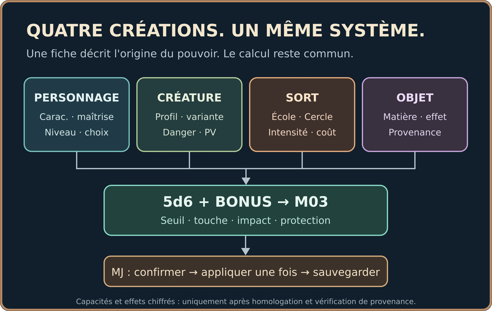
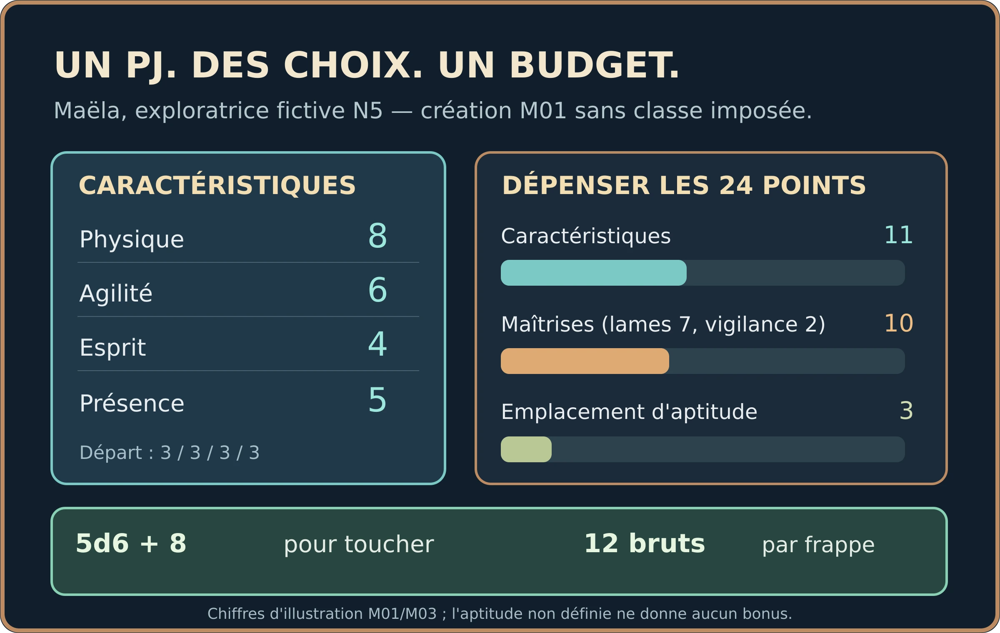
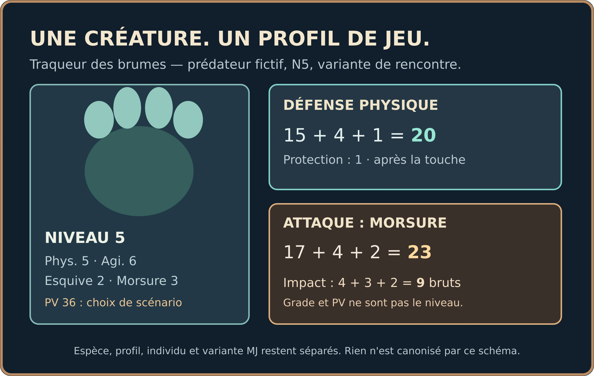
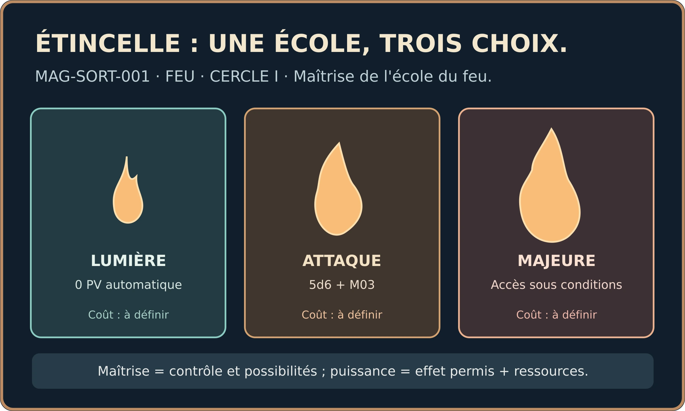
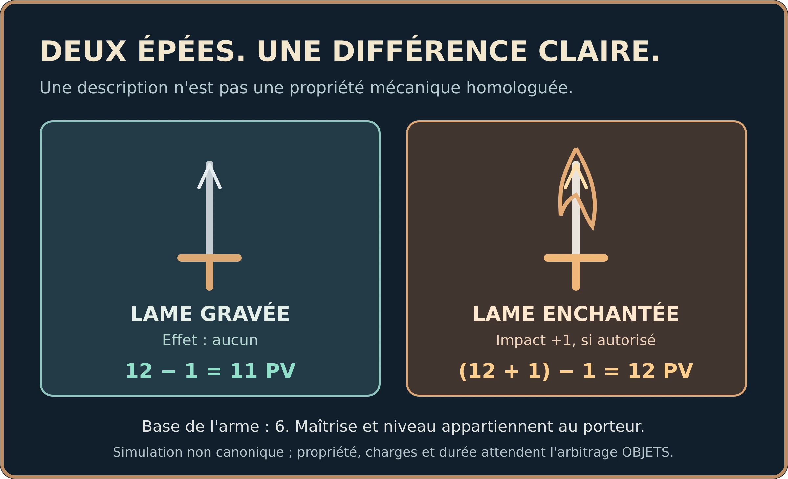

# Créer avec le système 5d6

*Personnages, créatures, capacités, sorts et objets : cinq portes d'entrée, une règle commune pour savoir si une action réussit.*

> [!warning] Atelier de prépublication — exemples fictifs
> Ce guide accompagne le [[jouer/systeme-5d6-unifie-reference|système 5d6 unifié]]. Les **formules M01–M03 sont reprises de l'existant**, mais les personnages, créatures, objets et capacités ci-dessous sont des **créations de démonstration**, sans statut canonique. Les dépenses de mana, charges d'enchantements, effets divins et paramètres propres au sort Étincelle attendent homologation. Aucun exemple ne doit être importé dans le bestiaire canonique comme une source attestée.

## Le point commun entre toutes les créations

On conserve toujours **une définition**, **une instance jouée** et **une décision du MJ**. La définition raconte ce qu'un élément *peut* faire. L'instance indique *qui* agit, avec quel niveau, quelle maîtrise et quelles ressources. La décision du MJ confirme la faisabilité, la cible et l'application.

| Élément créé | Ce qu'on choisit d'abord | Ce qui rejoint le calcul 5d6 |
|---|---|---|
| **Personnage joueur** | Histoire, quatre caractéristiques, maîtrises, aptitudes, niveau | `E(caractéristique)`, `M(maîtrise)`, niveau, ressources |
| **Créature** | Espèce ou idée, rôle, danger, profil et variante individuelle | Statistiques, défense, protections, attaque et PV de l'instance |
| **Capacité** | Geste, prérequis, limites, coût en points et approbation MJ | Une famille d'effet homologuée ; jamais une interprétation automatique du texte |
| **Sort** | École, Cercle, effet, intensité, portée, coût et contrôle | Caractéristique, maîtrise d'école, résistance et M03 si offensif |
| **Objet / enchantement** | Forme, matériaux, propriété, provenance, charges et version | Valeur attestée d'équipement ou effet autorisé, **pas le seul nom** |

## 1. Créer un personnage joueur

### Étape A — Imaginer la personne

Avant les nombres, réponds à cinq questions : **qui est-elle, d'où vient-elle, que sait-elle faire, que cherche-t-elle et qu'est-ce qui lui manque ?** Une voie n'enferme pas le personnage dans une classe : un bâtisseur peut aussi se battre ; une exploratrice peut étudier le feu.

### Étape B — Répartir les caractéristiques de départ

À **N1**, le modèle M01 distribue **12 points** entre **Physique, Agilité, Esprit et Présence**. Chaque caractéristique de création commence à **1** et ne dépasse pas **5 à cette étape initiale**. Une répartition équilibrée est **3 / 3 / 3 / 3**. Après la création, les caractéristiques **ne sont pas plafonnées à 12** ; leurs achats deviennent progressivement plus coûteux.

### Étape C — Choisir son niveau et dépenser le budget

Le budget de progression M01 est **`6 × (niveau − 1)`**, en supplément des 12 points initiaux. Il sert à **la fois** aux caractéristiques, maîtrises et capacités ; aucune seconde réserve gratuite n'est ajoutée aux maîtrises.

| Niveau | Budget de développement | Exemple d'usage |
|---:|---:|---|
| **1** | 0 | Personnage débutant, 12 points de base |
| **5** | 24 | Aventurier formé, quelques spécialités |
| **10** | 54 | Pratique confirmée et choix techniques |
| **15** | 84 | Expertise affirmée |
| **20** | 114 | Éveil divin, traité aussi dans l'histoire |
| **25** | 144 | Accomplissement exceptionnel, sans tout maîtriser |

Pour les achats : un point de caractéristique **atteignant le rang `r`** coûte `1 + floor((r−1)/8)` ; un rang de maîtrise **atteignant `r`** coûte `1 + floor((r−1)/6)`. Les capacités ont leur budget M01 : **aptitude 3 points dès N3**, **technique 6 points dès N5**, **signature 9 points dès N17 avec validation MJ**. Ces valeurs sont des prix d'achat, **pas des bonus de dégâts**.

### Exemple entièrement compté : Maëla, exploratrice N5

*Maëla est un personnage fictif créé pour cette page, sans lien imposé avec l'Odyssée d'Orin.* Elle commence avec `3/3/3/3`, puis dépense **exactement 24 points** :

| Achat | Avant → après | Coût M01 |
|---|---:|---:|
| Physique | 3 → **8** | 5 |
| Agilité | 3 → **6** | 3 |
| Esprit | 3 → **4** | 1 |
| Présence | 3 → **5** | 2 |
| Maîtrise des lames | 0 → **7** | 8 *(rangs 1–6 : 1 chacun ; rang 7 : 2)* |
| Maîtrise de vigilance | 0 → **2** | 2 |
| Emplacement d'aptitude, à définir | Aucun → **1 emplacement** | 3 |
| **Total** | | **24 / 24** |

**Pourquoi un emplacement ?** Un emplacement M02 coûte des points, mais **ne donne aucun effet** tant qu'une capacité complète et ses limites n'ont pas été définies et acceptées. Le joueur peut le garder pour un développement narratif ultérieur.

Pour une action à l'épée, Maëla possède : `E(Physique 8)=+5` et `M(lames 7)=+3`. Son bonus de base au jet est donc **+8**, sans `+8` additionnel dû à son niveau. Avec 5d6 faisant **18**, elle obtient **26**.

Si sa lame est **mécaniquement définie** avec un impact de base **6**, sa frappe M03 réussie produit `6 + floor(0,7 × 5) + 3 = 12` dégâts bruts, **avant protection**. On n'a pas jeté les dés de dégâts.

> [!tip] Une autre Maëla, une autre répartition
> Elle pourrait échanger son emplacement d'aptitude (3 points) et un point d'Esprit, d'Agilité et de Présence (3 points économisés) contre une **technique à 6 points**. Elle aurait moins de polyvalence, mais accès à un geste potentiellement plus marquant, après définition et validation. Les deux versions restent **N5**, avec **24 points** dépensés.

### Étape D — Ajouter les limites et la fiche de table

Pour chaque action utilisée souvent, noter **« 5d6 + bonus / seuil opposé / impact fixe / ressource »**. Inventaire, fatigue, mana et aptitudes ne sont pas automatiquement remplis par le seul niveau. Un personnage N25 reste différent d'un autre N25 selon les investissements, l'histoire et les accès réellement acquis.

## 2. Créer une créature jouable pour une rencontre

Une créature **n'utilise pas obligatoirement le budget de création d'un PJ**. Son profil de jeu est une représentation d'espèce, d'individu ou de variante, avec un **niveau**, un **rôle tactique**, un **danger** et des **PV** distincts. Une variante de campagne appartient au MJ : elle n'altère pas la fiche documentaire d'origine.

### Les champs à prévoir

1. **Identité de conception :** nom provisoire, rôle, milieu proposé, description et comportements.
2. **Profil M03 :** niveau 1–25, quatre caractéristiques, maîtrises pertinentes, type de résistance.
3. **Survie :** PV de l'instance, grade de protection, contexte, esquive/parade éventuelles.
4. **Actions :** morsure, griffe, bond ou souffle **définis séparément**, avec impact de base homologué `[1..12]`, portée, condition et pénétration autorisée.
5. **Effets :** capacités spéciales avec source et limites ; aucun effet implicite en lisant « venimeux », « ancestral » ou « magique ».
6. **Publication :** séparer fiche encyclopédique, profil mécanique, individu de rencontre et variante MJ ; ne pas inventer un code documentaire officiel.

### Exemple : Traqueur des brumes, N5 (prototype inventé)

| Champ | Valeur d'essai | Pourquoi |
|---|---|---|
| Rôle | Prédateur mobile | Préfère contourner et isoler, peut fuir |
| Caractéristiques | Phys. **5**, Agi. **6**, Esp. **3**, Pré. **2** | Profil choisi pour l'exemple, **pas issu d'une espèce canonique** |
| Maîtrises | Esquive **2**, morsure **3** | Défense et attaque distinctes |
| Niveau / PV | **N5**, **36 PV** | PV **choisis pour cette scène**, pas règle universelle de Bestiaire |
| Équipement | Grade physique **1**, aucun autre bonus | Protection M03 : **1** au N5 |
| Attaque | Morsure, impact de base **4**, pénétration **0** | Valeurs fictives dans les bornes M03 |

**Défense physique :** `15 + E(Agilité 6) + M(Esquive 2) = 15 + 4 + 1 = 20`.

**Attaque de morsure :** sur un naturel **17**, `17 + E(Physique 5) + M(morsure 3) = 17 + 4 + 2 = 23`. Si la cible est atteinte, les dégâts bruts sont `4 + floor(0,7 × 5) + 2 = 9`. Face à **2 de protection**, cela donne **7 PV nets**.

Une option importante : **danger ≠ niveau**. Un adversaire fragile mais capable d'alerter toute une colonie peut présenter un danger de scène supérieur à son niveau individuel. Le nombre d'ennemis, le terrain et l'objectif changent la rencontre sans attribuer un bonus secret.

## 3. Créer une capacité physique ou magique

Décrire d'abord le geste, puis préciser **un prérequis, un déclencheur, une limite, une durée, une ressource éventuelle, une origine et l'accord MJ**. Une capacité définie n'est pas un bonus générique permanent.

| Exemple fictif | Famille d'effet candidate | Lecture de jeu |
|---|---|---|
| **Fente précise** (physique) | `impact +2`, **1 action**, si homologuée | Même 5d6 ; frappe de Maëla `12 → 14` bruts, puis protection ; aucun cumul d'impact illimité. |
| **Voile de concentration** (magique) | `defense +1`, durée à valider | Ne protège que selon son déclencheur homologué ; ne change pas toutes les résistances. |
| **Parole apaisante** (mentale) | `condition`, sans dégâts | Sur réussite, le MJ propose apaisement ou hésitation ; **0 PV**. |

> [!important] Pas de bonus parce que le texte est joli
> Les effets chiffrés ci-dessus sont des **hypothèses**. M03 reconnaît des catégories structurées `precision`, `defense`, `impact`, `penetration`, `absorption` avec bornes, mais l'habilitation complète, les coûts, la durée active et l'absorption restent à contre-auditer. Un descriptif libre ne se convertit **jamais** automatiquement en `+1` ou `+2`.

## 4. Créer un sort et choisir son intensité

Un sort n'est pas créé en donnant arbitrairement un chiffre de dégâts. La fiche commence par une **intention magique**, une **école**, un **Cercle**, un **rang numérique de maîtrise**, une éventuelle **reconnaissance narrative**, des **limites**, puis une **politique de ressources** à homologuer.

### Le pilote MAG-SORT-001 — Étincelle

| Champ | Définition pour l'atelier |
|---|---|
| Référence | `MAG-SORT-001` (projet de sort), école **du feu**, **Cercle I** |
| Maîtrise | Rang de l'**école du feu**, plus degré narratif séparé s'il est attesté |
| Usage mineur | Créer ou entretenir une petite lumière/une flamme **si la définition l'autorise** ; pas de dégâts PV automatiques |
| Usage offensif | Touche 5d6 + maîtrise et caractéristique, résistance magique, protection M03, impact homologué |
| Manifestation majeure | Intensité supplémentaire **seulement si permise** par l'effet, la maîtrise, les ressources et le MJ |
| À fixer par MAG | Base de dégâts, DD, portée, aire, durée, mana, conditions, coûts par intensité |

**Simulation chiffrée explicitement fictive :** un mage N5 avec Esprit **8** et maîtrise du feu **7** obtient `E(8)=5`, `M(7)=3`. Sur un jet naturel **18**, son attaque atteint **26**. Si l'on teste **provisoirement** `baseDamage=6`, alors M03 donne `6 + 3 (niveau) + 3 (maîtrise) = 12` bruts, avant protection magique. **Le 6 n'est pas la valeur officielle d'Étincelle.** Son coût n'est **pas** déduit de `demo-etincelle` (foudre) ; ce sont deux objets de conception distincts.

À **N21**, un effet offensif homologué à cette intensité pourrait choisir la grille candidate **×1**, **×1,25** ou **×1,50** suivant l'usage. Un mage divin peut aussi allumer une chandelle sans réclamer la manifestation majeure. Le coût doit dépendre de l'intensité réellement choisie, **pas seulement de la hauteur du niveau**.

## 5. Concevoir et fabriquer un objet

On distingue **l'objet décrit**, **l'objet utilisable en combat**, **l'enchantement éventuel** et **l'instance dans la campagne**. Un bel ouvrage n'est pas nécessairement magique ; une épée gravée ne reçoit pas automatiquement `+1`.

### Fiche minimale de création

1. **Forme et matériaux :** lame, armure, outil, bijou ; métal, bois, pierre, composants accessibles dans la fiction.
2. **Fonction concrète :** ce que l'objet permet sans surnaturel, et dans quelles conditions.
3. **Propriété mécanique :** `baseDamage`, grade de protection, pénétration ou effet **uniquement avec une définition homologuée**.
4. **Enchantement distinct :** famille d'effet, puissance bornée, déclencheur, durée, ressources/charges encore à arbitrer.
5. **Provenance et état :** auteur/atelier si connu, version de règle, propriétaire, usure, instance copiée dans la campagne.
6. **Validation :** test d'artisanat si la situation le justifie, accord du MJ, application/sauvegarde séparées.

**Exemple de fabrication.** Une artisane a Esprit **5**, maîtrise de forge **3**. Elle obtient **16** sur 5d6 : `16 + E(5)=4 + M(3)=2 = 22`. Face à une difficulté de **21**, le travail réussit. Cela prouve **la réussite de l'action de fabrication**, mais ne crée pas, à lui seul, une arme magique ni un bonus de dégâts.

| Objet proposé | Résultat de démonstration |
|---|---|
| **Lame de cuivre gravée** | Histoire et esthétique ; **aucun bonus** tiré de son nom. Si son type d'arme homologué a base **6**, elle attaque comme toute arme de ce type. |
| **Lame des braises** | Même attaque, plus un **effet `impact +1` hypothétique** si la propriété a une source, une version, une habilitation et une limite approuvées. Charges et coût : **réservés**. |

Ainsi, la frappe fictive de Maëla contre le Traqueur pourrait produire **12 − 1 = 11 PV** avec sa lame ordinaire, ou **(12 + 1) − 1 = 12 PV** si un effet d'enchantement `impact +1` était réellement homologué. L'adaptateur universel **OBJETS → M03 n'est pas encore en production** : c'est une comparaison mathématique, **pas** une option déjà active sur le site.

## 6. Trois mises en situation à jouer en cinq minutes

### Scène A — Le Traqueur sous le pont : attaque et riposte

**Situation :** Maëla (N5) protège une caravane. Un Traqueur fictif (N5) s'avance. Terrain neutre, aucun effet spécial ; pour les nombres, le MJ autorise une arme de base 6 et une armure de grade 2 pour Maëla.

1. **Maëla frappe.** Jet naturel **18** ; bonus `+5 physique +3 lames` : **26**. Le seuil est `max(DD21, défense20)=21` : **touche**. Impact **12** moins protection de la créature **1** = **11 PV**. Ses PV de scène vont de **36 à 25**.
2. **Le Traqueur riposte avec sa propre action.** Jet naturel **17**, bonus `+4 Physique +2 morsure` : **23**. La défense de Maëla vaut `15 + E(Physique 8)=5 + M(lames 7)=3`, soit **23** : la morsure **touche exactement**. Impact **9** moins armure de grade 2 (**2**) = **7 PV**. Maëla passe de **36 à 29 PV** *si sa fiche d'essai utilise également 36 PV*.
3. **Le MJ choisit la suite.** Retraite, posture de garde, protection d'autrui ou nouvel assaut : aucune riposte gratuite, aucune créature obligée de se battre jusqu'à la mort.

**À vérifier à la table :** les joueurs comprennent-ils que **toucher** et **blesser** sont deux étapes distinctes **du même jet** ? Le calcul est-il assez rapide avec les impacts préinscrits ?

### Scène B — Une lumière ou une attaque : même Étincelle

**Situation :** une magicienne N5 maîtrise le feu au rang **7**. Un couloir est obscur, puis un adversaire apparaît.

- Pour **éclairer**, la magicienne choisit une intensité modeste **si ce geste est connu**. Le MJ vérifie faisabilité et ressources ; aucun PV à calculer.
- Pour **attaquer**, même maîtrise de feu, mais opposition M03 : naturel **18** + **5** Esprit effectif + **3** maîtrise = **26**. Sur une cible dont le seuil vaut 21, elle touche. L'impact et le coût sont **laissés en attente de MAG** ; le résultat **12 bruts** présenté plus haut n'est qu'un étalon fictif de banc d'essai.
- Une fois la tentative engagée, un **échec** ne permet pas de retenter gratuitement sans appliquer la politique de ressource décidée. La prévisualisation, elle, ne consomme rien.

**Choix intéressant :** conserver de la ressource pour aider un allié, ou payer une intensité supérieure quand les circonstances le justifient. La maîtrise ouvre des solutions, pas une obligation de puissance maximale.

### Scène C — Passer sans violence : l'effet mental

**Situation :** un garde de pont hésite à laisser passer le groupe. L'action verbale est possible ; le MJ retient une résistance mentale **21**.

Une négociatrice avec Présence **5** (`E=4`) et maîtrise de persuasion **3** (`M=2`) obtient **17** sur ses cinq dés : **23**, soit **2 points de marge**. Le MJ propose un passage conditionnel, un échange d'informations ou la nécessité d'une preuve.

**Conséquence : 0 PV, toujours.** Réussir une opposition mentale ne rend pas l'interlocuteur servile et ne transforme pas une conversation en attaque invisible. Les droits, limites et suites sont des décisions de fiction distinctes.

## 7. Comment le Studio MJ devrait accompagner la création

| Écran | Geste du créateur | Aide et protection attendues |
|---|---|---|
| **Nouveau personnage** | Origine → attributs → budget → maîtrises → aptitude | Solde visible en direct ; coût des rangs exact ; avertissement si capacité non définie |
| **Nouvelle créature** | Rôle → profil → attaques → variante MJ | Aperçu résistance/protection/PV ; danger de rencontre distinct ; copie non destructrice |
| **Nouveau sort** | École/Cercle → usage → intensités → coût proposé | Prévisualisation 5d6/M03 ; coût `réservé` bloquant tant que non homologué |
| **Nouvel objet** | Forme → propriété → enchantement → instance | Zéro bonus pour simple description ; provenance et version obligatoires pour effet chiffré |
| **Jouer l'action** | Cible et intensité → **Engager / lancer** → **MJ : appliquer** | Un seul 5d6, journal idempotent, protections des secrets MJ, aucune double dépense |

> [!note] Les arbitrages qui restent ouverts
> Grilles exactes de PV/danger des créatures, liste des techniques et prérequis, coût/portée d'Étincelle, recettes d'enchantement, charge et récupération, effets d'état, coefficients et absorption candidate, permissions MJ et migration des fiches. Les exemples doivent servir à **tester les interfaces**, pas à déclarer ces chiffres officiels.

**Pour approfondir côté MJ :** `docs/rapports-missions/MATH_REF_001_REFERENCE_MATHEMATIQUE.md`, `MATH_EFF_001_MATRICE_INTEROP.md`, `M01_PROGRESSION_5D6.md`, `M02_ATELIER_CAPACITES_5D6.md`, `M03_COMBAT_BESTIAIRE_5D6.md`.
