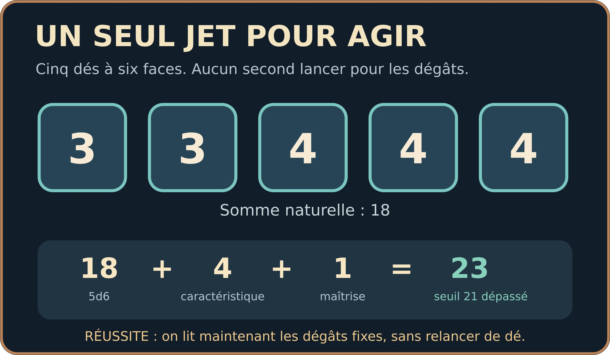
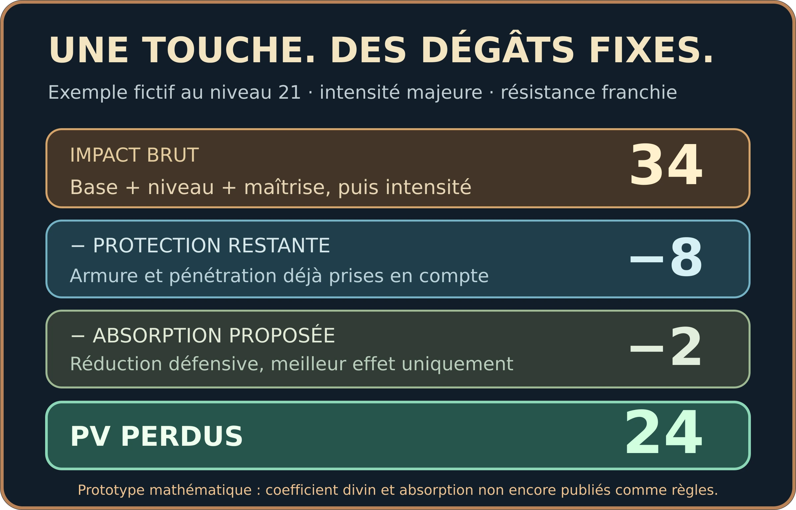
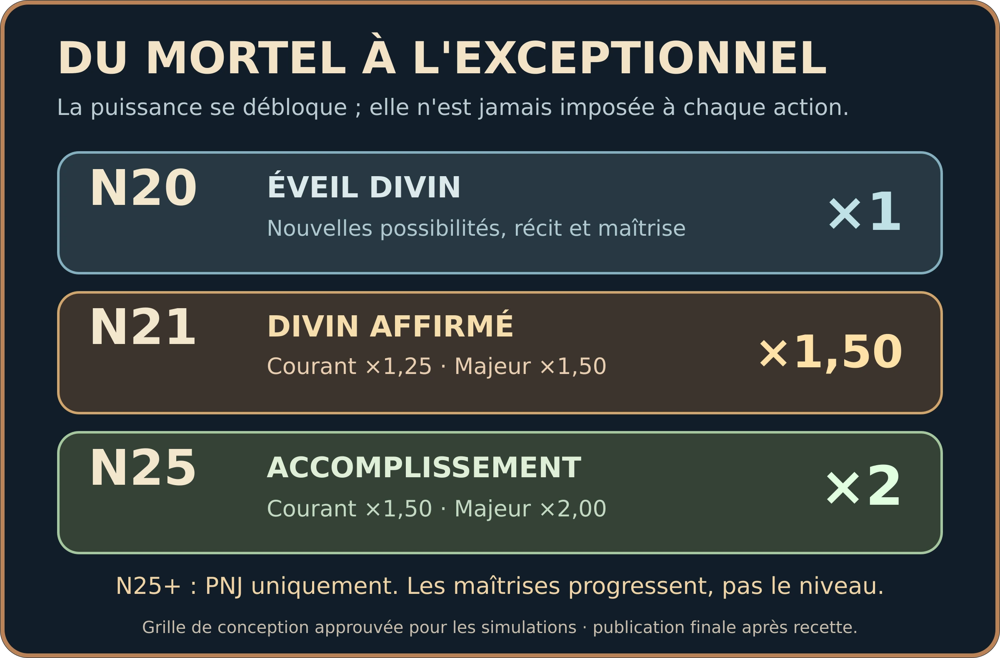

# Le système 5d6 unifié

*Une mécanique commune pour manier une épée, déclencher un sort, utiliser un objet enchanté ou résister à une influence mentale.*

> [!warning] Guide de prépublication — mécanique candidate
> Ce chapitre présente la direction **retenue par le créateur** et un modèle mathématique soumis à homologation. **Il ne modifie pas encore le moteur de production M03 et n'est pas une règle canonisée.** Les chiffres d'intensité divine, d'absorption et les exemples marqués « simulation » sont destinés aux tests. Aucun coût de mana, aucune charge d'objet et aucune matrice magique ne sont fixés ici.

## L'essentiel en trente secondes

1. **Annonce ce que tu fais.** Le MJ vérifie que l'action est possible et choisit la défense ou la difficulté.
2. **Lance cinq dés à six faces (5d6), une seule fois.** Ajoute tes bonus de caractéristique, de maîtrise et de situation.
3. **Compare au seuil.** Tu sais immédiatement si tu as réussi, et avec quelle marge.
4. **En cas d'attaque réussie, applique les dégâts déjà calculés.** La protection et l'absorption les réduisent. **Il n'y a pas de second jet de dégâts.**

Le site devra proposer **« Lancer l'action »**, puis, si besoin, **« MJ : appliquer »**. Autour d'une vraie table, les cinq dés suffisent : les bonus fixes et les dégâts peuvent être inscrits sur la fiche.

## 1. Les cinq dés décident de l'action

La formule de résolution actuellement portée par **M01–M03** est :

**Résultat = somme des 5d6 + bonus de caractéristique + bonus de maîtrise + situation + précision autorisée.**

Le seuil dépend de l'action ou de l'adversaire. Pour un test sans opposition, voici des repères simples :

| Difficulté | Seuil indicatif |
|---|---:|
| Facile | 18 |
| Ordinaire | **21** |
| Difficile | 24 |
| Héroïque | 27 |
| Exceptionnelle | 30 |

**Exemple.** Tu obtiens **3 + 3 + 4 + 4 + 4 = 18** sur les dés. Avec **+4** de caractéristique et **+1** de maîtrise, ton total est **23**. Le seuil est **21** : **réussite avec une marge de 2**.

En opposition, le défenseur dispose d'une **résistance** calculée à partir de ses défenses pertinentes. Une cible très protégée n'est pas forcément difficile à *toucher* ; la défense et la protection contre les dégâts sont deux questions différentes.

> [!tip] Et les jets extraordinaires ?
> Un total **naturel de 5 à 7** sur les cinq dés reste un échec. Un total naturel **de 27 à 30** peut ouvrir une occasion narrative exceptionnelle, mais ne transforme jamais une action impossible en réussite et ne cause pas automatiquement des dégâts. Les cinq dés ont **7 776 combinaisons** possibles : les extrêmes sont rares.

## 2. Une seule règle pour les dégâts

Une attaque au corps à corps, un sort offensif ou les griffes d'une créature suivent le **même ordre de calcul** :

**Touche réussie → impact brut → protection restante après pénétration → absorption → PV perdus.**

Dans l'exemple illustré, une frappe réussie annonce **34 points d'impact**. L'adversaire conserve **8 points de protection** après l'éventuelle pénétration, puis réduit encore de **2** grâce à une absorption autorisée : **34 − 8 − 2 = 24 PV**.

Cette illustration est une **simulation de l'extension proposée** ; le calcul de production M03 ne comprend pas encore cette absorption supplémentaire.

| Notion | À quoi sert-elle ? |
|---|---|
| **Touche / réussite** | Détermine si l'action atteint son objectif. Sans touche, **0 PV**. |
| **Impact** | Dégâts de base, progression, maîtrise et effet autorisé. |
| **Pénétration** | Ignore une partie de la protection, **sans créer des dégâts bonus**. |
| **Protection** | Réduit les dégâts qui traversent la touche. |
| **Absorption** | Réduction complémentaire **après** la protection ; **pas des PV temporaires**. Extension à valider. |

**Exemple M03 sans extension, niveau 5.** Une arme d'impact de base **6**, un bonus de niveau **3** et un bonus de maîtrise **1** donnent **10 dégâts bruts**. Face à une protection restante de **1**, la cible perd **9 PV** si l'attaque réussit. Le joueur ne relance aucun dé.

Les effets ne se cumulent pas sans limite : ils doivent être **définis, bornés et approuvés**, y compris lorsqu'ils viennent d'un objet ou d'une créature.

## 3. Une action, plusieurs origines

Le moteur ne change pas lorsque la fiction change. Seuls la caractéristique pertinente, la maîtrise, les ressources, la portée et les propriétés **effectivement homologuées** varient.

| Ce que tu fais | Ce que le système résout |
|---|---|
| **Attaquer avec une épée** | Toucher avec 5d6, puis impact physique et protections. |
| **Exécuter une capacité martiale** | Même toucher et dégâts ; condition ou technique autorisée en plus. |
| **Déclencher une capacité magique** | Même résolution ; maîtrise de l'école, contrôle et dépense spécifique. |
| **Lancer un sort offensif** | Même toucher et protections ; l'intensité choisie règle la puissance et les ressources. |
| **Utiliser une arme enchantée** | Attaque normale avec une propriété d'enchantement **définie** ; l'inscription descriptive seule ne donne aucun bonus. |
| **Jouer une créature** | Mêmes règles avec son profil, son attaque et les variantes du MJ. |
| **Intimider, charmer ou troubler un esprit** | Résistance mentale et conséquence validée par le MJ ; **aucune perte automatique de PV**. |

### Premier sort pilote : Étincelle

**MAG-SORT-001 — Étincelle** appartient à **l'école du feu**, **Cercle I**. Son intensité peut être adaptée à l'usage : un petit foyer lumineux, une perturbation limitée ou une attaque offensive — sous réserve de ce que la définition homologuée autorise.

À puissance réduite, le sort doit pouvoir rester utile **même à haut niveau** pour un coût proportionné. À forte intensité, il exige davantage de ressources ou de conditions. Sa **maîtrise du feu** améliore d'abord la précision, le contrôle et les possibilités techniques ; elle ne transforme pas chaque usage mineur en explosion.

> [!important] Deux Étincelles différentes
> **MAG-SORT-001** est un projet de **feu** ; l'ancien `demo-etincelle` est une démonstration **de foudre**, non canonique. Ses dégâts, coûts et limites ne deviennent **pas** automatiquement ceux du sort pilote. Les chiffres précis de mana et de portée attendent l'arbitrage MAG.

## 4. Progresser : maîtrise, techniques et puissance

Les personnages progressent sur **25 niveaux**, sans plafonner artificiellement les caractéristiques brutes à 12. Ils développent aussi des maîtrises précises : épées, défense, école du feu, fabrication, etc.

Un rang de maîtrise n'est **pas un +1 automatique** au jet. Les bonus effectifs avancent par paliers afin de préserver les probabilités des 5d6. Entre les paliers, l'apprentissage doit aussi offrir de **nouveaux gestes, usages, raffinements et choix tactiques**. L'objectif est de sentir le progrès régulièrement, sans inflation mathématique illimitée.

Les éléments suivants sont **distincts** :

- **Niveau** : l'expérience générale du personnage.
- **Rang numérique de maîtrise** : son apprentissage dans une discipline.
- **Cercle magique** : le répertoire auquel un sort appartient.
- **Neuf degrés narratifs d'école** : son statut, sa transmission et sa reconnaissance dans la fiction.

Ainsi, **un sort du Cercle I peut rester intéressant au niveau 25** ; il n'est ni automatiquement gratuit ni automatiquement surpuissant.

### De l'éveil divin à la maîtrise exceptionnelle

| Étape | Sens dans l'histoire | Proposition mécanique à homologuer |
|---|---|---|
| **Niveau 20** | **Éveil divin** : la nature du personnage commence à se révéler. | Nouvelles possibilités narratives et techniques ; pas de multiplicateur général. |
| **Niveau 21** | Divinité affirmée et assumée. | **×1,25** en intensité courante ou **×1,50** pour une manifestation majeure *éligible*. |
| **Niveaux 22–24** | Maîtrise divine approfondie. | Progression graduelle des intensités homologuées. |
| **Niveau 25** | Accomplissement exceptionnel. | **×1,50** courant ; **×2** majeur pour les effets autorisés. |
| **« 25+ »** | Expérience incomparable de certains êtres. | **PNJ uniquement** : toujours niveau 25, mais possibilité de crédits de maîtrise exceptionnels approuvés par le MJ. |

**Important :** ces multiplicateurs sont une **grille expérimentale acceptée comme direction de conception**, pas une règle active sur le site. Ils ne concernent **pas** automatiquement chaque action, objet ou description. Les effets éligibles, les dépenses et les bornes restent à valider.

L'évolution de niveau 20 à 21 peut s'étendre sur des années de campagne. Avec l'accord de toute la table, il reste possible de **commencer directement une aventure à haut niveau**.

## 5. Deux gestes sur écran ; un seul jet sur table

### Sur le site, côté joueur et MJ

1. Le joueur choisit son action, sa cible et, le cas échéant, l'**intensité**. L'écran prévisualise la portée, la difficulté, les coûts éventuels et les dégâts calculables. **Aucune ressource n'est encore dépensée.**
2. Le bouton **« Engager et lancer 5d6 »** vérifie les droits et les ressources, engage la tentative selon la politique de coût autorisée, puis produit un résultat unique. Le MJ voit la touche, la marge, les dégâts après protection et l'effet proposé.
3. Le bouton **« MJ : appliquer »** enregistre une seule fois les conséquences appropriées, **sans débiter à nouveau la ressource**, avec journal et sauvegarde. Il n'est pas nécessaire d'effectuer un autre jet. Les informations secrètes restent dans la vue MJ.

*Selon la politique de coût homologuée, une tentative ratée peut consommer sa ressource ; un simple aperçu n'en consomme jamais. L'interface doit empêcher les doubles dépenses et les doubles applications.*

### Autour d'une table avec cinq d6

- **Avant les dés**, le MJ annonce le seuil ; les coûts et l'intensité sont convenus.
- **Lance 5d6**, ajoute tes bonus notés sur la fiche et compare. Les totaux naturels 5 à 7 échouent.
- **Si tu touches**, lis l'impact préparé sur ta fiche, retranche protection et absorption autorisées. **C'est terminé.**

*Astuce MJ :* inscris sur les fiches une ligne par attaque connue : **« 5d6 + bonus de touche / impact fixe / type / ressource »**. Avec les valeurs de protection en face, le combat reste fluide.

## 6. Des affrontements qui avancent

La cible de conception retenue est un combat ordinaire de **3 à 5 rounds**, un adversaire d'élite de **5 à 8 rounds** et un boss de **8 à 12 rounds**, sans transformer chaque tour en succession de calculs. Des bancs de simulation ont donné des résultats encourageants, mais **ils ne remplacent pas des parties jouées**, car les adversaires n'y ripostent pas encore et la consommation réelle des ressources reste à intégrer.

Le but n'est pas de supprimer les choix, mais de réserver le temps de jeu aux décisions intéressantes : **qui protéger, quel risque prendre, quelle intensité choisir, attaquer ou négocier ?**

## Pour aller plus loin

- **MJ et référents techniques :** le contrat candidat complet figure dans `docs/rapports-missions/MATH_REF_001_REFERENCE_MATHEMATIQUE.md`, avec ses formules exactes et les protections M03.
- **Équilibrage :** `docs/rapports-missions/MATH_REF_001_SIMULATIONS_RECETTE.md` expose les hypothèses, la méthode et les limites du banc reproductible.
- **Sur table :** `docs/rapports-missions/MATH_REF_001_FICHE_5D6_TABLE.md` propose une aide de jeu technique.

> [!note] Ce qui attend encore une décision officielle
> Parité complète avec le M03 actif, coût et portée d'Étincelle, intensités et ressources des sorts, charges d'objets, homologation des effets, absorption, cadence des déblocages de maîtrise, puissance de certains PNJ 25+, tests de combats réels et recette des sauvegardes. **Aucune de ces décisions ne doit être déduite d'une illustration.**
