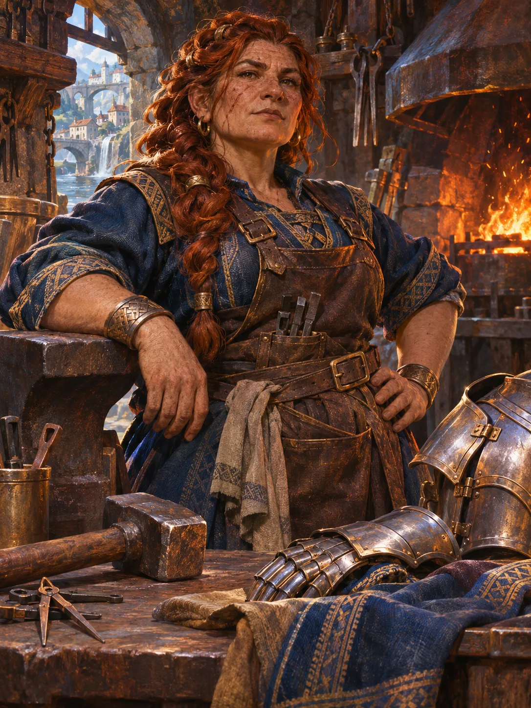

# Mara Vifacier — Forgeronne d’Entre-Rives

*Étude visuelle PNJ-001 pour la nouvelle bibliothèque. L'âge apparent, les traits et les vêtements sont des choix d'illustration **non validés** ; seule la profession et la situation documentées ci-dessous font autorité.*

## Métier, histoire et caractère

Mara Vifacier est une **Naine forgeronne d’Entre-Rives**. Elle examine l’armure héritée de Harald, conserve la mémoire de ses anciennes marques et améliore les articulations, attaches et protections pour le porteur présent.

## Situation vérifiée

Sa participation à l’adaptation de l’armure est **jouée** ; elle prépare des emplacements techniques, tandis que le travail runique appartient à Orin. Elle travaille aussi sur des interfaces entre métal, tissu et attaches en dialogue avec Elyra.

## Limites, relations et perspectives

Ne pas la confondre avec **Mara Belden**, exploitante de Corvelis, ni **Mara Ventrevent**, maîtresse d’équipage. Les futures commandes ne sont pas automatiquement signées.

Les autres pistes sont des propositions non jouées et ne doivent pas devenir des réussites rétroactives.

## Sources

*Compendium des personnages et des relations* v1.7, **IMP-04** ; renvois conservés : CB31 P00682–01090; P02201–02400; CB32 P00927. Ce code documentaire ne fixe ni allégeance, ni état de Rappelé, ni appartenance aux Revenants.

## En jeu — trois rencontres possibles

> [!info] Propositions inédites, non jouées
> Ces accroches ne sont ni des commandes déjà acceptées ni des scènes de l'Odyssée.

- **L'armure trop célèbre.** Un client exige de porter une ancienne armure malgré une articulation dangereuse. Mara explique les risques ; les joueurs peuvent négocier une transformation réversible, concevoir une pièce neuve ou respecter l'objet comme souvenir.
- **Deux métiers, une attache.** Métal et tissu ne réagissent pas de la même manière. Les aventuriers réunissent une couturière et une forgeronne pour examiner un défaut de fixation, puis choisissent qui réalise les essais.
- **Un apprenti pressé.** Un élève veut livrer un ouvrage avant qu'il soit éprouvé. Il faut décider comment tester la sécurité sans humilier l'apprenti ni sacrifier le délai.

**À jouer :** elle examine l'objet avant de promettre quoi que ce soit. Elle sait refuser une solution spectaculaire qui mettrait son porteur en danger. Ni profil 5d6 ni capacité de forge exceptionnelle ne sont attribués par ces idées.
