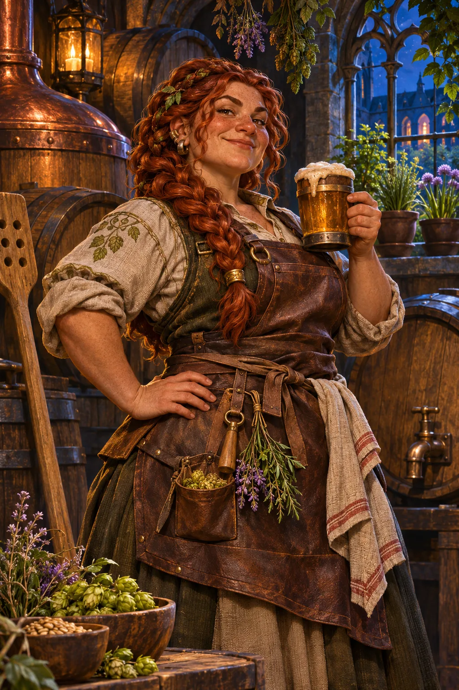

# Sivra Brassefeuille

*Illustration de travail PNJ-001 : cadre et costume proposés pour le site. Les traits physiques ne sont pas arrêtés par la campagne ni par l'approbation de sa profession.*

**Sivra Brassefeuille** est une brasseuse naine qui travaille à l’abbaye d’Entre-Rives. Elle expérimente avec les plantes, fruits, céréales et miels du pays. Elle accepte les commandes comme des invitations à essayer, jamais comme des recettes imposées : elle garde le droit de modifier, refuser ou abandonner un brassin.

La bière brune à la cacahuète qu’elle a élaborée a déjà été goûtée et appréciée. Elle prépare également **Premiers Flocons**, une bière ambrée de saison pour la Soirée annuelle de la Couronne.

Son nom est créé à la demande du créateur. Les éléments familiaux, son âge, son apprentissage et ses affiliations religieuses ne sont pas établis. Elle peut être rencontrée par des aventuriers en quête d’ingrédients, de nouvelles routes commerciales ou d’un savoir-faire de fermentation.

## Repères d’interprétation

Sivra parle volontiers par les arômes, les textures et les saisons. Elle préfère un essai modeste dont on sait décrire le résultat à une invention spectaculaire dont personne ne peut reproduire la recette. Ces repères de jeu sont une proposition cohérente, ajustable par les MJ.

**En scène — proposition non jouée :** elle fait comparer deux petits échantillons, puis demande ce qui change entre eux. Elle peut offrir une leçon de patience mais aucune capacité de brassage ni aucun XP n'est accordé automatiquement.

## Accroches de mission — propositions, non jouées

- **Une récolte avant les pluies :** aider Sivra à retrouver une plante ou un fruit local dont le dernier lot a disparu du marché. La solution peut être une négociation avec des récoltants plutôt qu’une chasse.
- **Le tonneau en route :** accompagner une petite cargaison de bière ou de miel vers un relais éloigné, en choisissant une route sûre et en préservant le chargement.
- **Les levures du vieux cellier :** déterminer pourquoi une fermentation varie entre deux salles de l’abbaye. Les personnages peuvent comparer température, fûts et gestes sans qu’il y ait nécessairement sabotage ou magie.

Ces accroches sont proposées pour d’autres tables et ne décrivent pas des aventures déjà survenues.

## Sources

- *Campagne Brut 3.1*, CB31 P12341–12444.
- Confirmation du créateur, 29 octobre 2026 : brasseuse naine de l’abbaye d’Entre-Rives; création autorisée d’un nom, d’une fiche et d’accroches de jeu.
