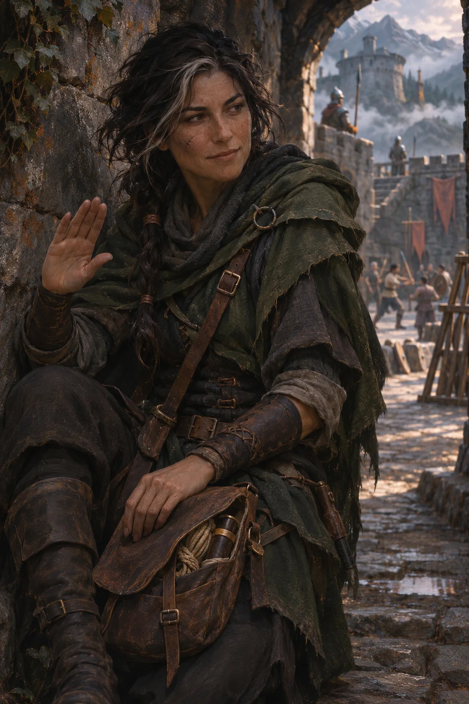

# Ylva

*Illustration originale proposée en novembre 2026. L'apparence, le vêtement et le décor représentés ne sont pas des détails biographiques attestés.*

Ylva accepte d’entraîner Orin à la discrétion. L’objectif est de mieux se déplacer et de sortir des lignes de vue, non de devenir invisible. L’exercice tient compte de son armure, de son gabarit et de son caractère.

La scène présente cette formation comme un complément à l’entraînement tactique mené par Torgarl et les vétérans. Le créateur confirme **Ylva** comme graphie canonique; « Ilva » dans la transcription est une erreur.

## Sources

- *Campagne Brut 3.1*, CB31 P12446–12610; P13844–13855.
- Confirmation du créateur, 29 octobre 2026 : graphie canonique **Ylva**.

## En jeu — atelier de discrétion (propositions non jouées)

- **La cour en plein jour :** traverser une cour sous le regard de passants qui ne sont pas des ennemis. Les personnages peuvent observer les habitudes, attendre un moment calme ou demander simplement l'autorisation de passer.
- **L'armure qui tinte :** l'équipement d'un apprenti trahit sa progression. Ylva propose d'examiner sangles, rythme et posture, sans offrir d'invisibilité ni effacer les contraintes de poids.
- **Le guetteur fatigué :** réussir l'exercice exige d'abord de distinguer surveillance, négligence et mise en danger d'autrui. Les joueurs choisissent de signaler la situation, de modifier l'exercice ou de s'y soustraire.

**Jeu de rôle :** poser la question « Qu'as-tu réellement observé ? » avant de commenter la technique. Ce tic de langage est **proposé**, pas une citation de CB31. Aucun prérequis ou avantage 5d6 nouveau n'est établi.

