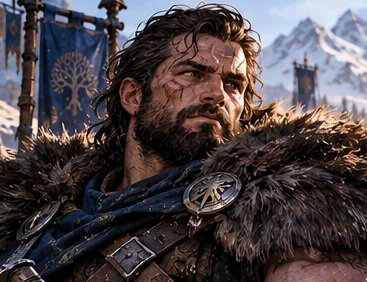

# Bram Vieux-Fer

*Étude visuelle provisoire issue d’une planche d’ensemble ; **apparence et détails à valider** avant de parler de portrait officiel.*

> [!info] Statut documentaire
> **Fiche de développement éditorial**, fondée sur le *Compendium des personnages et des relations* v1.7 et les scènes de campagne citées. Les faits joués, les intentions et les pistes narratives sont séparés. **Lore complémentaire approuvé le 28 octobre 2026 :** le créateur valide une enfance ordinaire dans les Montagnes, **Rochebrume comme bourg d’origine**, les années de formation militaire, les opérations sous Harald Forgecœur, la reconnaissance de Torgarl et l’amitié fondée sur le respect mutuel avec Orin. **Les anecdotes détaillées illustratives, les dialogues reconstitués, les dates, les grades précis et les campagnes non identifiées ne sont pas des scènes jouées.** Le portrait actuel est une direction graphique appréciée, pas encore une description physique intégralement fixée.

*Il a la mauvaise habitude de s'inquiéter à voix haute. C'est souvent ainsi qu'il s'assure que quelqu'un d'autre pourra rentrer vivant.*

## En quelques mots

Bram Vieux-Fer est le vétéran qui rappelle au groupe qu'un plan comporte **une sortie**, qu'une victoire laissant des blessés derrière elle mérite d'être interrogée, et qu'un homme peut protéger ses amis sans en faire constamment la démonstration. Ses objections à Orin ne sont pas une rébellion de façade : elles font partie de la sécurité collective. Sa vieille armure, son humour acerbe et ses gestes de préparation rendent tangibles les réalités d'une compagnie entourée de puissances extraordinaires.

## Situation et identité

- **Condition :** vivant ; membre de plein droit des [[GRP-01|Revenants]]. Aucune condition de « Rappelé » attribuée.
- **Fonction attestée :** vétéran, protecteur, responsable de terrain selon les missions, transmetteur de discipline et de couverture.
- **Origines validées :** les **Montagnes de l’Aube**, à **[[GEO-ROCHEBRUME|Rochebrume]]**, bourg de montagne lié aux anciennes routes de la région d’Aldhammar. Le bourg a désormais sa fiche d’Atlas ; son emplacement cartographique précis reste à établir.
- **Jeunesse et service militaire :** nouvelle direction donnée par le créateur : enfance relativement paisible, attrait précoce pour l’armée, progression par la fiabilité, quelques opérations sous les ordres de Harald Forgecœur et reconnaissance de ses aptitudes par Torgarl. **Grades précis, dates et campagnes détaillées ne sont pas arrêtés.**
- **Statut extérieur :** la fréquentation de l'entourage princier ne transforme pas Bram en officier nommé d'une nouvelle institution.
- **Équipement en évolution :** ancienne armure fonctionnelle mais éprouvée ; nouvelle armure commandée à **Mara Vifacier** et **Rempart du Retour** réalisé en CB42.
- **Portrait :** expression vigilante, matériel entretenu malgré l'usure et protection prête à être utilisée. Barbe, âge exact, couleur des cheveux et détails de cicatrices restent à valider.

## Avant les Revenants — l'homme des Montagnes

> [!info] Origines intégrées au lore par validation du créateur
> **Rochebrume**, l'enfance relativement paisible, la vocation militaire, la carrière sous Harald Forgecœur, la réputation gagnée auprès de Torgarl et l'amitié avec Orin sont **approuvées comme histoire du personnage** le 28 octobre 2026. Ce complément ne prétend pas que les scènes de jeunesse ont été jouées. Les scènes d'entraînement ou d'opérations présentées comme **anecdotes possibles** et les dialogues illustratifs sont des **reconstitutions littéraires**, non des citations de la campagne. Les dates, grades et personnes de la famille restent à déterminer.

### Rochebrume — une enfance sans tragédie

**[[GEO-ROCHEBRUME|Rochebrume]]** est un bourg accroché aux pentes des Montagnes de l'Aube, sur une ancienne route de charrois desservant la région d'**Aldhammar**. Ni forteresse légendaire ni village maudit : quelques maisons solides, des remises pour les mules, des ateliers où l'on refait les ferrures, des greniers dont on parle davantage que des exploits des anciens rois. **Le lieu et son nom sont désormais validés ; son emplacement précis sur la future carte reste à déterminer.**

Bram y a grandi **dans une famille ordinaire et un environnement plutôt heureux**. Les adultes travaillent, les enfants aident, le printemps apporte les routes abîmées par le dégel et l'hiver réclame des réserves bien comptées. Sa jeunesse est faite d'outils empruntés, de repas trop bruyants, de courses dans les chemins pentus et de corvées dont il apprend vite qu'elles ne se termineront pas toutes seules. Il n'a pas besoin d'avoir perdu ses parents, vu brûler son village ou grandi au milieu d'une guerre pour être devenu un homme courageux.

Ce qui l'intéresse chez les soldats de passage n'est d'abord ni la gloire ni le sang. Il observe **leur organisation** : les équipements inspectés avant le départ, les sentinelles qui se relaient et surtout la manière dont une patrouille rentre ensemble, même épuisée. Les enfants de Rochebrume imitent les héros en brandissant un bâton ; Bram, lui, finit par demander qui compte les hommes au retour. Cette question, plus tard, deviendra presque sa définition du métier.

La décision d'entrer dans l'armée s'inscrit dans une jeunesse familiale ordinaire, que le portrait narratif peut évoquer avec une combinaison de fierté et de moqueries ; les réactions exactes de ses proches restent à raconter. Il n'aurait pas quitté les siens pour échapper à un destin insupportable, mais **pour servir un royaume dont il connaissait les habitants et les chemins**. Ses retours chez lui — parfois avec trop peu de nouvelles, toujours avec un appétit solide — seraient une part importante de son histoire personnelle, encore ouverte au jeu.

### Les premiers galons — les bottes avant les médailles

À la formation, Bram n'est pas présenté comme le meilleur combattant dès le premier jour. Il aurait eu de bonnes épaules, trop d'assurance dans certaines manœuvres et une singulière capacité à remarquer les choses peu héroïques : une sangle usée, une ration insuffisante, une corde mal attachée. On l'aurait d'abord pris pour un homme qui se plaint trop. Puis on se serait aperçu que **ses plaintes préviennent des ennuis véritables**.

Une première anecdote pourrait résumer son apprentissage. Au cours d'une marche d'hiver, une section reçoit pour consigne de rejoindre un col avant la nuit. Bram constate qu'un des plus jeunes soldats boite, que les mules tirent mal et que le raccourci « rapide » traverse une pente instable. Plutôt que d'atteindre l'objectif en abandonnant les retardataires, il convainc son supérieur d'emprunter la route de repli, arrive avec toute la section et se fait d'abord reprocher son retard. Lors du contrôle suivant, l'officier comprend pourquoi la patrouille est la seule à avoir rapporté **ses hommes et tout son matériel**. L'épisode serait à écrire comme un souvenir de garnison, pas comme une bataille célèbre.

Bram gagne progressivement ses premiers galons **par constance plutôt que par faveur**. On lui confie d'abord des tâches et des hommes que personne ne veut perdre : escorter des convois, couvrir une retraite, prendre la relève d'un chef épuisé, remettre de l'ordre sans humilier les recrues. Il apprend à expliquer ses ordres et à accepter qu'un éclaireur connaissant mieux le terrain puisse le corriger. **Le grade exact de ces premières promotions reste à fixer** pour respecter l'organisation militaire des Montagnes.

### Sous Harald Forgecœur — un jeune soldat parmi d'autres

Au début de sa carrière, Bram participe à **quelques opérations placées sous les ordres de Harald Forgecœur**, père d'Orin, alors commandant expérimenté. Il n'est encore qu'un soldat parmi bien d'autres : un homme appliqué que son supérieur peut remarquer à l'occasion, mais pas encore le vétéran connu que deviendra Bram. Cela permet de conserver un détail confirmé plus tard dans la campagne : **Harald, revenu à la vie, ne reconnaît pas immédiatement Bram**, que le prince dit avoir été très jeune lorsque son père dirigeait ses hommes (*CB43, échange autour de Hroldan*).

Ces missions anciennes pourraient concerner **la sécurité de routes de montagne, la protection de relais et l'escorte de populations ou de ravitaillement**. Une opération possible, à valider, voit la troupe recevoir l'ordre de tenir un passage menacé. Le jeune Bram remarque qu'un groupe de conducteurs de mules risque de rester coincé derrière la ligne de défense. Il demande une courte couverture supplémentaire, fait dégager la route puis rejoint les autres. Il perd une occasion de se distinguer au premier rang, mais permet à des gens de rentrer. **Harald n'a pas besoin de prononcer un grand discours : un bref signe d'approbation lui suffit.**

Bram conserve de ce service un respect réel pour Harald, non parce que celui-ci appartenait à la famille royale, mais parce qu'il savait reconnaître **le travail discret et l'utilité d'un ordre bien donné**. Leur rencontre joyeuse au manoir, bien des années plus tard, prendrait alors une autre couleur : le père d'Orin découvre un ancien jeune soldat devenu un homme avec lequel il partage immédiatement le même humour.

### La confiance de Torgarl — être celui qu'on peut envoyer

Les rapports de garnison, les recommandations de supérieurs et les opérations bien conduites finissent par faire remonter le nom de Bram. **Torgarl le Brave** reconnaît ses aptitudes moins sur la foi d'un exploit flamboyant que dans la fiabilité d'un homme auquel on peut confier un groupe, une route ou une mission incertaine **sans craindre qu'il cherche la gloire au détriment des autres**.

Une scène à retenir pour la version définitive pourrait être celle d'une revue de dossiers : parmi les hommes ayant obtenu de belles victoires, le nom de Bram apparaît plusieurs fois pour des missions achevées avec peu de pertes, un ravitaillement bien géré et des décisions de repli justifiées. Torgarl relève cette récurrence. **C'est l'image d'un officier fiable, davantage que d'une charge héroïque, qui s'impose dans ce portrait narratif.** La reconnaissance de Torgarl est validée dans son principe ; les circonstances exactes demeurent ouvertes : **aucune décoration, audience ou promotion précise n'est établie**.

À Aldhammar, dans le présent de la campagne, cette estime prend un sens nouveau. Lorsque Torgarl accepte la cape des Revenants, il s'adresse à Bram en compagnon, le salue et plaisante avec lui. Ce sont des **faits joués en CB42** ; ils renforcent l'idée d'une estime mutuelle sans que nous ayons besoin d'inventer une décoration remise autrefois.

Ainsi se dessinerait le parcours de Bram : **un enfant des Montagnes, un soldat attentif, un responsable éprouvé, puis un vétéran capable de traiter le prince et l'ancien roi en hommes plutôt qu'en titres.**

## Histoire et scènes fortes

### Mérien et Lethrann — protéger l'ensemble

Issu de la **Compagnie du Mérien**, Bram se voit confier la conduite générale de l'opération à Lethrann alors que d'autres se chargent de la circulation, des observations et des soins. Il ne dirige pas tout à lui seul : sa première qualité est de permettre à une mission de fonctionner par compétences. La naissance des Revenants conserve ce principe. **Commander veut dire rendre les autres capables d'agir**, et non attirer chaque décision à soi. (*Compendium REV-01 ; Campagne regroupée, CB2.*)

### Les années d'autonomie et les entraînements

Pendant les cinq années où Orin soutient Yggdrasil, Bram continue d'assurer protection, formations et surveillance des besoins concrets. Lorsque la compagnie reprend les exercices face à Orin, il n'est pas simplement le vieux guerrier qui grogne dans un coin. Il reconnaît les failles d'une chaîne de communication et accepte que l'ennemi puisse exploiter les habitudes de tous. Dans **l'épreuve des doubles**, un faux Bram et d'autres copies troublent la défense ; ce qui compte devient la vérification mutuelle plutôt que la force individuelle. (*Campagne regroupée, CB34.*)

### Mara Vifacier — une armure à la mesure d'un homme

Orin confie à **Mara Vifacier**, forgeronne d'Entre-Rives, la réalisation d'une nouvelle armure pour Bram. Elle refuse de dupliquer l'ancienne armure de Harald Forgecœur : le corps de Bram, son **ancienne blessure à l'épaule gauche**, la liberté de mouvement et le bouclier de protection réclament des solutions adaptées. Les premières pièces sont montrées à Torngard ; **leur présentation n'est pas la preuve que toute l'armure a été livrée et éprouvée**. Mara et Elyra doivent aussi penser ensemble les attaches des capes et la place du métal. (*Campagne regroupée, CB31–32.*)

### Taagral — l'utilité d'une retraite

Dans la crise de Taagral, Bram prend sa part des opérations de terrain avec Kelm, tandis que Dac conserve le commandement militaire général et que les responsabilités changent selon la situation. Aux moments plus calmes, ils encadrent notamment de jeunes combattants orcs. La protection des civils, des prisonniers et des blessés ne doit pas céder devant l'idée d'une victoire spectaculaire. (*Continuité v1.7, échanges 012–119 ; Compendium « Compagnie pendant la crise ».*)

### Le manoir — le droit de râler chez soi

À l'arrivée d'Orin au manoir, Bram a toujours une remarque sur les portes que le prince pourrait employer normalement, l'organisation et la multiplication des projets. L'humour traverse son rapport à **Harald Forgecœur**, avec lequel il partage immédiatement des moqueries sur Orin. Cette vie quotidienne n'enlève rien au sérieux de sa vigilance : elle montre seulement que **le foyer compte autant que la marche**. (*Campagne Brut 4.2, P environs 615–617 dans l'édition paginée.*)

### Orin et Bram — l'amitié des hommes qui peuvent se contredire

Leur relation n'est ni celle d'un supérieur avec son subordonné, ni celle d'un prince avec un admirateur. **Orin et Bram sont des amis**, et il existe entre eux **un respect mutuel profond**. Orin sait pouvoir lui confier une mission, une décision difficile ou une objection que d'autres n'oseraient pas lui adresser. Bram, de son côté, connaît assez le prince pour distinguer ses élans de générosité de ses impulsions parfois démesurées — et pour lui dire franchement quand une idée risque de coûter cher aux autres.

Ils ont davantage de points communs qu'il n'y paraît. Tous deux accordent de l'importance aux **compagnons qui rentrent, à la dignité des gens ordinaires, aux artisans et aux choses bien faites**. Ils savent apprécier un bon repas, un verre partagé, les histoires de garnison et une plaisanterie qui tombe au mauvais moment. Tous deux peuvent être obstinés ; tous deux reconnaissent, lorsque l'essentiel est en jeu, qu'une bonne idée peut venir de quelqu'un d'autre.

Le contraste fait leur force. Orin voit souvent **ce qui pourrait devenir possible** ; Bram voit immédiatement **ce qui risque de céder avant d'y arriver**. Le prince ouvre des portes. Le vétéran vérifie qu'elles ne se refermeront pas sur les derniers à passer. Chacun a besoin de l'autre, non pour être obéi, mais pour **penser plus juste**.

Leur humour est une forme de confiance. Au manoir, Bram accueille Orin par une remarque sur cette invention prétendument extraordinaire qu'on appelle **« une porte »**. Il avertit aussi les compagnons qu'ils ne sont pas tenus d'accepter toutes les idées du prince. Il ose ces répliques parce qu'il connaît son ami ; Orin les accueille parce qu'il sait **ce qu'il doit à la franchise de Bram**. (*CB42, rencontre au manoir, scènes jouées.*)

À la rencontre de Harald Forgecœur, Bram découvre aussi que le père et le fils partagent certains travers. Son humour rejoint immédiatement celui de Harald, au grand plaisir des deux hommes : **le vétéran qui a jadis servi sous le père se retrouve à protéger le fils et à plaisanter avec les deux**. C'est une belle continuité de sa vie, bien plus importante qu'une ancienne décoration.

> [!quote] Petite scène possible — reconstitution littéraire, non jouée
> — Tu n'as jamais confiance en mes plans, Bram ?
>
> — Si. Dans leur intention, très souvent.
>
> — Et dans leur exécution ?
>
> — C'est pour ça que je reste à côté de toi.

Sous ces plaisanteries, il y a une fidélité qui ne demande pas de grandes déclarations. **Bram serait capable de refuser un ordre dangereux d'Orin sans cesser de le respecter. Orin serait capable de lui confier sa vie sans lui demander d'abandonner son jugement.** Voilà ce qui fait d'eux des amis autant que des compagnons.

## Personnalité et manière de l'interpréter

**Acerbe, drôle et tendre sans démonstration.** Son humour de vétéran est souvent une petite pointe envoyée à celui qu'il aime. Bram grogne avant de vérifier une sangle, fait une remarque sèche et prépare le matériel de celui qui n'a pas eu le temps d'y penser. La tendresse existe dans le geste ; la moquerie n'est jamais une excuse pour humilier un compagnon fragile.

**Un vrai vétéran, pas un général de légende.** Il connaît la fatigue, les marches ratées, les erreurs de transmission et la valeur d'un bon quartier-maître. Il sait écouter un jeune soldat compétent. Il peut avoir raison contre Orin et se tromper face à une structure inconnue ; son expérience ne lui donne ni omniscience ni autorité sur les rôles de Ragna, Haldrek ou Torven.

**Apprendre à être protégé.** Il sait couvrir le recul des autres. Laisser un autre compagnon assurer sa propre sécurité reste une possibilité de développement, pas une faiblesse acquise qu'on aurait déjà jouée.

## Relations

- **[[GRP-01|Les Revenants]] :** cercle choisi, compagnons de route, retour et responsabilités partagées.
- **Orin / Alrick :** amitié véritable et **respect mutuel**. Bram n'est pas un garde soumis : il peut discuter, refuser ou corriger une décision ; Orin apprécie précisément cette franchise. Ils se retrouvent dans le devoir envers leurs compagnons, la bonne chère, l'attention aux artisans et le goût des plaisanteries de garnison.
- **Ragna :** complémentarité entre l'objection du vétéran et l'écoute du terrain ; mêmes préoccupations de repli.
- **Kelm :** force mise au service de la couverture, formation et vigilance contre l'élan trop rapide.
- **Haldrek :** proximité de métier sur la discipline et la prévoyance ; le commandement peut passer de l'un à l'autre.
- **Torven :** ses exigences médicales rappellent qu'une extraction peut primer sur la poursuite d'un adversaire.
- **Mara Vifacier :** commande et échanges avec une artisane qui peut lui dire « non » quand l'essai exige de la prudence.
- **Harald Forgecœur :** **service militaire dans sa jeunesse**, direction nouvelle souhaitée par le créateur et cohérente avec le souvenir rappelé en CB43 ; reconnaissance non immédiate lors des retrouvailles. Rencontre amicale et échange d'ironie avec le père d'Orin ; ne pas confondre celui-ci avec Harald le lion de feu.
- **Torgarl le Brave :** ancien souverain dont Bram a gagné l'estime par sa fiabilité, selon le nouveau développement proposé ; aujourd'hui **Revenant d'honneur**, il accepte sa cape au milieu de la compagnie en CB42 et plaisante avec Bram. Les circonstances exactes de la reconnaissance passée restent à confirmer.
- **[[GEO-ROCHEBRUME|Rochebrume]] :** bourg d’origine désormais validé, créé comme fiche de lieu ; localisation cartographique précise à fixer.
- **Kaldrik :** échanges documentés sur protection, réserve et commandement dégradé ; pas de nomination formelle de Kaldrik chez les Revenants.

## Artefacts et limites

**Rempart du Retour.** Bouclier destiné à la couverture, à l'encaissement et à l'assistance au déplacement d'un blessé ; les premières fonctions des Insignes sont essayées en CB42. Il ne rend pas invulnérable et les gemmes d'amélioration spécialisées ne sont pas toutes chargées.

**Armure de Mara.** La commande et les premières pièces montrées sont attestées. La date de livraison complète, les essais définitifs et les modules personnalisés de tous les compagnons doivent être revérifiés avant de figer une fiche d'objet.

## Pistes ouvertes, non jouées

- Formation de recrues : programme envisagé, cohorte non encore constituée.
- Épisode où une autre personne réussit à protéger Bram, à jouer sans le transformer en victime passive.
- Préciser la position cartographique de **Rochebrume**, les noms des membres de sa famille et les souvenirs d'enfance encore non détaillés.
- Préciser les **grades** gagnés par Bram, les opérations de jeunesse sous **Harald Forgecœur** et la manière dont **Torgarl** a reconnu ses aptitudes, sans inventer un ordre militaire supplémentaire.
- Faire vivre son **amitié avec Orin** par une scène de camaraderie qui ne se résume ni au combat ni à un conseil militaire.
- Retrouvailles ou disputes autour d'une ancienne campagne à vérifier dans le brut avant de préciser des faits.

## Sources principales

- *Compendium des personnages et des relations*, v1.7, **REV-01**, état CB42 et antécédents CB39.
- *Campagne brute regroupée — Volume 1*, **CB2**, **CB31–32** (atelier et armures), **CB34** (exercice des copies).
- *Continuité de la campagne*, v1.7, **Taagral**, échanges 012–119.
- *Campagne Brut 4.2*, **CB42 P18752–21841** (Rempart, formation, vie au manoir, Torgarl et retrouvailles avec Harald Forgecœur).
- *Campagne Brut 4.3*, scène de la conversation avec **Hroldan Trois-Clefs** : Orin précise que Harald n'a pas reconnu Bram, probablement jeune soldat au temps où son père dirigeait ses hommes.
- **Développement approuvé par le créateur le 28 octobre 2026** : enfance paisible dans les Montagnes de l'Aube, **Rochebrume**, carrière militaire, service sous Harald, réputation auprès de Torgarl, amitié et respect entre Bram et Orin. **Les anecdotes spécifiques de formation, leurs dialogues et les détails de missions restent des propositions de mise en récit, non des scènes déjà jouées.**

## Feuillets liés

[[GRP-01|Les Revenants]] · [[REV-02|Ragna]] · [[REV-03|Kelm]] · [[REV-05|Torven]] · [[REV-07|Haldrek]] · [[REV-06|Heimdall]]