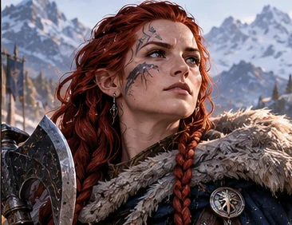

# Ragna Pierre-Sèche

*Étude visuelle provisoire issue d’une planche d’ensemble ; **apparence et détails à valider** avant de parler de portrait officiel.*

> [!info] Statut documentaire
> **Fiche de développement éditorial**, fondée sur le *Compendium des personnages et des relations* v1.7 et les scènes de campagne citées. **Ajouts proposés par le créateur le 28 octobre 2026, en attente de validation finale :** enfance urbaine dans une certaine aristocratie naine, vocation militaire, rôle pionnier d’une femme dans des corps encore très masculins, enquête et exploration au plus haut niveau, reconnaissance par l’état-major et Torgarl, chaleur discrète et affection protectrice. **Aldhammar comme ville d’origine et la branche de petite noblesse Pierre-Sèche sont des choix éditoriaux proposés, pas des renseignements extraits du brut.** La question d’une blessure intime liée au désir d’enfant est **un secret MJ optionnel non fixé**, volontairement absent de cette page publique. Portrait actuel à valider ; les faits joués et les idées de background restent distingués.

*Elle sait écouter une pierre, un témoin ou un compagnon. Et, lorsqu’elle parle enfin, c’est souvent parce qu’elle a déjà compris ce que les autres n’ont pas encore osé demander.*

## En quelques mots

Ragna Pierre-Sèche est l'une des plus remarquables **exploratrices et enquêtrices militaires** des Montagnes de l'Aube — direction de personnage proposée par le créateur. Elle sait **tenir une position sans s'y condamner**, mais aussi interroger un témoin sans lui voler ses mots, repérer une contradiction dans un récit, et revenir d'une reconnaissance avec une information dont le commandement peut réellement se servir.

Son écoute est sa marque. Elle remarque le sol, les écoulements, les fissures et les sorties possibles, mais tout autant une hésitation, une phrase évitée, une peur que quelqu'un dissimule derrière la colère. **Le silence n'est pas une absence de chaleur** : elle se sent aussi chez elle dans une salle pleine de rires que dans une marche au petit matin. Elle n'a pas besoin de parler davantage que les autres pour profiter de leur compagnie.

Son autorité vient de ce qu'elle a gagné sa place par sa compétence et son caractère, dans un milieu militaire où les femmes devaient encore faire leurs preuves plus durement. Elle garde cette dureté acquise **sans devenir dure envers les personnes** qui lui font confiance.

## Identité et état actuel

- **Condition :** vivante ; Revenante de plein droit.
- **Origine proposée :** **[[A42-02|Aldhammar]]**, ancienne capitale des Montagnes de l'Aube ; issue d'une **famille de petite aristocratie naine** attachée au service et à la réputation plutôt qu'au faste. L'origine urbaine et le rang précis restent à confirmer par le créateur.
- **Carrière proposée :** militaire pionnière, spécialiste des reconnaissances, des enquêtes et de l'exploration ; réputation gagnée au sein de l'état-major et estime de **Torgarl le Brave**, sans grade ou décoration inventés.
- **Rôle :** observation des terrains, **enquête de terrain**, reconnaissance, recoupement des témoignages, écoute, tenue et repli, coordination et commandement de phase selon le besoin.
- **Compagnon animal :** **Lok**, corbeau à elle, référencé **REV-17** dans le Compendium ; à ne confondre ni avec Halstor ni avec les corbeaux d'ombre des cérémonies.
- **Équipement :** première cape d'Elyra ; **Pierre d'Écoute** réalisée et testée dans son emploi initial en CB42.
- **Apparence attestée :** équipement sans ornements superflus, silhouette solide et gestes mesurés ; **âge exact, couleur des cheveux, traits du visage et marques éventuelles de blessure non fixés**. La proposition graphique actuelle ne doit pas imposer une chevelure rousse, des tatouages ou une cicatrice comme éléments de canon.

## Avant les Revenants — la jeune fille qui voulait voir au-delà des murs

> [!note] Développement proposé au créateur — non joué
> Les origines urbaines, la petite noblesse, la formation militaire et les enquêtes de jeunesse ci-dessous sont une **nouvelle construction de personnage**, inspirée des orientations données le 28 octobre 2026. Elles ne sont pas des scènes déjà jouées et n'impliquent **aucune réforme officielle de l'armée** ni décoration royale ajoutée rétroactivement. L'objectif est de bâtir une histoire cohérente avant validation, comme pour Bram et Rochebrume.

### Aldhammar — la petite noblesse et les grandes fenêtres

**[[A42-02|Aldhammar]]**, ancienne capitale des Montagnes de l'Aube, serait la ville où Ragna a grandi. On la verrait issue d'une **branche de petite noblesse naine**, les Pierre-Sèche, une famille assez ancienne pour être connue dans les cercles de garnison et les institutions, mais ni immensément puissante ni recluse dans un palais. Le nom familial pourrait évoquer des générations de services administratifs, d'arpentage ou de charges militaires ; **les fonctions exactes des parents, la généalogie et le patrimoine restent à définir**.

Dans une telle famille, on lui aurait enseigné à se tenir lors d'une réception, à écouter les récits des anciens officiers, à connaître les lignées, les usages et la valeur d'une parole donnée. Tout cela lui aurait été utile plus tard. Mais petite, **Ragna préférait les remparts, les cours intérieures, les cartes étalées sur les tables et les expéditions des patrouilleurs aux journées consacrées uniquement aux convenances**.

Son côté « garçon manqué » ne serait pas un rejet des autres femmes. C'est une enfant énergique, curieuse, qui grimpe là où on lui dit de ne pas aller, veut savoir comment une roue de charrette s'est brisée et revient avec les genoux pleins de poussière. On tente parfois de lui apprendre à se faire plus discrète ; elle finit surtout par apprendre **à se rendre discrète lorsqu'elle le choisit**, qualité bien différente. Elle n'a pas besoin de détester les belles tenues ou les bals ; elle refuse seulement que ces activités définissent ce qu'elle a le droit de devenir.

Une scène d'enfance possible : pendant qu'une réception occupe les adultes, elle reste longuement devant une carte de poste, pose trois questions sur un trajet et remarque qu'une route de secours n'y figure plus. L'officier à qui elle s'adresse croit d'abord à un jeu ; il découvre vite qu'elle s'intéresse davantage **aux hommes envoyés sur cette route** qu'à l'élégance de la carte. *Anecdote de couleur proposée, non jouée.*

### Entrer dans l'armée — la place qu'on ne lui donne pas

Ragna choisit l'armée des Montagnes sans renoncer à son nom, mais **refuse que son origine familiale lui ouvre une voie de convenance et lui ferme les unités de terrain**. Le parcours envisagé est celui d'une pionnière dans des corps d'exploration et de commandement traditionnellement très masculins. Certains officiers lui recommandent les bureaux ou les cérémonies ; d'autres doutent de son endurance, contestent ses recommandations ou s'attribuent plus volontiers les conclusions de ses reconnaissances. **Il s'agit d'une tension précise de son parcours proposé, non d'un jugement selon lequel tous les militaires des Montagnes auraient partagé ces préjugés.**

Elle découvre qu'il ne suffit pas d'être bonne. Il faut parfois **être meilleure, plus méthodique et plus patiente**, et apprendre à présenter une objection que le chef ne pourra pas balayer sans exposer tout le monde à un danger. Elle travaille le maniement des armes, les procédures de relais, la marche en montagne, l'orientation, la lecture des cartes et le commandement. Mais sa véritable différence apparaît dans sa façon d'interroger la situation avant d'agir.

Pour la formation, j'imaginerais un exercice où deux patrouilles recherchent un groupe disparu. La première suit les traces les plus spectaculaires. Ragna écoute le palefrenier, compare des horaires et remarque qu'un attelage est parti avec moins de poids qu'à son retour. Elle ne trouve pas les disparus par un tour de magie : elle **reconstitue une suite de décisions**, découvre un détour crédible et organise des recherches là où elles auront le plus de chances d'aboutir. Les hommes reviennent, et le rapport attribue le succès à toute l'équipe. *Souvenir à discuter, pas mission déjà attestée.*

### Enquêtrice et exploratrice — une intelligence qui vérifie

Ragna ne se définit pas simplement comme « celle qui trouve des pistes ». Son champ le plus précieux est **l'enquête en contexte militaire et d'exploration** : rassembler des versions incompatibles, distinguer le témoignage direct de la rumeur, replacer une blessure, une trace ou une cargaison dans un ensemble cohérent, puis proposer plusieurs explications sans présenter son intuition comme une preuve.

Elle sait **laisser parler**. Son calme évite de transformer immédiatement un témoin nerveux en suspect ; son attention permet de remarquer ce que les questions trop insistantes auraient fait disparaître. Elle peut enquêter sur une troupe manquante, un passage effondré, une fausse piste ou une disparition de ravitaillement ; **aucune affaire précise n'est fixée comme événement historique tant que le créateur ne l'a pas retenue**.

Lorsqu'elle part explorer une région inconnue, elle pratique une observation patiente : qualité des appuis, température, bruit de l'eau derrière la roche, répétition étrange d'un écho, traces d'un passage interrompu. Elle compare ses notes avec les spécialistes, et surtout **sait dire quand les données ne suffisent pas**. Cette méthode explique la confiance que les futurs Revenants placent en elle lors des enquêtes du Mérien et des travaux du Nord.

### La confiance de l'état-major et de Torgarl

Avec les années, ses résultats et ses rapports imposent le respect à des supérieurs qui ne l'auraient pas tous prise au sérieux lorsqu'elle a demandé une place dans les corps actifs. **Elle devient l'une des références de son domaine**, au point que l'état-major la recherche pour les missions où l'on préfère une vérité dérangeante à un compte rendu rassurant.

**Torgarl le Brave** reconnaîtrait précisément cette qualité : elle n'est ni une curiosité féminine décorative ni une héroïne à montrer aux troupes, mais une professionnelle qu'il est sage d'écouter. Là où certains réclament un exploit éclatant, elle apporte la carte d'un risque évité, les noms des soldats revenus et la raison vérifiable d'un ordre contesté. Le respect du vieux roi serait fondé sur **ses aptitudes, son caractère et sa capacité à protéger la décision collective**.

> [!tip] Scène de réputation proposée — non jouée
> Un officier lit un rapport d'exploration et souligne qu'il ne contient « aucune conclusion définitive ». Torgarl demande alors si les routes empruntées sont sûres.
>
> « Nous n'en savons pas assez pour l'affirmer », répond Ragna.
>
> Le vieux roi laisse passer un silence : « Voilà enfin une réponse sur laquelle on peut fonder un ordre. »

Aucun grade, titre, législation ou date de promotion n'est attribué. Ragna peut avoir fait progresser la place des femmes dans son domaine **par son exemple et par les carrières qu'elle a rendues possibles**, sans prétendre qu'elle a, à elle seule, transformé toute l'armée des Montagnes.

## Histoire et évolution

### La Compagnie du Mérien

Ragna commence comme une personne capable de protéger le pourtour pendant que d'autres approchent un phénomène dangereux. Ce rôle de garde n'est pas un manque d'ambition : il exige de comprendre quand la situation a changé sans attendre qu'un héros donne l'alerte. Elle est présente dans les premières enquêtes, où les relevés de terrain comptent autant que les pouvoirs. (*Compendium REV-02 ; CB2.*)

### L'enquête plutôt que la simple reconnaissance

Les campagnes montrent déjà une Ragna attentive à ce que le terrain raconte. Dans l'arc du **Mérien**, elle veille sur les abords et sécurise des observations que les chercheurs ne pourraient pas mener sans cette couverture. Lors des expéditions dans le **Nord**, elle suit les fractures, les écoulements et les limites de progression ; elle prend le temps de confronter ce qu'elle voit à ce que les autres mesurent.

Ce regard s'éclaire avec le nouveau passé proposé : Ragna **pose les questions qui empêchent d'enfermer trop vite une enquête dans une seule hypothèse**. Elle ne remplace ni la géologie de Dagrin et Elda, ni les dossiers de Névane, ni les réseaux de Vaëra, ni les analyses des anciens raccords par Heimdall. Elle leur apporte une compétence distincte : **mettre en relation les observations, les paroles et les conséquences pratiques pour les personnes qui doivent agir**.

À Taagral, cette méthode soutient son autorité de phase. Une bonne décision n'est pas une démonstration de supériorité : c'est celle que l'équipe peut comprendre, corriger et, si nécessaire, transmettre à quelqu'un d'autre.

### Du contrôle du sol à la maîtrise du retrait

Au Nord, Ragna regarde le terrain, les fractures, l'eau et les limites de progression. Elle ne remplace pas les spécialistes de géologie **Dagrin** ou **Elda** : son autorité porte sur la traduction de ces risques en décisions utilisables par les compagnons. Un lieu que l'on peut défendre n'est pas forcément un lieu d'où les blessés peuvent sortir. Cette distinction devient essentielle dans les exercices qui préparent la compagnie à agir sans Orin.

### Taagral — commander puis transmettre

À Taagral, le transfert de commandement **à Ragna puis depuis Ragna** est une réussite de fonctionnement, non une anomalie que les autres tolèrent. Le groupe accepte que la compétence du moment détermine qui décide. Haldrek structure les procédures ; Bram, Kelm, Torven, Vaëra et les autres remplissent leurs propres tâches. Elle ne transforme pas cette responsabilité en grade permanent imaginaire. (*Continuité v1.7, échanges 012–119.*)

### Pierre d'Écoute — écouter sous ses pieds

La **Pierre d'Écoute** produite en CB42 rend perceptibles **certaines vibrations propagées par le terrain**. Elle n'offre pas une écoute générale à travers tous les matériaux et ne lit pas les pensées. Elle prolonge un talent déjà présent : faire de l'observation une prudence partagée. Dans la discussion sur la transmission aux futurs apprentis, Ragna privilégie l'écoute, la coordination et l'adaptation ; les apprentis ne sont pas encore recrutés. (*CB42 P18752–19902.*)

### Le rire en compagnie

Ragna n'est pas condamnée à la gravité. Elle sait répondre à Bram, parfois avec une seule phrase, et interrompre avec affection les débats de terminologie d'Eamon. Les discussions d'Aldhammar après CB42 montrent cette camaraderie au milieu de personnages aux tempéraments éclatants. (*Campagne Brut 4.3, ouverture.*)

## Derrière le silence — chaleur, humour et loyauté

### Être bien avec les autres sans parler pour occuper la place

Ragna aime les **moments de silence** : marcher côte à côte, écouter un feu après la pluie, rester un instant au bord d'une fenêtre lorsque la montagne change de couleur. Elle y trouve du repos, pas une façon de tenir le monde à distance.

Elle aime aussi les **fêtes, les grandes tablées et les conversations où plusieurs voix s'entrecroisent**. On peut la voir assise près de Bram, attentive aux plaisanteries d'Eamon, sourire dans sa tasse ou rire sans ajouter un mot au vacarme. **Elle n'est pas solitaire par définition et son calme n'est pas de la tristesse.** Dans sa compagnie, chacun est libre d'être bruyant ; elle est libre d'en savourer la joie autrement.

La campagne en donne de bons exemples. À Aldhammar, elle reprend Bram lorsqu'il dramatise les intrigues du *Conseil des Tartelettes* ; lorsque Eamon veut ouvrir un débat de terminologie en fin de soirée, une phrase lui suffit pour le ramener à l'essentiel. Elle sait se moquer avec affection des habitudes de ses amis, **sans faire de l'humiliation un spectacle**. (*CB43, premières scènes à Aldhammar.*)

### Une force protectrice, parfois presque maternelle

Ragna est capable d'une attention très concrète : elle remarque la fatigue de celui qui dit aller bien, ralentit une marche avant qu'une personne tombe, ou se souvient qu'un jeune éclaireur a été effrayé lors de sa première nuit loin de la garnison. **Son côté maternel possible vient d'abord de la qualité de son regard et de son sens des responsabilités**, pas d'une explication biologique imposée.

Elle n'étouffe pas ceux qu'elle protège. Elle les aide à acquérir leurs propres repères. Lors des discussions autour des futurs apprentis, Ragna défend justement une formation où l'on n'oblige personne à remplacer son maître ou à devenir Revenant. Cette conviction est **jouée en CB42** ; le programme complet et les premières inscriptions restent à venir.

### Une fidélité qui laisse l'autre libre

Sa loyauté envers les Revenants est immense. Ragna pourrait être celle qui n'a pas besoin de répéter « je serai là », parce qu'on l'a vue **rester lorsque c'était utile, partir lorsque cela sauvait quelqu'un, puis revenir**. Ce sens du lien n'annule ni sa carrière personnelle, ni son droit de se reposer, ni son autonomie.

Son humour pince-sans-rire se nourrit de cette familiarité. Elle peut écouter Bram grogner trois minutes, lever un sourcil, puis lui rappeler exactement la même règle qu'il avait donnée la veille. C'est une femme de caractère **qui sait aussi être douce** — et dont la douceur ne diminue en rien l'autorité.

## Caractère et interprétation

**Peu de mots, mais beaucoup de présence.** Elle peut sourire, hausser un sourcil, poser une question précise ou rire franchement au milieu d'une soirée bruyante. Elle écoute sans chercher à être mystérieuse ni à mettre les autres mal à l'aise. Ses silences sont des moments habités.

**Prudente sans immobilisme.** Elle sait qu'il existe un moment où tenir coûte plus de vies que partir ; la tension entre persévérance et retrait est un ressort dramatique, pas une décision toujours facile.

**Autorité sans possessivité.** Quand la situation change, elle peut donner ou rendre la conduite du groupe. Elle doit conserver son esprit d'enquête et son regard critique même lorsque ses supérieurs — ou Orin — pensent déjà avoir compris.

**Chaleureuse sans démonstration obligatoire.** Elle peut aimer quelqu'un sans le dire à chaque rencontre, reconnaître l'effort d'une recrue maladroite et savourer les fêtes sans mener la conversation.

**Une pionnière, mais pas un symbole ambulant.** Sa carrière militaire et la place qu'elle a gagnée comme femme comptent profondément ; elles ne doivent pas être son unique sujet. Elle a des amitiés, des envies ordinaires, des faiblesses et des plaisirs personnels.

## Relations

- **[[GRP-01|Les Revenants]] :** groupe et foyer choisis ; elle n'en est pas une subordonnée perpétuellement silencieuse.
- **Orin :** le respecte, l'écoute, lui oppose une objection nécessaire et voit en lui un ami capable d'entendre la vérité. Orin reconnaît explicitement en CB42 qu'il voudrait transmettre à d'autres **l'écoute, l'observation et la coordination** que Ragna maîtrise, sans fabriquer une seconde Ragna.
- **[[REV-01|Bram]] :** amitié ancienne dans la compagnie, humour croisé, confiance de terrain et complémentarité entre protection et lecture du risque. **Proposition intime encore ouverte :** Bram pourrait être l'unique confident d'une blessure personnelle ; cet éventuel secret n'est pas détaillé sur cette page publique ni traité comme fait joué.
- **Kelm :** elle surveille les appuis et la juste mesure d'une force immense ; ils apprennent à anticiper les signes de l'autre.
- **Vaëra :** lecture des déplacements, observation et humour partagé, y compris à Aldhammar.
- **[[REV-07|Haldrek]] :** commandement réparti, procédure, retour d'expérience ; leurs exigences militaires peuvent se compléter sans jamais obliger Ragna à effacer l'autorité qu'elle a gagnée.
- **Torgarl le Brave :** dans le **passé proposé**, ancien souverain ayant reconnu ses compétences de pionnière, d'enquêtrice et d'exploratrice ; dans la campagne jouée, Revenant d'honneur reçu à Aldhammar par ses compagnons.
- **[[A42-02|Aldhammar]] et la famille Pierre-Sèche :** origine urbaine et petite aristocratie naine proposées ; liens familiaux personnels à écrire.
- **L'état-major des Montagnes :** reconnaissance progressive de sa compétence dans le passé proposé ; nominations, promotions et fonctions institutionnelles précises non déterminées.
- **Lok (REV-17) :** compagnon corbeau distinct de Halstor ; capacités particulières non présumées.
- **Névane :** collaboration autour de mesures et cartes ; l'écoute humaine ne remplace pas le relevé rigoureux.

## Ressources et limites

La Pierre d'Écoute ne crée pas une cartographie absolue du sous-sol. Les appareils de mesure, les relevés de géologues et les procédures de terrain demeurent nécessaires. L'observation d'un risque n'implique pas qu'elle puisse seule le résoudre.

## Projets ouverts, non joués

- **Valider** Aldhammar comme ville natale et préciser le statut de la **petite noblesse Pierre-Sèche**, sans inventer de famille ou de titres qui contredisent l'Atlas.
- Préciser son parcours militaire pionnier : promotions, unité, opérations, enquêtes marquantes et manière dont **Torgarl et l'état-major** ont reconnu ses aptitudes.
- Décider de l'existence et du traitement d'un **secret intime lié à une ancienne blessure**, selon l'option que le créateur envisage. **Aucun diagnostic, indiscrétion ou guérison n'est établi sur le site public.**
- Choisir si **Bram est effectivement son seul confident** — sans faire de lui un détenteur automatique de son histoire.
- Sélection d'une première cohorte et formation en binôme ou par spécialités croisées.
- Développer ses liens personnels et ses plaisirs ordinaires au-delà de la décision tactique.
- Décider avec les autres des circonstances qui justifient d'abandonner un poste important.

## Sources principales

- *Compendium des personnages*, v1.7, **REV-02** et **REV-17 — Lok**.
- *Campagne Brut 3.9*, **CB39 P01405–01993** (Lok et événements festifs).
- *Campagne Brut 4.2*, **CB42 P18752–19902** (Pierre d'Écoute, transmission).
- *Continuité*, v1.7, **Taagral**, échanges 012–119 (commandement réparti).
- *Campagne Brut 4.3*, début (scènes de repas à Aldhammar).
- **Orientations proposées par le créateur le 28 octobre 2026 :** excellente enquêtrice et exploratrice militaire, écoute exceptionnelle, passé urbain et aristocratie naine possible, parcours de pionnière respectée par l'état-major et Torgarl, chaleur et humour pince-sans-rire, blessure intime et confidentialité **à décider**. Les scènes de jeunesse et dialogues de formation présents ici sont des **reconstitutions proposées et non jouées**.

## Feuillets liés

[[GRP-01|Les Revenants]] · [[REV-01|Bram]] · [[REV-03|Kelm]] · [[REV-04|Vaëra]] · [[REV-07|Haldrek]] · [[A42-02|Aldhammar]]