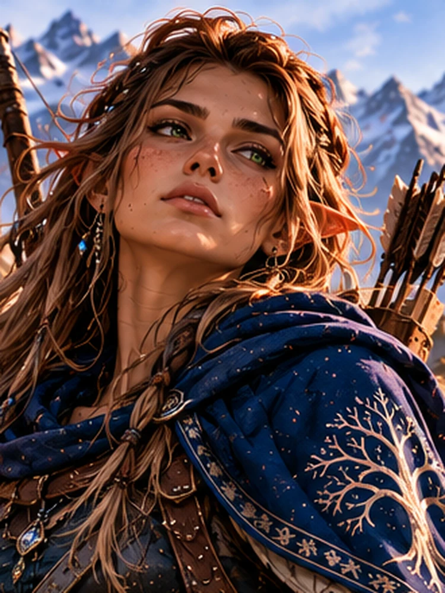
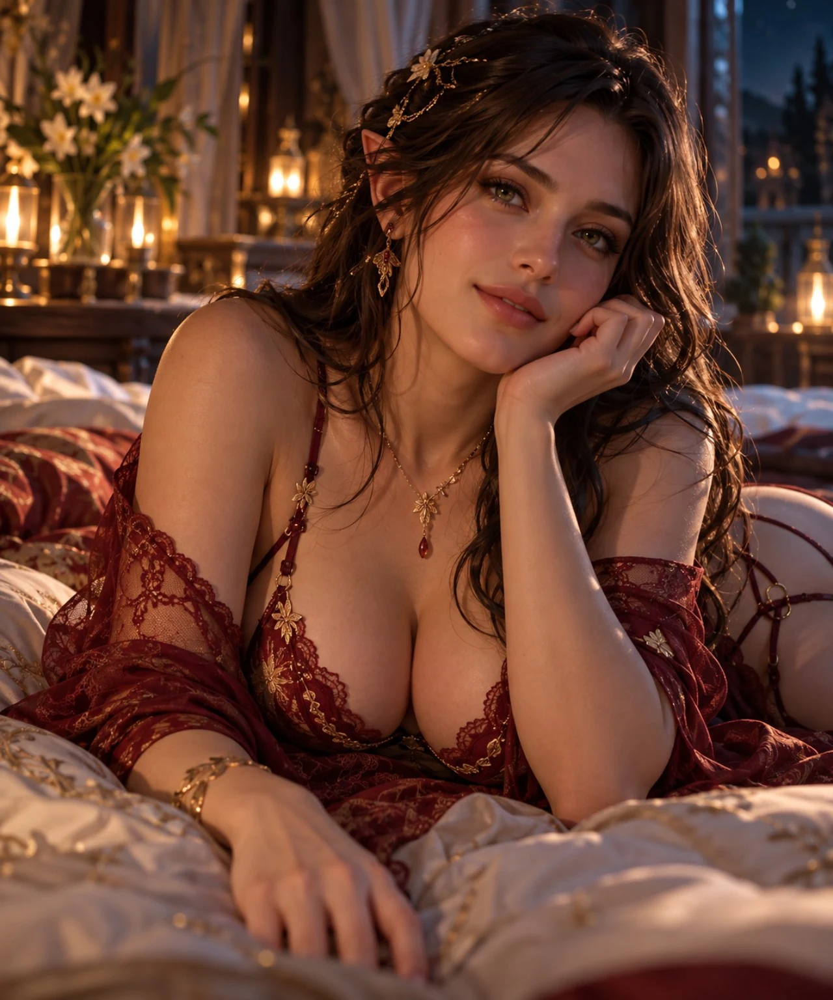
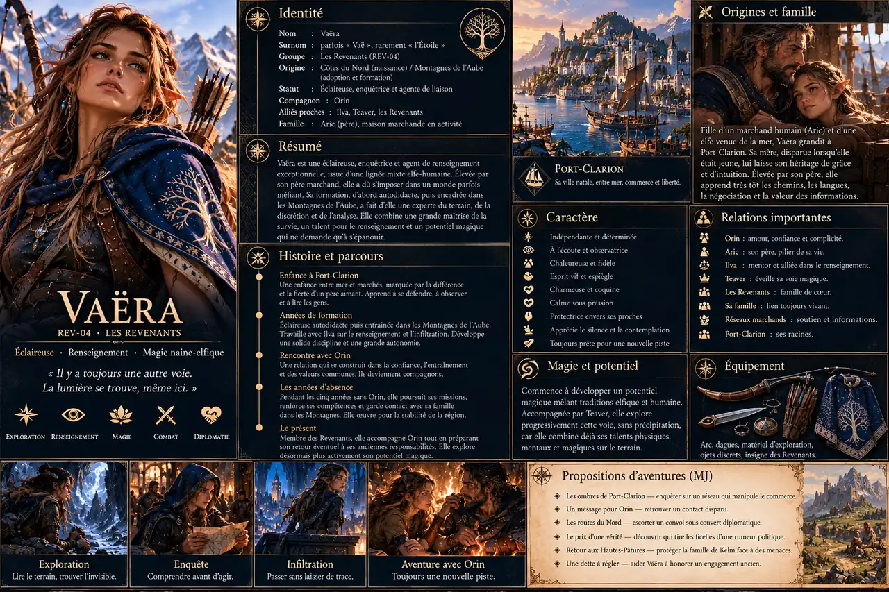

# Vaëra

## Mise à jour de continuité — CB42

> **État établi dans le registre :** ; Vaëra reste conjointe d’Orin et membre de la compagnie. Elle partage le Palais sans perdre sa vie propre, accompagne Vardhena puis les visites agricoles et les discussions botaniques. Son nouveau matériel comprend un insigne et un étui pour son couteau existant, avec chouette discrète ; Tevaer ne reçoit aucun lien forcé. La présence au Palais n’en fait ni gouvernante ni déesse automatiquement.
>
> **Repère de source :** CB42 P08333–21050.

*Illustration d'exploration **approuvée par le créateur**. Elle représente la facette éclaireuse de Vaëra. L'arc et le carquois illustrés peuvent exister dans certaines missions, mais **ne constituent pas son armement emblématique** : celui-ci repose avant tout sur les **dagues, les lames courtes et la lame d'ombre extensible à allonge variable**, dont les fonctions acquises restent à vérifier.*

> [!info] Statut documentaire
> **Fiche et illustrations approuvées par le créateur en octobre 2026**, à partir des scènes jouées dans CB2, CB31–34, CB37–43 et du *Compendium* v1.7. **Le nouveau lore familial** retient une enfance auprès d'un **père humain marchand**, tandis que **sa mère elfe n'a pas participé à son éducation** ; les raisons de l'absence maternelle, la généalogie et la ville d'origine restent à développer. **Mise à jour visuelle validée :** cheveux châtains aux reflets chauds, yeux verts, teint légèrement halé, traits elfiques et corps athlétique ; cette direction artistique **remplace la mention « cheveux noirs » du Compendium CB43**. La mention antérieure d'ascendance **elfique et narim** demeure à éclaircir, sans inventer une équivalence ethnique. Les épisodes d'enfance reconstitués et les scénarios proposés ne sont **pas des scènes déjà jouées**. L'affiche approuvée graphiquement est distinguée des faits de lore qu'elle ne prouve pas.

*Elle peut traverser une salle sans qu'on la remarque, puis dire une seule phrase qui change toute la conversation.*

## En quelques mots

**Vaëra** est une Revenante de plein droit, éclaireuse et agente de renseignement d'une rare finesse, dont le talent consiste à comprendre **les routes, les visages, les habitudes et ce que les personnes préfèrent taire**. Sa vie est devenue bien plus vaste que les chemins clandestins de sa jeunesse : formation au renseignement avec Ylva, maîtrise de l'étiquette, conduite d'opérations discrètes, progression magique avec Tevaer et une relation amoureuse construite avec Orin.

Elle est **espiègle, charmeuse, indépendante, parfois provocatrice et infiniment douce lorsqu'elle le choisit**. Son élégance naturelle n'a jamais effacé la discipline d'un corps entraîné pour les longues marches, l'escalade, les mouvements silencieux et le combat rapproché. Ceux qui prennent sa beauté ou sa tendresse pour de la faiblesse commettent une erreur potentiellement fatale.

Ses liens avec Orin lui ouvrent parfois des portes politiques et diplomatiques, mais ils **ne font pas d'elle une princesse officielle, une reine ni une déesse**. Elle entretient ses propres relations, possède ses obligations et peut diriger une mission sans qu'Orin ait à décider pour elle.

## Identité, apparence et statut

- **Origines familiales dans le lore approuvé :** père **humain et marchand**, mère **elfe** dont les motifs d'absence pendant l'enfance restent inconnus. Le Compendium antérieur la décrit comme d'héritage **elfique et narim** : le lien exact de ces termes avec sa filiation demande encore une étude sans correction silencieuse.
- **Apparence physique validée (révision visuelle) :** petite silhouette discrète et athlétique, **cheveux châtains foncés aux reflets chauds pouvant paraître dorés sous la lumière**, **yeux verts**, peau légèrement halée, traits elfiques fins, grâce naturelle et **musculature sculptée par l'entraînement**. Cette version reprend la nouvelle direction donnée par le créateur et **supplante la mention « cheveux noirs »** de CB43 dans les futurs portraits.
- **Niveau martial :** éclaireuse de très haut niveau, redoutable au contact comme dans les approches discrètes ; **aucun score chiffré ni invincibilité automatique**.
- **Armes de prédilection :** **dagues et lames courtes**, avec un projet de **lame d'ombre extensible à portée/allonge variable**, selon ses fonctions effectivement établies. Un arc peut faire partie d'une mission, mais **n'est pas son arme emblématique**.
- **Portrait intime fourni par le créateur :** une référence complémentaire montrant Vaëra hors mission, dans un cadre chaleureux et privé ; ce visage n'oblige pas à lui attribuer la tenue représentée comme vêtement habituel.
- **Appartenances :** membre du noyau des [[GRP-01|Revenants]], compagne d'Orin ; également accueillie dans sa Maison. Aucune attribution automatique de statut de déesse ou de titre souverain.
- **Compagnon animal :** **Tevaer**, chouette (REV-15), libre de suivre ses propres mouvements. Ne pas la confondre avec Lok, corbeau de Ragna.
- **Equipements :** lame personnelle et étui adaptés, insigne discret à motif de chouette ; châle adaptatif et vêtements d'Elyra, réalisés et portés selon les scènes.

## Avant les Revenants — l'enfance entre deux mondes

> [!info] Lore familial validé — récits de jeunesse illustratifs
> Le créateur retient **un père humain marchand qui a élevé Vaëra** et **une mère elfe absente de son éducation**, sans encore préciser pourquoi. Cette trame familiale est **un nouvel ajout approuvé**, et non une scène de jeunesse précédemment jouée dans CB2. Les anciennes mentions **« elfique et narim »** restent documentées ; la raison exacte de l'absence maternelle, l'origine du nom Vaëra, son port ou sa ville de naissance, le nom du père et son statut juridique **restent ouverts**. Les anecdotes proposées ci-dessous sont des **reconstitutions non jouées**, et ne prouvent pas que la mère serait partie volontairement.

### Une enfant de marchand, élevée par son père

Vaëra a grandi auprès de **son père marchand humain** ; on imagine leur quotidien entre les ballots, les pesées, les itinéraires inscrits sur des cartes fatiguées et les discussions entre marchands, dans **une ville ou un carrefour commercial encore à choisir**. Son père n'a pas besoin d'être prince ou chef de guilde : il peut être un homme de métier qui sait qu'un bon prix n'efface pas une promesse et qu'il vaut mieux rentrer pauvre que ne pas rentrer. Ces détails de scènes sont **des propositions de couleur non jouées**.

La mère de Vaëra, **elfe**, **n'a pas participé à son éducation**, mais **pourquoi** demeure inconnu. Pour éviter un cliché, nous gardons son histoire ouverte : séparation volontaire, pressions de sa famille, route dont elle n'a pu revenir, circonstances politiques ou décision dont seule Vaëra connaît peut-être une partie. Aucune de ces explications ne doit être imposée avant d'être choisie en jeu. La tendresse du père, elle, peut être pleine et entière : **il ne faut pas qu'une enfance difficile signifie automatiquement une enfance malheureuse**.

On peut imaginer qu'il l'emmène parfois avec lui chez les fournisseurs, lui apprenne à regarder les mains pendant une négociation, à lire un manifeste de chargement, à distinguer un marchand sincère d'un flatteur, et à reconnaître les accents des routes. La jeune fille comprend tôt que **l'information possède un prix**, mais aussi que certaines informations ne devraient pas être à vendre.

### Le poids des préjugés, et les petits bonheurs malgré tout

Dans certains lieux traversés par les caravanes, les enfants d'ascendance mêlée peuvent subir **moqueries, refus de compagnonnage, soupçons sur leur loyauté ou remarques malvenues sur leur appartenance**. Cela varie selon les communautés : Vaëra n'a pas grandi dans un monde unanimement hostile, et il serait faux de décréter que toute société naine, humaine ou elfique rejette les unions mixtes.

Les difficultés pourraient être très concrètes : un interlocuteur refuse de traiter directement avec elle malgré ses compétences ; une personne demande de « choisir » entre ses deux héritages ; un guetteur s'imagine qu'une fille demi-elfe apportera forcément des secrets de son autre famille. Elle apprend à **répondre par le regard, l'ironie ou le silence**, sans devoir toujours transformer son identité en débat public.

Il y eut aussi du beau : un marchand qui lui apprend une chanson de route, une artisane qui la défend sans en faire une héroïne, un ancien caravanier qui lui montre un raccourci, des amis qui la voient avant tout comme **Vaëra**, et le père qui fait mine de ne pas remarquer qu'elle a réussi sa première négociation mieux que lui. Ces souvenirs donnent une profondeur au personnage sans inventer un passé de persécution permanente.

### Le début d'un talent qui inquiète les gens trop sûrs d'eux

À l'adolescence puis dans sa jeunesse, Vaëra aurait développé un goût pour **les déplacements rapides, les passages détournés, les informations prises dans les gestes plutôt que les aveux**, et une capacité à se faire oublier lorsque cela l'arrange. La force de sa personnalité ne la rend pas nécessairement bruyante : son charme peut détourner l'attention pendant que son regard repère une serrure, un plan de sortie ou l'échange de deux billets.

Ses premiers contacts avec les **routes clandestines, les fausses identités et les intermédiaires** sont, eux, bien présents dans sa biographie documentée. Les circonstances exactes où elle passe du commerce au renseignement doivent encore être reconstruites. **Elle n'a pas besoin d'avoir été criminelle dès l'enfance**. Des pratiques discutables ont pu apparaître dans le monde des caravanes et des frontières ; son itinéraire moral reste un des meilleurs fils à développer.

### Une histoire qui ne finit pas quand elle quitte son père

Le père humain marchand peut demeurer **vivant et actif**, tant que le créateur n'a pas décidé autrement ; sa **situation actuelle reste une hypothèse non jouée**. Il peut être fier de sa fille, désapprouver certaines missions dangereuses, garder son vieux registre de commerce ou continuer à lui écrire sans lui demander de rapport sur Orin.

**L'histoire de sa mère est réservée à un développement ultérieur**, conformément au souhait du créateur. Sa disparition de l'éducation de Vaëra ne doit pas être automatiquement qualifiée d'abandon volontaire, et aucune explication, identité ou destinée ne doit être arrêtée maintenant. Une rencontre, une lettre ou le choix assumé de **ne pas chercher** restent des possibilités à discuter plus tard. Vaëra peut être heureuse aujourd'hui tout en gardant des interrogations sur ses origines.

## Des routes clandestines aux portes des palais

### La rencontre avec Orin — la confiance avant les titres

Le créateur souhaite donner davantage de place aux **entraînements et aux premières semaines précédant le départ pour le Mérien**, lorsque Vaëra et Orin se découvrent d'abord **dans les gestes de terrain, la contradiction, la curiosité et une confiance qui se mérite**. Le matériau regroupé montre la sélection des compagnons, leur évaluation avec Haldrek et le désir de ne pas choisir uniquement les meilleurs combattants, mais des gens aptes à protéger les autres et à former les suivants. Il est aussi établi que Vaëra était déjà envisagée pour les opérations nocturnes et devait apprendre à mieux travailler avec l'équipe. (*CB2, préparation et sélection avant Mérien.*)

Une petite scène de formation peut éclairer leur rapport, **sans être présentée comme un dialogue déjà joué**. Orin organise un exercice d'infiltration et attend une victoire spectaculaire ; Vaëra observe silencieusement les habitudes des sentinelles et choisit de ne pas prendre le trophée lorsqu'elle comprend qu'une recrue risque d'être blessée. À la fin, le prince veut connaître sa méthode. Elle lui répond, très sérieusement, qu'il a rendu son exercice presque impossible — en laissant trop d'indices à ceux qui savaient regarder. Il rit ; elle décide qu'il peut peut-être supporter qu'on lui dise la vérité.

L'intérêt de cette reconstruction n'est pas de créer une romance prédestinée. **Ils deviennent d'abord des compagnons capables de s'estimer**, puis découvrent qu'ils peuvent aussi se provoquer, rire ensemble et laisser l'autre libre.

### Le Mérien et les réseaux

Vaëra connaît les itinéraires discrets, les faux documents et des personnes qui n'apparaissent pas dans les registres officiels. Son expérience ne transforme pas automatiquement ses informations en vérité absolue. Elle choisit ce qu'elle raconte et à qui elle accorde sa confiance. Les débats concernant les **sang-mêlés** donnent à sa trajectoire une dimension politique qui n'est pas séparable de son histoire personnelle. (*Compendium REV-04 ; CB2.*)

### De la confiance au couple

Dans le voyage du Mérien, les conversations sur les peuples de filiation mêlée, la dignité et les choix individuels rapprochent Vaëra d'Orin. Elle comprend que ses projets d'accueil ne cherchent pas simplement à mettre quelques personnes « différentes » en vitrine, mais à créer des communautés où elles n'auront pas à renier une part d'elles-mêmes. Ce sujet touche directement à son histoire, même si sa généalogie nouvelle reste encore à fixer.

Les scènes jouées construisent leur relation sur **une attraction mutuelle, l'esprit de jeu, le respect et un consentement attentif**. Un duel de couteaux d'entraînement devient un échange de défis, de rires, d'étreintes puis de tendresse ; chacun peut ralentir ou changer de rythme. Ce couple ne naît pas d'une récompense accordée par le prince à une aventurière : **Vaëra choisit d'y entrer, comme elle choisit de le poursuivre**. (*CB2, séquences de rapprochement sur la route et à l'étape.*)

Après l'ellipse de cinq années, ce choix prend une autre dimension. Orin n'est pas toujours là ; Vaëra continue d'exister. Quand il revient, ils ont besoin de **temps pour se retrouver sans transformer chaque soirée en séance de travail**. Les scènes des CB42–43 montrent un quotidien partagé, des plaisanteries, de la magie, des visites et des instants privés ; elles n'établissent ni mariage officiel ni élévation dynastique.

### Une Revenante, pas une simple accompagnatrice

La composition du noyau est explicitement rappelée durant les exercices : **Vaëra participe comme membre de la défense**, avec Bram, Kelm, Ragna, Torven, Haldrek, Heimdall et Eamon. Sa relation avec Orin n'efface aucun de ses propres droits ni devoirs librement acceptés. Elle possède le droit d'agir sans lui, de refuser une méthode ou de suivre des intérêts distincts des projets du prince. (*Campagne regroupée, CB33–34.*)

### Ylva, la Couronne et cinq années d'une vie qui continue

Orin propose explicitement à Vaëra de travailler avec **Ylva**, son arrière-grand-mère, dont il admire les réseaux, la patience, la connaissance des mensonges et des rapports de pouvoir. Vaëra répond avec enthousiasme, consciente qu'elle a autant à apprendre **des usages politiques de la Couronne** qu'à transmettre **du terrain et des réseaux qui ne ressemblent pas à ceux des Montagnes**. L'enseignement doit circuler dans les deux sens. (*CB2 P11101–11200.*)

**Pendant les cinq années où Orin participe auprès d'Yggdrasil**, Vaëra ne se contente pas de l'attendre. Elle reste proche de la famille des Montagnes, s'aguerrit aux usages de cour, travaille ses rapports et ses contacts, et développe ses compétences de renseignement avec l'influence d'Ylva, **tant dans la compréhension des risques intérieurs que dans l'observation des menaces extérieures**. C'est une **précision nouvelle apportée par le créateur**, compatible avec le *Compendium* et les scènes d'autonomie des Revenants. **Le nom d'un service, ses effectifs, ses bureaux, le titre de Vaëra et la liste des opérations exactes ne sont pas encore établis.**

Elle apprend à **tenir une conversation de cour sans livrer l'information qui ne lui appartient pas**, à protéger une source, à lire les conséquences d'une rumeur et à distinguer une critique légitime d'une menace réelle. Cette collaboration ne l'autorise pas à surveiller arbitrairement les habitants du royaume. La doctrine rappelée durant les conseils distingue **collecte de renseignement et action clandestine**, **opposition et trahison**, **soupçon et preuve**. (*CB32, doctrine du renseignement intérieur et extérieur.*)

À Valbrume, elle intervient auprès de contacts discrets et dans une enquête qui contribue à la chute du régime de Duchaine, puis poursuit des opérations dont l'ampleur demeure liée aux faits vérifiés. Lors des rencontres diplomatiques plus récentes, elle accueille des délégations avec Orin, maîtrise les codes nécessaires et montre que son passé de terrain lui donne une lecture particulièrement juste des jeux sociaux. (*Compendium REV-04, CB37–39, CB42–43.*)

### Une femme aux deux fidélités — sans division obligatoire

Vaëra aime Orin, mais **n'appartient pas au palais**. Son rôle parmi les Revenants reste formel, sa collaboration avec Ylva est une activité propre et le travail de renseignement n'est pas automatiquement une mission de la Maison divine. Si la Couronne, les Revenants et Orin lui demandent des choses incompatibles, **elle doit pouvoir exposer ce conflit, refuser une méthode, préserver une source ou choisir de se retirer**.

Aujourd'hui, le couple privilégie surtout le plaisir de se retrouver après cinq ans de séparation. Ce n'est pas une retraite éternelle : Vaëra pourra **reprendre de grandes responsabilités lorsqu'elle en aura le désir ou la nécessité**, mais la campagne ne lui en impose pas encore une nouvelle. Le personnage gagne en profondeur lorsqu'on l'autorise à avoir des ambitions **et** des moments sans obligation.

### Taagral — voir sans s'arroger le commandement

Dans la crise du Nord, Vaëra occupe une place propre aux côtés de Haldrek, Ragna, Eamon, Torven, Heimdall et des responsables militaires. Le groupe partage renseignements, protection et décisions opérationnelles. Son observation des déplacements peut être déterminante, mais la conduite générale de l'opération relève de **Dac**, avec la responsabilité des autorités locales. (*Continuité, Taagral, échanges 012–119.*)

### Palais, ateliers et moments ordinaires (CB42–CB43)

Vaëra partage le **Palais divin** avec Orin sans devenir son intendante, sa gouvernante ou une déesse par simple cohabitation. Elle accompagne des visites agricoles, discute avec **Vardhena** et s'intéresse aux plantes. Elyra lui fournit une cape adaptée, puis un **châle modulable** ; elle reçoit également une **broche de chouette**, distincte de son insigne de combat et de Tevaer elle-même. En CB43, elle prend part à des échanges éducatifs, au dîner chez **Alice** et à la visite de caves avec les artisans. La relation de couple demeure privée dans ses détails. (*Compendium REV-04, mises à jour CB42–43.*)

## Tevaer et la magie — une éclaireuse qui change d'échelle

### Tevaer, la chouette d'ombre, pas un outil

**Tevaer (REV-15)** est une petite chouette fortement liée aux ombres et aux ténèbres. Elle vole, observe, hésite, choisit et **peut refuser** d'aller voir ce qui l'inquiète. Vaëra respecte ses décisions. Lors d'une reconnaissance au Nord, la chouette refuse d'abord d'approcher un endroit inquiétant ; lorsque l'ouverture devient visible, elle effectue un survol prudent, révèle la présence d'une paroi artificielle puis revient d'elle-même devant un mouvement suspect. (*CB31, reconnaissance du Nord P06401–06700.*)

Leur rapport peut aider Vaëra à **percevoir ou organiser certaines observations**, mais Tevaer n'est ni une caméra infinie, ni une batterie de mana, ni une conscience enfermée dans la future lame d'ombre. L'animal conserve ses peurs, ses désirs et sa liberté.

### Quatre Cercles stabilisés — un vrai seuil franchi

L'apprentissage magique de Vaëra n'est plus seulement un projet. Dans les entraînements où Orin accompagne aussi Elyra, **Vaëra finit par stabiliser quatre Cercles**, après avoir appris à simplifier certaines relations au lieu d'ajouter de la puissance. Orin considère explicitement qu'elle a franchi une étape permettant de la regarder comme une **mage**, et non seulement comme une espionne qui possède quelques capacités magiques. (*CB34, « Vaëra franchit la marche », P correspondant à la dernière phase d'entraînement.*)

Orin a envisagé qu'elle pourrait peut-être atteindre **six ou sept Cercles** en raison de son potentiel, mais **c'était une estimation**, pas une réussite démontrée. Pour les parties, retenir : **quatre Cercles effectivement stabilisés ; niveau supérieur à confirmer par des scènes ultérieures**. Cette différence est importante pour ne pas attribuer prématurément des pouvoirs non acquis.

Son style magique a ses propres formes : **angles, perception, retours, déplacements d'attention et économie de gestes**. Elle n'a pas à copier les architectures d'Orin. Avec une magie plus fine, une élève autrefois spécialiste de l'approche physique peut désormais produire un **effet de diversion, un contrôle ponctuel de perception ou une meilleure lecture de l'espace**, à la mesure des fonctions réellement testées ; le MJ ne doit pas transformer ces idées en invisibilité permanente, téléportation arbitraire ou omniscience.

### Une adversaire extrêmement dangereuse

Avant de chercher un affrontement, Vaëra a déjà souvent décidé **où il aurait lieu, quels angles seraient ouverts, qui aurait remarqué quoi et quand elle aurait intérêt à ne pas tirer sa lame**. Son entraînement des Revenants, sa pratique des armes courtes, ses réflexes et son sens des couvertures en font une combattante de niveau élevé, même sans ajouter sa magie.

Elle peut être charmante, plaisanter, embrasser Orin, puis redevenir en un instant une spécialiste particulièrement difficile à surprendre. **Un groupe ordinaire d'aventuriers qui décide de l'attaquer directement sous-estime gravement le danger**. Le combat contre elle ne doit pas être traité comme un duel équilibré par défaut. Cela ne veut pas dire qu'elle est invincible ou que toute agression provoque automatiquement la mort : elle est assez expérimentée pour **désarmer, esquiver, laisser fuir ou retenir ses coups selon la situation**.

Le lien amoureux avec Orin ne signifie pas non plus qu'il surgit automatiquement pour venger une insulte ou régler chaque querelle. Vaëra possède **son propre jugement, son réseau et ses propres moyens de protection**.

## Hors mission — un portrait intime de Vaëra

*Portrait intime fourni et **validé par le créateur**. Référence pour sa facette privée : charme, tendresse, espièglerie et assurance tranquille. Ses **cheveux châtains foncés aux reflets chauds** font désormais partie de sa direction visuelle approuvée. L'image ne décrit ni sa tenue habituelle en mission ni un événement intime déjà joué.*

L'éclaireuse que l'on remarque à peine en mission peut être tout autre dans un instant de repos : **expressive, douce, charmeuse, rieuse et sûre d'elle**. Son regard n'a pas besoin d'être menaçant pour révéler sa force. Rien n'oblige à choisir entre cette intimité et l'intelligence d'une professionnelle qui, quelques heures plus tôt, aurait pu conduire une reconnaissance particulièrement risquée.

Les illustrations de terrain et les portraits intimes sont **deux points de vue sur la même personne**, pas deux personnages, ni une preuve que sa vie amoureuse aurait changé son métier.

## Caractère et présence

**Espiègle et charmeuse.** Une réplique placée au bon moment, un sourire parfaitement innocent ou un commentaire discret suffisent à bouleverser une conversation. Elle aime le jeu, les sous-entendus affectueux et les provocations gentilles, sans abandonner son sens du danger.

**Une douceur immense derrière l'exigence.** Vaëra sait ce que coûte l'exposition d'un ancien réseau. Aimer et travailler ensemble ne signifie pas divulguer tous ses secrets ou abandonner le droit de décider ; elle peut pourtant se montrer profondément tendre, attentive à une fatigue, à une blessure ou à un moment de silence.

**Protection des marges.** Son intérêt pour les personnes mixtes, marginalisées ou sous-représentées est concret ; il ne doit pas être réduit à un symbolisme abstrait.

**La beauté n'est pas sa seule arme — et la beauté n'est pas une faute.** Son apparence envoûtante et sa grâce peuvent parfois attirer ou détourner l'attention, mais ne remplacent ni la patience, ni la technique, ni le respect des personnes. Ses renseignements sont situés, jamais universels : elle peut être dupée, choisir de faire confiance ou manquer une information.

**Physique d'athlète.** Sa souplesse et sa musculature appartiennent à une vie d'exploration et d'entraînement ; elle n'est pas uniquement une silhouette délicate destinée à recevoir des compliments.

## Relations

- **Orin / Alrick :** relation amoureuse durable et libre, désir réciproque, tendresse, malice et confiance professionnelle. Les **cinq années d'absence** ont renforcé le besoin de se retrouver plutôt que de transformer leur couple en charge publique. Orin peut lui confier un dossier ; elle peut refuser ou en préciser les conditions. Aucun mariage ni titre de reine établi.
- **Tevaer (REV-15) :** chouette familière et libre ; l'animal ne fait pas partie de sa lame ou de son insigne.
- **[[GRP-01|Les Revenants]] :** appartenance de plein droit, indépendante de son couple.
- **Ragna :** lecture du terrain, humour discret et conversations personnelles.
- **Kelm :** complémentarité entre discrétion et puissance mesurée.
- **Ylva :** **mentore et partenaire de travail durant les années d'absence**, selon la précision récente du créateur ; collaboration réciproque entre savoirs de cour et pratiques du terrain, renseignement intérieur et extérieur. Pas de grade ou de service autonome attribué sans décision formelle.
- **Père marchand humain (en développement) :** homme qui aurait élevé Vaëra et influencé sa lecture du monde des routes. **Nom, domicile et statut exact non fixés**.
- **Mère elfique (en développement) :** lien de filiation et absence durant l'enfance proposés ; **ses motivations ne sont pas établies**, ses liens avec l'ascendance narim restent à préciser.
- **Astrid et Torgarl :** proximité avec la famille des Montagnes durant l'ellipse, apprentissage de l'étiquette et familiarité avec la Couronne, sans supposer une charge dynastique.
- **Elyra :** tenue adaptée et châle réalisé ; esthétique sans entrave aux gestes.
- **Vardhena :** échanges agricoles et botaniques, sans inférer une nouvelle charge religieuse.

## Équipement et limites

**Les dagues et les lames courtes sont les armes qui correspondent le mieux au style de Vaëra** : rapides, adaptées à l'infiltration et au combat rapproché, elles prolongent sa manière d'entrer et de sortir d'une situation sans offrir une cible facile. Elles demeurent distinctes de ses talents de négociatrice, d'enquêtrice et de mage en progression.

Le **projet de lame d'ombre extensible** vise une arme à **allonge variable** : pouvoir modifier la distance utile d'engagement plutôt que manier un arc comme arme de référence. **Le Compendium la maintient en conception** ; les mécanismes exacts, les limites de l'extension, ses éventuels usages à distance et le statut final de fabrication restent à vérifier. Il ne faut ni en déduire des projectiles autonomes, ni considérer une lame d'ombre achevée sans preuve dans le brut. Une arme de jet ou un arc ne sont pas incompatibles avec ses talents, mais **ne définissent pas son profil**.

Le châle adaptatif et la broche de chouette sont documentés dans les scènes plus récentes. **Tevaer n'appartient ni à la lame ni à l'insigne** : leur lien demeure volontaire et l'animal conserve son autonomie.

> [!info] Révision visuelle validée et continuité
> Les **deux portraits** et l'**affiche** ont été approuvés par le créateur. Les cheveux châtains aux reflets chauds, les yeux verts, la peau légèrement halée, les traits elfiques et l'allure athlétique constituent **la nouvelle référence visuelle**, en remplacement des cheveux noirs du Compendium CB43. **Les armes dessinées, les noms et toponymes inscrits dans l'affiche ne deviennent pas pour autant des faits historiques** ; les équipements et la filiation demeurent décrits par les sources et les validations spécifiques.

## Jouer avec Vaëra — enquêtes, missions et campagnes

> [!info] Guide de jeu — possibilités non jouées
> Ces rencontres, commanditaires, dossiers, personnages secondaires et aventures sont des **propositions pour maîtres du jeu et joueurs**, pas des événements attestés. **Vaëra peut accepter, négocier, modifier ou refuser une mission.** Les PJ prennent leurs propres décisions et ne deviennent pas automatiquement des agents d'Orin. Aucun contact clandestin n'est automatiquement traître, aucune faction n'est jugée coupable sans enquête, et la présence de Vaëra ne révèle aucun secret qu'elle n'a pas choisi de partager.

### Un point de contact récurrent pour des aventuriers

| Rôle | Utilisation possible |
|---|---|
| **Commanditaire discrète** | Elle confie une mission limitée, expose ce qu'elle sait et laisse ses agents déterminer leurs méthodes légales et raisonnables. |
| **Enquêtrice ou guide** | Elle accompagne un groupe dans une ville inconnue ou une région frontière, aide à établir des contacts et peut agir seule lorsque la discrétion l'exige. |
| **Mentore de furtivité et de renseignement** | Elle enseigne observation, couverture, contre-surveillance, protection des sources, choix des informations à transmettre et refus d'une action injustifiée. |
| **Relais entre aventuriers et Couronne** | Elle peut vérifier un rapport et décider de le faire suivre aux autorités concernées, éventuellement à Ylva ou à Orin, **sans garantir une audience**. |
| **Alliée des Revenants** | Elle constitue une petite équipe selon la mission : Ragna pour les enquêtes de terrain, Kelm pour une évacuation, Eamon ou Névane pour une recherche documentaire, etc., **si les personnes acceptent et sont disponibles**. |
| **Compagne de route** | Une mission peut simplement commencer par quelques heures de voyage, un repas et une conversation sans dévoilement spectaculaire ni combat. |

### Six pistes de scénarios, du premier contact à l'affaire d'État

**1. Le registre dont personne ne réclame la perte — enquête commerciale (niveau accessible).** Un registre de péages disparaît d'une maison marchande. Son propriétaire assure qu'il n'a aucune valeur, mais des commerçants modestes ont soudain des difficultés à franchir un passage. Vaëra demande aux PJ de comparer les trajets, écouter les convoyeurs et retrouver **qui perd réellement de l'argent**. **Indices :** une écriture différente sur trois lignes, un sceau mal reproduit, un itinéraire trop coûteux pour les marchandises annoncées. **Issues :** fraude, dette familiale, mauvaise réforme ou tentative de protéger une route contre le brigandage. L'absence de coupable démontré peut être un résultat utile.

**2. Les lettres des deux rives — protection d'une personne (accessible à intermédiaire).** Une jeune personne issue de deux communautés veut faire parvenir des lettres à des proches de chaque côté d'une frontière, sans qu'une administration locale fasse de son histoire une affaire publique. Vaëra peut employer des aventuriers dont la présence attire moins l'attention que celle des Revenants. **Dilemmes :** vérifier un passage, négocier avec un officier prudent, respecter le consentement du destinataire et ne pas imposer une réunion familiale. Le but n'est pas de prouver qu'un peuple entier est intolérant.

**3. Le marchand qui ment pour une bonne raison — réseau et dilemme moral (intermédiaire).** Un ancien contact a falsifié une identité de voyage. Les témoins le croient coupable de contrebande ; Vaëra refuse de le blanchir sans preuve, mais sait aussi qu'un document faux peut parfois sauver des vies. **Indices :** destinataire d'une lettre, date impossible, marchandises qui n'ont jamais été vendues. Les PJ doivent établir **les faits avant la culpabilité**, protéger les personnes exposées et décider ce qu'il faut transmettre aux autorités.

**4. Les messagers du Nord — exploration et information (intermédiaire à élevé).** Plusieurs points de contact rapportent des mouvements inhabituels près d'une ancienne route. Les descriptions ne concordent pas. Vaëra propose aux aventuriers une **reconnaissance discrète** et peut venir avec Tevaer. **Choix :** observer, secourir un témoin, comparer les itinéraires, demander le soutien de Ragna ou mettre fin à la mission sans provoquer un incident armé. La Première Ancre, les populations locales et les phénomènes plus anciens **ne sont pas confondus automatiquement**.

**5. Le bal aux trois serments — intrigue de cour (élevé).** Lors d'une réception, une personnalité promet la même faveur à trois délégations rivales. Vaëra invite les PJ à vérifier **si ces promesses sont incompatibles, frauduleuses ou simplement mal comprises**. Les aventuriers peuvent y réussir par diplomatie, connaissance des usages, enquête ou discrétion. **Risque :** révéler un renseignement exact au mauvais moment peut détruire une négociation pourtant utile. Elle n'agit jamais au nom d'Ylva ou d'Orin sans mandat.

**6. Une information pour Orin — grande campagne à embranchements (très élevé).** Les PJ découvrent une série de faits dont la portée dépasse une simple fraude : plusieurs routes, communautés et relais semblent exploités selon un même motif. Vaëra reçoit leurs rapports, vérifie les sources, répartit les vérifications et tente d'éviter que **tout le poids de la crise repose immédiatement sur Orin**. Si les preuves justifient une intervention, elle peut transmettre le dossier **au prince des Montagnes, au roi d'Orinor, ou aux interlocuteurs compétents de sa Maison divine**, selon la nature précise de la crise. Cela ne lui confère aucune autorité pour engager seule le royaume ni provoquer automatiquement une intervention divine. Les joueurs choisissent s'ils veulent poursuivre l'enquête, rechercher une solution civile, demander une audience ou partir de leur côté.

### Des récompenses crédibles sans obliger Orin à tout résoudre

Vaëra peut obtenir ou recommander des **récompenses adaptées à l'importance du service rendu et aux moyens réellement disponibles** :

- Pour une première mission : paiement convenu, frais de route, matériel d'exploration, accès à un contact commercial ou recommandation limitée.
- Pour une opération importante : entraînement par un Revenant volontaire, consultation de cartes ou d'archives autorisées, contrat de protection ou audience demandée aux responsables compétents.
- Pour un service d'ampleur politique : reconnaissance officielle, soutien logistique ou présentation possible d'un rapport à **Orin en qualité appropriée**. L'accueil, la récompense ou l'intervention divine éventuelle dépendent de **ses choix et des institutions compétentes** ; aucune récompense magique ou faveur divine n'est garantie à l'avance.

Les aventuriers ne deviennent pas automatiquement ses espions, pas plus qu'ils ne reçoivent par simple amitié le droit d'entrer dans les lieux secrets du palais. Les ressources exceptionnelles restent **soumis au consentement et à la disponibilité de ceux qui les possèdent**.

### Une première rencontre — « La femme qui avait tout entendu »

*Marché couvert, fin de journée. Scène littéraire proposée, non jouée.*

À quelques tables, une jeune femme aux gestes souples écoute un vendeur protester qu'un sac de céréales n'a jamais quitté sa boutique. Elle ne l'accuse pas de mentir. Elle observe le grain collé à son vêtement, les traces sèches sur la corde et la direction prise par le dernier chariot.

Quand les aventuriers traversent l'allée, elle leur adresse un sourire très doux.

> — Vous avez l'air de chercher quelqu'un.
>
> Elle montre du menton le chariot qui s'éloigne.
>
> — Ou peut-être quelque chose. Vous devriez regarder les roues.
>
> Elle laisse passer une seconde, presque amusée.
>
> — Quant à moi, Vaëra. Mais je suppose que vous n'avez pas besoin de connaître le reste tout de suite.

Si les personnages s'intéressent à elle, elle peut leur confier une observation, demander une vérification ou simplement partager une route. **La scène n'oblige pas à accepter une mission**. Les PJ peuvent très bien ne pas découvrir qu'ils ont parlé à l'une des Revenantes les plus dangereuses.

### Comment l'interpréter à une table

- **Voix :** chaleureuse, précise, ironique et parfois volontairement charmeuse ; ne pas confondre séduction sociale et absence de sincérité.
- **Tendresse :** elle peut être infiniment douce avec Orin, Tevaer, ses amis ou une personne en danger sans cesser d'être redoutable.
- **Milieu social :** elle comprend à la fois les routes marchandes, l'infiltration, les usages de cour et les jeux de pouvoir ; elle ne sait pas tout.
- **Combat :** adversaire de très haut niveau, souvent avantagée par la préparation, la mobilité, l'ombre et les angles ; le MJ n'a aucune obligation de la rendre équivalente à des PJ novices. Une issue non mortelle reste possible.
- **Magie :** quatre Cercles stabilisés dans le cycle documenté ; les Cercles supérieurs et les fonctions de la lame d'ombre sont **à vérifier** avant d'être joués comme acquis.
- **Tevaer :** chouette indépendante, capable de refuser un survol dangereux ; pas de surveillance totale ni de télépathie illimitée.
- **Profession :** elle distingue collecte, analyse et action clandestine ; elle peut refuser une mission contraire à ses principes.
- **Orin :** elle ne promet jamais à sa place. Le MJ ne peut pas forcer les choix du personnage joueur Orin en inventant une faveur, une audience ou une mission divine automatique.

### Pour une aventure conversationnelle

*« Nous jouons un petit groupe d'aventuriers qui rencontre Vaëra dans une ville marchande. Nous ignorons qu'elle est Revenante. Elle cherche des témoignages sur des routes dont les registres ne concordent plus. Le MJ gère ses paroles, ses choix et ses ressources selon sa fiche et le canon, tandis que nous décidons librement de nos actions. »*

Le site documentaire peut fournir cette base narrative, mais **ne comporte pas encore d'agent IA conversationnel autonome**. Les événements nouveaux créés au fil d'une partie restent propres à cette table jusqu'à décision contraire du créateur.

## Affiche de Vaëra — composition artistique validée

*L'affiche originale est **validée par le créateur comme œuvre d'illustration, de composition et d'ambiance**. Elle accompagne les deux portraits et peut inspirer une future présentation graphique complète du dossier.*

> [!warning] Ce que l'image ne fixe pas dans le canon
> Le texte intégré à cette affiche générée contient des éléments de **conception artistique non documentés**, notamment **« Port-Clarion »** comme ville d'origine et **« Aric »** comme prénom du père, ainsi que des formulations simplifiées sur la mère et la magie. **Ces noms, détails historiques, appartenances et pouvoirs ne deviennent pas canoniques parce que le graphisme est approuvé.** Les renseignements fiables sont ceux des sections de cette fiche et des sources citées. Une édition textuelle corrigée de l'affiche pourra être préparée si elle doit servir de référence encyclopédique autonome.

Cette distinction permet d'approuver **l'art et l'atmosphère** sans retoucher rétroactivement le passé de Vaëra ni décider à la place du créateur de questions encore ouvertes.

## Pistes ouvertes (non jouées)

- **À développer plus tard :** nom du père humain marchand, ville de naissance et articulation de l'ancien héritage elfique/narim. **Ne pas développer davantage la mère elfe à ce stade** : son identité, les raisons de son absence et son éventuelle réapparition sont volontairement différées.
- **Continuité visuelle résolue :** la couleur **châtain foncé à reflets chauds/dorés**, les yeux verts et les deux portraits ont été **validés**. Le changement par rapport aux cheveux noirs de CB43 est volontaire. L'arc représenté dans l'étude d'exploration n'est pas un armement principal validé.
- Autres contacts que Vaëra accepte de revoir de son propre chef ; ne pas inventer d'adhésions.
- Missions d'enquête ou d'enseignement librement choisies, sans absorption de son identité par celle d'Orin.
- Clarifier les pouvoirs exacts de son matériel, la progression magique après quatre Cercles et les emplois nouveaux après CB43. Les six missions suggérées sont **non jouées**.

## Sources principales

- *Compendium des personnages*, v1.7, **REV-04**, mise à jour explicite **CB43 P14802–15458, P17817–18456, P19363–21327, P22957–23573**.
- *Campagne brute regroupée — Volume 1*, **CB2**, scènes de sélection et d'entraînement, conversations sur les sang-mêlés et confiance, rapprochement d'Orin et Vaëra, proposition de travail réciproque avec Ylva ; **CB31**, reconnaissance du Nord avec Tevaer ; **CB32**, doctrine des renseignements ; **CB34**, progression et **quatre Cercles stabilisés**.
- **Développements de lore et direction artistique approuvés par le créateur, octobre 2026 :** père humain marchand et mère elfe absente de l'éducation (circonstances non fixées), enfance mêlant préjugés et joies, beauté athlétique et **cheveux châtains aux reflets chauds** validés, quatre Cercles effectivement stabilisés, coopération avec Ylva, possible rôle récurrent de commanditaire pour aventuriers. Les **deux portraits et l'affiche sont validés artistiquement**. **Dagues et lame d'ombre à allonge variable privilégiées** plutôt que l'arc ; capacités futures de la lame non présumées. L'histoire de la mère et le rapport à l'ancienne filiation « elfique et narim » restent ouverts. **Les toponymes et prénoms inventés dans l'affiche n'ont pas été homologués comme lore.**
- *Campagne Brut 4.2*, **CB42 P08333–21050** ; *Campagne Brut 4.1*, **CB41 P00904–07108**.
- *Campagne Brut 3.7–3.9*, épisodes Valbrume, diplomatie et visites.
- *Continuité*, v1.7, crise de Taagral.

## Feuillets liés

[[GRP-01|Les Revenants]] · [[REV-02|Ragna]] · [[REV-03|Kelm]] · [[REV-05|Torven]] · [[REV-06|Heimdall]]