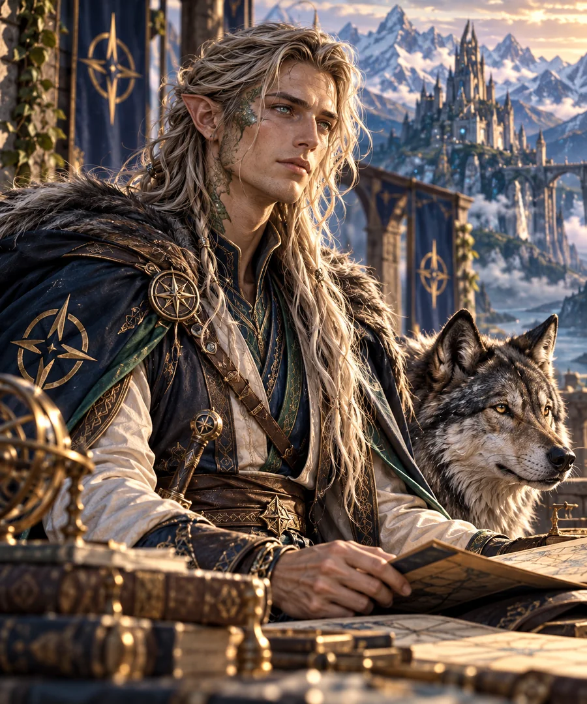

# Heimdall

*Portrait de référence choisi pour les Archives d’Alrick — Heimdall et Aldren, 27 octobre 2026.*

*Le veilleur qui a choisi de vivre.*

> [!abstract] En quelques mots
> Heimdall est une personne nouvelle née au sein d’un héritage très ancien de veille. La mémoire de générations de veilleurs marque son origine, mais il n’est pas la simple addition de ces vies : dans une rencontre où Orin lui laisse le choix, il devient lui-même. Reconnu comme une personne à part entière, il apprend à choisir, à travailler avec d’autres et à s’autoriser une existence qui ne se réduit plus à surveiller des seuils. Après cinq années d'évolution du monde, il dirige ses propres équipes d'étude prudente des structures anciennes.

> [!info] État de la fiche
> **Référence : REV-06.** Synthèse fondée sur le Compendium des personnages v1.7, la Continuité de campagne v1.7 et les scènes conservées de CB2 à CB43. Dernier état documentaire étudié : après les cinq années d'absence d'Orin et les événements enregistrés jusqu'à CB43. L’apparence visuelle décrite par le créateur de l’univers le 27 octobre 2026 est désormais fixée dans ses grandes lignes ; le mécanisme métaphysique exact reste ouvert.

## Apparence — portrait de référence

Heimdall possède l’allure d’un **grand elfe longiligne**, d’une élégance naturelle presque irréelle. Cette comparaison exprime sa silhouette et sa grâce : **elle ne suffit pas à déterminer son espèce**. Quelques **fines écailles draconiques vertes** se dessinent çà et là sur son corps, discrètes et harmonieuses, sans constituer une armure.

Ses yeux sont son trait le plus saisissant : son regard semble **constellé de millions d’étoiles**. Il dégage un charme spontané, une beauté parfois **presque glaçante**, particulièrement lorsqu’il observe en silence ce que d’autres n’ont même pas remarqué.

**Elyra confectionne ses vêtements**, toujours parfaitement taillés, raffinés et sobres, avec de très légères notes de couleur. Lorsqu’il part à l’aventure, il porte **la cape des Revenants** sur les épaules et **une épée à la ceinture**. Hors des missions, Heimdall évoque davantage un **savant attentif**, très observateur, fasciné par les êtres, les phénomènes et les découvertes du monde qui l’entoure.

> [!important] Canon visuel — confirmé par le créateur le 27 octobre 2026
> Silhouette élancée proche d’un grand elfe, légères écailles draconiques vertes, yeux constellés d’étoiles, vêtements sur mesure d’Elyra, cape des Revenants et épée en voyage. La couleur des cheveux, la coiffure, l’âge apparent précis et les détails du visage ne sont pas encore arrêtés. Les écailles n’établissent pas une filiation draconique particulière.

## Portrait narratif

**Heimdall du Mérien** ne se définit plus par ce qu'il surveille, mais par ce qu'il décide de faire de son attention. Là où d'autres chercheraient une réponse définitive, il apprend à regarder la question, à mesurer ce qu'il ignore et à laisser chaque être libre de choisir sa traversée.

Sa curiosité s'est construite au contact des autres : les repas partagés, les entraînements, la recherche menée en équipe, le compagnonnage d'un loup dont la fidélité ne relève pas de l'obéissance. Ce sont des expériences modestes au regard des anciennes Voies, mais essentielles pour quelqu'un à qui l'on avait trop longtemps demandé d'être une fonction avant d'être quelqu'un.

Heimdall est maintenant un chercheur et un responsable de terrain. Sa prudence n'est pas de l'inaction : elle consiste à apprendre, vérifier, transmettre et permettre à d'autres de poursuivre le travail sans dépendre d'un gardien unique.

### Repères essentiels

| Domaine | Situation documentée |
|---|---|
| **Origine connue** | Naissance récente au contact du vieux système de veille du Mérien ; héritage des empreintes de nombreux veilleurs. Le mécanisme exact de son émergence reste à préciser. |
| **Condition actuelle** | Personne vivante et autonome, dont les choix lui appartiennent |
| **Appartenances** | Membre des **Revenants** et de la **Maison d'Orin**, appartenances compatibles et librement assumées |
| **Fonction actuelle** | Étude des raccords et structures anciennes ; direction de ses propres équipes de recherche |
| **Compagnon** | [[REV-16|Aldren, le loup du Mérien]], compagnon libre, et non propriété |
| **Lien familial choisi** | Orin se dit son père ; Heimdall reconnaît l’affection mais discute, parfois avec humour, la chronologie et la nature de cette filiation. Aucune filiation biologique. |
| **Aptitudes montrées** | Analyse des seuils, étude des raccords, coordination technique, apprentissage et transmission |
| **Équipement documenté** | La **Clé-Œil** pour les raccords ; la **cape des Revenants** et une **épée** lors des aventures |

## Histoire et évolution

### Le Mérien — apprendre à ne plus être une fonction

L'histoire de Heimdall commence dans les anciennes structures de veille du Mérien. Le système auquel il était lié risquait de faire disparaître l'individu derrière la tâche : reconnaître les passages, distinguer les dangers, maintenir des références. La libération ne lui a pas donné d'emblée toutes les réponses sur ce qu'il est ; elle lui a surtout rendu le droit de ne pas être défini par un mécanisme.

Au fil des travaux sur les Voies et les balises vivantes, Heimdall participe à la reconstruction d'une doctrine fondamentale : un dispositif peut **signaler le danger** sans s'arroger le droit de décider quels êtres « méritent » de passer. Les nouvelles connexions demandent une reconnaissance réciproque des extrémités, la possibilité de se retirer et des procédures d'essai qui commencent par l'inerte plutôt que par des personnes vivantes.

Cette philosophie ne se limite pas à une technique. Elle résume aussi ce que Heimdall a appris de sa propre histoire : protéger n'autorise pas à posséder.

### Une naissance récente, des empreintes immémoriales

Heimdall est jeune **comme personne individualisée** : sa vie propre commence au moment où il peut se distinguer de l’antique fonction de veille et choisir son chemin. Pourtant, sa naissance ne part pas de rien. Elle s’inscrit dans la longue accumulation de traces, de gestes et d’empreintes laissées par **d’innombrables veilleurs**. Cette profondeur de mémoire lui donne un rapport paradoxal au temps. Sa conscience personnelle est neuve ; l’héritage qu’il porte est ancien, peut-être immensément ancien.

Cette double temporalité n’autorise pas à lui attribuer mécaniquement l’âge, les expériences personnelles ou les souvenirs intacts de chacun de ses prédécesseurs. Elle explique plutôt pourquoi les interlocuteurs anciens, notamment les dragons, prennent son existence au sérieux : **il y a plus d’histoire dans sa formation que d’années dans sa vie propre.**

L’intervention d’Orin ne consiste pas simplement à fabriquer une créature dont le destin serait fixé d’avance. Son pouvoir grandissant et les anciennes structures rendent possible cette émergence ; **Orin lui laisse le choix**. Heimdall participe ainsi à ce qu’il devient : le terme d’« auto-création » exprime ce rôle actif dans sa propre naissance, sans prouver qu’il s’est créé seul ou que le mécanisme métaphysique soit intégralement élucidé.

> [!important] Deux âges, une seule personne
> Distinguer **l’âge de Heimdall en tant qu’individu** de **l’ancienneté des empreintes qui l’ont rendu possible**. Lorsqu’Orin le compare en plaisantant aux très anciennes puissances, Vaerdrak refuse de transformer cette hypothèse en datation certaine.

### La rencontre avec Aldren

Au Mérien, Orin donne forme à un grand loup destiné à **accompagner** Heimdall, et non à lui obéir. Le loup s'approche librement, reconnaît son futur compagnon et choisit de demeurer près de lui. Il reçoit le nom d'**Aldren**, « Compagnon des Lisières ».

La scène est un tournant intime : Heimdall demande si l'animal lui appartient ; Orin répond que non. Heimdall comprend alors que leur proximité repose sur deux libertés qui se rencontrent. Pour un veilleur longtemps enfermé dans son utilité, être accompagné sans être surveillé ni posséder l'autre prend un sens particulier.

> **Parole marquante d'Orin :** « Parce que les veilleurs aussi doivent parfois être veillés. »

Aldren est un compagnon, pas une arme, un insigne ou une extension de Heimdall. Tous deux doivent pouvoir apprendre à agir sans contrôler continuellement l'autre.

### Les Revenants — une place au sein d'un groupe

Heimdall fait partie du noyau des Revenants aux côtés notamment d'Orin, Bram, Kelm, Ragna, Vaëra, Torven, Haldrek et Eamon. Il n'y tient pas le rôle d'un oracle qui fournirait automatiquement la bonne réponse : ses observations nourrissent les décisions d'une équipe dont les compétences et le commandement se répartissent selon les situations.

Il s'exerce notamment à l'épée avec **Dac** et **Eamon**, tout en développant sa capacité à partager le travail d'observation. Il découvre les usages quotidiens, les relations et les loisirs sans que ses interrogations parfois littérales soient traitées comme de la sottise.

Son appartenance aux Revenants est une **appartenance de groupe** : elle ne fait pas de lui un « Rappelé » au sens des personnes revenues d'entre les morts par l'intervention d'Orin.

### La Maison d'Orin — être accueilli sans être absorbé

Heimdall confirme personnellement son appartenance à la Maison d'Orin tout en conservant sa place parmi les Revenants. Orin affirme un lien d'affection paternelle choisi. Heimdall peut lui donner un sens familial sans devoir devenir une imitation de lui, ni être ramené à sa naissance inhabituelle.

Son échange direct avec **Kagen**, au Cercle sans Trône, prolonge cette recherche d'identité : la conversation appartient à Heimdall autant qu'à son interlocuteur. Orin n'a pas à en rester l'intermédiaire.

Les quartiers et les moyens que la Maison lui offre ne retirent rien à ses responsabilités de terrain ni à sa capacité de décider.

### « Je remets en cause la chronologie » — Orin et la filiation choisie

Orin considère Heimdall comme son fils. Le lien est réel sur le plan affectif : il est fier de son indépendance et de ses progrès, et la Maison lui reconnaît une place librement consentie. **Mais Heimdall ne se laisse pas enfermer dans le rôle d’un enfant créé pour confirmer la grandeur de son père.** Il revendique son propre temps, son propre nom et le droit d’interroger ce qui le définit.

Lors de l’audience auprès de Vaerdrak, Orin annonce que sa « paternité » est contestée. Heimdall lui répond, très sérieusement :

> « Je ne remets pas en cause votre affection. Je remets en cause la chronologie. »

Vaerdrak refuse alors d’arbitrer ce différend familial exceptionnel. Plus tard, lorsque le dragon souhaite garder Heimdall auprès de lui pour discuter, Orin parle de « garde alternée ». La plaisanterie revient jusque dans les histoires de « petit-fils », lorsqu’il traite affectueusement Aldren comme tel. Ce comique familial ne retire rien à la sincérité du lien ; il évite au contraire que la filiation choisie devienne un titre imposé.

### Orin auprès d’Yggdrasil — présence, mémoire et missions confiées

Au cours de son séjour auprès d’**Yggdrasil**, Orin n’est pas simplement retiré du monde. Il est avant tout là pour **la soutenir et demeurer auprès d’elle**. Il répare ce qu’il peut, oriente parfois certaines divinités vers des lieux plus propices pour continuer leur chemin, **préserve la mémoire de certaines puissances**, et met parfois des divinités en relation avec sa Maison.

**Heimdall est l’un des contacts d’Orin pendant ce séjour.** Orin lui confie plusieurs missions destinées à permettre, à terme, de **délivrer Níðor du fardeau qui le contraint**. Le veilleur doit donc faire preuve d’initiative et de discernement : il travaille avec ses équipes, accomplit ces missions et contribue à la compréhension du dispositif, pendant qu’Orin se tient auprès d’Yggdrasil. Cette relation n’efface pas l’autonomie de Heimdall ; elle montre au contraire qu’Orin peut lui confier des responsabilités réelles.

> [!note] Portée de cette précision
> Le rôle de Heimdall comme **contact d’Orin et destinataire de missions** pendant le séjour auprès d’Yggdrasil est confirmé par le créateur de l’univers (27 octobre 2026). La fréquence, le moyen exact des communications et la liste exhaustive des missions devront être complétés à partir des scènes. **Níðor est un partenaire distinct ; il n’est pas un Revenant.**

### Les années d'autonomie — transmettre la recherche

Pendant les cinq années où Orin accompagne Yggdrasil, le monde continue de vivre sans lui. Heimdall et ses collaborateurs gagnent en autonomie : il **dirige ses propres équipes** consacrées à l'étude prudente des structures anciennes, pendant que les Revenants apprennent plus largement à travailler avec une rotation effective du commandement.

Ses recherches participent aux réparations du Nord. Dans le dossier de l'ancien dispositif où **Níðor** restait contraint d'assurer un maintien vivant permanent, ses équipes identifient depuis plusieurs années une relation fonctionnelle manquante. Elles ne prétendent pas pouvoir la fabriquer sans la comprendre. Orin, de retour, réussit finalement à la reconstruire et Níðor peut quitter physiquement la structure.

La réussite est collective et précisément limitée : Heimdall n'a pas réparé seul le dispositif, et Níðor n'est pas pour autant libéré de toutes ses fonctions cosmiques.

### Níðor — une relation de confiance forgée par la recherche

La relation avec **Níðor** est l'un des grands axes de l'histoire de Heimdall, et non un simple renvoi dans la rubrique « techniques ». Dès les enquêtes sur les anciens passages, leurs échanges portent sur des dispositifs qui maintiennent les distinctions entre réalités. Pendant qu’Orin soutient Yggdrasil, Heimdall ne se contente pas d’attendre : il **organise et dirige des études** avec ses collaborateurs et mène **plusieurs missions confiées par Orin**, afin de comprendre ce qui retient Níðor dans la fonction de contrefort vivant.

Les équipes identifient depuis environ trois années un raccordement fonctionnel manquant, sans pouvoir le reconstituer par la seule force ou par approximation. Après son retour, Orin rassemble les principes nécessaires pour accomplir la réparation et **relever Níðor du maintien permanent**. Le résultat témoigne de la continuité du travail pendant l’absence d’Orin et de la capacité de Heimdall à agir sans dépendre de lui à chaque étape.

Níðor est un **être distinct, avec ses propres responsabilités draconiques**. Il choisit de rejoindre librement la Maison d’Orin, mais **n’est pas membre des Revenants** et n’est pas un suivant personnel soumis à Orin. La relation des deux êtres ne doit donc pas être réduite à une appartenance commune : c’est une coopération née autour d’une liberté à reconquérir.

> [!question] Relais pendant les cinq années — précision à retrouver
> **Confirmé par le créateur le 27 octobre 2026 :** Heimdall joue bien un rôle de contact auprès d’Orin et reçoit des missions en rapport avec la délivrance de Níðor. Les modalités des échanges restent à documenter ; ne pas inventer de communication permanente ou illimitée.

### Les dragons, les anciens et l'art d'apprendre

**Vaerdrak** reconnaît dans Heimdall une nature qui suscite autant d’attention que de questions. Il le reçoit au sanctuaire, discute avec lui et l’accompagne ensuite dans l’étude d’une structure du Nord, avec d’autres spécialistes. La mission ne consiste pas à forcer le passage, mais à observer et à obtenir des réponses fiables. Le dragon contribue également à lui transmettre une magie plus proche de sa nature de veilleur.

**Drakon**, grande puissance draconique rencontrée par Orin, est associé dans les scènes aux discussions sur le poids des fonctions et la possibilité d’une vie qui ne soit pas uniquement consacrée au devoir. Il prend avec humour l’image de Heimdall découvrant la pêche. La présence de Drakon dans cette réflexion ne prouve pas à elle seule une formation directe et régulière de Heimdall par lui ; le lien mérite d’être développé à partir des scènes explicites.

**Tairin** est une puissance dont il faut conserver la place dans le réseau de relations du personnage. **Correction explicite du créateur : « Terra » était une erreur de dictée pour Tairin, et non pour Vaëra.** Les scènes précises des échanges entre Heimdall et Tairin restent à référencer : ne pas inventer de formation ni de rencontre supplémentaire.

### L'escrime avec Dac et Eamon

Heimdall étudie également une discipline où son passé de veilleur ne donne pas immédiatement les bonnes réponses : **l'épée**. Il s'entraîne avec **le général Dac** et **Eamon**. Eamon souligne même l'opposition entre leurs apprentissages : lui doit parfois corriger de vieilles habitudes ; Heimdall en possède encore très peu et peut construire sa technique à partir des fondements — garde, distance, appuis, économie de mouvement et bon moment pour agir.

L’intérêt de cet épisode dépasse le combat. Le veilleur acquiert un art qui ne lui est pas imposé par une fonction ancienne ; il accepte d'être débutant, de répéter et de progresser auprès d'autres personnes.

### La pêche — apprendre à ne rien devoir au monde

Dans les souvenirs partagés avec Orin, **la pêche** tient une place affectueuse et délibérément ordinaire. Une canne et quelques heures au bord de l'eau n'ont aucun rapport avec la sauvegarde des Couronnes. C'est précisément ce qui compte : passer du temps ensemble sans que la survie d'un monde dépende de l'efficacité du veilleur ou de celle du prince.

Les campagnes récentes évoquent des **parties de pêche avec Heimdall** ; une nouvelle journée tranquille est également envisagée. La fiche ne doit ni transformer ce projet en sortie déjà jouée, ni effacer l'existence des moments antérieurs rappelés par Orin. L'humour de Drakon face à cette image appartient à l'histoire des liens familiaux, non à un exploit magique.

## Personnalité et interprétation

**Une attention neuve.** Heimdall observe les usages ordinaires avec la même application que les anciens raccords. Cette curiosité peut produire des questions inattendues, parfois drôles, mais jamais parce qu'il serait incapable de comprendre les personnes.

**Une prudence acquise.** Il accepte désormais qu'une observation soit incomplète. Il distingue ce qui est établi, ce qui peut être testé et ce qu'il serait dangereux de forcer. Sa capacité à dire « je ne sais pas » fait partie de son expertise.

**Une loyauté choisie.** Les Revenants, la Maison, Aldren et Orin comptent pour lui, sans annuler son indépendance. La fidélité n'exige ni servitude ni renoncement à ses propres préférences.

**Un besoin d'expérience.** Les repas, la pratique de l'épée, la présence tranquille d'Aldren et les moments simples auprès de ses proches participent pleinement à sa vie. La pêche avec Heimdall est également évoquée dans les échanges récents ; une nouvelle sortie est envisagée, sans qu'il faille inventer ses détails.

> [!tip] Pour interpréter Heimdall
> Lui donner une voix attentive, capable de précision et parfois de littéralité, mais **pas une voix mécanique figée**. Il peut sourire, ne pas savoir, corriger Orin, refuser une tâche, prendre une initiative et découvrir des plaisirs qui n'ont aucune utilité stratégique.

## Liens et relations

| Personne ou groupe | Nature du lien et limites |
|---|---|
| **Orin / Alrick** | Père affectif revendiqué par Orin ; Heimdall reconnaît son affection tout en discutant la chronologie. Création et filiation ne valent ni propriété ni obéissance ; leur humour est récurrent. |
| **[[REV-16|Aldren]]** | Compagnon animal autonome ; présence familière, apprentissage mutuel de la confiance. |
| **Les Revenants** | Groupe d'appartenance et compagnons de mission ; compétences complémentaires et autonomie des membres. |
| **Níðor** | Relation majeure de recherche et de confiance : enquêtes sur les passages, travaux des équipes de Heimdall, puis libération du maintien contraint achevée par Orin. **Níðor n’est pas un Revenant**. |
| **Eamon** | Partenaire d’entraînement à l’épée auprès de Dac, interlocuteur de recherche et de transmission ; « Maisons des Pourquoi ». |
| **Névane** | Coopération technique, relevés, procédures d'essai et attention aux contraintes de raccordement. |
| **Dac (général)** | Formateur à l’escrime, avec Eamon : apprentissage des gestes fondamentaux avant les effets spectaculaires. |
| **Kagen** | Conversation directe autour de l'identité, de la liberté et de la filiation choisie. |
| **Ostrel** | Travaux liés aux structures anciennes et aux passages dans la Maison au cours des cinq années. |
| **Vaerdrak** | Dragon ancien : échanges directs sur l’identité, le temps et les structures du Nord ; transmission et recherches de terrain. |
| **Drakon** | Puissance draconique ; discussions autour du devoir, de la liberté et du plaisir des loisirs. Lien direct avec Heimdall à préciser. |
| **Vaëra** | Compagne d’Orin, Revenante et membre de la Maison ; partage avec Heimdall la vie du groupe, les échanges et la transmission. Elle ne doit pas être confondue avec Tairin. |
| **Tairin** | Grande puissance de l’entourage d’Orin ; à relier à Heimdall, avec scènes de leur relation à sourcer précisément. |

## Lieux associés

- **Le Mérien :** point d'origine documentaire, anciennes Voies, balises, apprentissages, rencontre avec Aldren et projets de transmission.
- **Le Nord et ses structures anciennes :** terrains d'analyse, de diagnostic et de réparation ; travaux conduits progressivement par ses équipes.
- **Valbrume :** enquête sur les caisses et l'arche déplacée, en collaboration avec Níðor et les autres intervenants.
- **La Maison d'Orin :** lieu d'appartenance libre, d'accueil et de recherche, sans obligation de demeurer dans un centre unique.
- **Le Cercle sans Trône :** échange avec Kagen sur ce qu'il devient au-delà de son origine.

## Travaux et objets

### Clé-Œil

La Clé-Œil peut aider à vérifier la compatibilité de raccords connus et à retenir volontairement des repères utiles au retour. **Elle n'ouvre pas tous les passages**, ne remplace pas le consentement des extrémités et ne constitue pas un droit de traverser où l'on veut. La documentation n'autorise pas à en déduire une téléportation illimitée.

### Étude et réparation des raccords

Heimdall privilégie la reconnaissance réciproque des points d'ancrage, les essais graduels et les fermetures sûres. Il contribue à un corpus de recherches destiné à être compris et utilisé par plusieurs personnes plutôt qu'à créer une nouvelle dépendance envers un être irremplaçable.

### Les Maisons des Pourquoi

Avec Eamon et d'autres collaborateurs, Heimdall présente une **proposition** de transmission des mémoires par les raisons, les gestes et les évolutions des usages. L'idée est de conserver les témoignages sans condamner les générations futures à les interpréter de façon inchangée. **La présentation du projet est attestée ; son déploiement général n'est pas confirmé par ces sources.**

## Moments marquants — petite chronologie

1. **Mérien, anciennes Voies :** Heimdall acquiert une existence personnelle qui n'est plus absorbée par son rôle de veilleur.
2. **Mérien, enseignement des passages :** il affirme qu'une infrastructure peut identifier un danger sans juger la valeur morale des voyageurs.
3. **Mérien, rencontre avec Aldren :** naît une relation de confiance réciproque qui n'est pas une relation de possession.
4. **Les Revenants et la Maison :** il confirme ses appartenances, développe ses relations et apprend à agir dans des groupes autonomes.
5. **Sanctuaire de Vaerdrak :** Heimdall découvre un interlocuteur capable de regarder son héritage de veilleur autrement ; Orin et lui plaisantent sur leur filiation.
6. **Dac et Eamon :** entraînement à l’épée et appropriation d’une discipline choisie.
7. **Après cinq années d’absence d’Orin :** il est devenu responsable d’équipes capables d’étudier et de poursuivre les travaux par elles-mêmes.
8. **Níðor et le dispositif ancien :** les diagnostics de ses équipes contribuent à permettre la réparation finale réalisée avec Orin.
9. **Moments de pêche :** des sorties sont évoquées dans les souvenirs ; CB43 envisage une nouvelle journée avec Orin.

## Archives du maître du jeu — révélations et garde-fous

> [!warning] Attention : éléments de continuité et révélations sur l'origine de Heimdall
> Cette section est accessible à tous, mais elle dévoile des enjeux que les joueurs peuvent préférer découvrir en partie.

**Ne pas définir trop vite son origine.** Heimdall est une personne récemment individualisée, née d’un héritage où se sont accumulées les empreintes de nombreux veilleurs. Sa part active dans le choix de devenir lui-même est centrale ; ni l’ancienneté exacte de ces empreintes ni le mécanisme intégral de son émergence ne sont fixés.

**Ne pas en faire une infrastructure ambulante.** Ses facultés de perception et son expérience n'autorisent ni surveillance totale du monde, ni détection infaillible, ni obligation d'intervenir partout.

**Ne pas confondre les catégories.** Heimdall appartient aux **Revenants** ; les **Rappelés** désignent autre chose. Il est aussi membre libre de la Maison. **Níðor n’est pas un Revenant** : il appartient à la Maison par choix, en conservant son autorité propre.

**Ne pas effacer son progrès.** À l’état le plus récent, il dirige ses équipes et possède des initiatives propres. Les anciennes scènes d’apprentissage restent vraies historiquement, mais ne résument plus toute sa condition. Il n’est ni un enfant ni l’addition mécanique de toutes les personnes qui ont veillé avant lui.

**Ne pas forcer Aldren.** Le loup est une conscience animale libre. Un lien affectif n’est ni contrôle mental ni propriété.

**Ne pas transformer une blague en généalogie.** La paternité d’Orin est affective et discutée par Heimdall sur le plan de la chronologie ; Aldren surnommé « petit-fils » n’a pas de lien biologique avec Orin.

**Points documentaires à résoudre.** Le rôle de Heimdall comme contact d’Orin et destinataire de missions pendant le séjour auprès d’Yggdrasil est confirmé ; préciser les modalités des échanges et les missions particulières. « Terra » désigne **Tairin**, et non Vaëra. La direction artistique est fixée, mais le portrait officiel reste à produire.

### Pistes de développement — non jouées

Ces idées proviennent du Compendium ou prolongent ses thèmes ; **elles ne sont pas des événements canoniques** :

- Heimdall adopte volontairement un loisir dans lequel il se découvre médiocre.
- L'une de ses équipes doit composer avec une réponse honnête mais incertaine plutôt qu'une certitude artificielle.
- Il présente à Orin un rapport contredisant une hypothèse et lui demande une aide précise, sans lui céder la direction de l'étude.
- Heimdall et Aldren réussissent un exercice précisément parce qu'ils acceptent de se séparer pendant un moment.

## Portrait et iconographie

> [!note] Apparence définie par le créateur
> **Portrait illustré retenu pour les Archives d’Alrick le 27 octobre 2026.** Heimdall y apparaît grand et longiligne comme un elfe, avec des écailles draconiques vertes discrètes, le regard constellé d’étoiles, les vêtements raffinés d’Elyra, la cape des Revenants et une épée de voyage. Il est représenté près d’Aldren, dans son environnement de savant et d’explorateur. Cette image fixe une interprétation visuelle approuvée, sans établir par elle-même son espèce biologique ou son ascendance.

## Sources et traçabilité

**Références prioritaires :**

- *03 — Compendium des personnages et des relations*, v1.7, fiche **REV-06**, « Heimdall », état CB42 et historique CB39 / CB38 ; section des Revenants et synthèse de l'autonomie après cinq années.
- *06 — Continuité de la campagne et de l'œuvre*, v1.7 : Heimdall et l'ancien système de veille ; Valbrume et l'enquête ; cinq années d'autonomie ; diagnostics du dispositif de Níðor.
- *05 — Orin, la Maison et les traditions religieuses*, v1.8 : appartenance confirmée à la Maison et relation filiale choisie ; échange avec Kagen.
- *04 — Codex de la magie et de l'ingénierie*, v1.7 : propriétés et limites de la Clé-Œil.
- *Campagne brute regroupée — Volume 1*, **CB2** : reconstruction des Voies, Aldren, les « Maisons des Pourquoi », épreuves de raccordement ; **CB32** : échanges avec Vaerdrak sur la filiation, la chronologie et l’escrime avec Dac et Eamon ; enquête du Nord et rapports sur Níðor.
- *Campagne Brut 4.3*, **CB43** : références aux moments de pêche avec Heimdall ; à ne pas transformer en nouvelles scènes jouées détaillées.

**Repères de source repris du Compendium :** CB38 P06750–07262 et P19467–19961 ; CB39 P02944–04569, P20311–20701 et P40542–41267 ; CB42 P18752–21050.

**À compléter sans inventer :** fonctionnement métaphysique exact de l’héritage des veilleurs, modalités et liste des missions pendant le séjour d’Orin auprès d’Yggdrasil, échanges précis avec Tairin, chronologie fictive datée.

**Apports éditoriaux du 27 octobre 2026 :** précisions sur l’ancienneté paradoxale, le choix fondateur et les relations avec Níðor, Orin, Vaëra, Vaerdrak, Drakon, Dac et Eamon ; approfondissement de l’humour de la filiation et de la pêche. Les éléments expressément incertains restent signalés.

**Précisions canoniques du créateur — 27 octobre 2026 :** correction du nom **Tairin**, rôle actif d’Orin auprès d’Yggdrasil, rôle de contact et missions confiées à Heimdall pour la future délivrance de Níðor, et définition de l’apparence de Heimdall.

**Portrait de référence :** illustration créée pour les Archives d’Alrick, approuvée par le créateur le 27 octobre 2026 ; fichier `content/images/personnages/heimdall-portrait.webp`.