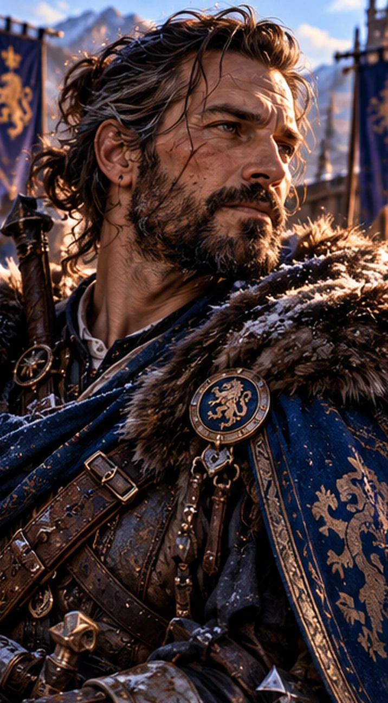

# Haldrek

*Portrait individuel **approuvé par le créateur** : Haldrek prend ici l'allure d'un capitaine vétéran au regard expérimenté, dans une tenue militaire sobre. **Ce portrait constitue sa référence artistique validée** ; les accessoires décoratifs ne prouvent pas à eux seuls un objet historique, une décoration officielle ni une nomination déjà signée à Bordociel.*

> [!info] Statut documentaire
> **Fiche approfondie approuvée par le créateur et prête à être publiée.** Les entraînements menés par Haldrek, y compris auprès d’Orin et lors des exercices de Tairin et Drakon, les colloques, ses fonctions chez les Revenants et ses interventions à Taagral sont fondés sur la **campagne jouée**. **Orientations nouvelles du créateur :** une enfance réellement vécue dans la caserne et auprès de ses parents, le lien affectif presque filial avec Orin, un éventuel passé sous Harald Forgecœur et la direction future de l’**académie militaire de Bordociel**. **La jeunesse en caserne est retenue comme développement de lore validé**, mais ses anecdotes reconstituées restent des scènes non jouées ; la collaboration possible avec Harald et la nomination future à Bordociel restent des pistes, non des événements accomplis. Les scénarios sont des amorces inédites. **Le portrait individuel est approuvé comme référence visuelle.** Dernier état CB43 prioritaire.

*Il pose toujours la même question, parfois avant même qu'Orin ait terminé sa phrase : « Et si le plan ne fonctionne pas ? »*

## En quelques mots

**Haldrek** est le vétéran qui a compris qu'une bataille gagnée peut parfois être une leçon mal apprise. **Son véritable héritage n'est pas une victoire personnelle : c'est une équipe qui sait agir, vérifier et revenir même lorsque tous les anciens chefs sont absents.** Il peut prendre la direction d'une opération, soutenir un camarade au contact, préparer le repli et surtout apprendre à un autre à faire de même.

Il n'est **ni un instructeur extérieur engagé par Orin, ni un personnage dépassé par les exploits magiques de ses compagnons**. Revenant de plein droit, capitaine et formateur opérationnel, il les accompagne, les contredit et les aide à devenir autonomes. Son autorité se fonde sur un jugement éprouvé, pas sur l'idée qu'il aurait toujours raison.

Au cours des colloques, il montre aussi une dimension politique : la société peut former ses habitants à la sécurité et aux secours sans transformer chaque village en caserne ; les militaires doivent posséder des règles claires pour **refuser une exaction sans devenir des autorités politiques rivales**. Ce sont les convictions d'un homme qui a suffisamment servi pour savoir à quel point une force mal orientée peut abîmer ceux qu'elle prétend protéger.

## Identité et état

- **Statut :** vivant ; Revenant de plein droit, **pas** entraîneur extérieur à la compagnie.
- **Rôle actuel :** **capitaine vétéran et Revenant**, **responsable principal de l'entraînement opérationnel régulier des Revenants**, coordinateur de formations et de missions, instructeur d'Orin, conseiller militaire et pédagogue du commandement.
- **Taagral :** selon la précision du créateur, **adjoint de coordination de terrain auprès du général Dac**, plutôt en retrait des démonstrations spectaculaires ; le **commandement militaire général reste à Dac**, et un grade permanent d'état-major n'est pas créé rétroactivement.
- **Académie de Bordociel :** **direction future souhaitée et confiée en intention par Orin**, possiblement comme directeur principal ou l'un des directeurs avec Torgarl et d'autres responsables. **Le poste formel, les statuts définitifs et l'ouverture de l'école ne sont pas encore joués**.
- **Harald Forgecœur :** collaboration militaire antérieure **envisagée** avec le père d'Orin, à confirmer par la chronologie et une scène ou validation explicite.
- **Équipement :** longue-vue et insigne optique **achevés et placés dans un coffret** en CB42 ; la remise effective du coffret n'est pas montrée séparément dans le brut examiné.
- **Apparence :** vétéran en tenue de terrain, arme d'exercice ou instrument d'observation ; **espèce/ascendance exacte, âge, cicatrices, couleur des cheveux et proches familiaux non déterminés avec certitude**. Le portrait collectif reste une suggestion artistique.

## Avant Orin — l'enfant de la caserne

> [!info] Origines proposées et direction du personnage
> **L'enfance au sein de la vie militaire, avec ses deux parents présents dans son horizon quotidien, est un développement de lore approuvé par le créateur.** Il faut la distinguer du capitaine et formateur déjà attesté par la campagne. Les noms, métiers précis et devenirs de ses parents, sa ville natale, son espèce, ses anciennes unités et les dates de ses promotions ne sont pas définis ; **aucun parent n'est déclaré mort**. Les anecdotes ci-dessous servent à proposer son atmosphère et ne sont pas des scènes jouées.

### Grandir là où les soldats rentrent le soir

Haldrek n'a pas simplement découvert l'armée à l'âge de s'engager. **Il a grandi dans son environnement**, enfant circulant entre les bâtiments d'une garnison, les cours d'entraînement, les écuries ou ateliers, les salles où l'on tient les registres de rationnement et les maisons des familles. Il voit les départs, mais aussi **les retours** : des militaires qui arrivent sales et fatigués, dont les noms ne figurent sur aucun chant héroïque, et à qui quelqu'un offre pourtant une chaise et un repas.

**Ses parents occupent une place dans cette enfance**, sans être nécessairement tous deux officiers : l'un peut servir dans les rangs, l'autre travailler auprès des artisans, de l'administration ou des familles. La caserne n'est pas une institution qui l'arrache à eux ; c'est aussi **le quartier où il a des voisins, des habitudes et des gens auxquels il tient**. Nous choisirons plus tard leurs métiers, leur caractère et leur histoire plutôt que de les réduire à une tragédie commode.

Enfant, il aurait pu s'asseoir sur une marche pour regarder les exercices, imiter maladroitement les gestes des anciens avec un bâton trop grand, puis apprendre à ramasser le matériel après la leçon. **Il n'est pas né maître de la discipline.** Un jeune Haldrek impatient, joueur, parfois fier de se montrer plus habile qu'un autre, est plus intéressant qu'un futur capitaine déjà parfait.

### La première leçon : connaître ceux qu'on commande

Une scène de jeunesse **proposée et non jouée** : Haldrek, à peine adolescent, est chargé de transmettre un message entre deux postes. Il arrive vite, très fier de lui, sans s'être assuré que la personne qui devait le remplacer a compris l'horaire, la position et la consigne. Le service est interrompu pendant plusieurs minutes. Un adulte ne lui reproche pas sa vitesse ; il lui demande **qui aurait pris sa place s'il n'était pas revenu**.

Cet apprentissage peut avoir pris bien d'autres formes, mais la leçon rejoint directement le Haldrek que nous connaissons : **une mission n'est pas accomplie simplement parce qu'un individu a parfaitement exécuté son propre geste.**

Plus tard, comme recrue puis soldat, il aurait appris les marches, la garde, les armes, la lecture de cartes et la logistique. Son caractère s'affirme dans **l'effort et la camaraderie**, pas dans une succession obligatoire de catastrophes. Il découvre le travail de l'escouade, puis celui de la patrouille et les difficultés de transmettre un ordre quand un supérieur est absent.

### Du jeune soldat au capitaine

Haldrek **devient capitaine avant les événements du Mérien**. Son autorité a été gagnée en sachant entraîner, organiser, écouter les objections utiles et **ramener les hommes qu'il conduit**. Les grades intermédiaires, les engagements précis et la date de sa promotion restent ouverts.

Il a pu connaître d'anciens chefs exigeants, servir plusieurs garnisons ou participer à des campagnes. **Nous ne devons pas en inventer les batailles, les morts et les décorations comme des faits passés**. Il est possible de lui offrir des souvenirs vivants : un premier commandement mal préparé puis corrigé, une fête de promotion où ses camarades rient de sa raideur, ou une lettre de ses parents qu'il garde dans ses affaires. Chacune de ces anecdotes demeure **une proposition**.

### La piste Harald Forgecœur — une génération de chefs

Le créateur envisage **qu'Haldrek ait servi pendant un temps auprès de [[FAM-06|Harald Forgecœur]]**, père d'Orin, à une époque où il était déjà capitaine ou en passe de le devenir. Cela pourrait expliquer une compréhension instinctive entre Haldrek et la famille royale, ainsi que certaines ressemblances de style : exigence, sens de l'honneur, protection des hommes et refus des effets de manche inutiles.

**Mais ce service commun n'est pas encore attesté comme épisode joué.** La chronologie exacte devra être confrontée à la vie de Harald, aux années de service d'Haldrek et aux périodes d'Orin avant toute affirmation selon laquelle ils auraient combattu ensemble, ou selon laquelle Harald aurait été son supérieur. Leur **éventuelle collaboration est une piste de lore à valider**, et non une camaraderie déjà prouvée par leur seul métier.

## Histoire

### Bien choisir une équipe, y compris ceux qui ne partent pas

Lors des préparatifs de l'expédition du **Mérien**, Haldrek évalue les candidats, mais refuse de transformer la sélection en jugement de valeur sur leur personne. Ceux qui restent ne deviennent pas des « recalés » sans avenir. Il travaille sur la protection d'Entre-Rives, les voies de retour et la possibilité qu'un chef tombe ou doive céder sa place. (*Compendium REV-07 ; CB2.*)

### Orin et Haldrek — le maître qui peut corriger un prince

Avant le départ pour le **Mérien**, Haldrek ne se contente pas d'évaluer les candidats et de coordonner leurs exercices. **Il entraîne aussi Orin lui-même.** Cette responsabilité rend leur confiance exceptionnelle : le prince accepte qu'un militaire expérimenté lui dise qu'une idée est mauvaise, qu'il manque une étape de préparation ou qu'il faut recommencer une manœuvre. Haldrek, de son côté, **connaît l'élève et l'homme**, suffisamment pour voir quand Orin s'apprête à transformer une difficulté raisonnable en expérience démesurée.

Leur relation est plus profonde qu'un contrat entre un instructeur et un souverain. Ils **se reconnaissent comme deux chefs**, capables de s'estimer et de se contredire, mais une affection presque filiale s'est installée : Haldrek peut éprouver à l'égard d'Orin **la fierté et l'inquiétude d'un ancien qui l'a vu grandir dans son métier**, tandis qu'Orin reçoit ses corrections comme celles d'un compagnon de longue confiance.

Il ne s'agit pas de remplacer **Harald Forgecœur, son père**, ni **Elyan Corbeau-Gris, son grand-père et mentor mage**. Haldrek possède une place bien distincte : **celle du capitaine qui a formé le chef de terrain**, avec lequel Orin peut parfois redevenir un élève sans cesser d'être un prince.

Les scènes du Mérien démontrent l'autonomie qu'Orin lui reconnaît, et les dialogues de CB31–34 témoignent d'une complicité respectueuse, souvent teintée d'ironie. **La qualification affective presque filiale est une précision nouvelle du créateur**, pas un titre officiel de parenté.

### Tairin et Drakon — le vétéran au milieu des puissances

La confiance d'Orin se voit particulièrement dans ses entraînements avec **Tairin et Drakon**. Ceux-ci travaillent à des échelles de mouvement et de puissance qui dépassent largement une pratique militaire ordinaire. **Haldrek participe pourtant réellement à la préparation, aux consignes et aux débriefings**, parce que même une puissance formidable a besoin d'un objectif précis et de conditions permettant de comprendre ses erreurs.

Lors d'un exercice autour d'un promontoire et d'une chute contrôlée, Haldrek demande à Orin de lui expliquer **ce qui s'est passé**, plutôt que de déclarer simplement l'épreuve réussie ou ratée. Lorsque Tairin annonce qu'il compte déplacer le promontoire, Haldrek l'interrompt d'un mot : **« Objectif. »** Tairin doit alors énoncer le résultat attendu. Le capitaine conserve sa méthode sans se laisser impressionner par la nature de ses interlocuteurs. (*CB33 P04901–05000, exercice avec Tairin et Drakon.*)

Il ne rivalise pas en puissance avec ces êtres et **n'acquiert aucun rang divin par leur fréquentation**. Sa valeur, irremplaçable dans cette scène, consiste à savoir **transformer un affrontement spectaculaire en apprentissage reproductible**. Il n'est pas celui qui projette la montagne ; il est celui qui demande ce que le prince devait apprendre avant qu'elle ne commence à bouger.

### L'entraîneur quotidien des Revenants

**Haldrek est le responsable principal des entraînements opérationnels de la compagnie**, tant qu'il est présent et disponible. Ce n'est pas seulement une compétence qu'il exerce occasionnellement : **Orin lui fait confiance pour préparer et coordonner régulièrement le travail collectif**. Les Revenants n'attendent pas un ordre du prince pour s'entraîner, et chacun développe sa spécialité — Bram la couverture, Ragna l'observation, Kelm la maîtrise de la force, Vaëra l'approche discrète, Torven le secours, Heimdall les passages et Eamon la transmission.

Haldrek coordonne **les objectifs, les équipes, les situations d'échec, les relais de commandement, les consignes de sécurité et les retours d'expérience**. Il peut lui-même combattre ou prendre le commandement d'un groupe, mais sa réussite se mesure aussi au moment où **ses compagnons savent se passer de lui**.

**Torgarl** apporte une autre dimension : confrontation et entraînement supérieur, doctrine de combat et exigence. Les deux peuvent travailler ensemble sans que l'un efface l'autre. Le rôle d'Haldrek est déjà formulé lors des discussions sur les Revenants : **entraînement opérationnel, autonomie des équipes, transmission et retour d'expérience**. (*CB32 P02101–02200 ; CB42, état des entraînements et projets d'apprentis.*)

### Celui qui a vu le contrôle de Kelm

Il remarque Kelm non parce qu'il possède un marteau impressionnant, mais **parce qu'il retient une frappe pour protéger quelqu'un qui se tient au-delà de la cible**. Cette attitude annonce le type de combattant que Haldrek veut former : capable de s'arrêter, de discerner et de choisir. Le lien n'est pas une simple hiérarchie maître-élève immuable : Kelm devient progressivement capable de commander lui-même.

### Les entraînements contre Orin

Lors des exercices de la compagnie, Haldrek organise préparation, observation, communications et situations de contrainte. Orin s'amuse à perturber la défense par une multiplication de doubles et de tactiques inattendues. La réaction intéressante n'est pas le nombre de coups portés, mais la capacité des Revenants à établir des vérifications lorsque **même un message ou un visage connu peut être falsifié**. La meilleure leçon de l'exercice est que personne, pas même Haldrek, ne doit être irremplaçable. (*Campagne regroupée, CB33–34.*)

### Bordociel — l'école militaire qu'il pourrait diriger

> [!info] Orthographe et état institutionnel
> Les archives écrivent **Bordociel** (et non « Bordociel »). **La ville et l'académie sont dans les projets de développement du royaume ; la fondation et l'ouverture effective de l'établissement ne sont pas encore des événements joués.** Le créateur souhaite qu'Haldrek en soit **le directeur ou l'un des directeurs**, sans abandonner les Revenants. Cette orientation est retenue pour la préparation du lore, **mais la nomination, les co-directeurs, les statuts et la date d'ouverture restent à établir dans la campagne**.

Depuis plusieurs années, **Orin, Torgarl et Haldrek travaillent à la formation militaire**. Le colloque ne commence pas à partir d'une page vierge : il reprend leurs discussions sur **une grande académie qui ne serait surtout pas une fabrique à officiers persuadés que la guerre suit fidèlement leurs cartes**. Haldrek doit contribuer au programme par ses véritables spécialités : **observation de l'adversaire, adaptation, ravitaillement, retraite, fausses informations, peur, erreurs de classification, campagnes ratées et leçons des victoires**. (*CB32 P07301–07400.*)

Le maître d'instruction pourrait désormais devenir **le directeur opérationnel principal de l'école**, ou prendre place dans une direction partagée avec **Torgarl** et les autres acteurs compétents. La répartition souhaitable serait claire : Torgarl apporte l'expérience royale, la doctrine supérieure et sa haute exigence ; Haldrek conduit **la pédagogie des opérations, la formation des responsables et l'évaluation des équipes**. La direction administrative, les diplômes et les responsabilités civiles devront être définis sans inventer une nomination déjà signée.

Le cursus qu'ils élaborent peut inclure :

- **Condition physique, sens du terrain et discipline**, sans se limiter à savoir porter les armes.
- **Préparation des missions**, cartographie, transmissions, ravitaillement, reconnaissance, retours et retraites.
- **Relève du commandement**, décision sous fatigue, désaccord motivé et devoir d'alerte.
- **Secours et extraction**, du soldat au chef de corps, avec Torven et les autres soignants ; Torgarl a déjà exigé que **nul ne quitte l'école incapable d'aider un camarade jusqu'à l'arrivée d'un plus compétent**. (*CB31 P16201–16300.*)
- **Éthique et droit de la guerre**, protection des civils, reddition, refus des actes manifestement interdits et recours à une autorité habilitée.
- **Contre-tactique et adversaire qui apprend**, exercices où réussir l'objectif apparent peut être une erreur si les blessés, les routes ou la transmission sont abandonnés.
- **Méthodes des Revenants**, accueillies comme expériences utiles mais **non obligatoires pour toutes les unités de l'armée**.

Haldrek n'a pas besoin d'abandonner sa compagnie pour accepter ce futur rôle : **former des équipes capables d'agir sans son regard permanent** est justement la condition pour qu'il puisse enseigner à Bordociel, repartir avec ses compagnons ou déléguer une partie de l'école à des responsables qualifiés.

**Les futures séances à Bordociel** devront nous permettre de jouer la véritable fondation, le choix des enseignants, les premiers élèves, les bâtiments, le budget, le dialogue avec les autorités civiles et la première promotion. Jusqu'à ces scènes, ce sont **un projet mûri et un rôle pressenti**, pas une académie déjà inaugurée.

### L'académie et le colloque — préparer des citoyens, pas une armée de conscrits

Pendant les discussions de CB32 sur la préparation du royaume, Haldrek intervient de manière décisive. Une population peut gagner à recevoir une éducation physique et des connaissances de sécurité, mais **il faut distinguer trois activités** : **condition physique, préparation civile, formation au combat**.

La condition physique peut être encouragée ; la préparation civile doit être largement accessible ; **l'apprentissage des armes demeure volontaire**. Il craint qu'une politique de protection bien intentionnée ne devienne, en quelques générations, un entraînement de milice obligatoire pour des habitants qui n'ont rien demandé. La formule de gouvernance retenue est sans équivoque : **préparation civile ≠ conscription**. (*CB32 P08801–08900.*)

Ce détail est essentiel à son caractère. Haldrek ne veut pas fabriquer des combattants partout pour lui procurer une armée plus grande. Il veut que **lorsqu'une route se ferme, lorsqu'un voisin chute ou lorsqu'un village doit évacuer, des personnes ordinaires sachent agir ensemble sans avoir besoin d'être soldats**.

### Une force qui connaît ses limites — la doctrine du refus

Au même colloque, les discussions entre Orin, Kelm, Ragna, Bram, Brynja et les responsables militaires conduisent à préciser comment un soldat peut faire face à un ordre manifestement interdit **sans disposer pour autant d'un droit général de désobéir**.

Haldrek insiste sur une frontière capitale : un militaire peut **refuser de devenir lui-même l'instrument d'un acte clairement illégal**, exposer ses raisons et demander un contrôle indépendant lorsqu'il existe un temps raisonnable pour le faire. Il **ne devient pas, par ce refus, le commandant de toute l'opération**. La règle discutée est résumée par **« refuser l'acte ≠ prendre le commandement »**. (*CB32 P09901–10000 environ, discussion des ordres rouges et gris.*)

Il contribue à la distinction entre **les ordres manifestement interdits**, les situations douteuses nécessitant un examen et **les décisions difficiles mais non automatiquement illégales** : abandonner une position, retenir temporairement un suspect ou différer un secours peuvent relever de jugements militaires soumis à des conditions précises. L'enseignement doit permettre le discernement sans transformer chaque fantassin en tribunal itinérant.

Ce n'est pas un discours de désobéissance romantique. C'est **une pensée mûre du métier des armes** : la loyauté envers une mission ne peut pas exiger l'abandon du jugement, mais l'exercice de ce jugement doit lui aussi respecter des règles et des responsabilités.

### « Nous ne savons pas tout » — de la longue-vue à la transmission

Lors des travaux sur les insignes des Revenants, Haldrek demande un instrument capable **de comparer des observations**, conserver distances, traces et silhouettes, sans décréter automatiquement qu'une forme est ennemie ni convertir des hypothèses en certitudes. Sa longue-vue ne sert pas à avoir toujours raison : elle sert à **distinguer ce qui a été constaté de ce que la mémoire ou la peur ajoute après coup**. (*CB31 P00501–00600.*)

À un autre moment, il rappelle qu'une compagnie doit pouvoir partir **en plusieurs petites équipes**, agir sans Orin, sans Bram et sans lui-même, puis revenir verser au groupe ce qu'elle a appris. Les nouvelles expériences ne doivent pas se perdre dans les carnets individuels. **La transmission est une capacité collective**. (*CB31 P03401–03500 ; CB32 P02101–02200.*)

La longue-vue et son insigne de transmission sont **réalisés puis placés dans un coffret en CB42** ; le brut examiné ne décrit pas séparément le moment de la remise. Une partie ne doit pas lui faire raconter une cérémonie de remise qui n'a pas encore été documentée.

### Un combattant de haute expérience — pas uniquement un instructeur

Haldrek possède la présence, les réflexes et l'autorité d'un **vétéran opérationnel**. Il a participé à la préparation des équipes, à la formation au contact, à la gestion des réserves et au travail de coordination de missions dangereuses. Sa valeur militaire n'est pas théorique : il est capable de **prendre part à une opération, d'encadrer une équipe, de défendre une position ou de conduire un repli**, selon les besoins.

Ceux qui voient sa prudence comme de la peur se trompent. Lorsqu'un ennemi cherche à attirer les combattants dans une poursuite risquée, Haldrek peut être le plus dangereux **précisément parce qu'il ne cède pas à la provocation**. Sa force n'est ni omniscience ni invincibilité ; elle naît du courage, de la pratique et d'une capacité rare à garder une tête claire quand le plan change.

Dans les entraînements contre Orin, les doubles, les ruptures magiques et les pièges montrent qu'aucune routine n'est suffisante. Haldrek accepte que ses compagnons trouvent de meilleures solutions que lui et rappelle ensuite qu'une **bonne improvisation ne dispense pas d'un compte rendu correct**. (*CB32–34, exercices des Revenants.*)

### Taagral — l'homme discret auprès du général Dac

À **Taagral**, Haldrek occupe une place fondamentale, mais peu spectaculaire : **il travaille à la coordination de terrain auprès du général Dac**, dans une position de **second opérationnel de fait** selon la précision du créateur. **Dac conserve le commandement général de la réponse militaire organisée** ; Haldrek soutient cette conduite, suit les informations, aide à préserver les relais de responsabilité et veille à ce que les équipes disposent d'objectifs et de voies de retour compréhensibles.

Il serait faux de raconter qu'Haldrek aurait commandé toute la bataille ou qu'il aurait été le héros de chaque affrontement. Son excellence s'exprime dans **les transmissions, les changements de phase, l'anticipation des ruptures et la capacité à faire agir les autres**. Ragna, Bram, Kelm, Torven et les autres remplissent des tâches propres, sans attendre que le prince leur dicte chaque geste. Orin intervient comme réserve stratégique lorsque la puissance nécessaire dépasse les moyens ordinaires. (*Continuité v1.7, « Taagral : crise militaire et doctrine de commandement », échanges 012–119.*)

**La qualification d'adjoint/second de terrain est une précision apportée aujourd'hui par le créateur** : elle reconnaît le rôle de soutien déjà compatible avec les scènes, **sans inventer un décret de nomination comme adjoint permanent au général Dac**. Haldrek conserve sa propre appartenance aux Revenants.

Sa manière de faire éclaire ce qu'il transmet ensuite : **une initiative heureuse ne démontre pas que le système de communication était bon**. Pour lui, un succès qui ne peut être expliqué ou repris est une leçon incomplète.

### Valbrume — réserve n'est pas absence

Pendant l'incident de **Valbrume**, Haldrek reste disponible comme **réserve opérationnelle**, au cas où la situation exigerait une escalade. Cette fonction est distincte du commandement de l'ensemble confié à d'autres et de la réserve stratégique d'Orin. Il n'est ni sacrifié ni disparu. (*Compendium, actualisation CB39 P02944–04569.*)

### Les cadeaux d'honneur (CB42)

Haldrek est absent d'une partie des réunions sur les apprentis et doit donc être consulté : les autres ne décident pas définitivement de sa place à sa place. Sa **longue-vue** est réalisée puis mise dans un coffret destiné à une remise personnelle. Plus tard, il est **effectivement présent** à la cérémonie de Torgarl à Aldhammar. L'absence d'une scène de remise du coffret ne prouve pas qu'il ne l'a jamais reçu ; elle ne permet simplement pas de fixer le moment. (*CB42 P19455–21050.*)

### Un capitaine qu'Hroldan veut rencontrer (CB43)

Lorsqu'Orin évoque son capitaine Haldrek à **Hroldan**, celui-ci reconnaît un nom possible, mais **refuse d'affirmer qu'il s'agit de la même personne** : plusieurs hommes ont porté ce nom. Hroldan souhaite rencontrer Haldrek avant de prétendre partager un passé avec lui. **Ce lien n'est donc pas une ancienne camaraderie canoniquement établie.** (*Campagne Brut 4.3, entretien d'Orin et Hroldan.*)

## Derrière le capitaine — une vie à lui

Haldrek peut être un homme dont la plaisanterie naît de la connaissance intime des autres. Il n'a pas besoin d'écraser une conversation : **un regard posé sur Orin au bon moment** suffit souvent à provoquer le rire de la table. Il apprécie particulièrement que Kelm commence à poser des questions auxquelles les chefs n'avaient pas pensé — même lorsque ces questions les obligent à recommencer un tableau entier.

Il est capable d'affection et de **fierté discrète** envers ses élèves. Lorsqu'un ancien apprenti prend une bonne décision sans se retourner vers lui pour demander l'autorisation, cela peut lui procurer une joie véritable, bien qu'il préfère probablement demander si le retour d'expérience a été écrit.

Il peut aussi aimer une soirée de taverne, réparer son matériel avec soin, retrouver une rue de son ancien quartier ou passer une matinée sans objectif militaire. **Ces plaisirs précis sont des pistes de jeu proposées**, pas une liste de goûts déjà joués. L'homme doit conserver une vie qui ne se limite pas à corriger les autres.

Sa faiblesse possible est celle des excellents planificateurs : **vouloir rendre chaque situation prévisible**. Parfois, ses compagnons devront lui prouver que leur autonomie suppose de pouvoir s'écarter du schéma prévu. Son arc personnel ne consiste pas à devenir moins prudent, mais à apprendre **à faire confiance à une prudence qu'il a transmise à d'autres**.

## Caractère et interprétation

**Une autorité qui se corrige.** Haldrek apprécie davantage une erreur reconnue et corrigée qu'une bravade masquée.

**Pince-sans-rire.** Il sait annoncer, d'un regard, qu'il a déjà compris pourquoi une « excellente idée » d'Orin pourrait mal tourner.

**Prévoyant sans être maître de tout.** Le danger serait de vouloir contrôler chaque variable au lieu d'apprendre à ses élèves à improviser intelligemment. Cette faille reste une piste, pas un échec nécessairement joué.

## Liens de confiance et camaraderies

### Orin — une confiance de chef et une affection presque filiale

La relation n'est pas née au sommet de la puissance d'Orin : **elle s'enracine dans les années de formation et les épreuves partagées**. Haldrek a entraîné le jeune Alrick / Orin, lui a appris à regarder les issues, à prendre une correction et à respecter des gens dont la compétence n'a rien à voir avec le rang. Le prince ne lui a pas confié l'entraînement quotidien des Revenants par confort : **il sait qui est Haldrek, comment il forme et pourquoi il sait dire non**.

Il existe entre eux une affection **presque filiale sans parenté de sang**, proche de celle d'un vieux capitaine envers un jeune commandant qu'il a vu acquérir la confiance nécessaire pour décider. Orin reconnaît l'expérience du vétéran ; Haldrek reconnaît dans Orin un chef qui doit parfois apprendre **à laisser les autres décider sans lui**.

Cette relation **ne remplace ni Harald Forgecœur ni Elyan Corbeau-Gris**. Elle complète l'histoire d'Orin en lui donnant une figure d'autorité militaire et de camaraderie protectrice. Ils peuvent s'opposer dans un exercice, sourire devant les absurdités de l'autre et s'asseoir ensuite à la même table, sans qu'aucun protocole de cour soit nécessaire.

**Orin / Alrick** lui offre des raisons quotidiennes de soupirer et d'être fier. Haldrek peut contester une idée invraisemblable même lorsqu'elle vient d'un prince ou d'un être dont la puissance progresse à grande vitesse. Sa fidélité est **un droit de contradiction exercé avec affection**, et non une soumission.

**[[REV-03|Kelm]]** est l'un des meilleurs exemples de son enseignement. Haldrek a vu en lui un homme qui **ralentissait volontairement une frappe** pour ne pas mettre une personne en danger, puis lui a confié une petite équipe à ramener entière. Voir Kelm développer son propre commandement confirme que **le bon maître rend son élève libre**.

**[[REV-02|Ragna]]** est une collègue dont il reconnaît l'excellence dans l'enquête, le terrain et les décisions de phase. Ni l'un ni l'autre ne possède en permanence toute l'autorité. Ils peuvent se contredire sans s'humilier, puis se répartir les tâches.

**[[REV-01|Bram]]** partage son souci de protection et une longue habitude des remarques sèches. Bram regarde volontiers qui tient la ligne et ce qu'il faut couvrir ; Haldrek s'inquiète également de la manière dont les responsabilités seront **transmises après la rupture de cette ligne**.

**[[REV-05|Torven]]** rappelle que le plan de retraite ne vaut rien si l'on ignore comment on transportera les personnes incapables de marcher. **[[REV-04|Vaëra]]** sait que les messages peuvent mentir ; **[[REV-08|Eamon]]** cherche à documenter les raisons et les expériences après les faits. **[[REV-06|Heimdall]]** apporte un rapport particulier aux passages et aux anomalies qui exige d'avouer ce que personne ne comprend encore.

**Torgarl le Brave** développe une formation supérieure au combat et une doctrine de confrontation, tandis que Haldrek possède le domaine propre de **l'entraînement opérationnel et de l'autonomie des équipes**. Il ne prend pas sa place et n'en dépend pas à chaque exercice.

**Le général Dac** reste le commandant militaire d'ensemble dans les situations comme Taagral ; Haldrek y intervient **comme coordinateur et second de terrain de fait**, non comme chef permanent au-dessus de l'état-major. Leur coopération peut avoir été forte même lorsqu'elle n'a pas attiré les regards des chroniqueurs.

**Harald Forgecœur** pourrait avoir connu Haldrek durant leurs années de service, voire partagé un temps de responsabilité militaire avec lui. **C'est une hypothèse de lore, pas une campagne commune déjà vérifiée**. Elle mérite d'être examinée plus tard avec la chronologie de Harald.

**Bordociel et Torgarl** : Haldrek participe déjà à la réflexion sur le cursus et **est pressenti par Orin pour la future direction de l'académie militaire**. Il pourra demander le soutien de professionnels d'autres métiers et de responsables pédagogiques, sans se transformer en administrateur omnipotent.

**Hroldan** pourrait constituer un fil passionnant. Son nom évoque peut-être à cet homme une ancienne relation, mais il **refuse de la confirmer avant une rencontre avec Haldrek**. Il ne faut ni inventer d'ancienne camaraderie, ni décider d'avance qu'ils se reconnaîtront.

## Relations

- **[[GRP-01|Les Revenants]] :** membre de plein droit, formateur interne et compagnon de route.
- **Orin / Alrick :** respect et contradiction utile, notamment lorsque les idées surgissent plus vite que les dispositifs de sécurité.
- **Kelm :** discipline de la force et apprentissage du commandement.
- **Ragna :** circulation réelle de l'autorité entre les phases.
- **Bram :** même exigence de couverture, responsabilités différentes selon la situation.
- **Dac :** commandement militaire professionnel ; ne pas confondre leurs fonctions.
- **Torgarl :** entraînement supérieur et doctrine du combat ; Haldrek développe surtout l'entraînement opérationnel.
- **Hroldan :** rencontre envisagée, ancien lien personnel **non confirmé**.

## Ressources et limites

L'insigne optique aide à **observer et comparer** ; il ne révèle pas par magie la vraie nature de tous les phénomènes. L'expérience de Haldrek n'est pas une solution instantanée aux structures anciennes. **Son autorité d'entraîneur régulier des Revenants est reconnue ; la direction de l'académie de Bordociel est un choix d'avenir approuvé en intention, non une nomination formelle déjà jouée.** Sa relation à Orin et sa valeur au combat ne lui confèrent ni pouvoirs divins ni commandement universel.

## Jouer avec Haldrek — le maître des missions qui peuvent mal tourner

> [!info] Guide MJ — rencontres et missions proposées, jamais jouées
> Les amorces suivantes n'ajoutent **aucun événement passé au canon**. Elles permettent à Haldrek de devenir **commanditaire, chef de patrouille, allié, instructeur ou témoin des décisions militaires**. Il ne résout pas tous les problèmes à la place des joueurs et ne dispose pas d'une autorité absolue sur les armées, les institutions ou Orin.

### Comment il peut entrer dans une campagne

| Rôle | Ce qu'il peut apporter |
|---|---|
| **Commanditaire** | Il donne un objectif, une information vérifiée, une limite claire et une condition de repli ; les aventuriers choisissent leurs méthodes. |
| **Chef d'une mission des Revenants** | Il compose une équipe selon les compétences utiles, partage l'autorité et peut mener un affrontement réel. |
| **Instructeur** | Il organise une simulation exigeante où un succès tactique mal préparé peut valoir une mauvaise note. |
| **Allié de terrain** | Il couvre une retraite ou apporte une décision de commandement au moment critique sans confisquer l'initiative des PJ. |
| **Conseiller militaire ou civil** | Il aide à distinguer besoins de sécurité, procédures, liberté des habitants et interventions des forces professionnelles. |
| **Ancienne connaissance potentielle** | Une visite ou un dossier lié à Hroldan peut apporter de nouvelles informations, mais ne présuppose aucune histoire commune. |

### Six missions à jouer

**1. Le signal qui venait de trop loin — enquête et communication (accessible à intermédiaire).** Une patrouille reçoit un message qui semble venir d'une garnison éloignée, alors que le relais ne signale aucun passage. Haldrek demande aux PJ de vérifier les sources, les horaires et les itinéraires avant de se laisser entraîner dans une fausse urgence. **Indices :** marques d'un ancien code, message transmis hors séquence, traces de caravane sans escorte. **Dénouements ouverts :** erreur humaine, relais défectueux, usurpation ou demande sincère émise au mauvais endroit.

**2. Une route pour tout le monde — préparation civile (accessible).** Une vallée souhaite préparer ses habitants à des incursions et accidents, mais certains notables exigent que tous les adultes suivent un entraînement armé obligatoire. Haldrek demande aux aventuriers d'identifier les dangers et de bâtir avec les habitants une préparation utile : **premiers secours, alerte, évacuation, connaissance des routes, armes seulement pour les volontaires**. Le conflit peut se régler par dialogue et choix collectifs ; Haldrek ne transforme pas les villageois en recrues.

**3. Le commandant absent — exercice qui devient réel (intermédiaire).** Haldrek dirige un exercice de reconnaissance avec une équipe de PJ. Au milieu d'un incident, un messager lui annonce une urgence et il **doit transmettre temporairement le commandement**, comme l'exercice le prévoyait peut-être. Les joueurs doivent décider qui coordonne, comment vérifier les ordres, quand interrompre la mission et quels risques accepter. L'incident peut être prévu ou réel selon la table ; **l'échec d'un objectif secondaire peut être une excellente décision**.

**4. L'ordre rouge et la zone grise — aventure d'éthique militaire (élevé).** Les aventuriers accompagnent une unité envoyée sécuriser une zone de frontière. Un officier transmet une consigne contestée : réquisitionner des biens, retenir une personne ou forcer un passage. Les preuves sont insuffisantes et les interprétations divergent. Haldrek demande de distinguer **acte clairement interdit, doute à signaler et ordre difficile mais régulier**, puis de faire appel à une autorité habilitée si le temps le permet. Aucune affaire réelle de la campagne n'est ainsi décidée d'avance ; les PJ peuvent agir, refuser leur propre participation ou demander une vérification, sans prendre le contrôle de toute l'armée.

**5. La longue-vue et les trois silhouettes — exploration, Nord et savoir (élevé).** Plusieurs observateurs décrivent trois silhouettes sur une ancienne crête, mais leurs comptes rendus s'opposent. Haldrek souhaite une équipe capable de **distinguer observation, souvenir et supposition**, sans partir du principe que les silhouettes sont des ennemis. Ragna peut aider à l'enquête, Heimdall à la lecture des passages, Vaëra à la reconnaissance, si leurs agendas le permettent. Le MJ décide ce qui se trouve réellement là : êtres vivants, phénomène naturel, construction ancienne ou malentendu. La longue-vue **n'est pas un détecteur de vérité universel**.

**6. Le nom dans le vieux registre — Hroldan, mémoire et passé (élevé, long cours).** Hroldan souhaite rencontrer un capitaine nommé Haldrek dont le nom évoque peut-être une autre époque. Il hésite car **plusieurs hommes ont porté ce nom**. Les aventuriers peuvent servir d'intermédiaires, rechercher des inscriptions ou organiser une rencontre respectueuse. **Leur tâche n'est pas de « découvrir qu'ils étaient frères d'armes »** : la relation peut être totalement inexistante, indirecte ou importante, selon la future décision du créateur. Haldrek doit pouvoir choisir lui-même ce qu'il souhaite raconter.

### Trois scénarios supplémentaires — Haldrek et Bordociel

**7. Les fondations ne tiennent pas toutes sur des plans — fondation d'académie (intermédiaire).** Le groupe arrive à **Bordociel** alors que les préparatifs de la future école militaire avancent. Les aventuriers peuvent aider Haldrek à **inspecter des bâtiments proposés, comprendre les besoins des habitants, évaluer l'accès à l'eau et aux soins, et écouter les futurs instructeurs**. Plusieurs équipes défendent des programmes différents : prestigieux duels d'officiers, formation à l'extraction ou enseignements civils accessibles. Haldrek et Torgarl doivent choisir une proposition viable. **Cette installation, la présence des élèves et toute date d'ouverture restent des événements à jouer**, pas une école déjà en service.

**8. Le maître qui refuse de choisir son successeur — direction et transmission (élevé).** Une première promotion ou équipe d'instructeurs **future et non encore créée** doit apprendre à conduire un exercice sans Haldrek. Une décision mal comprise provoque des tensions entre formateurs, militaires et représentants civils. Le MJ peut demander aux PJ de comparer les rapports, organiser une nouvelle simulation ou défendre le droit d'un instructeur compétent à corriger son supérieur. **L'enjeu : rendre la nouvelle école durable sans lier chaque décision au seul Haldrek**.

**9. Un nom dans les anciennes campagnes — Harald Forgecœur (enquête de mémoire, optionnelle).** Une archive militaire évoque une affectation à laquelle **Haldrek et Harald auraient pu participer**. Les PJ sont chargés de vérifier dates, garnisons, noms de capitaines et témoignages. **Aucun service commun n'est préétabli** ; l'issue peut révéler un simple rapprochement de dates, une erreur de nom, des échanges administratifs ou une collaboration réelle **si le créateur la confirme**. La mission permet aussi de découvrir quel jeune officier était Haldrek sans transformer sa jeunesse en saga de morts et de batailles inventées.

Ces trois pistes viennent **en complément des six précédentes**. Elles sont non jouées ; le fonctionnement de l'école, les noms des élèves et la mémoire exacte du service de Harald restent ouverts.

### Première scène — « Vous avez prévu de revenir ? »

*Cour de garnison, entre deux départs. Rencontre proposée, non jouée.*

Une patrouille finit de charger ses montures. Un officier âgé d'expérience examine silencieusement l'itinéraire présenté par un jeune chef. Celui-ci annonce le temps nécessaire pour atteindre le col.

> — Très bien, dit Haldrek. Et pour revenir ?
>
> Le jeune homme hésite.
>
> — Nous reviendrons par le même chemin.
>
> Haldrek regarde les aventuriers qui s'approchent.
>
> — Une bonne idée, à condition que le chemin existe encore.

Il ne leur demande pas immédiatement leurs titres ou leur force. **Il demande quelle difficulté ils savent résoudre et comment ils comptent rapporter ce qu'ils auront appris.** Si les joueurs répondent avec intelligence, il peut leur proposer une mission ou leur confier une équipe. S'ils refusent, il ne les fait pas arrêter pour avoir déçu un vétéran.

### Conseils d'interprétation

- **Voix :** ferme, mesurée, ironie discrète ; les questions précèdent souvent le jugement.
- **Valeurs :** protection des personnes, transmission, discipline révisable, responsabilité de ses actes.
- **Compétences :** entraînement tactique, combat, reconnaissance, préparation des itinéraires, communication, retraite, doctrine militaire.
- **Combat :** adversaire de très grande expérience ; il n'est ni une cible facile ni un personnage invincible. Il refuse volontiers un duel inutile.
- **Objet :** la longue-vue aide à comparer des observations ; elle **ne révèle pas automatiquement les illusions ou la véritable identité d'un adversaire**.
- **Autorité :** Revenant autonome, commandant d'équipe lorsque cela lui revient, pas général en chef de l'armée ni propriétaire de l'académie.
- **Difficultés humaines :** son désir de tout préparer peut lui faire éprouver la confiance nécessaire envers ceux qu'il a lui-même formés.
- **Liberté des PJ :** une procédure bien conçue admet la correction, le désaccord et un repli ; Haldrek n'emploie pas une humiliation systématique comme méthode.

### Pour lancer une partie conversationnelle

*« Nous sommes de nouveaux aventuriers sollicités par le capitaine Haldrek, l'un des Revenants, afin de vérifier la disparition de messages d'une patrouille dans les Montagnes. Il ne nous connaît pas et nous ignorons ses méthodes. Le MJ respecte les événements déjà joués et laisse notre groupe choisir l'enquête, les contacts et le plan de retour. »*

Le site peut fournir ces fiches et amorces, **mais n'anime pas automatiquement les personnages comme des agents IA**. Ce qui se passe dans une partie nouvelle demeure propre à cette table jusqu'à validation du créateur.

## Pistes ouvertes

- **Enfance de caserne retenue comme direction du lore**, avec ses parents dans son entourage ; fixer plus tard les professions, les noms, les âges et les épisodes personnels sans leur attribuer de décès ou de guerre inventés.
- **Service éventuel auprès de Harald Forgecœur** : vérifier les âges, les unités et les périodes ; rien n'est encore joué ou confirmé.
- **Bordociel** : jouer la fondation de l'académie, préciser le rôle de directeur principal ou de codirecteur confié en intention à Haldrek, ses collègues, les bâtiments, les cursus et le fonctionnement réel.
- **Développer la vie ordinaire** du vétéran : proches, métiers de jeunesse, habitudes et humour hors service.
- Remise documentée du coffret et usages de la longue-vue après CB42.
- **Entraînement quotidien déjà assuré chez les Revenants** ; développer les curricula de Bordociel, les premiers formateurs et les apprentis dans de futures scènes.
- Rencontre éventuelle avec Hroldan et confirmation, ou non, d'une histoire commune.
- **Neuf amorces de missions pour MJ**, dont trois ouvertes autour de Bordociel, d'une éventuelle direction et de l'hypothèse Harald ; ces idées sont **approuvées comme possibilités jouables, mais aucun des événements n'a déjà eu lieu**.

## Sources principales

- *Compendium des personnages*, v1.7, **REV-07**, actualisations CB39 et CB42.
- **Précisions du créateur, octobre 2026** : enfance dans la vie de caserne, rôle de mentor d'Orin avec affection presque filiale, responsabilité des entraînements quotidiens des Revenants, coordination auprès du général Dac à Taagral, pressenti pour la direction de l'école militaire de **Bordociel** ; **collaboration possible avec Harald Forgecœur à vérifier**. Les anecdotes d'enfance et scènes proposées sont non jouées.
- *Campagne brute regroupée — Volume 1*, **CB2 P04101–04200** (préparation des candidats), **CB2 P05301–05400** (recrutement et formation de Kelm), **CB31 P00501–00600 et P03401–03500** (longue-vue et autonomie), **CB32 P02101–02200, P08801–08900 et P09901–10000** (transmission, préparation civile, refus et contrôle des ordres), **CB33–34** (exercices, commandement et documentation).
- *Campagne brute regroupée*, **CB2** (préparation et entraînement au Mérien), **CB31 P16201–16300** (secours dans le cursus de Bordociel), **CB32 P02101–02200 et P07301–07400** (répartition des formations et travail déjà engagé avec Torgarl), **CB33 P04901–05000** (exercice avec Tairin et Drakon sous le regard de Haldrek), **CB33–34** (entraînement d'Orin et des Revenants) ; *Continuité*, Taagral, échanges 012–119.
- *Campagne Brut 4.2*, **CB42 P19455–21050**.
- *Campagne Brut 4.3*, entretien Hroldan (ne pas inventer de parenté d'armes).
- **Nouveau portrait individuel** créé en octobre 2026, **proposition artistique non canonique jusqu'à approbation** ; la grande affiche conceptuelle a été écartée car elle comportait des ajouts biographiques non vérifiés.

## Feuillets liés

[[GRP-01|Les Revenants]] · [[REV-01|Bram]] · [[REV-03|Kelm]] · [[REV-02|Ragna]] · [[REV-08|Eamon]]
