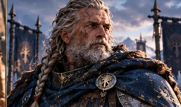

# Haldrek

*Étude visuelle provisoire issue d’une planche d’ensemble ; **apparence et détails à valider** avant de parler de portrait officiel.*

> [!info] Statut documentaire
> **Fiche de développement éditorial**, fondée sur le *Compendium des personnages et des relations* v1.7 et les scènes de campagne citées. Les faits joués, les intentions et les pistes narratives sont séparés. Les portraits proposés sont des **interprétations artistiques**, pas des descriptions physiques canoniques tant que leur apparence n'a pas été approuvée. Le dernier état du cycle CB43 prime sur les anciennes notes de conception.

*Il pose toujours la même question, parfois avant même qu'Orin ait terminé sa phrase : « Et si le plan ne fonctionne pas ? »*

## En quelques mots

**Haldrek** est le vétéran pour lequel une opération réussie ne prouve pas que sa méthode était sûre. Un soldat peut triompher par chance ; un bon formateur doit pouvoir enseigner **une procédure qui protège encore le lendemain**, y compris lorsque le chef, le prince ou le personnage le plus puissant est absent. Son expérience et son ironie dessinent une figure d'autorité exigeante, mais certainement pas hostile à l'autonomie de ses compagnons.

## Identité et état

- **Statut :** vivant ; Revenant de plein droit, **pas** entraîneur extérieur à la compagnie.
- **Rôle :** vétéran, capitaine connu d'Orin, préparation de missions, observation et entraînement opérationnel ; participation à la formation de futurs responsables.
- **Équipement :** longue-vue et insigne optique **achevés et placés dans un coffret** en CB42 ; la remise effective du coffret n'est pas montrée séparément dans le brut examiné.
- **Apparence :** homme marqué par l'expérience, tenue de terrain, arme d'exercice ou instrument d'observation ; couleur des cheveux et âge exact non fixés.

## Histoire

### Bien choisir une équipe, y compris ceux qui ne partent pas

Lors des préparatifs de l'expédition du **Mérien**, Haldrek évalue les candidats, mais refuse de transformer la sélection en jugement de valeur sur leur personne. Ceux qui restent ne deviennent pas des « recalés » sans avenir. Il travaille sur la protection d'Entre-Rives, les voies de retour et la possibilité qu'un chef tombe ou doive céder sa place. (*Compendium REV-07 ; CB2.*)

### Celui qui a vu le contrôle de Kelm

Il remarque Kelm non parce qu'il possède un marteau impressionnant, mais **parce qu'il retient une frappe pour protéger quelqu'un qui se tient au-delà de la cible**. Cette attitude annonce le type de combattant que Haldrek veut former : capable de s'arrêter, de discerner et de choisir. Le lien n'est pas une simple hiérarchie maître-élève immuable : Kelm devient progressivement capable de commander lui-même.

### Les entraînements contre Orin

Lors des exercices de la compagnie, Haldrek organise préparation, observation, communications et situations de contrainte. Orin s'amuse à perturber la défense par une multiplication de doubles et de tactiques inattendues. La réaction intéressante n'est pas le nombre de coups portés, mais la capacité des Revenants à établir des vérifications lorsque **même un message ou un visage connu peut être falsifié**. La meilleure leçon de l'exercice est que personne, pas même Haldrek, ne doit être irremplaçable. (*Campagne regroupée, CB33–34.*)

### Taagral — l'instruction à l'épreuve du réel

À Taagral, Haldrek rappelle que la circulation de l'information et le commandement de remplacement ne sont pas des formalités. **Dac** commande l'opération militaire d'ensemble, tandis que Ragna, Bram, Kelm et les autres prennent différentes responsabilités. Haldrek insiste : **une initiative heureuse n'est pas toujours une bonne procédure**. Son autorité sert à rendre les équipes autonomes, non à s'attribuer le résultat de chaque action. (*Continuité, Taagral, échanges 012–119.*)

### Valbrume — réserve n'est pas absence

Pendant l'incident de **Valbrume**, Haldrek reste disponible comme **réserve opérationnelle**, au cas où la situation exigerait une escalade. Cette fonction est distincte du commandement de l'ensemble confié à d'autres et de la réserve stratégique d'Orin. Il n'est ni sacrifié ni disparu. (*Compendium, actualisation CB39 P02944–04569.*)

### Les cadeaux d'honneur (CB42)

Haldrek est absent d'une partie des réunions sur les apprentis et doit donc être consulté : les autres ne décident pas définitivement de sa place à sa place. Sa **longue-vue** est réalisée puis mise dans un coffret destiné à une remise personnelle. Plus tard, il est **effectivement présent** à la cérémonie de Torgarl à Aldhammar. L'absence d'une scène de remise du coffret ne prouve pas qu'il ne l'a jamais reçu ; elle ne permet simplement pas de fixer le moment. (*CB42 P19455–21050.*)

### Un capitaine qu'Hroldan veut rencontrer (CB43)

Lorsqu'Orin évoque son capitaine Haldrek à **Hroldan**, celui-ci reconnaît un nom possible, mais **refuse d'affirmer qu'il s'agit de la même personne** : plusieurs hommes ont porté ce nom. Hroldan souhaite rencontrer Haldrek avant de prétendre partager un passé avec lui. **Ce lien n'est donc pas une ancienne camaraderie canoniquement établie.** (*Campagne Brut 4.3, entretien d'Orin et Hroldan.*)

## Caractère et interprétation

**Une autorité qui se corrige.** Haldrek apprécie davantage une erreur reconnue et corrigée qu'une bravade masquée.

**Pince-sans-rire.** Il sait annoncer, d'un regard, qu'il a déjà compris pourquoi une « excellente idée » d'Orin pourrait mal tourner.

**Prévoyant sans être maître de tout.** Le danger serait de vouloir contrôler chaque variable au lieu d'apprendre à ses élèves à improviser intelligemment. Cette faille reste une piste, pas un échec nécessairement joué.

## Relations

- **[[GRP-01|Les Revenants]] :** membre de plein droit, formateur interne et compagnon de route.
- **Orin / Alrick :** respect et contradiction utile, notamment lorsque les idées surgissent plus vite que les dispositifs de sécurité.
- **Kelm :** discipline de la force et apprentissage du commandement.
- **Ragna :** circulation réelle de l'autorité entre les phases.
- **Bram :** même exigence de couverture, responsabilités différentes selon la situation.
- **Dac :** commandement militaire professionnel ; ne pas confondre leurs fonctions.
- **Torgarl :** entraînement supérieur et doctrine du combat ; Haldrek développe surtout l'entraînement opérationnel.
- **Hroldan :** rencontre envisagée, ancien lien personnel **non confirmé**.

## Ressources et limites

L'insigne optique aide à **observer et comparer** ; il ne révèle pas par magie la vraie nature de tous les phénomènes. L'expérience de Haldrek n'est pas une solution instantanée aux structures anciennes. Son projet d'académie ou de formation ne vaut pas automatiquement une nomination à un poste permanent.

## Pistes ouvertes

- Remise documentée du coffret et usages de la longue-vue après CB42.
- Développement d'un cursus opérationnel pour futurs apprentis.
- Rencontre éventuelle avec Hroldan et confirmation, ou non, d'une histoire commune.

## Sources principales

- *Compendium des personnages*, v1.7, **REV-07**, actualisations CB39 et CB42.
- *Campagne brute regroupée*, **CB2**, **CB33–34** ; *Continuité*, Taagral, échanges 012–119.
- *Campagne Brut 4.2*, **CB42 P19455–21050**.
- *Campagne Brut 4.3*, entretien Hroldan (ne pas inventer de parenté d'armes).

## Feuillets liés

[[GRP-01|Les Revenants]] · [[REV-01|Bram]] · [[REV-03|Kelm]] · [[REV-02|Ragna]] · [[REV-08|Eamon]]