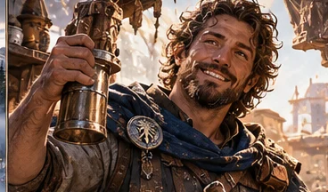

# Eamon

*Étude visuelle provisoire issue d’une planche d’ensemble ; **apparence et détails à valider** avant de parler de portrait officiel.*

> [!info] Statut documentaire
> **Fiche de développement éditorial**, fondée sur le *Compendium des personnages et des relations* v1.7 et les scènes de campagne citées. Les faits joués, les intentions et les pistes narratives sont séparés. Les portraits proposés sont des **interprétations artistiques**, pas des descriptions physiques canoniques tant que leur apparence n'a pas été approuvée. Le dernier état du cycle CB43 prime sur les anciennes notes de conception.

*Eamon ne collectionne pas seulement des faits. Il s'efforce de conserver la manière dont les gens les ont vécus.*

## En quelques mots

**Eamon** est un professeur, dessinateur, voyageur et enquêteur qui a appris auprès d'Alrick avant de devenir son égal dans une relation transformée. Il sait combien une archive peut oublier si elle ne conserve que le nom du prince ou le résultat d'une décision. Au sein des Revenants, il apporte les récits, les questions, la transmission et le droit d'affirmer que **l'on ne sait pas encore**. Son humour érudit est une présence familière dans la compagnie.

## Situation et appartenance

- **Statut :** vivant ; **Revenant de plein droit** par consentement personnel.
- **Travail :** professeur à **Skalor**, artiste et chercheur ; conserve **ses étudiants et ses obligations**.
- **Vie personnelle :** relation avec **Névane Carte-Claire** désormais traitée dans les scènes comme **un couple existant** (mise à jour 3.4). **Ni mariage, ni fiançailles, ni titre institutionnel** ne sont démontrés par cette évolution.
- **Équipement :** carnet de recherche à annotation et classement contrôlé, produit en CB42 ; matériel de dessin et de voyage.
- **Apparence :** personnage observateur, carnet toujours accessible, tenue pratique ; âge et traits physiques précis non fixés.

## Parcours et évolution

### L'apprenti d'Alrick — devenir un artiste

Eamon a d'abord appris auprès d'**Alrick**, auprès duquel il affine le regard, la mémoire et la capacité à poser des questions avant de raconter. Il parcourt les routes, recueille des histoires, en particulier des **récits nahrim**, et apprend à donner une place aux voix qu'un registre officiel aurait écartées. Sa vie dépasse cependant celle d'un personnage né pour expliquer au lecteur la grandeur du prince. (*Compendium REV-08, CB1–2.*)

### Une adhésion avec des conditions

Quand il rejoint les Revenants, Eamon accepte les voyages et le partage du savoir, mais dit une chose très claire : **il ne redevient pas l'apprenti d'Orin**. Il a des élèves, ses travaux, des responsabilités à Skalor et la liberté de refuser des expéditions. Orin accepte ces conditions ; l'adhésion devient un geste de confiance entre personnes autonomes, non le retour à une hiérarchie oubliée. (*Campagne regroupée, CB31.*)

### Les exercices — désapprendre certains gestes

Avec **Heimdall**, Eamon reprend l'escrime auprès du général **Dac**. Le contraste est instructif : Eamon doit corriger des habitudes anciennes, tandis que Heimdall construit des gestes nouveaux sans avoir à défaire les mêmes réflexes. L'entraînement complète sa pédagogie, mais il n'en devient pas pour autant un guerrier invincible. Pendant l'exercice des clones des Revenants, son attention aux consignes et aux informations confirme l'importance de **vérifier qui parle et ce qui a été réellement dit**. (*Compendium REV-06 ; Campagne regroupée, CB32–34.*)

### Névane et l'art de garder une histoire exacte

Les deux personnages collaborent depuis longtemps à la documentation des Cercles, cartes et expériences. Ils s'attachent à séparer **observation**, **hypothèse** et **interprétation**. **Les sources les traitent désormais comme un couple**, ce qui corrige les fiches plus anciennes qui ne parlaient que d'une complicité équivoque. Cette relation ne permet pas de leur inventer un mariage ni une dépendance mutuelle dans leurs fonctions. (*Compendium, actualisation 3.4 ; REV-08 et REV-09.*)

### L'institut et les futurs apprentis — dire oui à l'idée, pas à tous les postes

Eamon s'intéresse aux bibliothèques, à l'université et à la transmission transversale. Il voit ce qu'un apprenti de Bram pourrait apprendre de Torven, ou ce que l'histoire peut offrir à un protecteur. **Il n'est pas nommé automatiquement directeur de la nouvelle université** : les documents soulignent au contraire le risque de lui accumuler des charges sans son consentement. En CB42, il reçoit un carnet permettant **annotation, classement et copie contrôlée**. Les usages exacts demeurent soumis aux limites de l'objet ; aucun accès universel à tous les savoirs. (*CB37–38 ; CB42 P18752–19902.*)

### Dorsa au manoir — accueillir avant de décider (CB43)

Orin appelle Eamon pour accompagner **Dorsa Vaun**, invitée à visiter le manoir des Revenants afin de comprendre ses habitants et ses besoins avant toute décision sur un emploi possible. Eamon accepte, accueille Dorsa et l'accompagne **sans lui présenter les chambres privées comme des espaces ouverts**. La visite est **une observation rémunérée**, pas une nomination d'intendante. Ce petit épisode illustre sa manière de relier la courtoisie, les informations pratiques et l'autonomie des personnes. (*Campagne Brut 4.3, CB43 P01075–01157.*)

## Caractère et voix

**Curiosité généreuse.** Eamon veut savoir ce que les témoins ont réellement vu, mais surtout ce qu'ils souhaiteraient ne pas voir disparaître.

**Ironie intellectuelle.** Il peut commencer une conférence imprévue au milieu d'un repas, ce qui pousse Bram et Ragna à le rappeler à la vie commune.

**Une liberté devenue ferme.** Il sait refuser une fonction prestigieuse pour continuer un travail plus modeste qu'il considère essentiel.

**Risquer de trop retenir.** Le droit de ne pas raconter une histoire doit rester aussi important que son désir de la préserver.

## Relations

- **Orin / Alrick :** ancien mentor devenu compagnon et ami ; Eamon n'est plus son élève.
- **Névane Carte-Claire :** couple attesté dans les mises à jour récentes, partenariat de recherches et de méthodes.
- **Alice :** échanges de bibliothèque et de mémoire à Skalor ; travail intellectuel distinct de la vie de couple.
- **Heimdall :** recherches sur les passages, partage des protocoles et entraînement à l'épée avec Dac.
- **Dac :** maître d'armes ; correction des gestes et des habitudes.
- **Bram et Ragna :** répliques complices lorsqu'il transforme une conversation en séminaire.
- **Dorsa Vaun :** accueil et accompagnement en CB43, sans promesse de fonction future.
- **[[GRP-01|Les Revenants]] :** cercle choisi ; ne lui impose pas d'abandonner ses étudiants.

## Équipement et limites

Le carnet réalisé en CB42 améliore le travail documentaire par **classement, annotations et copies volontaires**. Il ne recueille pas automatiquement toutes les pensées et n'autorise pas à lire les écrits privés. De même, être conseiller de projets savants ne vaut pas nomination de directeur.

## Projets ouverts, non joués

- Répartition de ses responsabilités à Skalor et dans les institutions futures.
- Récits personnels que ses élèves souhaitent sauver sans les soumettre à l'histoire d'Orin.
- Développement de ses créations artistiques sans fonction pratique.

## Sources principales

- *Compendium des personnages*, v1.7, **REV-08**, états CB37–43 et **mise à jour 3.4 Eamon–Névane**.
- *Campagne brute regroupée*, **CB31–34** ; *Campagne Brut 4.2*, **CB42 P18752–19902**.
- *Campagne Brut 4.3*, **CB43 P01075–01157** (Dorsa).

## Feuillets liés

[[GRP-01|Les Revenants]] · [[REV-06|Heimdall]] · [[REV-01|Bram]] · [[REV-02|Ragna]] · [[REV-07|Haldrek]]