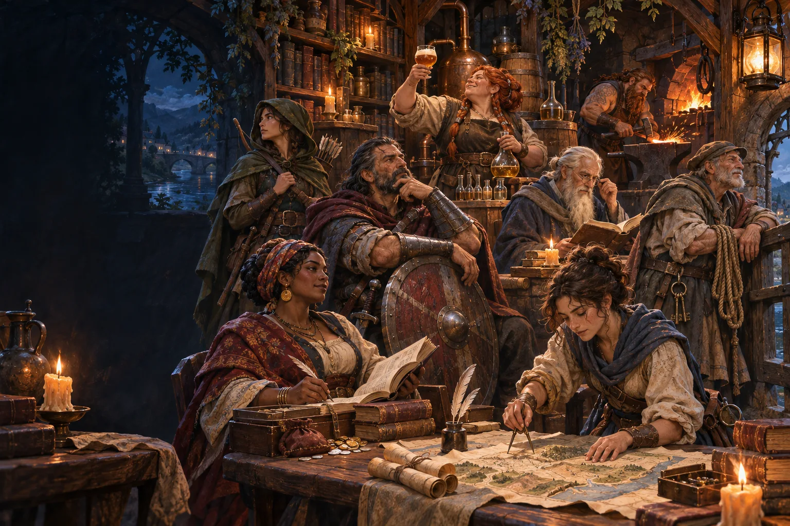

# Le Cabinet des Rencontres

*Fresque créée pour le prototype PNJ-001 : les silhouettes sont des archétypes de jeu, **pas** des portraits des personnages nommés ci-dessous. Cette sélection est un brouillon non publié.*

Soixante-six noms qui existent déjà dans les Archives, autant de portes d'entrée pour une table. **Chaque nom renvoie à une seule fiche source** : le catalogue ne réécrit ni l'histoire, ni les liens familiaux, ni les appartenances. Les amorces proposées aux MJ demeurent non jouées. Les fiches à révélations restent à avertissement ; ce sommaire lui-même n'est pas proposé à la publication sans examen. Cinq fiches supplémentaires sont **non publiées** et ne doivent pas être offertes aux joueurs par défaut.

## La compagnie

- [[REV-01|Bram Vieux-Fer]] — l'art du repli et de la protection.
- [[REV-02|Ragna Pierre-Sèche]] — écouter, observer, décider.
- [[REV-03|Kelm Poing-Calme]] — la force sans brutalité gratuite.
- [[REV-04|Vaëra]] — la discrétion et l'autonomie.
- [[REV-05|Torven Cendreval]] — soigner avant de compter les victoires.
- [[REV-06|Heimdall]] — veiller avec des limites.
- [[REV-07|Haldrek]] — organiser la discipline et les retraites.
- [[REV-08|Eamon]] — transmettre et vérifier les récits.

## Mentors et proches

- [[PER-CB2-TORGARL|Torgarl]] — consulter avant de décider.
- [[PER-CB31-YLVA|Ylva]] — enseigner la discrétion réaliste.
- [[PER-CB43-ELYAN-CORBEAU-GRIS|Elyan Corbeau-Gris]] — chercher, transmettre, questionner.
- [[PER-CB31-ASTRID|Astrid]] — arbitrer les aides aux ateliers.
- [[PER-CB31-FREYA|Freya]] — mémoire et liens personnels.
- [[PER-CB31-ALRIANA|Alriana]] — récits et traces d'une vie, sans en inventer la fin.
- [[FAM-06|Harald Forgecœur]] — le service, les armes et les runes.
- [[PER-CB1-EDRIC|Edric Varen / Edric de Valbrume]] — navigation et logistique, puis fonction ducale selon l'époque.
- [[PER-CB31-SERELYA|Serelya]] — fêtes, marchés et écoute des communautés.
- [[PER-CB31-MAELYA|Maëlya]] — mots, traductions et échanges entre communautés ; mariage situé dans sa période jouée.
- [[PER-CB43-CESAR|César]] — chat parlant, hospitalité sans fonction imposée.
- [[PER-CB42-RES-08-EREN-VALOMBRE|Éren Valombre]] — vie retrouvée et libre choix de voyage ; distinct d'Eren gardien.
- [[PER-CB42-RES-18-NAELINE-FENDRELUNE|Naëline Fendrelune]] — dessin et liberté après le Rappel, sans obligation d'emploi.
- [[PER-CB43-NAHLA-SEREVIN|Nahla Serevin]] — coordination du cabinet personnel dans les limites de son contrat signé.

## Métiers et territoires

- [[PER-CB31-MARA-VIFACIER|Mara Vifacier]] — forger pour un corps et un usage.
- [[PER-CB31-SIVRA-BRASSEFEUILLE|Sivra Brassefeuille]] — fermenter, essayer, créer.
- [[PER-CB42-LYSANDRA-DAVARENNE|Lysandra d'Avarenne]] — cultiver et examiner l'eau.
- [[PER-CB42-RES-03-BRAKKA-MAINFRANCHE|Brakka Mainfranche]] — accueillir une caravane sans contrat inventé.
- [[PER-CB42-RES-01-DORRIK-VALECLEF|Dorrik Valeclef]] — le protocole d'une époque révolue ; **décédé** au dernier état connu.
- [[PER-CB44-HELOINE-VALCIR|Héloïne Valcir]] — recevoir sans exclure.
- [[PER-CB44-BERRIK-TROIS-TONNEAUX|Berrik Trois-Tonneaux]] — l'art des caves.
- [[PER-CB44-SELYA-VIGNEBRUME|Selya Vignebrume]] — collections et producteurs.
- [[PER-CB44-ODRAN-VALCENDRE|Odran Valcendre]] — le terroir et l'indépendance de l'artisan.
- [[PER-CB31-ELYRA|Elyra]] — vêtement vivant, autonomie et transmission textile.
- [[PER-CB31-AERENDIR|Aerendir]] — artisan voyageur et réparation du quotidien.
- [[PER-CB31-LETHIEL|Lethiel]] — architecture, usages et acoustique.
- [[PER-CB43-MIRELDA-CHENECLAIR|Mirelda Chêneclair]] — tonnellerie et fermentation expérimentale.
- [[PER-CB31-DURGAN|Durgan Main-d'Acier]] — le geste de forge avant la puissance de l'outil.
- [[PER-CB38-MAEL-TORVENN|Maël Torvenn]] — instruments réparables et transmission musicale ; distinct de Torven Cendreval.
- [[PER-CB42-RES-02-MIRENA-VALCOURT|Mirena Valcourt]] — intendance, autonomie des équipes et rythme de travail.
- [[PER-CB42-RES-05-YSANNE-TROIS-FOURS|Ysanne des Trois-Fours]] — cuisine, mémoire et accueil des voyageurs.
- [[SEC-68|Célianne]] — botanique choisie librement, sans contrat par parenté.
- [[PER-CB42-RES-07-DAGNA-ROUE-CUIVRE|Dagna Roue-de-Cuivre]] — levage, pompes et sécurité ; **fiche non publiée, aucune embauche**.
- [[PER-CB42-RES-10-LIORA-POMMEBRUNE|Liora Pommebrune]] — savoir-faire d'accueil ; **fiche non publiée, aucun contrat**.
- [[PER-CB42-RES-12-VASKA-PERLEDOMBRE|Vaska Perledombre]] — ravitaillement des petites communautés ; **fiche non publiée, aucun contrat**.
- [[PER-CB42-RES-14-FARWEN-PIERRECLAIRE|Farwen Pierreclaire]] — entretien d'Aldhammar ; **fiche non publiée, aucun contrat**.
- [[PER-CB42-RES-16-MARGHA-TROIS-MERS|Margha Trois-Mers]] — cuisine de bord ; recrutement confirmé, signature non mise en scène.

## Savoirs et gardiens

- [[PER-CB2-MAELIN|Maelin]] — maintenir sans porter seule la charge.
- [[PER-CB2-RUDEK|Rudek]] — la pierre et ses fondations.
- [[PER-CB2-SELA|Sela]] — cordages, tensions et témoignages.
- [[PER-CB2-SOREN|Eren]] — transmettre ; **le code ancien conserve « SOREN »**, mais ce n'est pas le marin Sören.
- [[PER-CB43-ERYNDEL-FORMULES-INACHEVEES|Eryndel des Formules Inachevées]] — recherche indépendante.
- [[PER-CB44-BREGAN-BATISSEURS|Brégan des Bâtisseurs]] — construire par adhésion, pas par absorption.
- [[PER-CB1-SIGRID|Sigrid]] — mémoire entretenue au Champ des Noms.
- [[PER-CB1-SOREN|Sören, le vieux marin]] — lire des traces anciennes ; **distinct d'Eren** et sans révélation du lieu.
- [[PER-CB2-DAGRIN|Dagrin Veine-Sombre]] — mesurer et accepter de ne pas savoir.
- [[PER-CB31-THAERON|Thaëron]] — musique, écoute et résonance des salles.
- [[PER-CB39-DALEN-MIR|Dalen Mir]] — infrastructures, notes et administration.
- [[PER-CB39-SARIEL-VARN|Sariel Varn]] — limites du pouvoir et responsabilité du Conseil.
- [[PER-CB39-SERAH-DENVAR|Serah Denvar]] — commandement et formation envisagée, non acquise d'avance.
- [[PER-CB42-RES-06-THALEA-BRISE-ECUME|Thaléa Brise-Écume]] — responsabilité nautique et décisions de capitaine.
- [[RES-28|Larek]] — apprenti marin et liberté de progresser à son rythme.
- [[SEC-74|Odris Ferren]] — machines d'eau réparables sur place.
- [[SEC-63|Tomas]] — apprentissage des Cercles sans maîtrise élevée automatique.
- [[PER-CB39-OREN-DAST|Oren Dast]] — développement d'Orinor et arbitrage des moyens.
- [[PER-CB39-YSE-KORR|Yse Korr]] — coopération militaire et sécurité des routes.
- [[PER-CB42-RES-13-NERYS-SILVENAINE|Nerys Silvenaine]] — entretien des enchantements ; **fiche non publiée, accès non prouvé**.
- [[PER-CB42-RES-15-LURNE-BRISE-BOULON|Lurne Brise-Boulon]] — navigation astronomique et contrat de cartographe signé.

## Illustrations et variantes

Les portraits déjà présents dans les Archives sont réutilisés avec leurs statuts propres. Les concepts supplémentaires de **Mara**, **Sivra**, **Sigrid**, **Mirelda**, **Sariel** et **Naëline** ne fixent pas leurs traits physiques ; les autres cartes sans portrait utilisent des emblèmes décoratifs provisoires. Aucune image du catalogue n'attribue un état de Rappelé, un grade, un âge non attesté, un lien familial ou une affiliation. Le portrait de Naëline montre une possibilité graphique de son intérêt pour le dessin, non une scène jouée ni une apparence attestée.

**Trois inspirations visuelles externes** sont proposées pour Durgan (une forge), Célianne (une planche botanique) et Thaléa (une marine). Elles proviennent de [Wikimedia Commons](https://commons.wikimedia.org/) avec auteurs, pages sources et mentions de licence conservés. Elles ne sont **ni** des portraits de ces personnes **ni** des documents du monde. Dans le prototype HTML, les images distantes sont **désactivées par défaut** : leur affichage est un choix du lecteur et peut transmettre une requête au site hébergeant l'image. Voir `docs/pnj/PNJ-003_SOURCES_VISUELLES.md`.

Chaque fiche peut servir plusieurs campagnes et, plus tard, plusieurs profils 5d6 **référencés et versionnés séparément**. Le présent catalogue n'attribue aucune statistique, XP, capacité ou rang. Les rencontres proposées sont des options, non des événements passés.

## Suivi éditorial

- **Version de travail :** PNJ-001 à PNJ-004, 16 novembre 2026 ; sous revue, non publiée.
- **Sources :** les soixante-six fiches liées, leurs `source_brute`, le [contrat éditorial](https://github.com/Sijiel44/archives-alrick/blob/main/CONTRAT_EDITORIAL.md) et le Compendium lorsqu'il est cité par chaque fiche.
- **Décisions ouvertes :** choix des portraits définitifs, ordre de publication, traitement des révélations, adaptations mécaniques INDEX/MATH et raccord de cette présentation au Studio MJ.
