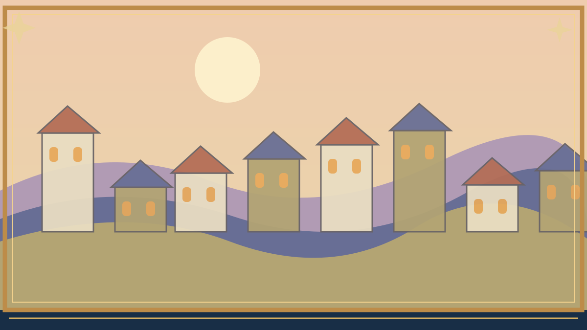

# La capitale relevée d’Orinor

*Le symbole de la reconstruction de Duchêne — illustration d’ambiance originale, non cartographique.*

> **À PUBLIER DANS L’ATLAS ET LE LORE — BROUILLON NON PUBLIC.** **Acquis :** la capitale existe dans l’histoire de Duchêne ; sa reconstruction est son identité retenue. **Le nom historique reste non confirmé**. Les autres quartiers, cultures, paysages et intrigues sont **des propositions non jouées**. Le dessin ne fixe ni frontière ni distance.

## Portrait du territoire
Ville ancienne dont le nom d’archives reste à confirmer. Des palais hérités du régime précédent ont été réaffectés ; la reconstruction est devenue un projet politique, architectural et mémoriel.

## Habitants et rythmes de vie
Marchés, écoles, ateliers et assemblées voisinent avec des hôtels diplomatiques. La ville ne se réduit pas aux cérémonies royales.

## Économie, visiteurs et relations
Gouvernement élu, justice, archives, diplomatie, arts, culture et hôtellerie de prestige.

Pour les échanges nationaux, cette localité est à mettre en relation avec les autres villes d’Orinor et avec les partenaires des Montagnes de l’Aube. L’accueil des visiteurs doit exister pour plusieurs budgets, sans réserver les services civiques aux riches ni aux fidèles d’Orin.

## Lieux à créer et à vérifier
- **Le Vieux Palais réaffecté** — nom de lieu proposé, non attesté dans la campagne.
- **Parvis des Délibérations** — nom de lieu proposé, non attesté dans la campagne.
- **Jardins de la Place** — nom de lieu proposé, non attesté dans la campagne.

## Un conflit qui fait vivre le lieu
Conserver les traces d’une tyrannie sans faire de la ville un musée figé. La réponse appartient aux habitants, aux représentants élus et aux autorités compétentes : aucune intervention divine automatique n’est présumée.

## À jouer — amorce jamais jouée
Des dossiers de procès de Duchêne ressurgissent derrière les murs de l’ancien palais. Qui protégera les témoins et les archives ?

## Place dans le royaume et limites du canon
Le Saint Royaume d’Orinor est l’ancien Duchêne. Orin demeure son souverain tutélaire, mais le créateur retient une **monarchie constitutionnelle administrée par des représentants élus**. Les croyances restent libres : nul ne doit prier Orin pour conserver sa place. La **monnaie commune et l’alliance privilégiée avec les Montagnes de l’Aube** sont des décisions récentes du créateur, qui prévalent sur la formulation plus ancienne des plans CB39 où elles étaient encore en projet. Les usages exacts des passages entre Couronnes nécessitent des validations distinctes.

## Autres fiches du lot

- [Registre des arbitrages](../DECISIONS_ET_PROVENANCE.md)

## Documentation
Sources de contexte : [GEO-002 — Orinor](../../../content/lieux/GEO-002.md), [passages entre Couronnes](../../../content/monde/passages-entre-couronnes.md) et *Campagnes brutes 3.7–4.3*. Les détails inventés ici sont des propositions de création autonome et ne sont pas présentés comme des scènes jouées.
