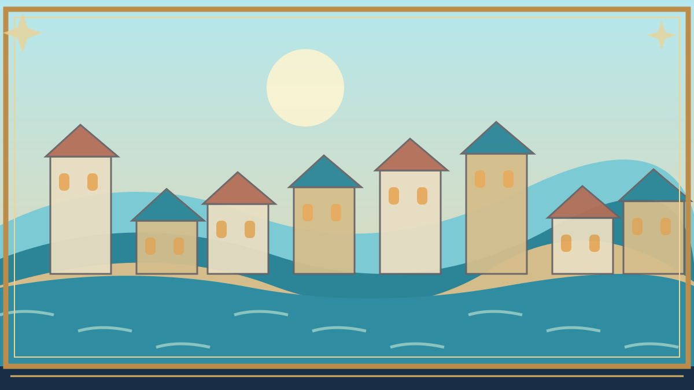

# Bellécume

*Grande cité de la mer, du luxe et des vacances — illustration d’ambiance originale, non cartographique.*

> **À PUBLIER DANS L’ATLAS ET LE LORE — BROUILLON NON PUBLIC.** **Acquis :** nom de ville et fonction principale retenus. Les autres quartiers, cultures, paysages et intrigues sont **des propositions non jouées**. Le dessin ne fixe ni frontière ni distance.

## Portrait du territoire
Métropole côtière construite autour d’une baie abritée ; les quais historiques ont été étendus par des promenades, des villas, des jardins et des établissements de villégiature.

## Habitants et rythmes de vie
Les habitants vivent des chantiers, de la pêche, des marchés et des services. Les travailleurs de l’hôtellerie doivent conserver accès aux mêmes plages que les visiteurs.

## Économie, visiteurs et relations
Maisons de commerce, port, écoles hôtelières, parfums, verreries, haute cuisine, palaces classiques et magiques.

Pour les échanges nationaux, cette localité est à mettre en relation avec les autres villes d’Orinor et avec les partenaires des Montagnes de l’Aube. L’accueil des visiteurs doit exister pour plusieurs budgets, sans réserver les services civiques aux riches ni aux fidèles d’Orin.

## Lieux à créer et à vérifier
- **Grand Port** — nom de lieu proposé, non attesté dans la campagne.
- **Promenade des Ors** — nom de lieu proposé, non attesté dans la campagne.
- **Vieilles Voiles** — nom de lieu proposé, non attesté dans la campagne.
- **Darse des Voyageurs** — nom de lieu proposé, non attesté dans la campagne.

## Un conflit qui fait vivre le lieu
Un investisseur cherche une concession exclusive sur une plage fréquentée de longue date. La réponse appartient aux habitants, aux représentants élus et aux autorités compétentes : aucune intervention divine automatique n’est présumée.

## À jouer — amorce jamais jouée
Les PJ retrouvent des actes portuaires qui pourraient contredire la concession d’un hôtel prestigieux.

## Place dans le royaume et limites du canon
Le Saint Royaume d’Orinor est l’ancien Duchêne. Orin demeure son souverain tutélaire, mais le créateur retient une **monarchie constitutionnelle administrée par des représentants élus**. Les croyances restent libres : nul ne doit prier Orin pour conserver sa place. La **monnaie commune et l’alliance privilégiée avec les Montagnes de l’Aube** sont des décisions récentes du créateur, qui prévalent sur la formulation plus ancienne des plans CB39 où elles étaient encore en projet. Les usages exacts des passages entre Couronnes nécessitent des validations distinctes.

## Autres fiches du lot
- [Les Côtes lumineuses](ori-reg-002.md)
- [Caldrine](ori-loc-003.md)
- [Port-Écaille](ori-loc-004.md)
- [Registre des arbitrages](../DECISIONS_ET_PROVENANCE.md)

## Documentation
Sources de contexte : [GEO-002 — Orinor](../../../content/lieux/GEO-002.md), [passages entre Couronnes](../../../content/monde/passages-entre-couronnes.md) et *Campagnes brutes 3.7–4.3*. Les détails inventés ici sont des propositions de création autonome et ne sont pas présentés comme des scènes jouées.
