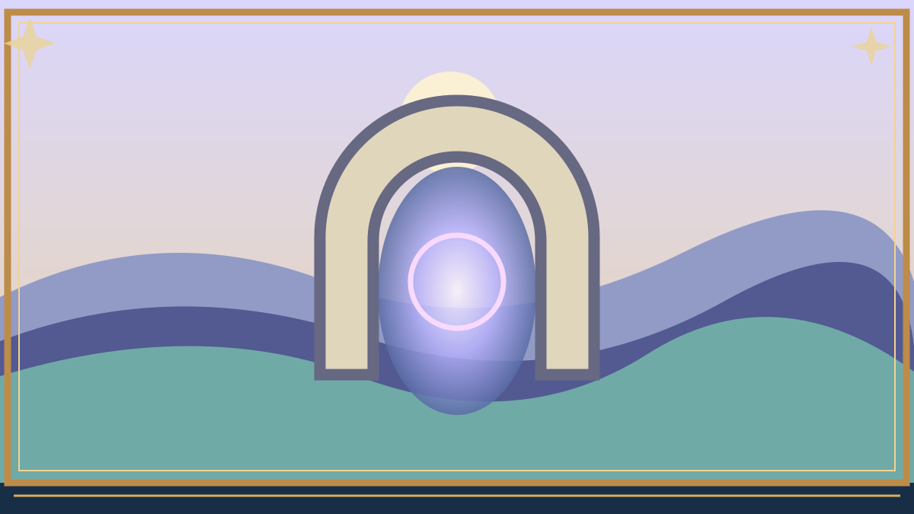

# Clairseuil

*La cité des savoirs, de la magie et des rencontres — illustration d’ambiance originale, non cartographique.*

> **À PUBLIER DANS L’ATLAS ET LE LORE — BROUILLON NON PUBLIC.** **Acquis :** nom de ville et fonction principale retenus. Les autres quartiers, cultures, paysages et intrigues sont **des propositions non jouées**. Le dessin ne fixe ni frontière ni distance.

## Portrait du territoire
Les cours, bibliothèques, observatoires, maisons de traduction et jardins savants sont pensés comme un ensemble cosmopolite. La ville ne remplace pas l’École de l’Espace sur demande.

## Habitants et rythmes de vie
Enseignants, étudiants, artisans, gardiens et visiteurs des Couronnes y travaillent. Tous les habitants ne sont pas magiciens et nul ne doit perdre ses droits pour cela.

## Économie, visiteurs et relations
Recherche magique, reliure, traduction, instruments, hôtellerie des congrès, accueil de voyageurs accrédités.

Pour les échanges nationaux, cette localité est à mettre en relation avec les autres villes d’Orinor et avec les partenaires des Montagnes de l’Aube. L’accueil des visiteurs doit exister pour plusieurs budgets, sans réserver les services civiques aux riches ni aux fidèles d’Orin.

## Lieux à créer et à vérifier
- **Grandes Archives** — nom de lieu proposé, non attesté dans la campagne.
- **Cercle académique** — nom de lieu proposé, non attesté dans la campagne.
- **Maisons étrangères** — nom de lieu proposé, non attesté dans la campagne.
- **Portes surveillées** — nom de lieu proposé, non attesté dans la campagne.

## Un conflit qui fait vivre le lieu
Les chercheurs les plus prestigieux captent les financements au détriment de l’enseignement populaire. La réponse appartient aux habitants, aux représentants élus et aux autorités compétentes : aucune intervention divine automatique n’est présumée.

## À jouer — amorce jamais jouée
Une interruption de passage laisse des familles séparées. Les PJ cherchent une solution administrative et magique sans franchissement illégal.

## Place dans le royaume et limites du canon
Le Saint Royaume d’Orinor est l’ancien Duchêne. Orin demeure son souverain tutélaire, mais le créateur retient une **monarchie constitutionnelle administrée par des représentants élus**. Les croyances restent libres : nul ne doit prier Orin pour conserver sa place. La **monnaie commune et l’alliance privilégiée avec les Montagnes de l’Aube** sont des décisions récentes du créateur, qui prévalent sur la formulation plus ancienne des plans CB39 où elles étaient encore en projet. Les usages exacts des passages entre Couronnes nécessitent des validations distinctes.

## Autres fiches du lot
- [Les Marches des Passages](ori-reg-005.md)
- [Veilleporte](ori-loc-009.md)
- [Clairval](ori-loc-010.md)
- [Registre des arbitrages](../DECISIONS_ET_PROVENANCE.md)

## Documentation
Sources de contexte : [GEO-002 — Orinor](../../../content/lieux/GEO-002.md), [passages entre Couronnes](../../../content/monde/passages-entre-couronnes.md) et *Campagnes brutes 3.7–4.3*. Les détails inventés ici sont des propositions de création autonome et ne sont pas présentés comme des scènes jouées.
