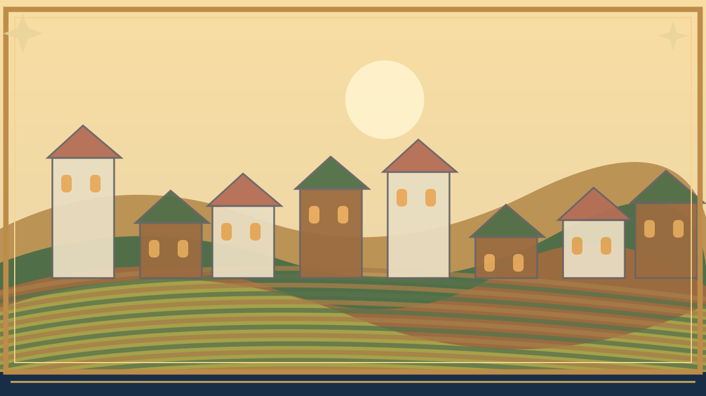

# Bréval

*La grande ville des six terroirs — illustration d’ambiance originale, non cartographique.*

> **À PUBLIER DANS L’ATLAS ET LE LORE — BROUILLON NON PUBLIC.** **Acquis :** nom de ville et fonction principale retenus. Les autres quartiers, cultures, paysages et intrigues sont **des propositions non jouées**. Le dessin ne fixe ni frontière ni distance.

## Portrait du territoire
Marchés et caves s’imbriquent avec des quartiers anciens et les routes du Grand Bassin de Bréval ; les rapports exacts avec les autres terroirs restent culturels.

## Habitants et rythmes de vie
Les restaurateurs, producteurs, caveurs, négociants et transporteurs se rencontrent dans les halles. Les grandes maisons n’effacent pas l’identité des domaines modestes.

## Économie, visiteurs et relations
Vins d’assemblage, affinage, gastronomie, tonnellerie, concours et commerce de produits de luxe.

Pour les échanges nationaux, cette localité est à mettre en relation avec les autres villes d’Orinor et avec les partenaires des Montagnes de l’Aube. L’accueil des visiteurs doit exister pour plusieurs budgets, sans réserver les services civiques aux riches ni aux fidèles d’Orin.

## Lieux à créer et à vérifier
- **Halle des Six Terroirs** — nom de lieu proposé, non attesté dans la campagne.
- **Grandes Caves** — nom de lieu proposé, non attesté dans la campagne.
- **Vieille-Pierre** — nom de lieu proposé, non attesté dans la campagne.
- **Jardins des Saveurs** — nom de lieu proposé, non attesté dans la campagne.

## Un conflit qui fait vivre le lieu
Les petits domaines contestent les critères d’un concours régional dominé par les grands négociants. La réponse appartient aux habitants, aux représentants élus et aux autorités compétentes : aucune intervention divine automatique n’est présumée.

## À jouer — amorce jamais jouée
Une dégustation prestigieuse révèle des lots mal étiquetés. L’enquête doit distinguer fraude, erreur et divergence de tradition.

## Place dans le royaume et limites du canon
Le Saint Royaume d’Orinor est l’ancien Duchêne. Orin demeure son souverain tutélaire, mais le créateur retient une **monarchie constitutionnelle administrée par des représentants élus**. Les croyances restent libres : nul ne doit prier Orin pour conserver sa place. La **monnaie commune et l’alliance privilégiée avec les Montagnes de l’Aube** sont des décisions récentes du créateur, qui prévalent sur la formulation plus ancienne des plans CB39 où elles étaient encore en projet. Les usages exacts des passages entre Couronnes nécessitent des validations distinctes.

## Autres fiches du lot
- [Orignac](ori-reg-001.md)
- [Vaurenne](ori-loc-001.md)
- [Saulaie-des-Sept-Saules](ori-loc-002.md)
- [Registre des arbitrages](../DECISIONS_ET_PROVENANCE.md)

## Documentation
Sources de contexte : [GEO-002 — Orinor](../../../content/lieux/GEO-002.md), [passages entre Couronnes](../../../content/monde/passages-entre-couronnes.md) et *Campagnes brutes 3.7–4.3*. Les détails inventés ici sont des propositions de création autonome et ne sont pas présentés comme des scènes jouées.
