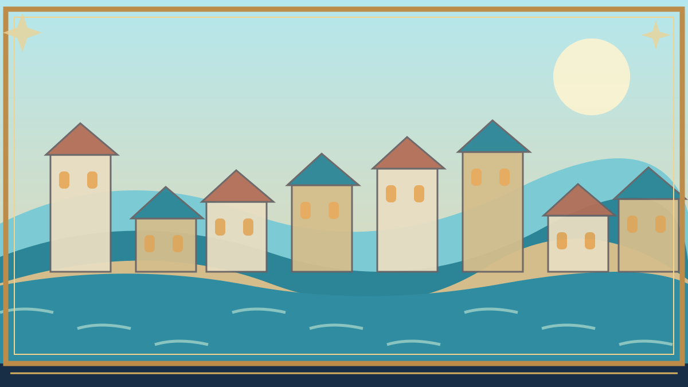

# Port-Écaille

*Village de pêche aux maisons colorées — illustration d’ambiance originale, non cartographique.*

> **À PUBLIER DANS L’ATLAS ET LE LORE — BROUILLON NON PUBLIC.** **À arbitrer :** nom ou implantation de la localité, quartiers et établissements. Les autres quartiers, cultures, paysages et intrigues sont **des propositions non jouées**. Le dessin ne fixe ni frontière ni distance.

## Portrait du territoire
Crique étroite, pontons, casiers et vieux escalier de pierre.

## Habitants et rythmes de vie
La vie suit les marées, le travail des filets et les départs des petits bateaux.

## Économie, visiteurs et relations
Pêche, salaisons, petite restauration marine et accueil familial.

Pour les échanges nationaux, cette localité est à mettre en relation avec les autres villes d’Orinor et avec les partenaires des Montagnes de l’Aube. L’accueil des visiteurs doit exister pour plusieurs budgets, sans réserver les services civiques aux riches ni aux fidèles d’Orin.

## Lieux à créer et à vérifier
- **La Jetée des Filets** — nom de lieu proposé, non attesté dans la campagne.
- **Atelier des Écailles** — nom de lieu proposé, non attesté dans la campagne.

## Un conflit qui fait vivre le lieu
Le développement d’un port de plaisance modifie les usages du quai. La réponse appartient aux habitants, aux représentants élus et aux autorités compétentes : aucune intervention divine automatique n’est présumée.

## À jouer — amorce jamais jouée
Des bateaux rentrent avec des traces d’un obstacle dangereux non signalé.

## Place dans le royaume et limites du canon
Le Saint Royaume d’Orinor est l’ancien Duchêne. Orin demeure son souverain tutélaire, mais le créateur retient une **monarchie constitutionnelle administrée par des représentants élus**. Les croyances restent libres : nul ne doit prier Orin pour conserver sa place. La **monnaie commune et l’alliance privilégiée avec les Montagnes de l’Aube** sont des décisions récentes du créateur, qui prévalent sur la formulation plus ancienne des plans CB39 où elles étaient encore en projet. Les usages exacts des passages entre Couronnes nécessitent des validations distinctes.

## Autres fiches du lot
- [Les Côtes lumineuses](ori-reg-002.md)
- [Bellécume](ori-cit-001.md)
- [Caldrine](ori-loc-003.md)
- [Registre des arbitrages](../DECISIONS_ET_PROVENANCE.md)

## Documentation
Sources de contexte : [GEO-002 — Orinor](../../../content/lieux/GEO-002.md), [passages entre Couronnes](../../../content/monde/passages-entre-couronnes.md) et *Campagnes brutes 3.7–4.3*. Les détails inventés ici sont des propositions de création autonome et ne sont pas présentés comme des scènes jouées.
