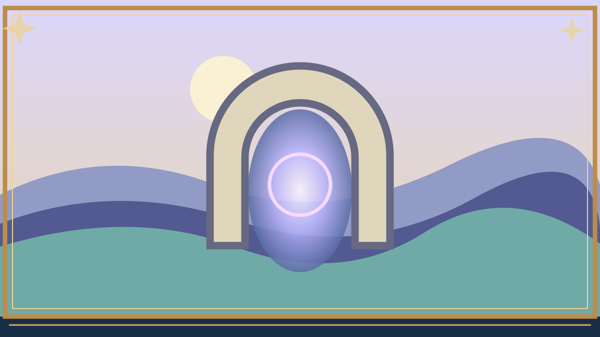

# Veilleporte

*Bourg d’accueil et de relais — illustration d’ambiance originale, non cartographique.*

> **À PUBLIER DANS L’ATLAS ET LE LORE — BROUILLON NON PUBLIC.** **À arbitrer :** nom ou implantation de la localité, quartiers et établissements. Les autres quartiers, cultures, paysages et intrigues sont **des propositions non jouées**. Le dessin ne fixe ni frontière ni distance.

## Portrait du territoire
Route des voyageurs bordée de maisons d’hôtes, postes d’information et anciens pavillons.

## Habitants et rythmes de vie
Les interprètes, hébergeurs et agents civiques aident ceux qui ne comprennent pas les usages locaux.

## Économie, visiteurs et relations
Accueil, traduction, relais, restauration et contrôle des documents.

Pour les échanges nationaux, cette localité est à mettre en relation avec les autres villes d’Orinor et avec les partenaires des Montagnes de l’Aube. L’accueil des visiteurs doit exister pour plusieurs budgets, sans réserver les services civiques aux riches ni aux fidèles d’Orin.

## Lieux à créer et à vérifier
- **Maison des Interprètes** — nom de lieu proposé, non attesté dans la campagne.
- **Relais des Enseignes** — nom de lieu proposé, non attesté dans la campagne.

## Un conflit qui fait vivre le lieu
Des voyageurs disposent de recommandations contradictoires sur leur droit de passage. La réponse appartient aux habitants, aux représentants élus et aux autorités compétentes : aucune intervention divine automatique n’est présumée.

## À jouer — amorce jamais jouée
Un voyageur perd ses documents pendant une fermeture de transit.

## Place dans le royaume et limites du canon
Le Saint Royaume d’Orinor est l’ancien Duchêne. Orin demeure son souverain tutélaire, mais le créateur retient une **monarchie constitutionnelle administrée par des représentants élus**. Les croyances restent libres : nul ne doit prier Orin pour conserver sa place. La **monnaie commune et l’alliance privilégiée avec les Montagnes de l’Aube** sont des décisions récentes du créateur, qui prévalent sur la formulation plus ancienne des plans CB39 où elles étaient encore en projet. Les usages exacts des passages entre Couronnes nécessitent des validations distinctes.

## Autres fiches du lot
- [Les Marches des Passages](ori-reg-005.md)
- [Clairseuil](ori-cit-002.md)
- [Clairval](ori-loc-010.md)
- [Registre des arbitrages](../DECISIONS_ET_PROVENANCE.md)

## Documentation
Sources de contexte : [GEO-002 — Orinor](../../../content/lieux/GEO-002.md), [passages entre Couronnes](../../../content/monde/passages-entre-couronnes.md) et *Campagnes brutes 3.7–4.3*. Les détails inventés ici sont des propositions de création autonome et ne sont pas présentés comme des scènes jouées.
