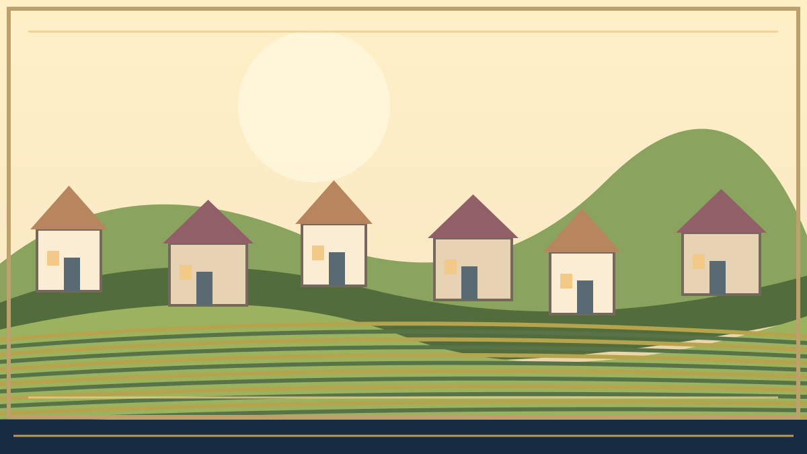

# Solombre — La cité des terrasses et de la lumière

> **ATLAS ET LORE — CONTENU À PUBLIER ULTÉRIEUREMENT.** Tout ce qui suit, y compris le nom de ce lieu et les personnes présentées, est une **proposition non jouée**. Ne pas interpréter le paysage comme une carte, une preuve de faits historiques ou une localisation canonique.

## Terre, lumière et premières impressions
La ville s'étage sur des murs de pierre sèche, parmi les vergers, vignes de coteaux chauds et escaliers ombragés.

## Mémoire du lieu
Les familles ont préservé les terrasses pendant les années difficiles de Duchêne. Ce passé ne fixe ni dynastie municipale ni date ; il inspire aujourd'hui un débat sur la transmission des terres.

## Une journée dans le bourg
Les petites maisons vigneronnes alternent avec les boutiques de cuisiniers, les ateliers d'huile et les auberges. Les enfants apprennent tôt à entretenir les canaux plutôt qu'à les considérer comme des décors.

## Économie et liens avec la région
Rosés secs, aromates, huiles, herbes, fromages de chèvre, gastronomie estivale et hôtellerie de charme. Son développement doit rester compatible avec l’économie des habitants et avec les échanges entre les royaumes alliés, sans déduire l’existence d’une route terminée ou d’une corporation officiellement fondée.

## Trois lieux remarquables à jouer
- **L'Escalier des Figuiers** — un point de rendez-vous pour les habitants et les visiteurs ; noms et usages précis à arbitrer
- **la Maison des Eaux** — un lieu d'activité où métiers, traditions et débats peuvent se rencontrer
- **le Théâtre des Terrasses** — un lieu propice à une enquête, une fête ou une décision civique

## Un visage du lieu — personnage proposé, non attesté
**Maëlle Valcor**, hydraulicienne de quartier. Elle connaît les anciennes répartitions de l'eau, préfère les relevés aux promesses et refuse que le conflit soit ramené à la jalousie des petits domaines. Ce personnage est librement utilisable par un MJ ; il n’appartient ni à la campagne jouée d’Orin ni au registre canonique des PNJ.

## La tension locale
Le manque d'eau pousse une grande maison à envisager un pompage profond qui réduirait l'irrigation des jardins communaux.

## Une aventure sans solution imposée
Un contrat promet un nouveau bassin aux habitants contre une concession de cinquante ans. Qui a réellement le pouvoir de signer ?

Trois façons de faire avancer cette aventure : **écouter** les parties prenantes et recueillir les témoignages ; **vérifier** documents et ressources ; **négocier** un accord ou une solution provisoire. Aucune issue ni récompense mécanique n’est présumée.

## Relations avec les autres lieux
Cette fiche approfondit **Orignac** et peut être reliée à **Bréval** et **Vaurenne** comme relations narratives possibles, **sans fixer de kilomètres ou de route réelle**.

- [Vue régionale](ori-reg-001.md)
- [Grande cité liée à la région](ori-cit-003.md)
- [Index des 36 lieux de travail](../INDEX_ATLAS.md)

## Continuité et garde-fous
Orinor demeure un royaume indépendant des Montagnes de l’Aube, sous une monarchie constitutionnelle dont les élus exercent l'administration. La foi en Orin ou toute autre divinité n'est pas obligatoire. Le tourisme et le luxe ne doivent pas soustraire les établissements privés aux droits civiques. Aucun passage magique public ne peut être inventé à partir de la seule proximité de Clairseuil. Cette fiche reste **hors publication** jusqu'à une approbation éditoriale explicite.
