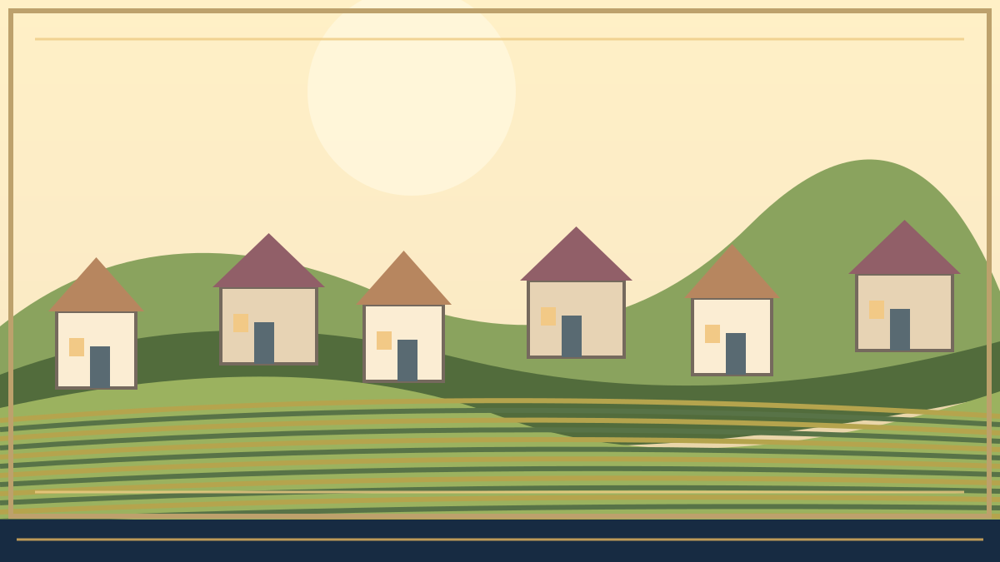

# Elsac-des-Brumes — Les blancs aromatiques sous la montagne

> **ATLAS ET LORE — CONTENU À PUBLIER ULTÉRIEUREMENT.** Tout ce qui suit, y compris le nom de ce lieu et les personnes présentées, est une **proposition non jouée**. Ne pas interpréter le paysage comme une carte, une preuve de faits historiques ou une localisation canonique.

## Terre, lumière et premières impressions
Le bourg se blottit contre des pentes fraîches où les vignes, les vergers et les pâturages occupent des étages distincts.

## Mémoire du lieu
Son histoire est celle de familles de vignerons et d'affineurs qui adaptent leurs pratiques à des saisons capricieuses. Les Hautes Brumes d'Elsac sont un terroir culturel, non une province.

## Une journée dans le bourg
Les caves humides, les pressoirs et les ateliers de tonnellerie restent actifs même quand le tourisme ralentit. Les visiteurs viennent pour des dégustations et des randonnées prudentes.

## Économie et liens avec la région
Blancs aromatiques, fromages à croûte lavée, charcuterie de montagne, bois et hôtellerie de cave. Son développement doit rester compatible avec l’économie des habitants et avec les échanges entre les royaumes alliés, sans déduire l’existence d’une route terminée ou d’une corporation officiellement fondée.

## Trois lieux remarquables à jouer
- **Le Cellier des Brumes** — un point de rendez-vous pour les habitants et les visiteurs ; noms et usages précis à arbitrer
- **la Cour des Fromagers** — un lieu d'activité où métiers, traditions et débats peuvent se rencontrer
- **le Belvédère des Vents** — un lieu propice à une enquête, une fête ou une décision civique

## Un visage du lieu — personnage proposé, non attesté
**Eldan Perchêne**, affineur indépendant. Il reconnaît les bénéfices de certains enchantements mais demande la publication honnête des méthodes de production. Ce personnage est librement utilisable par un MJ ; il n’appartient ni à la campagne jouée d’Orin ni au registre canonique des PNJ.

## La tension locale
Une maison de négoce souhaite déplacer la maturation des fromages dans un grand bâtiment enchanté, ce qui menacerait la réputation du climat naturel.

## Une aventure sans solution imposée
Un concours oppose un fromage élevé dans une cave vivante et une version affinée magiquement. La tradition interdit-elle vraiment l'invention ?

Trois façons de faire avancer cette aventure : **écouter** les parties prenantes et recueillir les témoignages ; **vérifier** documents et ressources ; **négocier** un accord ou une solution provisoire. Aucune issue ni récompense mécanique n’est présumée.

## Relations avec les autres lieux
Cette fiche approfondit **Orignac** et peut être reliée à **Bréval** et **Saulaie-des-Sept-Saules** comme relations narratives possibles, **sans fixer de kilomètres ou de route réelle**.

- [Vue régionale](ori-reg-001.md)
- [Grande cité liée à la région](ori-cit-003.md)
- [Index des 36 lieux de travail](../INDEX_ATLAS.md)

## Continuité et garde-fous
Orinor demeure un royaume indépendant des Montagnes de l’Aube, sous une monarchie constitutionnelle dont les élus exercent l'administration. La foi en Orin ou toute autre divinité n'est pas obligatoire. Le tourisme et le luxe ne doivent pas soustraire les établissements privés aux droits civiques. Aucun passage magique public ne peut être inventé à partir de la seule proximité de Clairseuil. Cette fiche reste **hors publication** jusqu'à une approbation éditoriale explicite.
