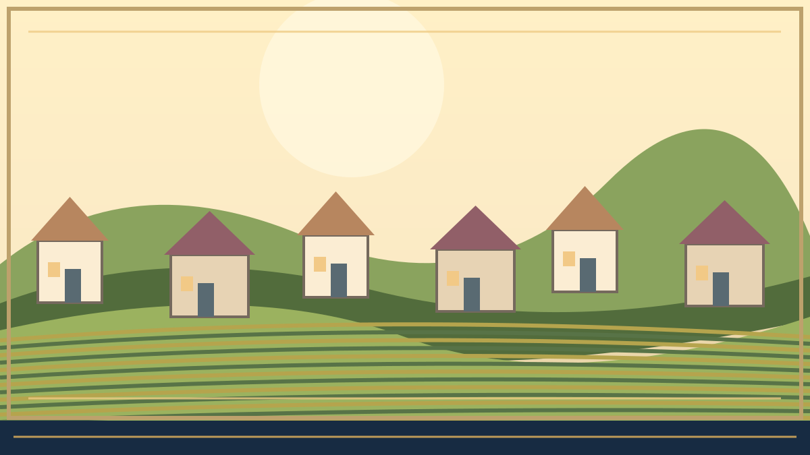

# Arvège-sur-Lande — Le pays des longues tablées

> **ATLAS ET LORE — CONTENU À PUBLIER ULTÉRIEUREMENT.** Tout ce qui suit, y compris le nom de ce lieu et les personnes présentées, est une **proposition non jouée**. Ne pas interpréter le paysage comme une carte, une preuve de faits historiques ou une localisation canonique.

## Terre, lumière et premières impressions
Le village habite un plateau de landes et de haies, parmi de petits troupeaux, des fermes basses et des routes anciennes.

## Mémoire du lieu
Des coutumes de partage des pâturages pourraient y remonter à l'ancien Duchêne ; leur existence précise doit être vérifiée et non rétroprojetée.

## Une journée dans le bourg
Les habitants se retrouvent autour de fours, d'étables communes, de fêtes de laine et de repas généreux. Le séjour rural n'est pas seulement destiné aux riches.

## Économie et liens avec la région
Vins rouges vigoureux, fromages de brebis, viandes séchées, laine et randonnées pastorales. Son développement doit rester compatible avec l’économie des habitants et avec les échanges entre les royaumes alliés, sans déduire l’existence d’une route terminée ou d’une corporation officiellement fondée.

## Trois lieux remarquables à jouer
- **La Cour des Brebis** — un point de rendez-vous pour les habitants et les visiteurs ; noms et usages précis à arbitrer
- **le Four des Retours** — un lieu d'activité où métiers, traditions et débats peuvent se rencontrer
- **l'Auberge des Landes** — un lieu propice à une enquête, une fête ou une décision civique

## Un visage du lieu — personnage proposé, non attesté
**Tessia Arvold**, éleveuse et porte-parole locale. Elle défend la liberté de ceux qui veulent partir aussi vigoureusement que le droit des anciens à rester. Ce personnage est librement utilisable par un MJ ; il n’appartient ni à la campagne jouée d’Orin ni au registre canonique des PNJ.

## La tension locale
Une partie des jeunes générations veut diversifier l'élevage tandis que les grandes maisons demandent une production plus standardisée.

## Une aventure sans solution imposée
Un contrat d'approvisionnement avantageux semble obliger trois fermes à abandonner leur pâture commune. Les PJ examinent qui en a réellement accepté les clauses.

Trois façons de faire avancer cette aventure : **écouter** les parties prenantes et recueillir les témoignages ; **vérifier** documents et ressources ; **négocier** un accord ou une solution provisoire. Aucune issue ni récompense mécanique n’est présumée.

## Relations avec les autres lieux
Cette fiche approfondit **Orignac** et peut être reliée à **Bréval** et **Vaurenne** comme relations narratives possibles, **sans fixer de kilomètres ou de route réelle**.

- [Vue régionale](ori-reg-001.md)
- [Grande cité liée à la région](ori-cit-003.md)
- [Index des 36 lieux de travail](../INDEX_ATLAS.md)

## Continuité et garde-fous
Orinor demeure un royaume indépendant des Montagnes de l’Aube, sous une monarchie constitutionnelle dont les élus exercent l'administration. La foi en Orin ou toute autre divinité n'est pas obligatoire. Le tourisme et le luxe ne doivent pas soustraire les établissements privés aux droits civiques. Aucun passage magique public ne peut être inventé à partir de la seule proximité de Clairseuil. Cette fiche reste **hors publication** jusqu'à une approbation éditoriale explicite.
