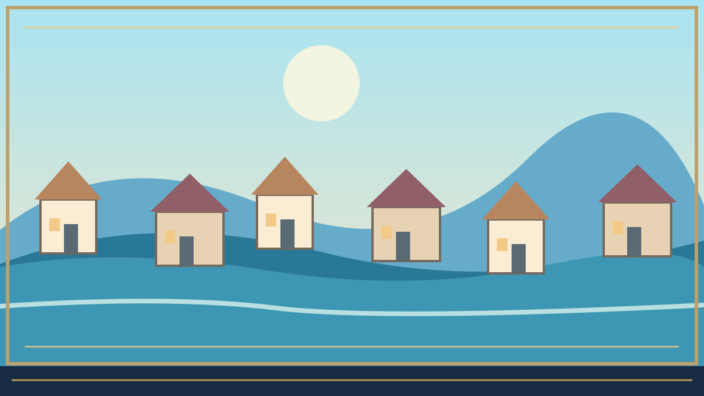

# Marévelle — La promenade des artistes de la mer

> **ATLAS ET LORE — CONTENU À PUBLIER ULTÉRIEUREMENT.** Tout ce qui suit, y compris le nom de ce lieu et les personnes présentées, est une **proposition non jouée**. Ne pas interpréter le paysage comme une carte, une preuve de faits historiques ou une localisation canonique.

## Terre, lumière et premières impressions
Petite ville de corniche aux jardins fleuris, aux galeries ouvertes sur la baie et aux terrasses de spectacles.

## Mémoire du lieu
Ses vieilles halles maritimes ont été transformées progressivement en ateliers, sans que toute la ville devienne une station privée.

## Une journée dans le bourg
En hiver, les écoles de danse, les réparateurs de bateaux et les marchés locaux sont plus visibles que les visiteurs. Les habitants ont à cœur de préserver cette vie hors saison.

## Économie et liens avec la région
Théâtres, arts verriers, tissus légers, restaurants, petites villas et promenades. Son développement doit rester compatible avec l’économie des habitants et avec les échanges entre les royaumes alliés, sans déduire l’existence d’une route terminée ou d’une corporation officiellement fondée.

## Trois lieux remarquables à jouer
- **Le Théâtre des Vents** — un point de rendez-vous pour les habitants et les visiteurs ; noms et usages précis à arbitrer
- **les Verreries de l'Écume** — un lieu d'activité où métiers, traditions et débats peuvent se rencontrer
- **le Jardin des Proues** — un lieu propice à une enquête, une fête ou une décision civique

## Un visage du lieu — personnage proposé, non attesté
**Céline Maravo**, directrice de troupe. Elle veut accueillir des artistes de toutes les Couronnes mais refuse que les spectacles populaires deviennent un souvenir. Ce personnage est librement utilisable par un MJ ; il n’appartient ni à la campagne jouée d’Orin ni au registre canonique des PNJ.

## La tension locale
Un festival mondial entraîne des loyers saisonniers si élevés que plusieurs troupes locales ne peuvent plus répéter en ville.

## Une aventure sans solution imposée
La meilleure scène du festival est louée à une troupe étrangère. Une association demande l'accès à l'ancien théâtre municipal.

Trois façons de faire avancer cette aventure : **écouter** les parties prenantes et recueillir les témoignages ; **vérifier** documents et ressources ; **négocier** un accord ou une solution provisoire. Aucune issue ni récompense mécanique n’est présumée.

## Relations avec les autres lieux
Cette fiche approfondit **Côtes lumineuses** et peut être reliée à **Bellécume** et **Caldrine** comme relations narratives possibles, **sans fixer de kilomètres ou de route réelle**.

- [Vue régionale](ori-reg-002.md)
- [Grande cité liée à la région](ori-cit-001.md)
- [Index des 36 lieux de travail](../INDEX_ATLAS.md)

## Continuité et garde-fous
Orinor demeure un royaume indépendant des Montagnes de l’Aube, sous une monarchie constitutionnelle dont les élus exercent l'administration. La foi en Orin ou toute autre divinité n'est pas obligatoire. Le tourisme et le luxe ne doivent pas soustraire les établissements privés aux droits civiques. Aucun passage magique public ne peut être inventé à partir de la seule proximité de Clairseuil. Cette fiche reste **hors publication** jusqu'à une approbation éditoriale explicite.
