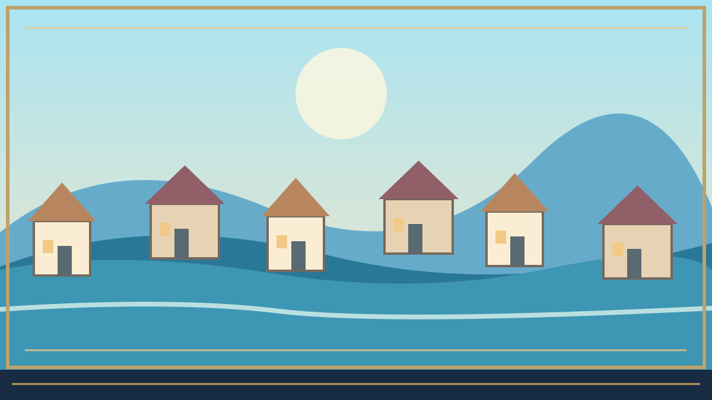

# Néréa-des-Criques — Le village au rythme des barques

> **ATLAS ET LORE — CONTENU À PUBLIER ULTÉRIEUREMENT.** Tout ce qui suit, y compris le nom de ce lieu et les personnes présentées, est une **proposition non jouée**. Ne pas interpréter le paysage comme une carte, une preuve de faits historiques ou une localisation canonique.

## Terre, lumière et premières impressions
Des escaliers descendent des maisons calcaires vers trois petites criques qui forment un refuge pour les barques.

## Mémoire du lieu
Les familles ont survécu aux variations du commerce maritime en partageant l'entretien des pontons et des filets ; l'organisation exacte reste à créer.

## Une journée dans le bourg
Le village s'éveille tôt. La petite place sert aussi bien de marché au poisson que de lieu de repos pour les promeneurs.

## Économie et liens avec la région
Poissons, salaisons, nacre artisanale, restauration marine et auberges familiales. Son développement doit rester compatible avec l’économie des habitants et avec les échanges entre les royaumes alliés, sans déduire l’existence d’une route terminée ou d’une corporation officiellement fondée.

## Trois lieux remarquables à jouer
- **La Jetée des Trois-Criques** — un point de rendez-vous pour les habitants et les visiteurs ; noms et usages précis à arbitrer
- **la Maison du Sel** — un lieu d'activité où métiers, traditions et débats peuvent se rencontrer
- **l'Escalier des Barques** — un lieu propice à une enquête, une fête ou une décision civique

## Un visage du lieu — personnage proposé, non attesté
**Narel Vesse**, capitaine de petite pêche. Il sait reconnaître les étrangers de bonne volonté, mais refuse que les touristes décident de la sécurité en mer. Ce personnage est librement utilisable par un MJ ; il n’appartient ni à la campagne jouée d’Orin ni au registre canonique des PNJ.

## La tension locale
Des bateaux de plaisance de grande taille occupent les abris nécessaires aux pêcheurs pendant les mauvais jours.

## Une aventure sans solution imposée
À la veille d'une tempête, qui a priorité sur les trois places restantes au bassin protégé ? Les PJ doivent écouter les deux communautés.

Trois façons de faire avancer cette aventure : **écouter** les parties prenantes et recueillir les témoignages ; **vérifier** documents et ressources ; **négocier** un accord ou une solution provisoire. Aucune issue ni récompense mécanique n’est présumée.

## Relations avec les autres lieux
Cette fiche approfondit **Côtes lumineuses** et peut être reliée à **Bellécume** et **Port-Écaille** comme relations narratives possibles, **sans fixer de kilomètres ou de route réelle**.

- [Vue régionale](ori-reg-002.md)
- [Grande cité liée à la région](ori-cit-001.md)
- [Index des 36 lieux de travail](../INDEX_ATLAS.md)

## Continuité et garde-fous
Orinor demeure un royaume indépendant des Montagnes de l’Aube, sous une monarchie constitutionnelle dont les élus exercent l'administration. La foi en Orin ou toute autre divinité n'est pas obligatoire. Le tourisme et le luxe ne doivent pas soustraire les établissements privés aux droits civiques. Aucun passage magique public ne peut être inventé à partir de la seule proximité de Clairseuil. Cette fiche reste **hors publication** jusqu'à une approbation éditoriale explicite.
