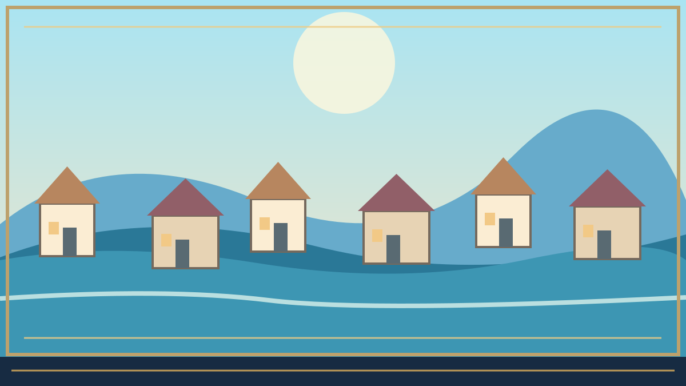

# Sableclair — Les dunes et les bains de soleil

> **ATLAS ET LORE — CONTENU À PUBLIER ULTÉRIEUREMENT.** Tout ce qui suit, y compris le nom de ce lieu et les personnes présentées, est une **proposition non jouée**. Ne pas interpréter le paysage comme une carte, une preuve de faits historiques ou une localisation canonique.

## Terre, lumière et premières impressions
Un bourg de plages, de dunes basses et de bosquets parfumés s'est développé entre route littorale et petites fermes.

## Mémoire du lieu
La prospérité vient d'un tourisme partagé entre campements saisonniers, maisons d'hôtes et établissements très luxueux. Aucun complexe particulier n'est encore déclaré achevé.

## Une journée dans le bourg
Des familles accueillent des visiteurs depuis des générations. Les promenades et les sentiers d'accès font partie des habitudes collectives.

## Économie et liens avec la région
Séjours balnéaires, huiles parfumées, culture d'agrumes, jardins et artisanat de céramique. Son développement doit rester compatible avec l’économie des habitants et avec les échanges entre les royaumes alliés, sans déduire l’existence d’une route terminée ou d’une corporation officiellement fondée.

## Trois lieux remarquables à jouer
- **La Maison des Dunes** — un point de rendez-vous pour les habitants et les visiteurs ; noms et usages précis à arbitrer
- **les Bains du Soleil** — un lieu d'activité où métiers, traditions et débats peuvent se rencontrer
- **le Sentier des Tamaris** — un lieu propice à une enquête, une fête ou une décision civique

## Un visage du lieu — personnage proposé, non attesté
**Hélois Darnet**, jardinier des dunes. Il considère les touristes comme des invités précieux, mais rappelle qu'une plage vivante n'est pas une terrasse privée. Ce personnage est librement utilisable par un MJ ; il n’appartient ni à la campagne jouée d’Orin ni au registre canonique des PNJ.

## La tension locale
Une entreprise souhaite stabiliser les dunes à l'aide d'un procédé magique qui modifierait la migration des oiseaux et le drainage des fermes.

## Une aventure sans solution imposée
Les PJ peuvent comparer les relevés des botanistes, agriculteurs et ingénieurs avant un vote municipal.

Trois façons de faire avancer cette aventure : **écouter** les parties prenantes et recueillir les témoignages ; **vérifier** documents et ressources ; **négocier** un accord ou une solution provisoire. Aucune issue ni récompense mécanique n’est présumée.

## Relations avec les autres lieux
Cette fiche approfondit **Côtes lumineuses** et peut être reliée à **Bellécume** et **Marévelle** comme relations narratives possibles, **sans fixer de kilomètres ou de route réelle**.

- [Vue régionale](ori-reg-002.md)
- [Grande cité liée à la région](ori-cit-001.md)
- [Index des 36 lieux de travail](../INDEX_ATLAS.md)

## Continuité et garde-fous
Orinor demeure un royaume indépendant des Montagnes de l’Aube, sous une monarchie constitutionnelle dont les élus exercent l'administration. La foi en Orin ou toute autre divinité n'est pas obligatoire. Le tourisme et le luxe ne doivent pas soustraire les établissements privés aux droits civiques. Aucun passage magique public ne peut être inventé à partir de la seule proximité de Clairseuil. Cette fiche reste **hors publication** jusqu'à une approbation éditoriale explicite.
