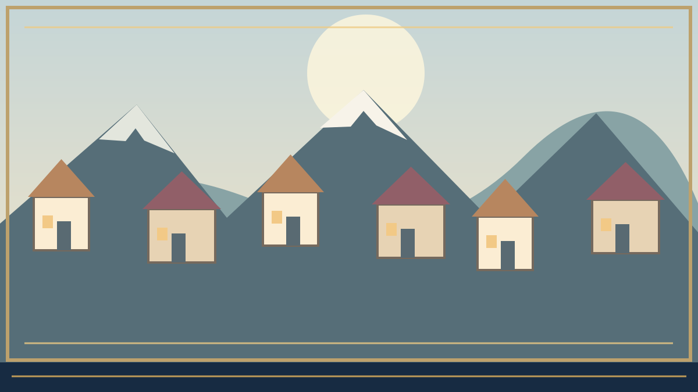

# Viellebrume — Les archives du vent et de la pluie

> **ATLAS ET LORE — CONTENU À PUBLIER ULTÉRIEUREMENT.** Tout ce qui suit, y compris le nom de ce lieu et les personnes présentées, est une **proposition non jouée**. Ne pas interpréter le paysage comme une carte, une preuve de faits historiques ou une localisation canonique.

## Terre, lumière et premières impressions
Une cité de toits sombres repose au bord d'un lac battu par les vents, sous des falaises brouillées de pluie.

## Mémoire du lieu
Sa mémoire collective s'est construite autour des veillées, des décisions d'entraide et des récits de chemins perdus. Elle conserve peut-être des registres d'avant la Reprise.

## Une journée dans le bourg
Les rues abritées mènent à des tavernes, des ateliers de cuir, des librairies et des maisons de guides.

## Économie et liens avec la région
Cartes météorologiques, cuir, laine, bateaux de lac, restauration et séjours de montagne. Son développement doit rester compatible avec l’économie des habitants et avec les échanges entre les royaumes alliés, sans déduire l’existence d’une route terminée ou d’une corporation officiellement fondée.

## Trois lieux remarquables à jouer
- **La Halle des Veilleurs** — un point de rendez-vous pour les habitants et les visiteurs ; noms et usages précis à arbitrer
- **l'Archive des Pluies** — un lieu d'activité où métiers, traditions et débats peuvent se rencontrer
- **les Bains du Lac** — un lieu propice à une enquête, une fête ou une décision civique

## Un visage du lieu — personnage proposé, non attesté
**Orven Brassevent**, archiviste et guide. Il explique que conserver un chemin sur une carte ne signifie pas qu'il soit praticable aujourd'hui. Ce personnage est librement utilisable par un MJ ; il n’appartient ni à la campagne jouée d’Orin ni au registre canonique des PNJ.

## La tension locale
Une école de cartographie veut diffuser les itinéraires de montagne, alors que des guides craignent un afflux de voyageurs imprudents.

## Une aventure sans solution imposée
Un ancien itinéraire réapparaît sur une carte d'archives. Qui doit autoriser son ouverture et financer les secours ?

Trois façons de faire avancer cette aventure : **écouter** les parties prenantes et recueillir les témoignages ; **vérifier** documents et ressources ; **négocier** un accord ou une solution provisoire. Aucune issue ni récompense mécanique n’est présumée.

## Relations avec les autres lieux
Cette fiche approfondit **Hautes Terres brumeuses** et peut être reliée à **Brumehaute** et **Sourcefroide** comme relations narratives possibles, **sans fixer de kilomètres ou de route réelle**.

- [Vue régionale](ori-reg-003.md)
- [Grande cité liée à la région](ori-cit-004.md)
- [Index des 36 lieux de travail](../INDEX_ATLAS.md)

## Continuité et garde-fous
Orinor demeure un royaume indépendant des Montagnes de l’Aube, sous une monarchie constitutionnelle dont les élus exercent l'administration. La foi en Orin ou toute autre divinité n'est pas obligatoire. Le tourisme et le luxe ne doivent pas soustraire les établissements privés aux droits civiques. Aucun passage magique public ne peut être inventé à partir de la seule proximité de Clairseuil. Cette fiche reste **hors publication** jusqu'à une approbation éditoriale explicite.
