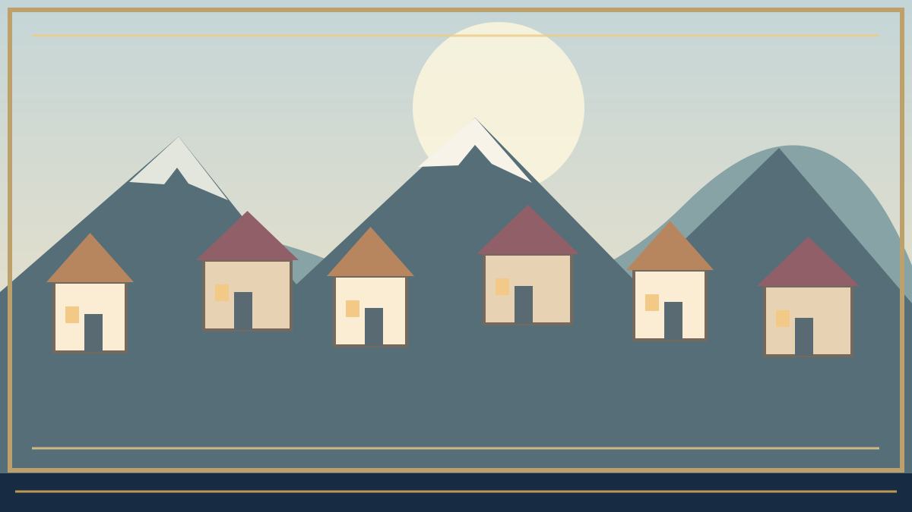

# Haut-Pont-des-Landes — Le franchissement des caravanes

> **ATLAS ET LORE — CONTENU À PUBLIER ULTÉRIEUREMENT.** Tout ce qui suit, y compris le nom de ce lieu et les personnes présentées, est une **proposition non jouée**. Ne pas interpréter le paysage comme une carte, une preuve de faits historiques ou une localisation canonique.

## Terre, lumière et premières impressions
Un grand pont de pierre relie deux versants de lande au-dessus d'un torrent puissant, à proximité de pâturages.

## Mémoire du lieu
La vie locale est née autour des passages, des relais, du soin aux montures et des réparations de ponts. Son emplacement exact n'est pas fixé.

## Une journée dans le bourg
Les aubergistes, forgerons, bergers et messagers y forment une communauté aussi soucieuse du passage des habitants que de celui des visiteurs.

## Économie et liens avec la région
Relais, ferronnerie, peaux, fourrage, transport de vallée et petite hôtellerie. Son développement doit rester compatible avec l’économie des habitants et avec les échanges entre les royaumes alliés, sans déduire l’existence d’une route terminée ou d’une corporation officiellement fondée.

## Trois lieux remarquables à jouer
- **Le Pont des Deux Vents** — un point de rendez-vous pour les habitants et les visiteurs ; noms et usages précis à arbitrer
- **la Forge du Relais** — un lieu d'activité où métiers, traditions et débats peuvent se rencontrer
- **la Cour des Montures** — un lieu propice à une enquête, une fête ou une décision civique

## Un visage du lieu — personnage proposé, non attesté
**Bryna Hauterive**, maîtresse de relais. Elle sait exactement quels voyageurs ont besoin d'un passage gratuit, mais elle n'a pas le pouvoir de financer seule la route. Ce personnage est librement utilisable par un MJ ; il n’appartient ni à la campagne jouée d’Orin ni au registre canonique des PNJ.

## La tension locale
Un nouvel ouvrage réservé au transport marchand ferait gagner du temps aux caravanes mais repousserait les piétons sur une route dangereuse.

## Une aventure sans solution imposée
La réparation de la passerelle de service provoque un conflit de budget avec le grand pont ; les PJ recueillent les comptes et témoignages.

Trois façons de faire avancer cette aventure : **écouter** les parties prenantes et recueillir les témoignages ; **vérifier** documents et ressources ; **négocier** un accord ou une solution provisoire. Aucune issue ni récompense mécanique n’est présumée.

## Relations avec les autres lieux
Cette fiche approfondit **Hautes Terres brumeuses** et peut être reliée à **Brumehaute** et **Pâture-Ronde** comme relations narratives possibles, **sans fixer de kilomètres ou de route réelle**.

- [Vue régionale](ori-reg-003.md)
- [Grande cité liée à la région](ori-cit-004.md)
- [Index des 36 lieux de travail](../INDEX_ATLAS.md)

## Continuité et garde-fous
Orinor demeure un royaume indépendant des Montagnes de l’Aube, sous une monarchie constitutionnelle dont les élus exercent l'administration. La foi en Orin ou toute autre divinité n'est pas obligatoire. Le tourisme et le luxe ne doivent pas soustraire les établissements privés aux droits civiques. Aucun passage magique public ne peut être inventé à partir de la seule proximité de Clairseuil. Cette fiche reste **hors publication** jusqu'à une approbation éditoriale explicite.
