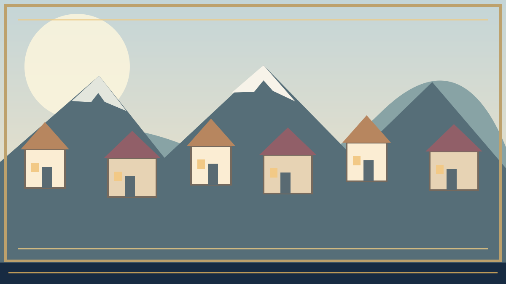

# Les Trois-Foyers — Trois maisons d'accueil sur la lande

> **ATLAS ET LORE — CONTENU À PUBLIER ULTÉRIEUREMENT.** Tout ce qui suit, y compris le nom de ce lieu et les personnes présentées, est une **proposition non jouée**. Ne pas interpréter le paysage comme une carte, une preuve de faits historiques ou une localisation canonique.

## Terre, lumière et premières impressions
Trois groupes de maisons et leurs foyers communs entourent des pâtures humides et un chemin d'altitude.

## Mémoire du lieu
Le nom pourrait venir de trois familles qui accueillirent des voyageurs égarés ; cette étymologie est une légende proposée, pas un fait historique.

## Une journée dans le bourg
On y répare les bottes, partage la soupe et sèche les manteaux dans les mêmes salles que les grandes discussions du village.

## Économie et liens avec la région
Fromages de ferme, laine, feutre, petits séjours de marche et entretien des chemins. Son développement doit rester compatible avec l’économie des habitants et avec les échanges entre les royaumes alliés, sans déduire l’existence d’une route terminée ou d’une corporation officiellement fondée.

## Trois lieux remarquables à jouer
- **Le Grand Foyer** — un point de rendez-vous pour les habitants et les visiteurs ; noms et usages précis à arbitrer
- **les Trois Granges** — un lieu d'activité où métiers, traditions et débats peuvent se rencontrer
- **la Pierre des Retours** — un lieu propice à une enquête, une fête ou une décision civique

## Un visage du lieu — personnage proposé, non attesté
**Lissa Torfeu**, aubergiste et doyenne d'accueil. Elle estime qu'un visiteur riche n'a pas davantage de place devant le feu qu'un berger trempé. Ce personnage est librement utilisable par un MJ ; il n’appartient ni à la campagne jouée d’Orin ni au registre canonique des PNJ.

## La tension locale
La demande de chambres luxueuses risque d'obliger les habitants à transformer les salles réservées autrefois aux voyageurs sans ressources.

## Une aventure sans solution imposée
Une maison de retraite magique propose de financer un nouveau toit, mais demande l'usage exclusif d'un foyer.

Trois façons de faire avancer cette aventure : **écouter** les parties prenantes et recueillir les témoignages ; **vérifier** documents et ressources ; **négocier** un accord ou une solution provisoire. Aucune issue ni récompense mécanique n’est présumée.

## Relations avec les autres lieux
Cette fiche approfondit **Hautes Terres brumeuses** et peut être reliée à **Pâture-Ronde** et **Sourcefroide** comme relations narratives possibles, **sans fixer de kilomètres ou de route réelle**.

- [Vue régionale](ori-reg-003.md)
- [Grande cité liée à la région](ori-cit-004.md)
- [Index des 36 lieux de travail](../INDEX_ATLAS.md)

## Continuité et garde-fous
Orinor demeure un royaume indépendant des Montagnes de l’Aube, sous une monarchie constitutionnelle dont les élus exercent l'administration. La foi en Orin ou toute autre divinité n'est pas obligatoire. Le tourisme et le luxe ne doivent pas soustraire les établissements privés aux droits civiques. Aucun passage magique public ne peut être inventé à partir de la seule proximité de Clairseuil. Cette fiche reste **hors publication** jusqu'à une approbation éditoriale explicite.
