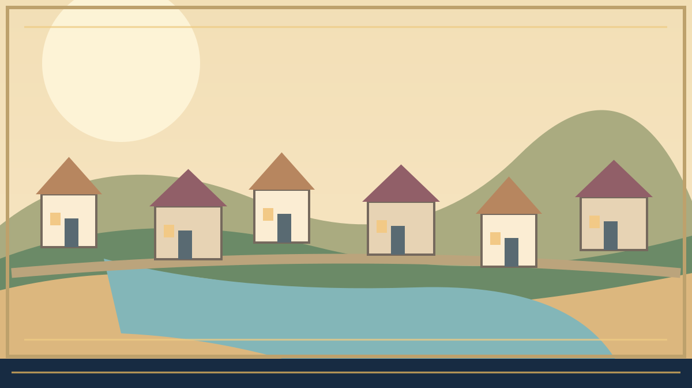

# Verranne — La ville des verrières et des machines délicates

> **ATLAS ET LORE — CONTENU À PUBLIER ULTÉRIEUREMENT.** Tout ce qui suit, y compris le nom de ce lieu et les personnes présentées, est une **proposition non jouée**. Ne pas interpréter le paysage comme une carte, une preuve de faits historiques ou une localisation canonique.

## Terre, lumière et premières impressions
Des ponts franchissent un canal bordé de bâtiments de pierre, de fours et de façades vitrées.

## Mémoire du lieu
La ville conserve un artisanat ancien des vitraux et développe des procédés nouveaux de verre enchanté ; les premiers ateliers demeurent à documenter.

## Une journée dans le bourg
Les ouvriers du verre travaillent aux côtés de dessinateurs, chimistes, enlumineurs et apprentis. Les marchés montrent aussi les objets ratés, parfois plus instructifs que les réussites.

## Économie et liens avec la région
Verrerie, luminaires, miroirs, instruments optiques, décoration de luxe et équipements civiques. Son développement doit rester compatible avec l’économie des habitants et avec les échanges entre les royaumes alliés, sans déduire l’existence d’une route terminée ou d’une corporation officiellement fondée.

## Trois lieux remarquables à jouer
- **La Cour des Verriers** — un point de rendez-vous pour les habitants et les visiteurs ; noms et usages précis à arbitrer
- **les Verrières du Canal** — un lieu d'activité où métiers, traditions et débats peuvent se rencontrer
- **le Musée des Pièces Ratées** — un lieu propice à une enquête, une fête ou une décision civique

## Un visage du lieu — personnage proposé, non attesté
**Tivane Rouxel**, maîtresse verrière. Elle ne méprise pas la magie mais exige que les enchantements puissent être compris et entretenus. Ce personnage est librement utilisable par un MJ ; il n’appartient ni à la campagne jouée d’Orin ni au registre canonique des PNJ.

## La tension locale
Une maison de luxe refuse de communiquer les risques d'une nouvelle vitre enchantée pour conserver une avance commerciale.

## Une aventure sans solution imposée
Une série de fenêtres se couvre de givre en pleine chaleur. Accident, malfaçon ou effet attendu ? Les PJ enquêteurs travaillent avec les ateliers.

Trois façons de faire avancer cette aventure : **écouter** les parties prenantes et recueillir les témoignages ; **vérifier** documents et ressources ; **négocier** un accord ou une solution provisoire. Aucune issue ni récompense mécanique n’est présumée.

## Relations avec les autres lieux
Cette fiche approfondit **Bassins de la Reprise** et peut être reliée à **Pontelier** et **Ressenne** comme relations narratives possibles, **sans fixer de kilomètres ou de route réelle**.

- [Vue régionale](ori-reg-004.md)
- [Grande cité liée à la région](ori-cit-005.md)
- [Index des 36 lieux de travail](../INDEX_ATLAS.md)

## Continuité et garde-fous
Orinor demeure un royaume indépendant des Montagnes de l’Aube, sous une monarchie constitutionnelle dont les élus exercent l'administration. La foi en Orin ou toute autre divinité n'est pas obligatoire. Le tourisme et le luxe ne doivent pas soustraire les établissements privés aux droits civiques. Aucun passage magique public ne peut être inventé à partir de la seule proximité de Clairseuil. Cette fiche reste **hors publication** jusqu'à une approbation éditoriale explicite.
