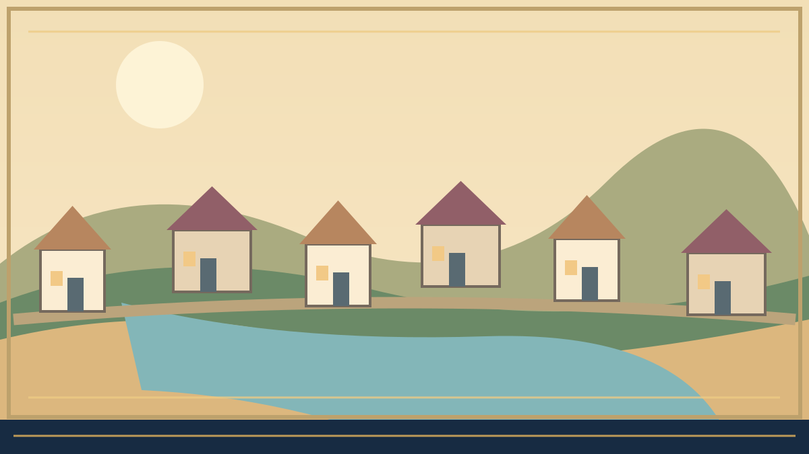

# Rivegran — Le marché des bateaux et des grains

> **ATLAS ET LORE — CONTENU À PUBLIER ULTÉRIEUREMENT.** Tout ce qui suit, y compris le nom de ce lieu et les personnes présentées, est une **proposition non jouée**. Ne pas interpréter le paysage comme une carte, une preuve de faits historiques ou une localisation canonique.

## Terre, lumière et premières impressions
Un bourg de rives cultivées, de greniers et de pontons légers s'étend dans un bassin fertile.

## Mémoire du lieu
Le développement des foires a accompagné la reconstruction des routes et des campagnes après Duchêne, sans supprimer les coutumes paysannes.

## Une journée dans le bourg
Le marché accueille transporteurs, cultivateurs et aubergistes. Les grandes maisons cherchent à imposer des contrats d'exclusivité ; les coopératives sont encore à définir.

## Économie et liens avec la région
Céréales, farine, barges, stockage, cordages et foires agricoles. Son développement doit rester compatible avec l’économie des habitants et avec les échanges entre les royaumes alliés, sans déduire l’existence d’une route terminée ou d’une corporation officiellement fondée.

## Trois lieux remarquables à jouer
- **Le Grand Grenier** — un point de rendez-vous pour les habitants et les visiteurs ; noms et usages précis à arbitrer
- **la Halle des Quais** — un lieu d'activité où métiers, traditions et débats peuvent se rencontrer
- **le Pré des Foires** — un lieu propice à une enquête, une fête ou une décision civique

## Un visage du lieu — personnage proposé, non attesté
**Miriel Verdan**, greffière du marché. Elle aide les marchands à comprendre leurs obligations mais tient à ce que les petits paysans disposent eux aussi de conseils juridiques. Ce personnage est librement utilisable par un MJ ; il n’appartient ni à la campagne jouée d’Orin ni au registre canonique des PNJ.

## La tension locale
Une banque propose un crédit avantageux à condition de vendre les futures récoltes à un négociant unique.

## Une aventure sans solution imposée
Les PJ examinent un contrat dont les termes semblent différents dans les deux langues utilisées par les signataires.

Trois façons de faire avancer cette aventure : **écouter** les parties prenantes et recueillir les témoignages ; **vérifier** documents et ressources ; **négocier** un accord ou une solution provisoire. Aucune issue ni récompense mécanique n’est présumée.

## Relations avec les autres lieux
Cette fiche approfondit **Bassins de la Reprise** et peut être reliée à **Ressenne** et **Trois-Moulins** comme relations narratives possibles, **sans fixer de kilomètres ou de route réelle**.

- [Vue régionale](ori-reg-004.md)
- [Grande cité liée à la région](ori-cit-005.md)
- [Index des 36 lieux de travail](../INDEX_ATLAS.md)

## Continuité et garde-fous
Orinor demeure un royaume indépendant des Montagnes de l’Aube, sous une monarchie constitutionnelle dont les élus exercent l'administration. La foi en Orin ou toute autre divinité n'est pas obligatoire. Le tourisme et le luxe ne doivent pas soustraire les établissements privés aux droits civiques. Aucun passage magique public ne peut être inventé à partir de la seule proximité de Clairseuil. Cette fiche reste **hors publication** jusqu'à une approbation éditoriale explicite.
