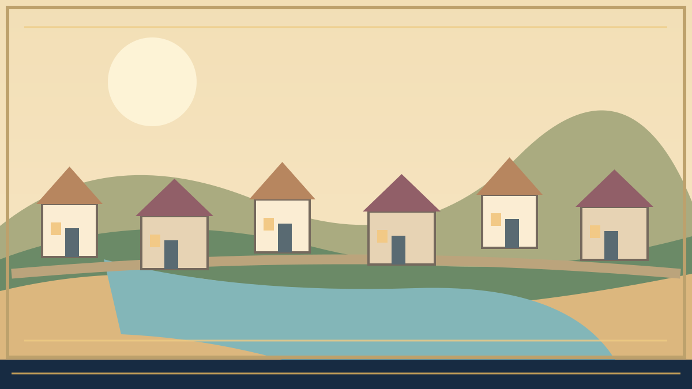

# Ferroue — Le village où l'eau entraîne le métal

> **ATLAS ET LORE — CONTENU À PUBLIER ULTÉRIEUREMENT.** Tout ce qui suit, y compris le nom de ce lieu et les personnes présentées, est une **proposition non jouée**. Ne pas interpréter le paysage comme une carte, une preuve de faits historiques ou une localisation canonique.

## Terre, lumière et premières impressions
Un ruisseau aménagé anime de modestes ateliers métallurgiques et des roues hydrauliques près de petites terres agricoles.

## Mémoire du lieu
Les familles ont longtemps réparé outils et mécanismes des fermes voisines. Les chantiers nationaux pourraient ouvrir de nouvelles commandes, sans garantie automatique.

## Une journée dans le bourg
Les enfants connaissent le bruit des roues et les périodes de décrue. Une école de gestes techniques pourrait préserver les savoirs.

## Économie et liens avec la région
Outils, petites machines, réparation, mécanique de précision et productions agricoles. Son développement doit rester compatible avec l’économie des habitants et avec les échanges entre les royaumes alliés, sans déduire l’existence d’une route terminée ou d’une corporation officiellement fondée.

## Trois lieux remarquables à jouer
- **La Roue de Fer** — un point de rendez-vous pour les habitants et les visiteurs ; noms et usages précis à arbitrer
- **l'École des Gestes** — un lieu d'activité où métiers, traditions et débats peuvent se rencontrer
- **le Petit Pont** — un lieu propice à une enquête, une fête ou une décision civique

## Un visage du lieu — personnage proposé, non attesté
**Doren Mainclaire**, mécanicien rural. Il défend la réparation avant le remplacement, sans idéaliser les vieux procédés dangereux. Ce personnage est librement utilisable par un MJ ; il n’appartient ni à la campagne jouée d’Orin ni au registre canonique des PNJ.

## La tension locale
Une usine lointaine propose des pièces moins chères que celles des forgerons locaux. Les habitants hésitent entre économie et autonomie.

## Une aventure sans solution imposée
Les PJ doivent comparer des outils défectueux et des contrats de maintenance avant de recommander un achat collectif.

Trois façons de faire avancer cette aventure : **écouter** les parties prenantes et recueillir les témoignages ; **vérifier** documents et ressources ; **négocier** un accord ou une solution provisoire. Aucune issue ni récompense mécanique n’est présumée.

## Relations avec les autres lieux
Cette fiche approfondit **Bassins de la Reprise** et peut être reliée à **Pontelier** et **Trois-Moulins** comme relations narratives possibles, **sans fixer de kilomètres ou de route réelle**.

- [Vue régionale](ori-reg-004.md)
- [Grande cité liée à la région](ori-cit-005.md)
- [Index des 36 lieux de travail](../INDEX_ATLAS.md)

## Continuité et garde-fous
Orinor demeure un royaume indépendant des Montagnes de l’Aube, sous une monarchie constitutionnelle dont les élus exercent l'administration. La foi en Orin ou toute autre divinité n'est pas obligatoire. Le tourisme et le luxe ne doivent pas soustraire les établissements privés aux droits civiques. Aucun passage magique public ne peut être inventé à partir de la seule proximité de Clairseuil. Cette fiche reste **hors publication** jusqu'à une approbation éditoriale explicite.
