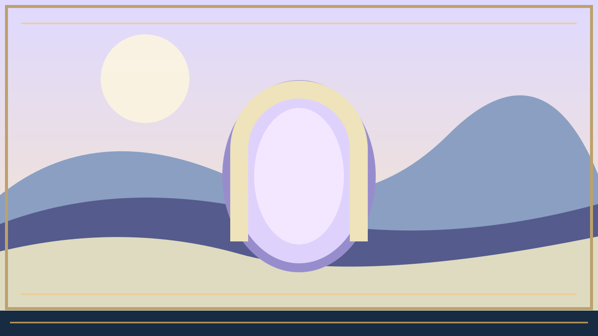

# Aubeseuil — La place où l'on apprend à se comprendre

> **ATLAS ET LORE — CONTENU À PUBLIER ULTÉRIEUREMENT.** Tout ce qui suit, y compris le nom de ce lieu et les personnes présentées, est une **proposition non jouée**. Ne pas interpréter le paysage comme une carte, une preuve de faits historiques ou une localisation canonique.

## Terre, lumière et premières impressions
Un bourg de routes croisées, de maisons de traduction et de cours d'étude accueille des communautés aux usages différents.

## Mémoire du lieu
Le lieu aurait grandi autour d'un ancien relais de messagers ; l'existence et la date exactes de ce relais restent des pistes à documenter.

## Une journée dans le bourg
Les habitants maîtrisent plusieurs langues et apprennent à reconnaître les gestes de bienvenue comme les gestes de refus des peuples voisins.

## Économie et liens avec la région
Traduction, librairies, restauration, médiation commerciale, cours de langue et accueil. Son développement doit rester compatible avec l’économie des habitants et avec les échanges entre les royaumes alliés, sans déduire l’existence d’une route terminée ou d’une corporation officiellement fondée.

## Trois lieux remarquables à jouer
- **Maison des Langues** — un point de rendez-vous pour les habitants et les visiteurs ; noms et usages précis à arbitrer
- **Cour des Étrangers** — un lieu d'activité où métiers, traditions et débats peuvent se rencontrer
- **Jardin des Accords** — un lieu propice à une enquête, une fête ou une décision civique

## Un visage du lieu — personnage proposé, non attesté
**Irel Sovaine**, traductrice et médiatrice. Elle rappelle qu'un mot compris ne signifie pas toujours une coutume acceptée. Ce personnage est librement utilisable par un MJ ; il n’appartient ni à la campagne jouée d’Orin ni au registre canonique des PNJ.

## La tension locale
Un marchand étranger affirme qu'un contrat traduit à Aubeseuil a supprimé une clause importante.

## Une aventure sans solution imposée
Des interprètes concurrents sont accusés de manipulation. Les personnages doivent distinguer faute, ambiguïté et fraude.

Trois façons de faire avancer cette aventure : **écouter** les parties prenantes et recueillir les témoignages ; **vérifier** documents et ressources ; **négocier** un accord ou une solution provisoire. Aucune issue ni récompense mécanique n’est présumée.

## Relations avec les autres lieux
Cette fiche approfondit **Marches des Passages** et peut être reliée à **Clairseuil** et **Veilleporte** comme relations narratives possibles, **sans fixer de kilomètres ou de route réelle**.

- [Vue régionale](ori-reg-005.md)
- [Grande cité liée à la région](ori-cit-002.md)
- [Index des 36 lieux de travail](../INDEX_ATLAS.md)

## Continuité et garde-fous
Orinor demeure un royaume indépendant des Montagnes de l’Aube, sous une monarchie constitutionnelle dont les élus exercent l'administration. La foi en Orin ou toute autre divinité n'est pas obligatoire. Le tourisme et le luxe ne doivent pas soustraire les établissements privés aux droits civiques. Aucun passage magique public ne peut être inventé à partir de la seule proximité de Clairseuil. Cette fiche reste **hors publication** jusqu'à une approbation éditoriale explicite.
