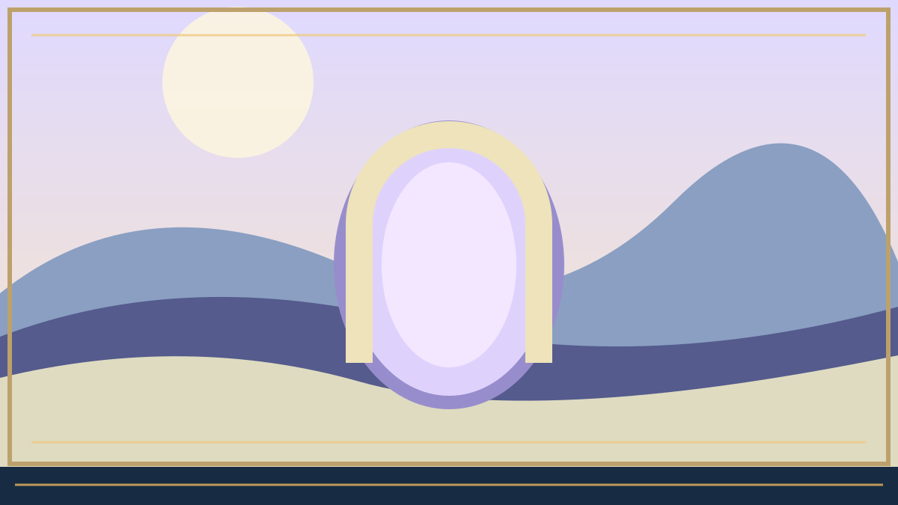

# L'Orme-des-Hôtes — Une halte de jardins et de chambres

> **ATLAS ET LORE — CONTENU À PUBLIER ULTÉRIEUREMENT.** Tout ce qui suit, y compris le nom de ce lieu et les personnes présentées, est une **proposition non jouée**. Ne pas interpréter le paysage comme une carte, une preuve de faits historiques ou une localisation canonique.

## Terre, lumière et premières impressions
Un village de vergers, de maisons sobres et de jardins clos offre du repos aux voyageurs entre deux étapes.

## Mémoire du lieu
Les maisons d'hôtes conservent des coutumes d'accueil transmises par les anciens du village. Le lieu n'est pas présumé relié à un portail permanent.

## Une journée dans le bourg
Les familles partagent l'entretien du vieux verger, des chemins piétons et des salles communes. Les étudiants en séjour y côtoient des voyageurs ordinaires.

## Économie et liens avec la région
Jardins, cuisine domestique, reliure, repos, vergers et accueil de groupes. Son développement doit rester compatible avec l’économie des habitants et avec les échanges entre les royaumes alliés, sans déduire l’existence d’une route terminée ou d’une corporation officiellement fondée.

## Trois lieux remarquables à jouer
- **Le Grand Orme** — un point de rendez-vous pour les habitants et les visiteurs ; noms et usages précis à arbitrer
- **Maison des Hôtes** — un lieu d'activité où métiers, traditions et débats peuvent se rencontrer
- **Allée des Jardins** — un lieu propice à une enquête, une fête ou une décision civique

## Un visage du lieu — personnage proposé, non attesté
**Aldia Lorn**, hôtelière et responsable d'entraide. Elle protège la dignité des visiteurs tout en défendant le droit des familles à ne pas être exploitées. Ce personnage est librement utilisable par un MJ ; il n’appartient ni à la campagne jouée d’Orin ni au registre canonique des PNJ.

## La tension locale
Une délégation riche réserve pour plusieurs mois les seules chambres accessibles aux personnes à mobilité réduite.

## Une aventure sans solution imposée
Les PJ sont appelés à proposer une solution à l'hébergement d'un groupe qui ne peut rejoindre Clairseuil le jour prévu.

Trois façons de faire avancer cette aventure : **écouter** les parties prenantes et recueillir les témoignages ; **vérifier** documents et ressources ; **négocier** un accord ou une solution provisoire. Aucune issue ni récompense mécanique n’est présumée.

## Relations avec les autres lieux
Cette fiche approfondit **Marches des Passages** et peut être reliée à **Clairval** et **Veilleporte** comme relations narratives possibles, **sans fixer de kilomètres ou de route réelle**.

- [Vue régionale](ori-reg-005.md)
- [Grande cité liée à la région](ori-cit-002.md)
- [Index des 36 lieux de travail](../INDEX_ATLAS.md)

## Continuité et garde-fous
Orinor demeure un royaume indépendant des Montagnes de l’Aube, sous une monarchie constitutionnelle dont les élus exercent l'administration. La foi en Orin ou toute autre divinité n'est pas obligatoire. Le tourisme et le luxe ne doivent pas soustraire les établissements privés aux droits civiques. Aucun passage magique public ne peut être inventé à partir de la seule proximité de Clairseuil. Cette fiche reste **hors publication** jusqu'à une approbation éditoriale explicite.
