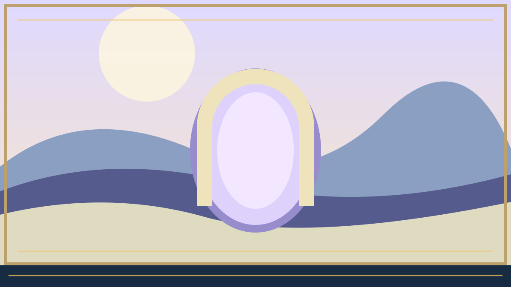

# Lanterive — La rive des lanternes et des diplomates

> **ATLAS ET LORE — CONTENU À PUBLIER ULTÉRIEUREMENT.** Tout ce qui suit, y compris le nom de ce lieu et les personnes présentées, est une **proposition non jouée**. Ne pas interpréter le paysage comme une carte, une preuve de faits historiques ou une localisation canonique.

## Terre, lumière et premières impressions
Une petite ville fluviale bâtie sur deux rives mêle quais, logements et édifices de rencontres.

## Mémoire du lieu
Elle pourrait être un centre historique de négociation commerciale entre régions et peuples, mais aucun traité particulier n'y est présumé signé.

## Une journée dans le bourg
Les citoyens voient passer artistes, savants, diplomates, guides et voyageurs. Les auberges cohabitent avec des foyers résidentiels qui veulent préserver le calme.

## Économie et liens avec la région
Congrès, traduction, transport de rivière, artisanat de lanternes et restauration internationale. Son développement doit rester compatible avec l’économie des habitants et avec les échanges entre les royaumes alliés, sans déduire l’existence d’une route terminée ou d’une corporation officiellement fondée.

## Trois lieux remarquables à jouer
- **Pont des Lanternes** — un point de rendez-vous pour les habitants et les visiteurs ; noms et usages précis à arbitrer
- **Halle des Délégations** — un lieu d'activité où métiers, traditions et débats peuvent se rencontrer
- **Maison des Rives** — un lieu propice à une enquête, une fête ou une décision civique

## Un visage du lieu — personnage proposé, non attesté
**Seln Arveuil**, organisateur d'accueil diplomatique. Il cherche des compromis entre cérémonial et égalité devant la loi, sans être un agent divin. Ce personnage est librement utilisable par un MJ ; il n’appartient ni à la campagne jouée d’Orin ni au registre canonique des PNJ.

## La tension locale
Un congrès prestigieux entraîne une hausse temporaire des prix et une pénurie de chambres pour les habitants.

## Une aventure sans solution imposée
Des représentants réclament une exemption de contrôle à l'entrée du pont ; les agents de la cité défendent un règlement commun.

Trois façons de faire avancer cette aventure : **écouter** les parties prenantes et recueillir les témoignages ; **vérifier** documents et ressources ; **négocier** un accord ou une solution provisoire. Aucune issue ni récompense mécanique n’est présumée.

## Relations avec les autres lieux
Cette fiche approfondit **Marches des Passages** et peut être reliée à **Clairseuil** et **Aubeseuil** comme relations narratives possibles, **sans fixer de kilomètres ou de route réelle**.

- [Vue régionale](ori-reg-005.md)
- [Grande cité liée à la région](ori-cit-002.md)
- [Index des 36 lieux de travail](../INDEX_ATLAS.md)

## Continuité et garde-fous
Orinor demeure un royaume indépendant des Montagnes de l’Aube, sous une monarchie constitutionnelle dont les élus exercent l'administration. La foi en Orin ou toute autre divinité n'est pas obligatoire. Le tourisme et le luxe ne doivent pas soustraire les établissements privés aux droits civiques. Aucun passage magique public ne peut être inventé à partir de la seule proximité de Clairseuil. Cette fiche reste **hors publication** jusqu'à une approbation éditoriale explicite.
