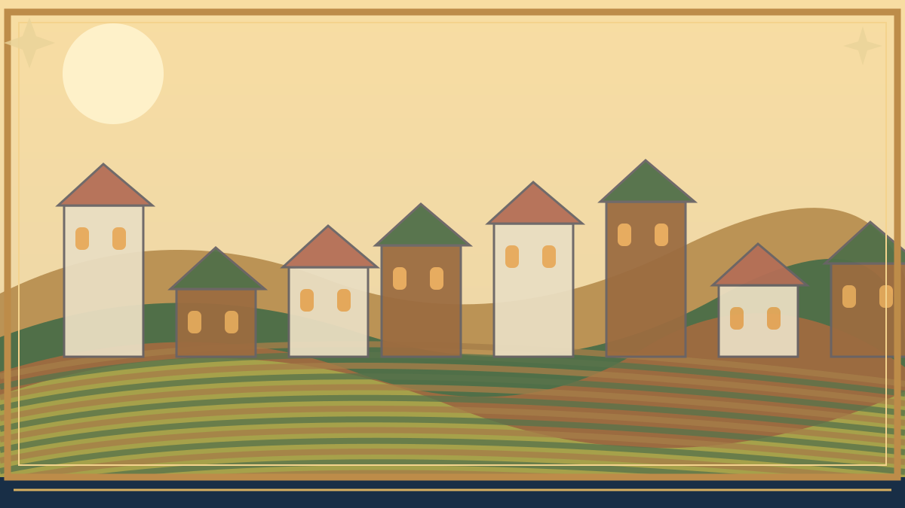

# Orignac

*Les six terroirs et leur culture de la table — illustration d’ambiance originale, non cartographique.*

> **À PUBLIER DANS L’ATLAS ET LE LORE — BROUILLON NON PUBLIC.** **Acquis :** Orignac et les six terroirs culturels, sans administrations propres. Les autres quartiers, cultures, paysages et intrigues sont **des propositions non jouées**. Le dessin ne fixe ni frontière ni distance.

## Portrait du territoire
Coteaux, bassins, plateaux de pâturage, vallées cultivées et villages de pierre coexistent. Les six terroirs sont les Côtes de Vaurenne, le Grand Bassin de Bréval, les Terrasses de Solombre, les Hautes Brumes d’Elsac, la Vallée des Sept-Saules et les Landes d’Arvège.

## Habitants et rythmes de vie
Viticulteurs, éleveurs, affineurs, tonneliers et restaurateurs transmettent des savoir-faire variés. Les fêtes de village peuvent réunir les habitants au-delà des compétitions de prestige.

## Économie, visiteurs et relations
Vins de garde et de caractère, blancs aromatiques, rosés, fromages de chèvre, brebis et montagne, auberges et négociants. Les terroirs sont culturels et ne disposent pas d’une administration propre.

Pour les échanges nationaux, cette localité est à mettre en relation avec les autres villes d’Orinor et avec les partenaires des Montagnes de l’Aube. L’accueil des visiteurs doit exister pour plusieurs budgets, sans réserver les services civiques aux riches ni aux fidèles d’Orin.

## Lieux à créer et à vérifier
- **Ronde des Six Terroirs** — nom de lieu proposé, non attesté dans la campagne.
- **vieilles caves** — nom de lieu proposé, non attesté dans la campagne.
- **halles de Bréval** — nom de lieu proposé, non attesté dans la campagne.

## Un conflit qui fait vivre le lieu
Une grande maison souhaite uniformiser les appellations au détriment des petites productions. La réponse appartient aux habitants, aux représentants élus et aux autorités compétentes : aucune intervention divine automatique n’est présumée.

## À jouer — amorce jamais jouée
Un domaine présente un vin dont le terroir d’origine est disputé ; les PJ étudient le sol, les témoignages et les registres.

## Place dans le royaume et limites du canon
Le Saint Royaume d’Orinor est l’ancien Duchêne. Orin demeure son souverain tutélaire, mais le créateur retient une **monarchie constitutionnelle administrée par des représentants élus**. Les croyances restent libres : nul ne doit prier Orin pour conserver sa place. La **monnaie commune et l’alliance privilégiée avec les Montagnes de l’Aube** sont des décisions récentes du créateur, qui prévalent sur la formulation plus ancienne des plans CB39 où elles étaient encore en projet. Les usages exacts des passages entre Couronnes nécessitent des validations distinctes.

## Autres fiches du lot
- [Bréval](ori-cit-003.md)
- [Vaurenne](ori-loc-001.md)
- [Saulaie-des-Sept-Saules](ori-loc-002.md)
- [Registre des arbitrages](../DECISIONS_ET_PROVENANCE.md)

## Documentation
Sources de contexte : [GEO-002 — Orinor](../../../content/lieux/GEO-002.md), [passages entre Couronnes](../../../content/monde/passages-entre-couronnes.md) et *Campagnes brutes 3.7–4.3*. Les détails inventés ici sont des propositions de création autonome et ne sont pas présentés comme des scènes jouées.
