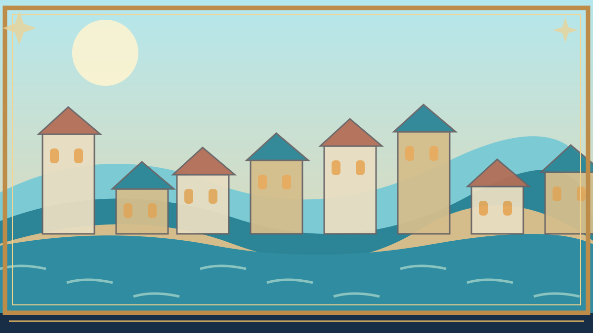

# Les Côtes lumineuses

*Le rivage de l’accueil et du grand commerce — illustration d’ambiance originale, non cartographique.*

> **À PUBLIER DANS L’ATLAS ET LE LORE — BROUILLON NON PUBLIC.** **Acquis :** ensemble géographique et culturel retenu comme axe de développement ; nom et découpage détaillés encore perfectibles. Les autres quartiers, cultures, paysages et intrigues sont **des propositions non jouées**. Le dessin ne fixe ni frontière ni distance.

## Portrait du territoire
Baies chaudes, criques, terrasses calcaires, jardins, îlots et ports dessinent un littoral qui rappelle certains paysages méditerranéens. Le tracé exact reste ouvert.

## Habitants et rythmes de vie
Les pêcheurs et équipages côtoient les hôteliers, restaurateurs, dockers, artisans du verre et familles installées depuis longtemps. Une cité de villégiature ne doit pas chasser ceux qui la font vivre.

## Économie, visiteurs et relations
Commerce maritime, stations thermales, grande hôtellerie, plaisance, construction navale, cuisine marine et parfumerie.

Pour les échanges nationaux, cette localité est à mettre en relation avec les autres villes d’Orinor et avec les partenaires des Montagnes de l’Aube. L’accueil des visiteurs doit exister pour plusieurs budgets, sans réserver les services civiques aux riches ni aux fidèles d’Orin.

## Lieux à créer et à vérifier
- **Bellécume** — nom de lieu proposé, non attesté dans la campagne.
- **plages publiques** — nom de lieu proposé, non attesté dans la campagne.
- **vieux ports** — nom de lieu proposé, non attesté dans la campagne.
- **promenades maritimes** — nom de lieu proposé, non attesté dans la campagne.

## Un conflit qui fait vivre le lieu
L’afflux des visiteurs fait monter le prix des logements et encourage la privatisation du bord de mer. La réponse appartient aux habitants, aux représentants élus et aux autorités compétentes : aucune intervention divine automatique n’est présumée.

## À jouer — amorce jamais jouée
Une plage anciennement commune se retrouve enfermée derrière les jardins d’un palace ; les archives des droits d’accès deviennent cruciales.

## Place dans le royaume et limites du canon
Le Saint Royaume d’Orinor est l’ancien Duchêne. Orin demeure son souverain tutélaire, mais le créateur retient une **monarchie constitutionnelle administrée par des représentants élus**. Les croyances restent libres : nul ne doit prier Orin pour conserver sa place. La **monnaie commune et l’alliance privilégiée avec les Montagnes de l’Aube** sont des décisions récentes du créateur, qui prévalent sur la formulation plus ancienne des plans CB39 où elles étaient encore en projet. Les usages exacts des passages entre Couronnes nécessitent des validations distinctes.

## Autres fiches du lot
- [Bellécume](ori-cit-001.md)
- [Caldrine](ori-loc-003.md)
- [Port-Écaille](ori-loc-004.md)
- [Registre des arbitrages](../DECISIONS_ET_PROVENANCE.md)

## Documentation
Sources de contexte : [GEO-002 — Orinor](../../../content/lieux/GEO-002.md), [passages entre Couronnes](../../../content/monde/passages-entre-couronnes.md) et *Campagnes brutes 3.7–4.3*. Les détails inventés ici sont des propositions de création autonome et ne sont pas présentés comme des scènes jouées.
