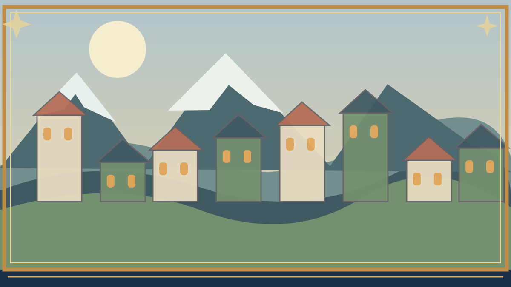

# Les Hautes Terres brumeuses

*Les landes, les brumes et les maisons ouvertes — illustration d’ambiance originale, non cartographique.*

> **À PUBLIER DANS L’ATLAS ET LE LORE — BROUILLON NON PUBLIC.** **Acquis :** ensemble géographique et culturel retenu comme axe de développement ; nom et découpage détaillés encore perfectibles. Les autres quartiers, cultures, paysages et intrigues sont **des propositions non jouées**. Le dessin ne fixe ni frontière ni distance.

## Portrait du territoire
Plateaux verts, vallées froides, crêtes, tourbières, falaises et sources chaudes évoquent les paysages du nord de l’Europe, sans constituer une carte réelle.

## Habitants et rythmes de vie
L’élevage, les petits ateliers, les marchés de laine, les bains et les maisons de repos rythment la vie. L’hospitalité est une nécessité autant qu’une réputation.

## Économie, visiteurs et relations
Fromages de montagne, laine, pierre, bois, thermalisme, guides de montagne et séjours de retraite.

Pour les échanges nationaux, cette localité est à mettre en relation avec les autres villes d’Orinor et avec les partenaires des Montagnes de l’Aube. L’accueil des visiteurs doit exister pour plusieurs budgets, sans réserver les services civiques aux riches ni aux fidèles d’Orin.

## Lieux à créer et à vérifier
- **Brumehaute** — nom de lieu proposé, non attesté dans la campagne.
- **Sourcefroide** — nom de lieu proposé, non attesté dans la campagne.
- **routes des pâturages** — nom de lieu proposé, non attesté dans la campagne.
- **auberges des cols** — nom de lieu proposé, non attesté dans la campagne.

## Un conflit qui fait vivre le lieu
La haute saison touristique exige des routes et des logements que les communes entretiennent toute l’année. La réponse appartient aux habitants, aux représentants élus et aux autorités compétentes : aucune intervention divine automatique n’est présumée.

## À jouer — amorce jamais jouée
Une tempête oblige à répartir les ressources entre touristes fortunés et hameaux isolés ; le choix relève des communautés.

## Place dans le royaume et limites du canon
Le Saint Royaume d’Orinor est l’ancien Duchêne. Orin demeure son souverain tutélaire, mais le créateur retient une **monarchie constitutionnelle administrée par des représentants élus**. Les croyances restent libres : nul ne doit prier Orin pour conserver sa place. La **monnaie commune et l’alliance privilégiée avec les Montagnes de l’Aube** sont des décisions récentes du créateur, qui prévalent sur la formulation plus ancienne des plans CB39 où elles étaient encore en projet. Les usages exacts des passages entre Couronnes nécessitent des validations distinctes.

## Autres fiches du lot
- [Brumehaute](ori-cit-004.md)
- [Sourcefroide](ori-loc-005.md)
- [Pâture-Ronde](ori-loc-006.md)
- [Registre des arbitrages](../DECISIONS_ET_PROVENANCE.md)

## Documentation
Sources de contexte : [GEO-002 — Orinor](../../../content/lieux/GEO-002.md), [passages entre Couronnes](../../../content/monde/passages-entre-couronnes.md) et *Campagnes brutes 3.7–4.3*. Les détails inventés ici sont des propositions de création autonome et ne sont pas présentés comme des scènes jouées.
