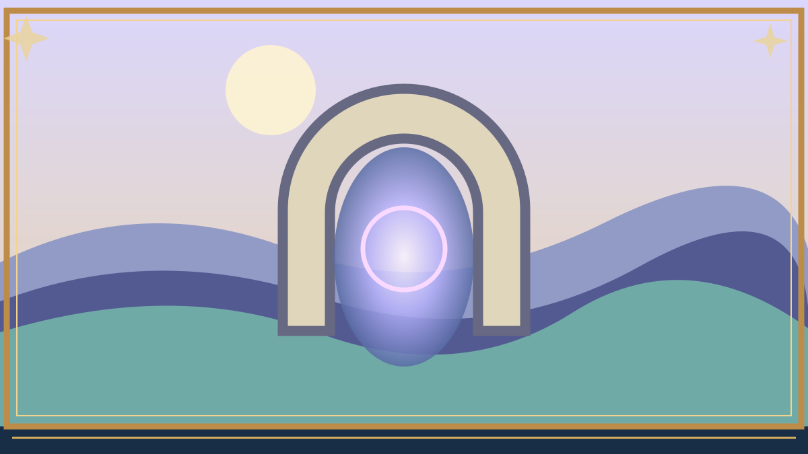

# Les Marches des Passages

*Le pays des voyageurs et des savoirs — illustration d’ambiance originale, non cartographique.*

> **À PUBLIER DANS L’ATLAS ET LE LORE — BROUILLON NON PUBLIC.** **Acquis :** ensemble géographique et culturel retenu comme axe de développement ; nom et découpage détaillés encore perfectibles. Les autres quartiers, cultures, paysages et intrigues sont **des propositions non jouées**. Le dessin ne fixe ni frontière ni distance.

## Portrait du territoire
Avenues savantes, routes anciennes, jardins de rencontre et lieux de transit autorisés constituent un paysage composite. Aucune position précise des Portes entre Couronnes n’est arrêtée.

## Habitants et rythmes de vie
Étudiants, gardiens, traducteurs, commerçants, agents d’accueil et familles étrangères y cohabitent. Le passage entre mondes est une activité encadrée, pas un droit d’accès universel aux domaines divins.

## Économie, visiteurs et relations
Académies, ateliers magiques, traduction, librairies, échanges culturels, hôtellerie internationale, diplomatie.

Pour les échanges nationaux, cette localité est à mettre en relation avec les autres villes d’Orinor et avec les partenaires des Montagnes de l’Aube. L’accueil des visiteurs doit exister pour plusieurs budgets, sans réserver les services civiques aux riches ni aux fidèles d’Orin.

## Lieux à créer et à vérifier
- **Clairseuil** — nom de lieu proposé, non attesté dans la campagne.
- **Veilleporte** — nom de lieu proposé, non attesté dans la campagne.
- **établissements d’enseignement** — nom de lieu proposé, non attesté dans la campagne.
- **maisons d’hôtes** — nom de lieu proposé, non attesté dans la campagne.

## Un conflit qui fait vivre le lieu
Les institutions prestigieuses attirent des capitaux, mais les personnes n’ayant pas accès à la magie risquent d’être marginalisées. La réponse appartient aux habitants, aux représentants élus et aux autorités compétentes : aucune intervention divine automatique n’est présumée.

## À jouer — amorce jamais jouée
Des passagers sont bloqués par une interruption de transit. Leurs documents et droits diffèrent : qui peut arbitrer sans discrimination ?

## Place dans le royaume et limites du canon
Le Saint Royaume d’Orinor est l’ancien Duchêne. Orin demeure son souverain tutélaire, mais le créateur retient une **monarchie constitutionnelle administrée par des représentants élus**. Les croyances restent libres : nul ne doit prier Orin pour conserver sa place. La **monnaie commune et l’alliance privilégiée avec les Montagnes de l’Aube** sont des décisions récentes du créateur, qui prévalent sur la formulation plus ancienne des plans CB39 où elles étaient encore en projet. Les usages exacts des passages entre Couronnes nécessitent des validations distinctes.

## Autres fiches du lot
- [Clairseuil](ori-cit-002.md)
- [Veilleporte](ori-loc-009.md)
- [Clairval](ori-loc-010.md)
- [Registre des arbitrages](../DECISIONS_ET_PROVENANCE.md)

## Documentation
Sources de contexte : [GEO-002 — Orinor](../../../content/lieux/GEO-002.md), [passages entre Couronnes](../../../content/monde/passages-entre-couronnes.md) et *Campagnes brutes 3.7–4.3*. Les détails inventés ici sont des propositions de création autonome et ne sont pas présentés comme des scènes jouées.
