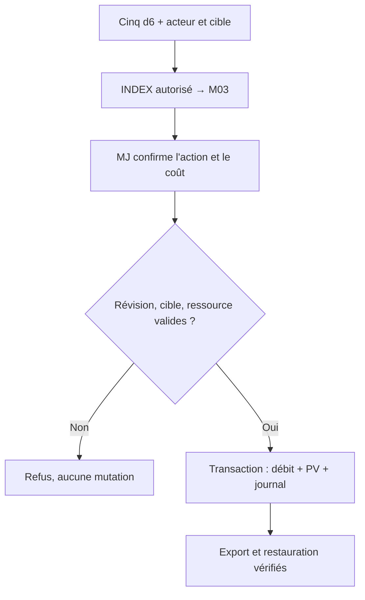

# ARCHIVES-EFF-003 — Engagement atomique des actions INDEX/M03

**Statut : candidat expérimental, non homologué, non fusionné et non publié.**

**Base de continuité :** STUDIO-CREATE-004C, PR #173, INDEX-EFF-002,
MATH-REF-002A, M03 historique et `studio-local/store.mjs`.

## Résultat attendu

Faire passer une action validée par le MJ de la simple prévisualisation à
l'engagement réel **dans une unique transaction IndexedDB** : dépenser au
plus une fois une ressource explicitement provisionnée, appliquer les dégâts
M03 si le MJ le choisit, conserver les cinq d6, les effets versionnés et
un journal rejouable. Ne pas ajouter un second moteur de calcul.

## Parcours de la tentative

### Deux nouvelles portes du Studio

- `execute({type:'register-index-resource', ...})` : le MJ déclare **explicitement**
  une provision de mana ou de charges. La réserve n'est pas inférée d'un Cercle,
  d'un rang de maîtrise, d'un objet descriptif ou de `demo-etincelle`.
  Le registre `entreRivesEffectResourcesV22` contient identifiant, détenteur,
  type, quantité initiale, disponible et version. Une réserve existante ne
  peut pas être écrasée pour la recharger silencieusement.
- `openStudioStore().executeIndexed(prepared, metadata)` : n'accepte qu'un
  objet `prepared` vivant issu de `prepareIndexedAttempt` après confirmation
  MJ locale (contrôle par identité en mémoire, pas par un drapeau JSON).
  Elle transforme la préparation en commande `record-indexed-opposition`
  **interne** ; l'appel direct de cette commande avec un objet copié est refusé.

Le journal utilise la liste historique `entreRivesPlayActionsV6` avec
l'extension `entreRivesIndexedOppositionV22`. L'ancien
`record-opposition` reste intact, et toutes les anciennes sauvegardes sont
toujours reconnues. Les nouveaux fichiers portent la version de sauvegarde 22.

### Règles de sécurité de la transaction

1. Lecture de la campagne et des ressources à **l'intérieur** de la transaction
   `readwrite` existante, après préparation et signature de la commande.
2. Vérification d'`operationId`, de la signature et de `expectedRevision`.
   Même identifiant et même signature : renvoi du résultat existant.
   Même identifiant et contenu différent : conflit. Révision dépassée : conflit.
3. Vérification de l'acteur et de la cible dans la scène active, du profil
   défenseur actuel, du coût, de la version de réserve et du solde.
4. Rejeu du justificatif INDEX/M03. Pour un effet mental, l'impact PV demeure
   nul. Les dégâts physiques ou magiques suivent **le moteur M03 existant**.
5. Le débit, l'effet PV et le journal sont enregistrés ensemble. Une interruption
   avant commit annule **tout** ; une réponse perdue après commit se rejoue
   sans deuxième débit.
6. Export, import et restauration vérifient les cinq d6, les preuves M03,
   la protection historique et l'équilibre des réserves à partir des dépenses
   du journal. Un fichier de sauvegarde est une **preuve de passé**, jamais une
   nouvelle autorisation MJ.

### Exemple entièrement fictif

Un PJ détient la réserve `mana-pj-mage` provisionnée à 10 par le MJ. Le sort
`MAG-SORT-001` (Étincelle) est sélectionné avec une définition `impact +2`
**uniquement pour le test**. Le MJ choisit un coût de **3 mana de test**.
Après la réussite calculée par M03, la transaction passe à 7 mana. Un double
clic avec `operationId` identique laisse la réserve à 7 ; un second clic
concurrent avec une autre opération périmée est refusé. Ce coût ne prétend
pas fixer le tarif de l'Étincelle canonique.

Une manœuvre physique autorisée ou un objet enchanté suit exactement la même
chaîne. Une arme purement descriptive n'obtient pas de bonus automatique.

## Recette exigée

| Cas | Attendu |
| --- | --- |
| Simulation cinq d6 / INDEX / M03 | Un seul jet, parité mécanique |
| Faux `approved:true`, JSON copié | Refus d'engagement |
| Provision absente / insuffisante | Refus sans débit |
| Interruption avant commit | Aucun dégât, aucune ressource débitée |
| Interruption après commit puis reprise | Même opération, aucun deuxième débit |
| Deux onglets au même numéro de révision | Une écriture, une réponse `conflict` |
| Charge et mana | Dépense explicite et versionnée ; pas de coût automatique |
| Influence mentale | Aucun PV automatiquement retiré |
| Export / réimport | Rejeu des effets, ressources et PV cohérents |
| Tentative de falsification après recomposition SHA | Rejet par vérification M03 |

**Commande navigateur :** `npm run test:archiveseff003`.
Cette recette est ajoutée au workflow CI GitHub, séparément de `npm test`, car
elle requiert un vrai navigateur Chrome/Chromium. La CI exacte doit être
consignée dans la PR ; aucune recette humaine n'est revendiquée par défaut.

## Hors périmètre et passations

- **STUDIO / ATELIERS** : construire le parcours UI « Prévisualiser » →
  « Confirmer » avec validation visible des ressources et retour d'erreur
  explicite. Une page joueur ne doit jamais exposer les coûts secrets, le
  registre interne, les intentions privées ou le justificatif complet.
- **MAG / OBJETS / CAP / INDEX / BESTIAIRE** : alimenter les références
  versionnées ; ne pas auto-homologuer les effets, ni déduire de tarifs non
  arbitrés des niveaux, Circles, rangs ou degrés narratifs.
- **ARCHIVES** : pas de commande générale de recharge dans ce lot. Concevoir
  ultérieurement la récupération/réattribution avec journal propre, plutôt
  qu'une mutation directe d'un champ courant.
- **QA** : recette de bout en bout sur fiches importées, Chrome/PC/tablette,
  restauration, fenêtres joueur et cas d'erreurs. Surveiller aussi les combats
  N25 trop longs ; **les formules M03 ne changent pas ici**.
- **DG** : revoir les preuves, les coûts et la confidentialité avant
  fusion. Ne rien publier automatiquement sur le nouveau site.

**Critère de sortie :** CI verte sur le SHA exact + QA/DG. La présence du code
et la réussite d'un test local ne constituent pas une homologation éditoriale.
