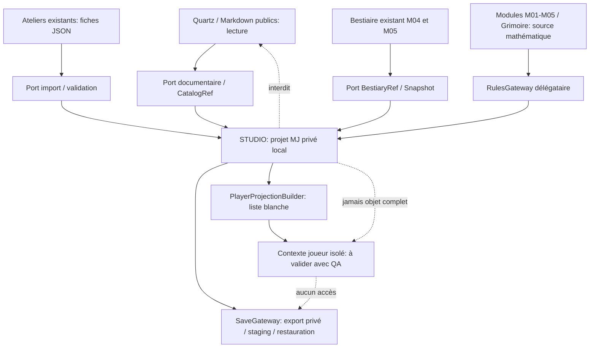

# BUILDER-001 — DG-LOT-002 — Rapport technique et spécification d'architecture

**Projet :** Les Chroniques d'Entre-Rives v0.1 · **Rôle :** 01 🧱 BUILDER (frontières d'architecture, API, réemploi)  
**Demandeur :** DG, lancement approuvé par le créateur · **Date de contrôle :** 3 novembre 2026 (America/Chicago)  
**Base applicative immuable examinée :** `main` `88f774f3d0d6d520d8d11443b72202b9caf4f94b`  
**Référence de gouvernance :** PR #78 ouverte en brouillon, `chore/chroniques-v01-organisation-ia` à `82d6b4c1096c7faa12da6b80ff09b82e11b9f259`, base `main` `88f774f...`.  
**Nature :** spécification **sans code applicatif** et contre-audit à partir d'inventaires existants ; banc indépendant sur JSON entièrement fictif. Aucun merge, correctif de production, publication, canonisation, changement de formule ou migration des données.  
**Statut recommandé :** **VALIDÉ AVEC RÉSERVES — conception de frontières et preuve de faisabilité contractuelle seulement**, non homologation fonctionnelle de l'Alpha.

## A. Chaîne de preuve et reprises (sans réinventaire intégral)

1. Le précédent dossier local `BUILDER_001_ARCHITECTURE_V01.md` et sa `FICHE_DIRECTION_BUILDER_001.md` ont été relus, puis prolongés. L'architecture initiale était proposée, non validée en production.
2. Le référentiel de lancement `docs/chroniques-v01/02_MISSIONS_INITIALES.md` (blob `d005a4f0b18d7104e20efdb7023145821e246fe7`) confirme BUILDER pour les frontières et STUDIO pour le cockpit. Le protocole `03_PROTOCOLE_RAPPORTS.md` (blob `85288a86ca694ca3589dc82c24e0e65914af67d7`) exige la séparation des faits, tests et validations.
3. Le rapport antérieur `Rapport-technique-STUDIO-001.md` a été consulté comme cadrage de STUDIO : STUDIO-001 construit campagne locale, scènes, projection; STUDIO-002 approfondit bibliothèque/création des campagnes; STUDIO-003/Table réseau et STUDIO-004/IA sont ultérieurs. Ces travaux STUDIO antérieurs sont **rapportés** et non remplacés par BUILDER.
4. Relecture directe des sources du `main` par le connecteur GitHub aux SHA ci-dessous; métadonnées de PR #54/#66/#78 et CI `main` vérifiées. Le `main` reste au SHA ci-dessus à la vérification.
5. Un banc de spécification isolé Python a été exécuté sur une fixture fictive : 27/27 assertions réussies. Ces vérifications sont **indépendantes de Quartz/Studio** et ne sont pas des tests applicatifs ni une validation de la sécurité réelle d'une fenêtre joueur.

### Références et blobs contrôlés

| Source à la révision indiquée | Blob SHA | Fait directement vérifié |
|---|---|---|
| `docs/chroniques-v01/02_MISSIONS_INITIALES.md` (PR #78) | `d005a4f0b18d7104e20efdb7023145821e246fe7` | Mandat et propriétaires du lot |
| `docs/chroniques-v01/03_PROTOCOLE_RAPPORTS.md` (PR #78) | `85288a86ca694ca3589dc82c24e0e65914af67d7` | Protocole des rapports, sécurité, revue |
| `quartz.ts` | `204b827ada036617f80db17d5e3e488f2b0e813e` | Façade Quartz, Atelier5d6, BestiaryWorkshop |
| `quartz.config.yaml` | `659c0d9dd0ecf95eb9afaac0cf0097eccfe96571` | Quartz SPA/baseUrl et alias redirects |
| `quartz/components/scripts/atelier5d6.inline.ts` | `c5d233692c41ef14cb7d06fcccba66905a710ba6` | Clés stockage, `alrick.sheets.v3`, `alrick.campaign.v1/v2`, confirmation restauration |
| `quartz/components/scripts/atelier5d6-progression.ts` | `d2040829ea0da7c0f6eae08dc8c701226bfc53c5` | M01, bonus effectifs, budget et progression |
| `quartz/components/scripts/atelier5d6-m02.ts` | `39a91de6c21d42c7bf66b2c575024cd8164fa521` | `AbilityDefinition` et adaptateur M02 |
| `quartz/components/scripts/atelier5d6-combat-m03.ts` | `09929f1b852a971d73d40474847bae036bf11ffb` | M03, `resolveCombatM03`, effet `absorption` accepté mais non appliqué |
| `quartz/components/scripts/atelier5d6-bestiary-workshop.ts` | `4dd84b20ee0ff213a0c8f17ad172fafbd5bd9c10` | `alrick.bestiary.v1`, validation, `exportBestiaryForAtelier` |
| `quartz/components/scripts/atelier5d6-m05-sheet-view.ts` | `9972aaa1f3e85acbc28e0d60d95776ca274a4154` | Fiche M05 en lecture ; `canOfferDocumentaryLink` = `false` |
| `quartz/components/scripts/atelier5d6-grimoire.ts` | `4f6d97ce1a6e57b427be6a0d22651a8ec0db899f` | Grimoire v1, sorts/matrices et attestations |
| `docs/bestiaire/B002_SPEC_INTEROPERABILITE.md` | `a572e1bf391f90772d0d44238b2b4b533cf3cdad` | Code documentaire distinct des IDs locaux; relations n:n désactivées |
| `.github/workflows/ci.yml` | `1ceb0a1f437069596ce58f3715f3cc38e8a84290` | CI `npm ci`, `npm test`, `test:m04:browser` |
| `scripts/check-site.mjs` | `afc5f2ab13af7914e978feeebb1f8093dfa3518f` | Contrôle URLs/ressources, recherche/sitemap MJ |

**Liens :** [PR #78](https://github.com/Sijiel44/archives-alrick/pull/78), [source de mission au commit exact](https://github.com/Sijiel44/archives-alrick/blob/82d6b4c1096c7faa12da6b80ff09b82e11b9f259/docs/chroniques-v01/02_MISSIONS_INITIALES.md), [main](https://github.com/Sijiel44/archives-alrick/tree/88f774f3d0d6d520d8d11443b72202b9caf4f94b), [CI main historique #41340618029](https://github.com/Sijiel44/archives-alrick/actions/runs/41340618029). PR #54 et #66 sont ouvertes en brouillon; elles ne sont pas dépendances de l'Alpha locale. La CI historique est bien terminée avec succès sur le SHA main mais **n'a pas été relancée par BUILDER**.

## B. Carte de conservation / extraction / adaptation / nouveau

| Domaine | Conserver intact | Extraire plus tard (sans copier les équations) | Adapter dans la tranche verticale | Nouveau à spécifier | Autorité / risque |
|---|---|---|---|---|---|
| Quartz, URL, navigation | `quartz.ts`, YAML, Markdown/Pages, routes, aliases, pipeline Pages | Aucun moteur à extraire de Quartz lors de ce lot | Future entrée « Studio du MJ » en sous-parcours Jouer, sans déplacer les URLs | Aucun routeur réécrit | BUILDER+ATELIERS/UX, QA; risque 404 et exposition d'HTML |
| Markdown et registre | `content/`, `modeles/`, codes et `CONTRAT_EDITORIAL.md`, statuts et sources | Futur adaptateur de lecture des fiches | `DocumentRef` *résolu* par registre; lien par code/slug/version explicitement vérifié | Rien de canonique | INDEX+DG; risques homonymie, spoiler, lien non prouvé |
| M01–M05 | Modules probas/progression/M02/combat M03/génération Bestiaire/lecture M05 | Port `RulesGateway` pur, points d'entrée vers fonctions existantes | Prévoir `ruleset`, sourceCommit et traçabilité au niveau de la copie de travail | Aucune formule, aucun calcul de combat bis | MATH; divergence legacy/M03 et absorption |
| Grimoire/mana/rites | Schémas v1, matrices, journaux et fonctions présentes dans `main` | Facade de lecture/transactions ultérieure après revue MAG | Référence de sort, pas d'exécution ni d'octroi implicite; restituer les champs en export privé | Pas de moteur magique Studio | MAG/MATH/ARCHIVES; double dépense et ID d'objet |
| Bestiaire | Atelier M04, `alrick.bestiary.v1`, M05, registres B-001/B-002 | Adaptateur de sélection/validation stable | Créer **référence et copie** avec provenance; M05 est une fiche MJ, non un écran joueur | Instance de campagne distincte du code documentaire | BEST+INDEX/STUDIO; canonisation accidentelle |
| Ateliers existants | Pages/JS de création PJ, créatures, Grimoire, imports/exports | Séparer progressivement règles pures et interactions DOM | Adapter via fichiers/imports volontaires, ne pas mutualiser l'état direct des pages | Panneau de raccord Studio minimal | STUDIO+ATELIERS; couplage SPA |
| Sauvegardes | Clés `archives-alrick-atelier-5d6-v1/v2`, `archives-alrick-bestiary-v1` et fichiers anciens | `SaveGateway` distinct, lecture/écriture hors UI | Prévisualiser/importer, exporter projet privé indépendant; réimport transactionnel | `entre-rives.studio.project.v0-proposal` **non adopté** | ARCHIVES+STUDIO; collision, perte de champs |
| INDEX | Identités/contrats existants M02, M03, Spell, Ritual, Bestiary | Port catalogue non calculateur | `CatalogRef` versionné, adaptation descriptive / numérique bloquée sans résolveur validé | Index de capacités v0.2 proposé, non stable | INDEX/MATH; IDs hétérogènes |
| Studio MJ | Aucun cockpit complet en `main` | Rien à retirer des ateliers actuels | Connexion par adaptateurs, pas d'accès direct aux internals DOM/stockage | Campagne locale, scène, copie, notes privées, projection, export | STUDIO (données/parcours), BUILDER (frontières) |
| Tables / réseau | Branches #54/#66 intactes | Port futur facultatif | **Aucun** pour cette tranche | Pas de backend ni d'autorité réseau | DG, ultérieur |

Les choix « extraire » décrivent des frontières *futures* : aucun déplacement de fichier ni séparation de paquet n'a été exécuté.

## C. Architecture cible et sources de vérité



| Donnée / autorité | Source de vérité | Autorisation d'écriture | Règle de cohérence |
|---|---|---|---|
| Fiche documentaire et canon | Markdown + registre approuvé, créateur | Éditorial hors Studio; pas d'écriture depuis campagne | `documentaryCode` ≠ `profileLocalId` ≠ `instanceId`; `publish` ≠ permission joueur |
| Calcul M01/M03 et vue M05 | Modules `main` à la révision explicitée | MATH sur branche propriétaire | Pas de duplication, pas de `+score brut`, pas de plafond 12 |
| Fiche PJ et inventaire importés | Fichier source; copie dans la campagne | Création/édition originale dans Atelier; instance dans Studio | `legacyOriginal` + champs inconnus conservés; historique non inventé |
| Créature de bibliothèque | B-001/B-002 documentaire ou BestiaryCard locale | Source en lecture seule | Copie de travail avec source/version/snapshot ; pas de propagation retour |
| Scène, notes, sélection à révéler | Projet local STUDIO | MJ sur son appareil; **pas** permission authentifiée | Champs privés absents du modèle joueur; pas de synchronisation |
| Projection affichée | Objet éphémère construit depuis **sélections explicites** | Seul le MJ choisit ce qui est révélé | Pas de chargement de l'objet projet ni de connexion au stockage MJ |
| Archive/restore projet | Export privé et staging local | Action locale explicite, confirmation avant remplacement | État courant intact si erreur ; hash/retour arrière, pas de migration in-place |

**Attention au modèle d'autorité :** la distinction « MJ »/« joueur » dans un navigateur local ne prouve ni identité ni habilitation. Une personne ayant accès au navigateur/stockage de MJ peut lire des secrets; l'Alpha doit être présentée comme séparation d'**affichage**, non comme protection contre toute personne sur le même appareil. Une fenêtre du même *origin* peut partager du stockage même si `window.opener` est coupé : l'isolation de fenêtre doit être démontrée par QA, pas seulement déclarée.

## D. Contrats d'API proposés — noms non adoptés et sans implémentation

| Port | Entrée minimale et gardes | Sortie / effet attendu | Refus / propriété |
|---|---|---|---|
| `DocumentReader.resolve` | `code`, `slug?`, `revision?`, preuve de publication et visibilité issues du registre | `SourceRef { code, slug, revision, sourceHash, status, visibility, spoilerFlag }` en lecture seule | Ne résout pas automatiquement les liens B-002 n:n ; aucun code attribué |
| `RulesGateway.evaluate` | `ruleset` `legacy|m02|m03`, input typé, référence moteur immuable | Résultat natif + `rulesetRevision` + `trace` ; `M05View` dérive sans recalcul | Interdire l'application d'effet non autorisé et le mélange legacy/M03 |
| `CatalogResolver.lookup` | ID contextualisé/version de capacité ou d'objet et provenance; effet descriptif/chiffré explicite | Entrée INDEX normalisée en **lecture**, `resolutionPolicy` | Chiffre bloqué sans règle native et approbation MJ; `charges` ≠ énergie |
| `CharacterImport.preview` | Fichier synthétique ou utilisateur volontaire `alrick.sheets.v1/v2/v3` ou `campaign.v1/v2` | Rapport d'écarts, warnings, original hash, instances à créer, `stagedCopy` | Collision ou format invalide → aucune écriture; import PJ = ajout, restore campagne = remplacement seulement après confirmation |
| `BestiaryAdapter.bind` | Fiche `alrick.bestiary.v1` validée, option `reference` ou `working-copy`, `sourceId/sourceVersion` | Référence immuable + `instanceId` unique et copie indépendante si choisie | Lien M05 `documentaryLink` déclaratif; `canOfferDocumentaryLink=false` |
| `SceneStore` (STUDIO) | `projectId`, scène, participants/copies, `gmNotes`, journal et ordre de scène | Nouvel état local et `revision` ; commandes explicites MJ | Ne modifie jamais les fichiers Quartz, l'Atelier ni le Bestiaire |
| `PlayerProjectionBuilder.build` | `sceneId`, `selection` explicitement choisie, media approuvés, revision | **NOUVEL** objet `{schema, sceneTitle, publicDescription, visibleCharacters:[{displayName, publicSummary}], authorizedMedia:[{url,alt}]}` | Refus par défaut; pas de sérialisation de la scène, de ses notes ou IDs internes. Aucune URL externe arbitraire |
| `ProjectionTransport.present/revoke` | Projection déjà minimale, contexte audité/isolation de stockage, validation d'origine/source des messages | Affichage joueur éphémère et révocable | Bloqué si same-origin permet à l'écran joueur de lire les données MJ; ne pas envoyer l'objet projet |
| `ProjectArchive.preview/commit` | `entre-rives.studio.project.v0-proposal`, fichiers/schémas pris en charge, SHA256, ID uniques, prévalidation | Rapport avant restauration ; nouvelle révision locale ou remplacement confirmé atomiquement | JSON invalide ou version inconnue → rejet sans changement ; champ inconnu conservé à l'export privé, jamais « publié » |

**Statut des schemas proposés :** `entre-rives.studio.project.v0-proposal` et `entre-rives.player-projection.v0-proposal` sont des **étiquettes de test** et non des standards d'échange adoptés. ARCHIVES+STUDIO devront choisir forme définitive, version et politique d'extensions; INDEX choisira l'identité des références de capacités. Ne pas forcer l'ancien `alrick.campaign.v2` à devenir un fichier Studio sans conversion volontaire.

### Précautions de projection

- Sélection explicite des champs de scène, des personnages et des médias : jamais `spread`/`Object.assign` sur l'objet de campagne pour « en retirer les secrets ».
- `gmNotes`, `sourceSnapshot`, `legacyOriginal`, inventaires, journaux privés, indices, capacités cachées, IDs privés, `documentaryLink` et extensions inconnues n'ont **aucun** chemin vers la projection.
- `publicDescription` et `publicSummary` peuvent malgré tout contenir un secret saisi par mégarde : confirmation humaine « révéler » et aperçu joueur nécessaires; filtrage logiciel de clés ne prouve pas la pertinence narrative.
- Médias : liste d'URLs autorisées, droits et option explicite; pas d'URL `javascript:`, `data:`, de fichier privé, ni d'image cachée dans HTML. Pour un contexte différent, décider un protocole d'assets sans réseau non contrôlé.
- Transport entre fenêtres : idéalement origine joueur distincte; à défaut, évaluer un **iframe sandbox sans `allow-same-origin`** et confirmer qu'il n'accède ni à l'instance MJ ni à son stockage. Une fenêtre pop-out `same-origin` (même avec `noopener`) reste **bloquée à l'homologation confidentialité** tant que cette isolation n'est pas démontrée.
- Ne pas intégrer de secrets dans `postMessage` (même sur canal privé), URL, historique, logs console, attributs DOM, payload réseau, service worker, `localStorage` du contexte joueur ou cache du navigateur joueur.
- Toute révélation à l'écran joueur doit être **révocable** par effacement complet du contenu reçu à la fermeture/à la fin de scène. La révocation ne « reprend » pas une information déjà vue ou capturée.

## E. Tranche verticale minimale — contrat BUILDER / propriétaire STUDIO

| Séquence | Action de l'utilisateur / rôle | Frontière BUILDER | Sortie observable et critère d'acceptation |
|---|---|---|---|
| V0 | Ouvrir un Studio local **neutre par rapport à Orin** | Quartz reste façade; pas de nouvelle règle, pas de serveur | Studio ouvre un projet neuf sans modifier route ou données Atelier |
| V1 | Créer campagne locale fictive | `ProjectArchive` nouveau, IDs d'instance non canoniques | `projectId`, version et revision uniques; un état local enregistré |
| V2 | Importer un PJ `sheets.v3` (puis tester v1/v2) | `CharacterImport` lit seulement les fichiers; `preview/commit` | Avertissements + origine conservée; stats brutes >12 intactes; import n'écrase pas la campagne Atelier |
| V3 | Choisir créature source, créer référence et copie | `BestiaryAdapter` distingue objet source, lien déclaratif et copie | Copie modifiable sans modifier la carte ni attribuer canon; M03/M05 réutilisables |
| V4 | Ajouter copie de créature à scène avec note MJ | API scène privée STUDIO | Plan et description publics distincts de `gmNotes`; aucune publication Quartz |
| V5 | Le MJ choisit texte/média/personnages à montrer | `PlayerProjectionBuilder` construit **objet nouveau** à liste blanche | Inspection du JSON, messages et DOM joueurs : zéro clé ou donnée privée; isolation contexte prouvée |
| V6 | Exporter projet complet **privé**, fermer et réimporter | `ProjectArchive` export, staging, conflits, version | Original conservé; réimport de copie fidèle (extensions, snapshots, log, statuts), sans écraser si refus/erreur |
| V7 | Fermer présentation et quitter/revenir | `present/revoke` et persistance STUDIO | Projection effacée; reprise locale valide; aucun lien canon déplacé |

**Parcours d'intégration proposé :** `campagne locale → import PJ → référence et copie de créature → scène → projection par liste blanche → export / restauration`. L'acceptation *réelle* nécessite un prototype et une recette navigateur documentée sur SHA final. Une preuve contractuelle indépendante n'établit pas V0–V7 comme fonctionnels.

### Conditions d'acceptation Alpha (portes QA)

| ID | Niveau | Attendu | État DG-LOT-002 |
|---|---|---|---|
| AC-01 | P0 | M01–M05 délégués, pas de formule bis, caractéristiques >12 et legacy séparés | **Réservé** : source lue, pas de test Studio |
| AC-02 | P0 | Créature source inchangée après copie et adaptation | **Réservé** : test mock T07/T08, navigateur non testé |
| AC-03 | P0 | Projet Studio ne modifie ni canon ni les URL Quartz | **Réservé** : architecture garantit le sens, code absent |
| AC-04 | P0 | Aucune note/secrète dans les messages, DOM, stockage et export joueur, même après navigation | **Bloqué** : mock whitelist réussi, pas d'UI réelle ni isolation vérifiée |
| AC-05 | P0 | Import/export v1/v2/v3, extensions inconnues, collisions, sauvegarde privée récupérable | **Bloqué** : fixture Studio fictive, pas de roundtrip natif sur vraies versions |
| AC-06 | P0 | Reprise via staging et confirmation; ancien état intact si échec | **Réservé** : test indépendant des validations, pas de transaction réelle |
| AC-07 | P0 | CI `npm test` et `test:m04:browser` verts sur HEAD final du prototype | **Non exécuté** : CI `main` antérieure observée seulement |
| AC-08 | P1 | Sélection/scène/reprojection/clôture en navigateur bureau + tablette | **Non exécuté** : besoin recette réelle |
| AC-09 | P1 | Validation droits médias, liens B-002 non activés, texte public approuvé | **Réservé** : tests mock médias et source, pas de workflow humain |

## F. Exécution, commandes, résultats et limites

### Commandes exécutées dans le conteneur de cette mission

```sh
node --version               # v22.16.0
npm --version                # 10.9.2
git --version                # 2.47.3
timeout 12 git ls-remote https://github.com/Sijiel44/archives-alrick.git HEAD
# exit 128, fatal: unable to access ... Could not resolve host: github.com
python3 /mnt/data/builder_dg_lot_002/evidence/builder001_preflight.py \
  /mnt/data/builder_dg_lot_002/fixtures/campagne_synthetique.json \
  > /mnt/data/builder_dg_lot_002/evidence/RESULTATS_BANC_CONTRAT.json
# PASS, 27/27 assertions, 0 échec ; données entièrement synthétiques
```

Le connecteur GitHub a permis **la lecture distante des sources**, mais le conteneur n'a pas pu joindre `github.com` par Git (DNS); aucun checkout exécutable du dépôt n'a été obtenu. `npm ci`, `npm test` et `npm run test:m04:browser` n'ont donc **pas été exécutés localement dans cette mission**. Il n'y a pas de simulation de leur succès. Les PR #54/#66 restent ouvertes, brouillon, sans être modifiées.

Le banc `builder001_preflight.py` est une **référence de contrat indépendante** (Python stdlib); il ne lance pas M01–M05, la SPA Quartz, un DOM navigateur, des fenêtre réelles ou la CI. Il vérifie une projection construite exclusivement avec les champs explicitement sélectionnés; la conservation d'un projet fictif; refus des collisions/version inconnue; conservation des extensions; présence d'un score brut 14; non-fuite de sentinelles `MJ_SECRET_CANARY` au niveau JSON; refus d'URL `javascript:`; distinction public/privé. Les tests T01–T27 et le rendu projeté sont conservés tels quels dans `evidence/RESULTATS_BANC_CONTRAT.json`. La fixture et le script permettent de refaire exactement le contrôle.

**Preuves directes :** blobs SHA GitHub, PR #78, `main`, test Python local et fichiers JSON originaux. **Résultats externes rapportés ou observés :** CI historique `#41340618029` succès (SHA `88f...`), diagnostics MATH-001/INDEX-001/STUDIO-001 antérieurs, qui ne valent pas un test Studio. **Non exécuté :** UI réelle, sécurité navigateur, restauration native réelle, audit de sauvegardes privées, test humain, CI sur branche de la tranche verticale, playtest.

### Écart mécanique source identifié, hors mandat de correction

`validateM03AbilityEffect` autorise `kind: "absorption"` dans `atelier5d6-combat-m03.ts`, alors que `resolveCombatM03` calcule `effectSum` pour `precision`, `defense`, `impact`, `penetration` **sans** employer `absorption`. L'observation est **directe dans le code au SHA ci-dessus** (lignes ~74–132) et concorde avec le rapport MATH-001. **Réservé à MATH**; aucune modification de formule autorisée ici.

## G. Décisions ouvertes, risques et marche arrière

| Code | Priorité | Arbitrage et option BUILDER | Responsable |
|---|---|---|---|
| D01 | P0 | Accepter les ports de lecture/calcul sans réécriture, compatible avec le modèle MATH-001 et INDEX-001 v0.2 *proposé* | MATH + INDEX → DG |
| D02 | P0 | Choisir `projectId`, version enveloppe, namespace et collision ID entre sources/instances; valider pertes permises ou **aucune** | STUDIO + ARCHIVES + INDEX → DG |
| D03 | P0 | Définir modèle effectif d'isolation « joueur » : iframe opaque isolé ou origine distincte; **pas** de pop-out même origine validé par simple whitelist | STUDIO + QA + sécurité → DG |
| D04 | P0 | Geler l'API projection exclusivement positive, média autorisé et sélection manuelle; interdire effets automatiques | STUDIO + INDEX + QA → DG |
| D05 | P0 | Politique restore: preview, hash initial, confirmation atomique, sauvegarde préalable et rollback | ARCHIVES + STUDIO → DG |
| D06 | P1 | Tracer les sources d'origine : DOI/documentCode, profils locaux, snapshots, alias, versions et statut de publication | INDEX + ARCHIVES → DG |
| D07 | P1 | Examiner spécifiquement anomalie `absorption` M03 et divergences `legacy` ; pas de patch dans ce lot | MATH/COMBAT → DG |
| D08 | P1 | Définir emplacement/route de Studio sans ruptures d'URL, et protocole de tests appareils | ATELIERS/UX + QA → DG |

**Risques principaux :** fuite par DOM/messages/cache, fenêtre même origine, pertes d'extensions, collisions, import incomplet, contenu canonique modifié indirectement, faux succès CI, couplage UI/règles, médias/illustrations non autorisés, fausse équivalence `charges`/ressource, effet `absorption` déjà incohérent, future migration destructrice. Aucune découverte de données utilisateur confidentielles n'a été demandée ni utilisée.

**Rollback futur :** conserver export privé avant essai, créer copie de travail et nouveau namespace Studio sans toucher `localStorage` ancien; versionner les écrans nouveaux derrière option désactivable; revenir à `main` si tests KO sans effacer le projet original; migration de production interdite jusqu'à décision explicite.

## H. Passations préparées — non envoyées

- **MATH — D01/D07 :** confirmer API native `RulesGateway` legacy/M03, gestion d'`absorption`, matrice de parité, sans nouveau moteur. Référence : SHA M03 `09929f1...` et `BUILDER_001_DG_LOT_002_RAPPORT_TECHNIQUE.md`.
- **INDEX — D01/D04/D06 :** arbitrer `CatalogRef`/`SourceRef`, statut numérique/descriptif, version, source et liens B-002; frontière joueur; aucun documentCode inventé. Référence : doc B-002 et fiche INDEX v0.2 proposée.
- **STUDIO — D02/D03/D04/D05 :** propriétaire du schéma campagne/scène/PJ/notes, de l'expérience de séance et du composant projection. Ajuster les noms de ports BUILDER et fixer sélection révélation/retrait/fermeture.
- **ARCHIVES — D02/D05/D06 :** matrice des anciens schémas, staging/confirmation/atomicité, conservation des inconnues, collisions et restauration sur vrais exports autorisés hors dépôt public.
- **QA — AC-01 à AC-09 :** sécurité de contexte joueur, absence de secrets dans DOM/messages/stockage, tests réels des navigateurs/fenêtres, CI/navigateur à SHA final, rollback et cas négatifs.
- **DG — ADR / D01 à D08 :** trancher l'acceptation des frontières proposées, les P0 bloquants et le droit d'ouvrir le développement de Studio sur branche future; n'autoriser aucune fusion par ce rapport.

**Aucune passation n'a été envoyée automatiquement** ; ces textes sont prêts à être centralisés par la session DG. Les propriétaires sont consultés par la revue humaine, pas simulés.

## I. Verdict du référent BUILDER

- **VALIDÉ (dans le périmètre démontré)** : inventaire réemployé et revérifié à deux SHA, modules sources et formats présents, différences sources vs copies, bornes de responsabilité, test local indépendant **27/27** de construction contractuelle d'un objet joueur à liste blanche.
- **VALIDÉ AVEC RÉSERVES** : orientation « Quartz conservé, moteur natif réutilisé, ports d'adaptation, Studio local et fichiers distincts » comme **architecture de conception**. Contrats versionnés non adoptés.
- **BLOQUÉ pour homologation Alpha** : sécurité du contexte fenêtre joueur et restauration applicative non démontrées, choix schema Studio/INDEX, arbitrage D01–D05, anomalie M03 hors lot.
- **NON EXÉCUTÉ** : création d'application, tests TypeScript/navigateurs, `npm test`, CI de nouveau commit, test mobile physique, publication, migration réelle, merge ou canonisation.

**À revoir par :** MATH, INDEX, STUDIO, ARCHIVES, QA (+ BEST/MAG/UX pour leurs interfaces).  
**À valider par DG/créateur :** D01–D08 et éventuelle autorisation d'une prochaine branche d'intégration.  
**Aucun correctif de production, changement de formule, fusion, publication, canonisation ou transfert de secrets.**