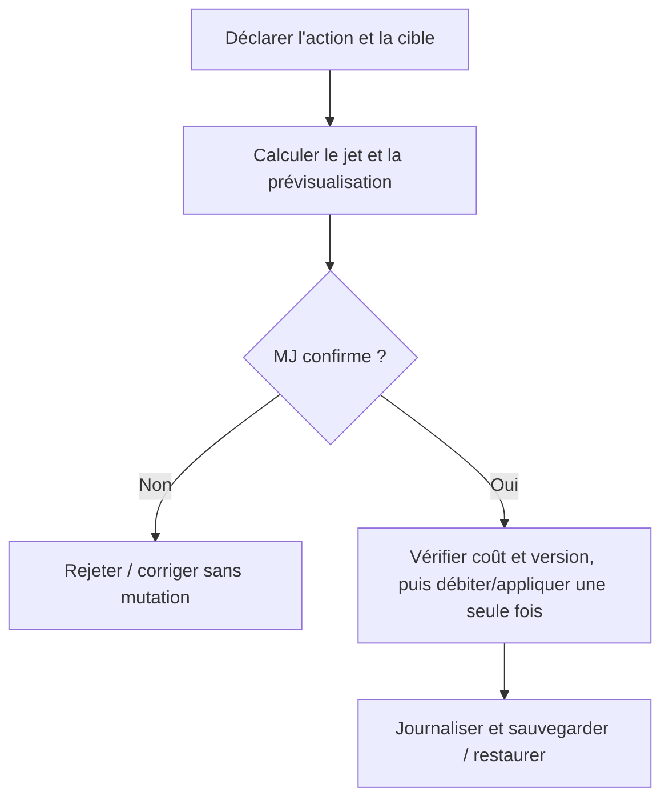

# MATH-EFF-001 — Contrat transversal des effets v0 (candidat)

**Statut : proposition technique, non homologuée, non déployée.** Base auditée : `main@8acc0079ace9da502d022dedc904eda1c02cfa31` (le SHA de lancement `8d4ae50e059d38b568ac5b04a576a6bd6a27b347` est un ancêtre de quatre commits). Ce contrat est une enveloppe **au-dessus du moteur M03 actuel**, non un nouveau moteur.

## 1. Invariant de calcul : un jet, une opposition, un résultat

Pour chaque action opposée, quelle que soit sa provenance :

1. **Choisir et contrôler** acteur, cible, effet déclaré, maîtrise pertinente, coût potentiel, faisabilité narrative, DD et autorisation MJ. La création/possession d'un objet ne donne aucun bonus implicite.
2. **Résoudre le même M03** : `total = 5d6 + E(caractéristique) + M(rang) + situation + précision_homologuée`; `seuil = max(DD, seuilMJ, résistanceCible + défense_homologuée)`.
3. **Constater la touche** : 5–7 = échec naturel ; un succès exige faisabilité et total suffisant ; 27–30 est un potentiel critique/contact, **pas des dégâts assurés**.
4. **Seulement en cas de succès applicable aux PV** : `bruts = base[1..12] + floor(0.7 × niveau) + M(rang) + impact_homologué + bonus_affinité_magique_si_arbitré` ; `prot_effective = protection_M03(cible)` ; `pénétration = min(prot_effective, pénétration_de_base[0..8] + pénétration_homologuée)` ; `absorbé = min(bruts,max(0,prot_effective - pénétration))` ; `PV = bruts - absorbé`. Tous les montants proviennent de M03.
5. **Mode mental** : proposer un effet narratif ou d'état au MJ ; toujours `grossDamage=damage=0`, même sur succès, tant qu'un effet PV spécifique n'est pas expressément défini et homologué. La résistance `mental` reste distincte de `magie` et `physique`.
6. **Expliquer et confirmer** le résultat, l'effet, ses cibles et les ressources. Aucun calcul pur M03 ne dépense une ressource ni ne modifie une fiche. Une application réelle exige transaction et journal idempotent.

**Formules préservées, pas uniformisées artificiellement :** `E(c)=⌊3 log₂(1+c/3)⌋`, `M(r)=⌊log₂(1+r)⌋`, `R=15+E(carac pertinente)+M(meilleure maîtrise défensive)+bonus défensif MJ`, protection de M03 par niveau/type/grade/contexte. La maîtrise progresse par paliers observables ; le rang brut ne s'ajoute jamais directement au jet. La formule d'impact de niveau **n'est pas une proposition de progression universelle 1→25** : elle est l'existant soumis à revue.

## 2. Enveloppes d'interopérabilité (types candidats, NON ajoutés à la production)

```ts
type EffectOrigin = "ordinary-attack" | "physical-ability" | "magical-ability"
  | "spell" | "item" | "enchantment" | "creature" | "ritual";
type EffectFamily = "damage" | "mental" | "condition" | "defense"
  | "protection" | "recovery" | "movement" | "descriptive";
type ApprovalState = "draft" | "proposed" | "approved" | "rejected";
type ResourcePolicy = {
  kind: "none" | "mana" | "charge" | "stamina" | "material";
  amount: number | null; // null = réservé, pas 'gratuit'
  timing: "awaiting-arbitration" | "on-confirmation" | "on-attempt";
  policyVersion: string | null;
};
type EffectDefinitionV0 = {
  id: string; revision: string; origin: EffectOrigin; sourceId: string;
  provenance: string; family: EffectFamily; approval: ApprovalState;
  mode: "melee" | "tir" | "magie" | "mental";
  resistanceKind: "physique" | "magie" | "mental" | null;
  characteristicKey: string | null; masteryKey: string | null;
  difficulty: number | null; baseDamage: number | null;
  penetration: number | null; // null si non encore arbitré
  m03Effects: readonly AuthorizedM03Effect[]; // validation et autorité prouvées côté MJ
  constraints: {requiresTarget:boolean;requiresFeasible:boolean;school?:string;
    magicCircle?:number; narrativeMasteryDegree?:number; itemGrade?:number};
  resources: ResourcePolicy;
  stateDescriptor: string | null; // texte/règle d'état, jamais exécuté par interprétation libre
};
type EffectIntentV0 = {
  intentId:string; definitionId:string; definitionRevision:string;
  campaignId:string; actorInstanceId:string; targetInstanceIds:string[];
  declaredDice:number[] | null; // 5 entiers 1..6, ou générés au clic
  situation:number; gmFeasibility:boolean; gmMinimum:number|null;
  authorizedEffectRefs:string[]; // liens vers homologation/version
};
type EffectOutcomeV0 = {
  intentId:string; resolutionEngine:"M03" | "M01-non-opposed";
  resolutionVersion:string; inputSnapshot:unknown; outputSnapshot:unknown;
  resourceReservation:unknown; suggestedChanges:unknown[];
  state:"preview"|"gm-approved"|"committed"|"rejected";
  commitId:string|null; // clé de déduplication de la mutation durable
};
```

Les alias `mode`, `resistanceKind`, `AuthorizedM03Effect` doivent être **mappés**, jamais passés tels quels à M03 si le champ n'existe pas dans son interface. `unknown` marque une structure à spécialiser par INDEX/ARCHIVES, et non une invitation à sérialiser des fonctions. `difficulty`, `baseDamage` et `penetration` à `null` bloquent une application chiffrée : pas de valeur déduite du titre ou du Cercle.

**Données à garder disjointes :**

| Dimension | Signification | Usage autorisé |
|---|---|---|
| `characterLevel` (1–25) | Progression du personnage ou profil de la créature | `impactBonusM03`, protections innées, éligibilité distincte |
| `magicCircle` (I à IX) | Catégorie d'accès/complexité d'un sort ou d'une matrice | Prérequis séparé ; ne vaut jamais bonus aux dégâts |
| `masteryRank` (0+) | Investissement chiffré dans une compétence/école | `M(r)`, précision et contribution existante aux dégâts |
| `narrativeMasteryDegree` (neuf degrés) | Reconnaissance fictionnelle de l'école | Accès à des gestes et possibilités attestées, aucun `+1` mécanique automatique |
| `resources` | Mana, charges, matériaux, effort, etc. | Limite l'usage/intensité *si une politique homologuée le prévoit* |
| `itemGrade` | Qualité/grade d'un équipement | Seulement quand M03 prévoit explicitement une protection ou un effet autorisé |

## 3. Maîtrise et intensité : deux axes à ne pas fusionner

- **Compétence/maîtrise** : réussite, précision, finesse, ciblage, contrôle d'une durée ou d'une forme, reconnaissance d'un geste admissible. Les valeurs effectives restent `M(r)` ; aucun `+rang` brut.
- **Puissance** : dégâts bruts existants, capacité/résistance de la cible et, **à terme seulement**, effort ou consommation réglée de ressources. La maîtrise participe déjà modestement au dégât par `M(r)` de M03 ; ne pas supprimer sans étude.
- **Palier 21–25** : l'idée de budget d'effet renforcé demeure une piste MATH-002 **réservée**, jamais un multiplicateur appliqué aux dégâts de base.
- **Capacités physiques** : même interface de rang et d'effet ; aucun régime de bonus « gratuit » distinct du magique.

## 4. Cycle transactionnel visé pour Studio MJ (2 gestes, 5d6 sur table)



- **Geste 1 : « Lancer / calculer »** (ou saisir cinq d6 physiques) → une carte unique `touche ?`, `seuil`, `dégâts nets`, `protection`, `effet proposé`, `ressource éventuelle`. Le calcul ne mute aucune fiche.
- **Geste 2 : « MJ : confirmer et appliquer »** → contrôle de version, rôle et cible, débits + changements PV/état atomiques, événement durable identifié par `intentId + commitId`. Double-clic ou reconnexion ne duplique ni blessure ni coût.
- **À la table** : une ligne pré-calculée `bonus de jet = E+M+situation+précision`, `seuil = max(DD, défense)`, une ligne `impact fixe = base + floor(.7N) + M + impact`, et la protection/pénétration de la cible ; lancer **5d6 une seule fois**. On soustrait ensuite `max(0,protection-pénétration)` si touché. L'attaque et les dégâts ne demandent pas deux lancers.
- **Conflits à résoudre** : l'existant Grimoire débite à la tentative après confirmation de lancer, tandis que l'opposition Studio possède une confirmation d'application séparée. La politique `timing` doit préserver les dépenses dues en cas de jet raté sans débiter lors d'une simple prévisualisation ; ne pas appliquer une transaction commune avant l'arbitrage MAG/ARCHIVES.

## 5. Garde-fous non négociables

1. **Source et autorité** : `approved:true` reçu dans l'input M03 ne prouve pas son origine ; l'adaptateur doit résoudre `id + revision + provenance + signature/rôle d'approbation` auprès d'un registre fiable et vérifier l'appartenance de l'effet à l'attaquant ou au défenseur. Aucun JSON importé ne gagne cette autorité tout seul.
2. **Non-cumul** : M03 prend au plus la meilleure magnitude homologuée (1–2) par catégorie ; ne pas additionner deux armes, sorts ou capacités dans une même catégorie.
3. **`absorption` M03 est reconnu/validé mais non appliqué** par `resolveCombatM03`. Son sens (bouclier, absorption après armure, réduction avant ou après pénétration) est une **décision ouverte bloquante** ; ne pas lui inventer une mécanique.
4. **Effets non-PV** : défense, condition mentale, mouvement, récupération, durée et aire restent des résolutions/conséquences distinctes. Une sortie M03 n'implique jamais une application automatique des états.
5. **Données confidentielles** : cacher toutes les cibles, effets ou règles privés dans la fenêtre joueur ; produire une présentation explicite en liste blanche seulement.
6. **Compatibilité** : garder les données legacy et imports, versionner la projection M03, conserver les inconnus sans les exécuter, et maintenir export/restauration hors ligne.

## 6. MAG-SORT-001 — Étincelle (fiche de pilote, aucun chiffre canonisé)

| Champ | État |
|---|---|
| `id` | `MAG-SORT-001` |
| Nom/école | Étincelle / **feu** |
| Cercle | **I**, préalable de magie séparé du niveau du personnage |
| Maîtrise | Rang numérique de **l'école du feu**, résolu par `M(r)`, et degré narratif éventuellement attesté |
| Intention | Peut viser offensivement une cible ; faisabilité et immunités arbitrées par MJ |
| Opposition | Mode `magie`, résistance `magie` (hypothèse à confirmer par MAG), résultat M03, dégâts seulement en cas de touche |
| Chiffres | DD, `baseDamage`, pénétration, portée, durée, coût mana, charges, bonus d'affinité **réservés** |
| Banc | `baseDamage=6`, DD=21 et ressources `reserved` **uniquement pour comparaison mathématique fictive** |
| Exclusion | `demo-etincelle` = démonstration de **foudre**, non canonique, avec ses coûts/valeurs propres ; aucun héritage ni alias |

La fiche peut décrire une flamme, amorce, intimidation ou allumage non combatif. Le contrat ne crée pas des PV par défaut pour ces usages ; l'effet dépend de la famille homologuée.

## 7. Questions d'homologation

Voir la [fiche Direction](FICHE_DIRECTION_MATH_EFF_001.md) pour la liste priorisée : politique de résistance et absorption, durée cible des combats, budget ressource/intensité, plafonds d'enchantements et de rangs, états mentaux, ownership et anti-doublon, nomenclature des neuf degrés et rôle des Cercles.
