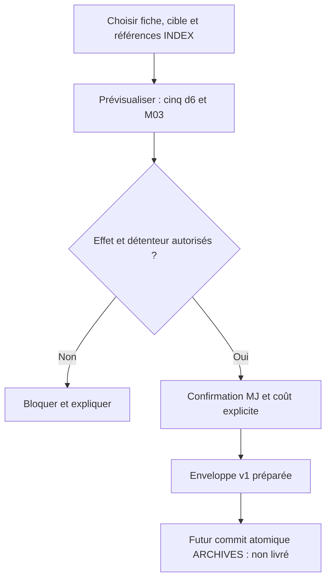

# STUDIO-CREATE-004C — Préparer et rejouer une tentative INDEX → M03

> **Candidat technique • Non homologué • Non publié • Aucune sauvegarde réelle.**
> Date : 17 novembre 2026 — Étape suivante de STUDIO-CREATE-004B et d'INDEX-EFF-002.

## Pourquoi ce lot ?

L'ancien journal `record-opposition` recalcule une attaque M03 ordinaire. Il ne connaît pas
les bonus INDEX autorisés par le MJ, l'intensité divine, le choix héroïque ou les ressources.
Il est donc **interdit de lui transmettre une action enrichie en faisant comme si elle était
ordinaire**. L'objectif du lot est de préparer les informations nécessaires à une nouvelle
transaction versionnée, sans modifier ce stockage historique.

## Parcours proposé au MJ

| Étape | Propriété assurée dans ce lot | Limite restante |
| --- | --- | --- |
| Jet | Exactement cinq d6, un seul jet M03 | Saisie tablette/bouton UI à raccorder |
| Effets | Définition, révision et permission temporaire par détenteur | Gouvernance des habilitations persistantes à cadrer |
| Dégâts | Calcul M03 réexécutable depuis le justificatif | Application sur PV **non livrée** |
| Absorption | Identique à M03, pas une réserve de PV | Tests intégrés supplémentaires avec ARCHIVES |
| Mental | Aucune perte de PV automatique | Conséquence narrative à faire confirmer par le MJ |
| Coût | Mana/charge/aucun saisi et approuvé explicitement, solde déclaré suffisant | Débit atomique **non livré** ; coût non déduit d'une grille expérimentale |
| Reprise | Justificatif sérialisable et recalcul historique contrôlé | Idempotence de la transaction IndexedDB à raccorder |

### Exemple 1 — Étincelle du Cercle I (illustratif, non canonique)

Le MJ sélectionne `MAG-SORT-001` au rang de sa révision 1, pour `pj-mage`.
Il autorise expressément sa définition d'effet et vise une créature. Le même jet 5d6
que pour une épée est résolu par M03 ; le contrat INDEX peut ajouter un effet
`impact` **seulement s'il est homologué**. Les valeurs du test `impact +2` et
`mana 3 / réserve 10` sont des **fixtures techniques**, pas des chiffres établis
pour le véritable sort. `demo-etincelle` (foudre non canonique) n'est pas importé.

### Exemple 2 — Capacité physique et arme enchantée

Une manœuvre martiale autorisée et un enchantement offensif homologué produisent
le même type de référence `{type,id,revision}` et la même structure d'effet que
le sort. Une arme **purement descriptive** ne donne aucune valeur de dégât ni
de précision additionnelle. Le moteur M03 demeure seul responsable du calcul.

### Exemple 3 — Influence mentale

Un jet mental peut confirmer une influence à proposer au MJ. L'enveloppe
transporte `applyDamage:false` et le rejeu M03 conserve `damage:0` : aucune
dépense de PV de la cible ne découle automatiquement de ce succès.

## API expérimentale

- `createIndexM03Session()` : définition et autorisation **locale** et bornée des
  effets INDEX ; un `approved:true` importé est ignoré.
- `previewIndexedOpposition(roll,card,session,selections)` : renvoie `result`,
  `used`, `blocked`, `proof`, `actionSnapshot`, `diceSnapshot` et `journalGate`.
- `replayIndexM03Proof(action,proof)` : rejoue le calcul historique de M03.
  **Ne donne pas le droit de lancer une nouvelle action.**
- `prepareIndexedAttempt(preview,details)` : n'accepte qu'un aperçu vivant
  ayant `journalGate:versioned-journal-required`, une confirmation MJ, un
  identifiant d'opération, une révision attendue et un coût explicite approuvé.
- `verifyArchivedIndexedAttempt(record)` : vérifie après sérialisation les
  références, les cinq d6, le coût déclaré, et la parité du résultat M03.

L'enveloppe porte le schéma `entre-rives.indexed-attempt.v1` et le statut
`prepared-not-committed`. Un enregistrement JSON peut **se fabriquer ou se
modifier** : son rejeu prouve une *cohérence mathématique*, pas l'identité
du MJ ni l'existence réelle d'une provision. **Ce JSON n'est jamais un
jeton d'autorisation ou de dépense.**

### Préparation et engagement sont deux opérations différentes

La version actuelle de `studio-local/store.mjs` vérifie déjà ses propres
`operationId`, révisions et signatures pour les opérations qu'elle connaît.
Elle **ne reçoit pas** l'enveloppe ci-dessus et ne débite **aucune** charge,
aucun mana et aucun PV pour elle. Une API d'engagement distincte devra :

1. Vérifier dans la même transaction les fiches de l'acteur, la cible,
   les droits et la révision des ressources.
2. Refuser une signature différente à `operationId` identique et une révision
   périmée ; réessayer une signature identique sans nouvelle dépense.
3. Débiter la ressource **une seule fois**, appliquer la conséquence validée,
   enregistrer l'évènement et la révision dans **une transaction IndexedDB**.
4. Rejouer les événements importés sans leur redonner des permissions d'action ;
   protéger les notes et champs secrets des projections joueur.
5. Tester interruption avant/pendant/après engagement, deux onglets,
   double clic, sauvegarde/restauration, Chrome et tablette.

Ces étapes sont **commandes à construire et à tester**, pas des garanties déjà obtenues.
Sans elles, on ne doit pas brancher le bouton « Confirmer » sur une modification de PV.

## Preuves et exécution

| Vérification | Commande | Portée |
| --- | --- | --- |
| Session INDEX et rejeu du justificatif | `npm run test:indexeff002` | Cas homologués et refus, bornes, absorption, intensité |
| Aperçu et garde du journal classique | `npm run test:studiocreate004` | Jet, détenteur, mental, anti-injection |
| Enveloppe préparatoire | `npm run test:studiocreate004c` | Coût déclaré, absence de débit, dates, copie illégale, falsification, mental |
| Types, contenu, site et autres modules | `npm test` | Recette complète automatisée à exécuter sur ce HEAD |

La recette manuelle multi-onglets et la vraie transaction ne sont **pas** couvertes
par les trois tests ciblés. Aucun délai de combat n'a été modifié.

## Passations / décisions

- **ARCHIVES** : contrat `record-indexed-opposition` en version propre, données
  de solde/charges, verrouillage de révision, anti-rejeu et restauration.
- **STUDIO / ATELIERS** : boutons « Prévisualiser » puis « Confirmer » séparés ;
  état bloqué visible, consentement MJ, statut non engagé explicite.
- **INDEX / MAG / CAP / OBJETS / BESTIAIRE** : références stables + provenance,
  droit par détenteur et effets M03 homologués ; ne pas déduire de coût d'un
  simple Cercle, grade d'objet ou niveau.
- **QA** : campagne fictive, double clic, reprise, export/réimport, refus de
  ressources épuisées et contrôle de confidentialité.
- **DG** : revue préalable du journal versionné puis feu vert à l'engagement ;
  guide mathématique illustré toujours préparatoire (`publish:false`).

**Aucune fusion, publication ni activation du calcul enrichi en campagne réelle
avant validation QA et DG.**
